# Thiết Kế Chi Tiết Quy Trình Fulfillment, Vận Chuyển Đa Đối Tác (GHN & Ahamove) và Hậu Mãi (RMA) Cho Hệ Thống GlowUp

> **Dự án:** GlowUp — Nền tảng Bán lẻ Mỹ phẩm Đa kênh (Omnichannel Cosmetics Retail)  
> **Tài liệu:** Thiết kế Nghiệp vụ & Kiến trúc Hệ thống (System & Business Architecture Design)  
> **Mã tài liệu:** `DES-05-FULFILLMENT-RMA`  
> **Phiên bản:** 2.0 (Production-Ready)  
> **Ngày phê duyệt:** 15/11/2026  
> **Đối chiếu thực tế:** Benchmarked trực tiếp từ mô hình vận hành của **Hasaki.vn** (NowFree 2H, Store Hubs, Quản lý lô/HSD FEFO) và **Shopee** (Shopee Mall, Đổi trả/Hoàn tiền 15 ngày, Reverse Logistics).

---

## Mục Lục

1. [Phân Tích Đối Chiếu & Bài Học Từ Hasaki & Shopee](#1-phân-tích-đối-chiếu--bài-học-từ-hasaki--shopee)
2. [Kiến Trúc Tổng Thể & Hạ Tầng Cloudflare Workers / Queues](#2-kiến-trúc-tổng-thể--hạ-tầng-cloudflare-workers--queues)
3. [Quy Trình Nghiệp Vụ 1: Xử Lý Đơn & Phân Tuyến Fulfillment (Order Routing)](#3-quy-trình-nghiệp-vụ-1-xử-lý-đơn--phân-tuyến-fulfillment-order-routing)
4. [Quy Trình Nghiệp Vụ 2: Vận Hành Kho & Cửa Hàng (Store/Warehouse WMS)](#4-quy-trình-nghiệp-vụ-2-vận-hành-kho--cửa-hàng-storewarehouse-wms)
5. [Quy Trình Nghiệp Vụ 3: Tích Hợp Vận Chuyển 3PL (GHN & Ahamove)](#5-quy-trình-nghiệp-vụ-3-tích-hợp-vận-chuyển-3pl-ghn--ahamove)
6. [Quy Trình Nghiệp Vụ 4: Giao Hàng, Đối Soát COD & Hoàn Tất Đơn](#6-quy-trình-nghiệp-vụ-4-giao-hàng-đối-soát-cod--hoàn-tất-đơn)
7. [Quy Trình Nghiệp Vụ 5: Hậu Mãi — Đổi Hàng, Trả Hàng & Hoàn Tiền (RMA)](#7-quy-trình-nghiệp-vụ-5-hậu-mãi--đổi-hàng-trả-hàng--hoàn-tiền-rma)
8. [Data Models, State Machines & Mapping Trạng Thái](#8-data-models-state-machines--mapping-trạng-thái)
9. [Đặc Tả Kỹ Thuật API Contracts & Webhook Payload](#9-đặc-tả-kỹ-thuật-api-contracts--webhook-payload)
10. [Chiến Lược Triển Khai (Roadmap) & Kịch Bản Kiểm Thử (E2E Test Matrix)](#10-chiến-lược-triển-khai-roadmap--kịch-bản-kiểm-thử-e2e-test-matrix)

---

## 1. Phân Tích Đối Chiếu & Bài Học Từ Hasaki & Shopee

### 1.1 Khảo sát mô hình Hasaki (Mỹ phẩm & Chăm sóc cá nhân)

Hasaki là hình mẫu tiêu chuẩn cho GlowUp vì có chung tập khách hàng, danh mục sản phẩm (Skincare, Makeup, Perfume) và mô hình chuỗi cửa hàng vật lý kết hợp online:

1. **Mô hình Omnichannel Fulfillment (Store as a Hub):**
   * Hasaki biến mỗi cửa hàng bán lẻ (Showroom) thành một mini-fulfillment center (kho vi mô).
   * **Dịch vụ Giao Nhanh 2H (NowFree):** Đơn hàng phát sinh trong bán kính 10–15km từ cửa hàng có sẵn tồn kho sẽ được nhân viên chi nhánh gom hàng (pick), đóng gói trong 15–20 phút và điều phối đối tác vận chuyển nội thành (Ahamove / Lalamove / đội shipper nội bộ).
2. **Đặc thù Đóng gói Hàng Mỹ phẩm:**
   * Chai lọ thủy tinh (toner, serum, nước hoa), sản phẩm dạng lỏng hoặc phấn nén rất dễ bể vỡ.
   * Quy chuẩn đóng gói: Bọc xốp bóng khí (bubble wrap) tối thiểu 2–3 lớp, chèn mút túi khí trong thùng carton, dán băng keo niêm phong thương hiệu và tem cảnh báo *"Hàng dễ vỡ — Không đồng kiểm — Vui lòng quay video clip mở kiện hàng"*.
3. **Chính sách Đổi trả & Khiếu nại:**
   * **Thời hạn:** 14 ngày (tối đa 30 ngày cho các dòng chuyên biệt).
   * **Bằng chứng bắt buộc:** Video quay rõ 6 mặt kiện hàng trước khi khui, tem vận đơn và quá trình mở hàng.
   * **Trường hợp kích ứng:** Hasaki hỗ trợ đổi trả nếu sản phẩm gây kích ứng da có giấy xác nhận từ phòng khám da liễu / bệnh viện và lượng hao hụt không vượt quá 20%.
   * **Đổi trả đa kênh:** Khách mua online có thể mang trực tiếp ra bất kỳ showroom nào để đổi lấy sản phẩm khác ngay lập tức, không bắt buộc phải chờ gửi bưu cục.

---

### 1.2 Khảo sát mô hình Shopee (Sàn TMĐT quy chuẩn)

1. **Vòng đời đơn hàng phân đoạn chuẩn mực:**
   * Phân rõ các trạng thái: `Chờ thanh toán` $\rightarrow$ `Chờ xác nhận` $\rightarrow$ `Chờ lấy hàng` $\rightarrow$ `Đang giao` $\rightarrow$ `Đã giao` $\rightarrow$ `Hoàn thành`.
   * **Khoảng đệm (Escrow & Grace Period):** Sau khi trạng thái là `Đã giao`, tiền COD hoặc tiền thanh toán online được giữ ở trạng thái tạm giữ (Escrow) trong 7 ngày (hoặc 15 ngày đối với Shopee Mall). Trong thời gian này, khách có quyền bấm *"Trả hàng/Hoàn tiền"*. Nếu khách bấm *"Đã nhận được hàng"* hoặc hết thời hạn bảo đảm, đơn mới chuyển sang `Hoàn thành` (Settled) và hạch toán doanh thu.
2. **Quy trình Reverse Logistics (Trả hàng hoàn tiền):**
   * Cho phép chọn 3 hình thức trả hàng:
     1. *Lấy hàng hoàn trả tận nơi (Pick-up):* Shipper GHN/SPX đến tận nhà lấy hàng.
     2. *Gửi trả tại bưu cục (Drop-off):* Khách mang gói hàng ra điểm giao nhận gần nhất, quét mã vạch hoàn trả không mất phí.
     3. *Tự sắp xếp chuyển phát:* Dành cho vùng sâu vùng xa.
3. **Cơ chế Trọng tài & Bằng chứng (Dispute Resolution):**
   * Khách hàng tải ảnh/video lỗi $\rightarrow$ Người bán duyệt trong 48h $\rightarrow$ Nếu không đồng ý, sàn đóng vai trò trọng tài phân xử dựa trên video đóng gói của kho và video mở hộp của khách.

---

### 1.3 Ma Trận So Sánh & Bài Học Áp Dụng Cho GlowUp

| Tiêu chí | Mô hình Hasaki | Mô hình Shopee | **Thiết kế cho GlowUp** |
| :--- | :--- | :--- | :--- |
| **Bản chất hệ thống** | Chuỗi bán lẻ chuỗi thương hiệu (Single-brand/Chain Retail + POS) | Sàn thương mại điện tử đa người bán (Marketplace C2C/B2C) | **Chuỗi Omnichannel (Online + POS Chuỗi cửa hàng)**, kiểm soát 100% kho vận và chất lượng |
| **Giao hàng hỏa tốc** | NowFree 2H (bán kính cửa hàng) | Shopee Instant / Hỏa Tốc (Ahamove/SPX Instant) | **Giao hỏa tốc 2H qua Ahamove** (tự động điều phối chi nhánh gần nhất) |
| **Giao tiêu chuẩn** | GHN / Viettel Post (toàn quốc) | SPX, GHN, J&T, NinjaVan | **Tích hợp GHN API v2** (áp dụng toàn quốc, tối ưu chi phí và phủ sóng huyện xã) |
| **Xử lý bất đồng bộ** | ERP & Hệ thống Kho riêng | Microservices + Message Queue phân tán khổng lồ | **Cloudflare Workers + Cloudflare Queues** (Xử lý hàng chờ đơn, Webhook buffer, Edge caching) |
| **Quản lý hạn sử dụng** | Bắt buộc FEFO (First Expired, First Out) | Không quản lý lô (seller tự quản) | **FEFO theo Lô hàng (Batch/Expiry tracking)** từ bước phân bổ đơn hàng |
| **Đổi trả sản phẩm** | 14 ngày (Mang ra showroom hoặc gửi về) | 15 ngày (Shopee Mall), gửi bưu cục | **7–14 ngày:** Mang ra Showroom GlowUp gần nhất HOẶC Shipper GHN lấy tận nhà |
| **Xử lý Đổi hàng** | Đổi trực tiếp tại quầy hoặc gửi mới | Không có tính năng đổi (chỉ hoàn tiền rồi mua lại) | **Hỗ trợ cả Đổi hàng (Exchange) bù trừ chênh lệch** và **Hoàn tiền (Refund)** |

---

## 2. Kiến Trúc Tổng Thể & Hạ Tầng Cloudflare Workers / Queues

Để đảm bảo hệ thống chịu tải tốt trong các đợt Flash Sale / Mega Sale (11.11, 12.12), loại bỏ tình trạng nghẽn kết nối Database khi nhận hàng ngàn Webhook từ đối tác vận chuyển và thanh toán, GlowUp áp dụng mô hình **Hybrid Edge-Core Architecture** kết hợp giữa **Cloudflare Workers/Queues** và **NestJS Backend Core**.

### 2.1 Sơ Đồ Kiến Trúc Hệ Thống (Architecture Blueprint)

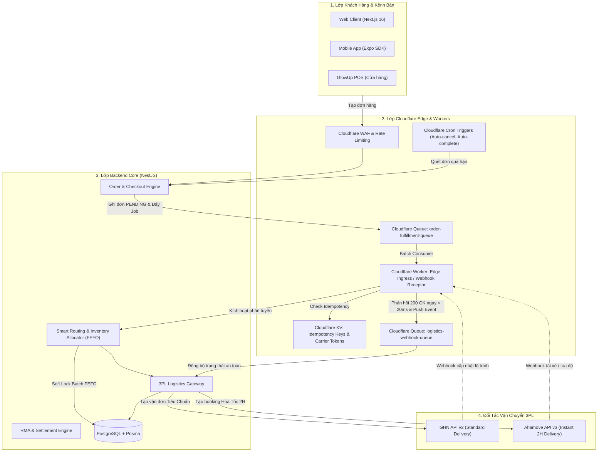

---

### 2.2 Vai Trò Cụ Thể của Cloudflare Workers & Queues

1. **Edge Webhook Receptor (Hấp thụ tải Webhook 3PL):**
   * Các đối tác như GHN và Ahamove gửi hàng chục ngàn webhook mỗi ngày khi trạng thái bưu kiện thay đổi (`picking`, `storing`, `delivering`, `delivered`).
   * Nếu gửi trực tiếp vào NestJS Core, database có thể bị nghẽn (connection pool exhaustion).
   * **Giải pháp:** Cloudflare Worker đón nhận Webhook tại Edge, xác minh chữ ký HMAC/Token bí mật, kiểm tra trùng lặp trên **Cloudflare KV**, trả về `HTTP 200 OK` cho đối tác chỉ trong **10–25ms** (tránh tình trạng GHN/Ahamove retry 10 lần do timeout), sau đó đẩy payload vào `logistics-webhook-queue`.
2. **Order Fulfillment Queue (Xếp hàng xử lý đơn):**
   * Khi khách hoàn tất thanh toán hoặc đặt COD thành công, backend đưa mã đơn vào `order-fulfillment-queue`.
   * Worker tiêu thụ (Consumer) tuần tự phân tích kho hàng, giữ chỗ tồn kho theo hạn sử dụng (FEFO), gọi API hãng vận chuyển để lấy mã vận đơn và link in nhãn.
3. **Dead Letter Queue (DLQ) & Cơ chế Backoff Retry:**
   * Mọi message bị lỗi kết nối 3PL sẽ được tự động retry theo cơ chế Exponential Backoff (1m, 5m, 15m). Sau 3 lần thất bại sẽ được đưa vào `*-dlq` và bắn cảnh báo tới kênh Telegram/Slack của đội ngũ vận hành (DevOps/Ops Team).
4. **Cloudflare Cron Triggers:**
   * Chạy định kỳ 5 phút: Quét các đơn thanh toán trực tuyến (SePay/VNPay/MoMo) chưa hoàn tất sau 15 phút để hủy đơn và giải phóng tồn kho.
   * Chạy định kỳ 1 giờ: Quét các đơn hàng `DELIVERED` sau 7 ngày không phát sinh khiếu nại để tự động chuyển thành `COMPLETED`, cộng điểm thành viên và hạch toán doanh thu.

---

## 3. Quy Trình Nghiệp Vụ 1: Xử Lý Đơn & Phân Tuyến Fulfillment (Order Routing)

### 3.1 Luồng Tổng Quan Từ Giỏ Hàng Đến Phân Tuyến

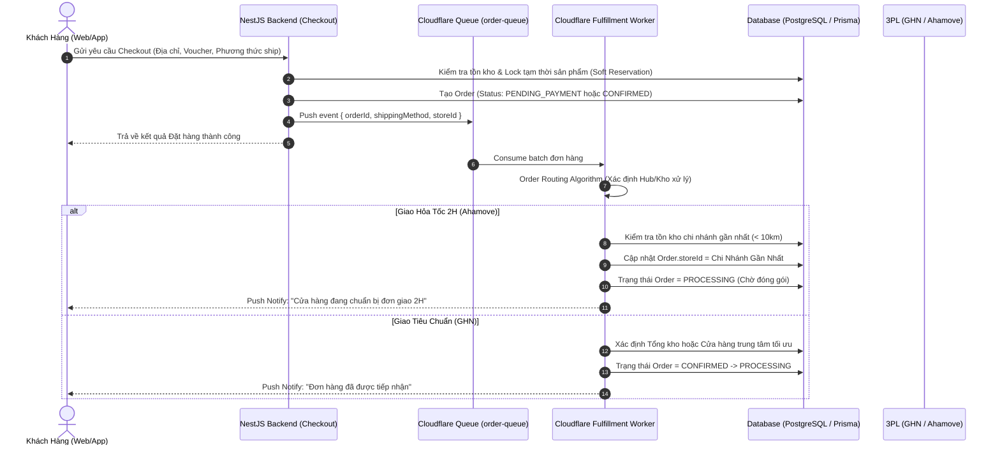

---

### 3.2 Thuật Toán Phân Tuyến Đơn Hàng (Order Routing Algorithm)

GlowUp không phải là một kho độc lập mà là mạng lưới chuỗi cửa hàng (Omnichannel Store Network). Việc chọn điểm đóng gói (Fulfillment Node) quyết định trực tiếp tới chi phí và tốc độ giao hàng:

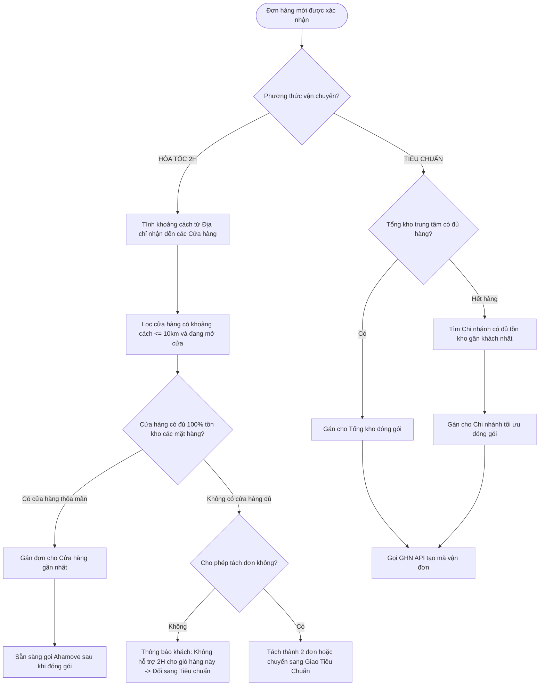

#### Quy tắc Phân Bổ Tồn Kho Theo Lô (FEFO - First Expired, First Out):
Đặc thù mỹ phẩm có hạn mở nắp (PAO) và hạn sử dụng (Expiry Date). Hệ thống GlowUp tự động trừ kho theo thứ tự:
1. Lô hàng có ngày hết hạn gần nhất còn đủ điều kiện xuất kho (hạn còn tối thiểu $\ge 6$ tháng đối với hàng dưỡng da, $\ge 12$ tháng đối với makeup).
2. Lô hàng cận date (dưới 6 tháng) chỉ được xuất nếu đơn hàng nằm trong chương trình *"Clearance Sale / Xả hàng cận date"* mà khách hàng đã đồng ý rõ ràng lúc chọn mua.
3. Bản ghi phân bổ được lưu chi tiết vào bảng `order_item_batches` (`orderItemId`, `batchId`, `quantity`).

---

## 4. Quy Trình Nghiệp Vụ 2: Vận Hành Kho & Cửa Hàng (Store/Warehouse WMS)

Sau khi đơn hàng được định tuyến về Cửa hàng hoặc Tổng kho, nhân viên kho/cửa hàng thực hiện quy trình 4 bước chuẩn mực:

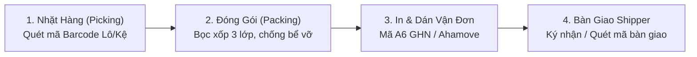

### 4.1 Chi Tiết Các Bước Nghiệp Vụ Tại Kho / Showroom

| Bước | Hành động nhân viên | Kiểm soát hệ thống (System Enforcements) | SLA mục tiêu |
| :--- | :--- | :--- | :--- |
| **1. Nhặt hàng (Picking)** | Nhân viên mở App Quản lý Kho/Cửa hàng, xem danh sách sản phẩm cần nhặt kèm vị trí kệ và mã Lô (Batch Code). Quét mã vạch sản phẩm. | * Hệ thống đối chiếu chính xác `Barcode` và `BatchId`.<br/>* Nếu nhân viên nhặt sai lô hoặc sai sản phẩm, app phát chuông báo lỗi và chặn bước tiếp theo. | $\le 10$ phút (Đơn 2H)<br/>$\le 2$ giờ (Đơn thường) |
| **2. Đóng gói (Packing)** | * Mỹ phẩm lỏng/thủy tinh: bọc tối thiểu 3 lớp xốp chống sốc, cố định nắp chai bằng băng dính chuyên dụng.<br/>* Xếp vào thùng carton chèn túi khí.<br/>* Dán tem niêm phong chống tráo vỡ của GlowUp. | * Nhân viên kích hoạt camera tại bàn đóng gói chụp 1 ảnh chụp kiện hàng mở và 1 ảnh kiện hàng đã dán niêm phong.<br/>* Ảnh tự động tải lên S3/R2 lưu trữ phục vụ giải quyết khiếu nại (bằng chứng đóng gói). | $\le 10$ phút (Đơn 2H)<br/>$\le 4$ giờ (Đơn thường) |
| **3. In nhãn (Labeling)** | Bấm nút *"Tạo đơn & In nhãn"* trên hệ thống. Máy in nhiệt in nhãn A6 chuẩn GHN hoặc phiếu vận chuyển Ahamove. Dán đè lên nắp hộp niêm phong. | * Hệ thống gọi Cloudflare Worker $\rightarrow$ API 3PL để lấy `trackingCode` và link PDF in nhãn.<br/>* Cập nhật trạng thái `Shipment.status = READY_TO_PICK`. | Tức thì ($\le 3$ giây) |
| **4. Bàn giao (Handover)** | Shipper đến điểm nhận hàng. Nhân viên quét mã vận đơn bàn giao trên app của GlowUp và shipper quét trên app của họ. | * Lưu `Shipment.handedOverAt = NOW()`.<br/>* Chuyển trạng thái `Order.status = SHIPPING`.<br/>* Tự động gửi thông báo (Push/SMS) cho khách hàng kèm mã theo dõi. | Trong khung giờ lấy hàng |

---

## 5. Quy Trình Nghiệp Vụ 3: Tích Hợp Vận Chuyển 3PL (GHN & Ahamove)

### 5.1 Tích Hợp Giao Hỏa Tốc 2H Qua Ahamove

* **Dịch vụ sử dụng:** Ahamove On-Demand Delivery (Dịch vụ xe máy: `SGN-BIKE` / `HAN-BIKE` hoặc `SGN-EXPRESS`).
* **Cơ chế gọi tài xế:** Khi nhân viên bấm *"Hoàn thành đóng gói"*, hệ thống mới chính thức gọi API Ahamove để tránh tình trạng tài xế đến sớm mà hàng chưa sẵn sàng, gây hủy chuyến.
* **Thời gian giao hàng cam kết:**
  * Soạn hàng + đóng gói: 20 phút.
  * Tài xế nhận hàng: 15 phút.
  * Thời gian di chuyển giao hàng: 45–60 phút.
  * **Tổng thời gian: < 120 phút (2 giờ).**
* **Trải nghiệm khách hàng:** Khách hàng mở App/Web GlowUp có thể xem **Bản đồ trực tiếp (Live Tracking Map)** vị trí tài xế di chuyển từ cửa hàng đến nhà mình thông qua `shared_link` của Ahamove.

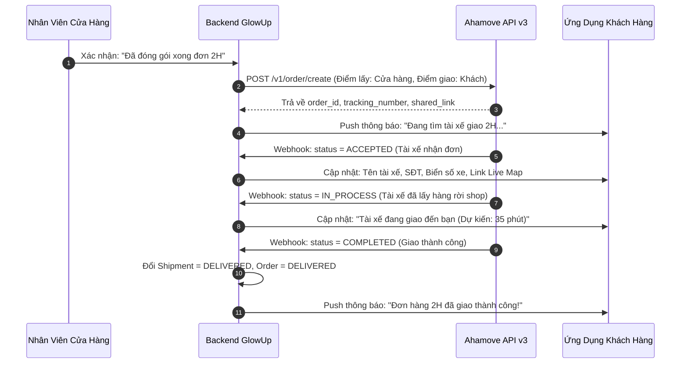

---

### 5.2 Tích Hợp Giao Tiêu Chuẩn Toàn Quốc Qua GHN (Giao Hàng Nhanh)

* **Dịch vụ sử dụng:** GHN E-commerce Delivery API v2.
* **Mã dịch vụ:** Dịch vụ chuẩn (`service_type_id = 2` - Chuẩn đi máy bay/đường bộ) hoặc tiết kiệm.
* **Quy chuẩn thông tin gửi hàng:**
  * Khối lượng (`weight`): Tính bằng gram (hệ thống tự cộng dồn `weight` của từng SKU + 150g bao bì hộp).
  * Kích thước (`length`, `width`, `height`): Đơn vị cm.
  * Lưu ý giao hàng (`required_note`): `CHOXEMHANGKHONGTHU` (Cho xem hàng không cho thử) hoặc `KHONGCHOXEMHANG` (theo cấu hình GlowUp - mặc định là không cho xem hàng, áp dụng cơ chế quay video mở hộp như Hasaki để tránh tráo hàng).
  * Tiền thu hộ (`cod_amount`): Nếu thanh toán online $\rightarrow 0$ VNĐ; nếu COD $\rightarrow$ Bằng `Order.totalAmount`.

---

## 6. Quy Trình Nghiệp Vụ 4: Giao Hàng, Đối Soát COD & Hoàn Tất Đơn

### 6.1 Xử Lý Giao Hàng Thất Bại & Lưu Kho Hoàn (Exception Handling)

Thực tế ngành bán lẻ online tại Việt Nam có tỉ lệ giao không thành công từ 5–10% (khách không nghe máy, hẹn lại ngày khác, hoặc từ chối nhận).

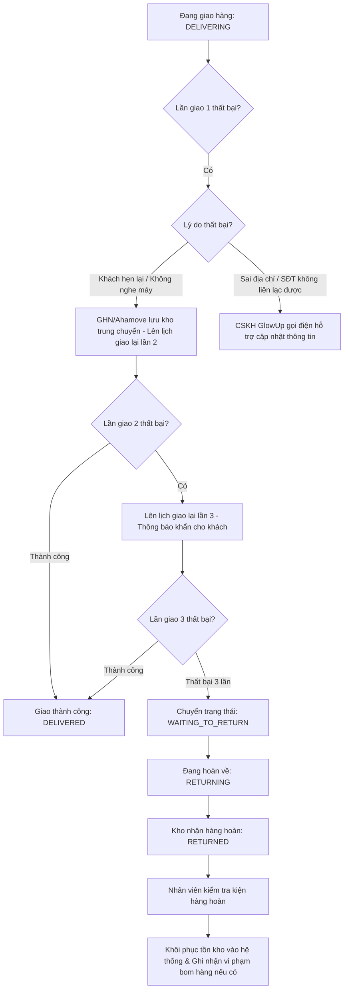

---

### 6.2 Đối Soát Tiền Thu Hộ (COD Settlement)

1. **Ghi nhận thu tiền:** Khi GHN/Ahamove gửi webhook `delivered` hoặc `money_collect_delivering`, trạng thái thanh toán đơn chuyển thành `PAID` (loại thanh toán: `COD`).
2. **Kỳ đối soát định kỳ:**
   * GHN đối soát và chuyển khoản tiền COD về tài khoản ngân hàng của GlowUp định kỳ (ví dụ: Thứ 2, Thứ 4, Thứ 6 hàng tuần).
   * Kế toán đối chiếu giữa báo cáo `cod_amount` trong bảng `shipments` với sao kê chuyển tiền của GHN.

---

### 6.3 Hoàn Tất Đơn Hàng & Kích Hoạt Quyền Lợi Khách Hàng (Order Completion)

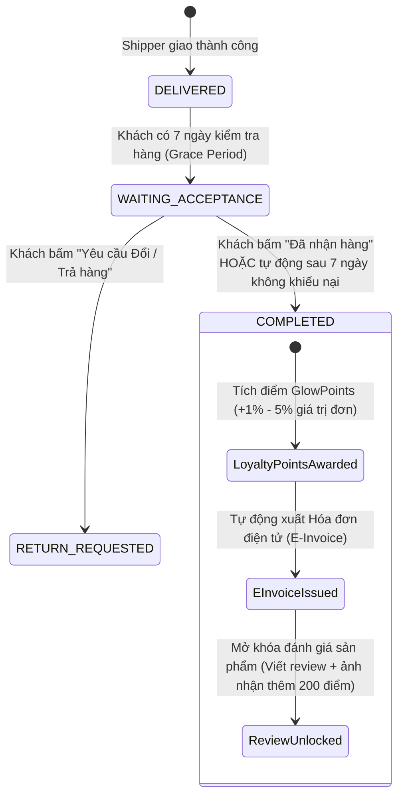

---

## 7. Quy Trình Nghiệp Vụ 5: Hậu Mãi — Đổi Hàng, Trả Hàng & Hoàn Tiền (RMA)

Đây là nghiệp vụ phức tạp nhất trong bán lẻ mỹ phẩm, được GlowUp chuẩn hóa toàn diện theo tiêu chuẩn của Hasaki và Shopee Mall.

### 7.1 Ma Trận Điều Kiện Đổi Trả Sản Phẩm

| Lý do đổi trả | Yêu cầu chứng minh | Thời hạn | Chi phí ship chiều về | Phương án giải quyết |
| :--- | :--- | :--- | :--- | :--- |
| **1. Bể vỡ / Đổ tràn / Hư hại do vận chuyển** | Bắt buộc có Video quay rõ 6 mặt kiện hàng trước khi mở và cảnh khui hộp. | 48 giờ kể từ khi nhận | GlowUp chịu 100% | Đổi ngay sản phẩm mới hoặc Hoàn tiền 100% |
| **2. Giao sai hàng (Sai màu son, dung tích, thiếu quà)** | Ảnh chụp sản phẩm thực nhận + Tem nhãn phụ dán trên bao bì. | 7 ngày | GlowUp chịu 100% | Đổi sản phẩm đúng hoặc Gửi bổ sung quà tặng |
| **3. Sản phẩm cận date / Hết date** | Ảnh chụp dập date (EXP/MFG) dưới đáy chai hoặc vỏ hộp. | 7 ngày | GlowUp chịu 100% | Đổi sản phẩm lô mới hoặc Hoàn tiền 100% |
| **4. Kích ứng da dị ứng mỹ phẩm** | Ảnh vùng da kích ứng kèm đơn thuốc/kết luận của bác sĩ chuyên khoa. Lượng hao hụt $\le 20\%$. | 14 ngày | GlowUp hỗ trợ | Đổi sang dòng sản phẩm lành tính khác hoặc Hoàn tiền voucher |
| **5. Khách đổi ý (Không ưng ý)** | Hàng còn **nguyên tem niêm phong (seal), chưa mở nắp**, hộp không móp rách. | 7 ngày | Khách hàng chịu phí ship | Cho phép Đổi sang sản phẩm khác cùng hoặc cao giá hơn |

---

### 7.2 Hai Kênh Tiếp Nhận Hàng Trả (Omnichannel Reverse Logistics)

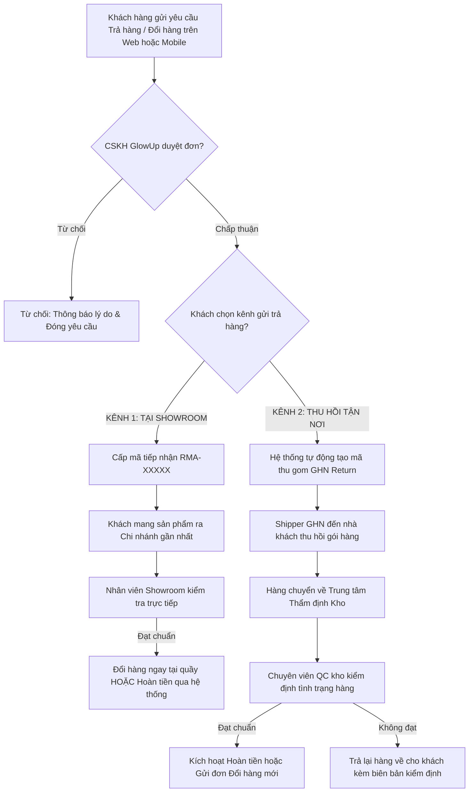

---

### 7.3 Nghiệp Vụ Xử Lý Hoàn Tiền (Refund Settlement Algorithm)

Khi hoàn tiền, hệ thống phải tính toán khấu trừ chính xác voucher khuyến mãi, điểm tích lũy và phí vận chuyển theo công thức công bằng:

$$\text{Số tiền hoàn thực tế} = \text{Tiền mặt khách đã trả cho SKU đó} - \text{Phần bổ bổ sung voucher theo tỉ lệ}$$

* **Bảo toàn điểm Loyalty:** Khách đã dùng bao nhiêu điểm cho món hàng đó sẽ được hoàn lại tương ứng vào tài khoản điểm (`pointsToRestore`).
* **Kênh hoàn tiền:**
  * Khách thanh toán online (VietQR, Thẻ): Hoàn về đúng tài khoản ngân hàng hoặc tài khoản ban đầu trong 24–48h làm việc.
  * Khách thanh toán COD: Hoàn tiền qua Chuyển khoản ngân hàng (khách cung cấp STK/IBAN lúc tạo yêu cầu RMA) HOẶC hoàn thành GlowUp Credit Voucher có giá trị tương đương (kèm ưu đãi tặng thêm 5% để khuyến khích tiếp tục mua sắm).

---

### 7.4 Nghiệp Vụ Đổi Hàng (Exchange Settlement & Replacement Order)

Khác với các sàn thuần túy (chỉ cho trả hàng hoàn tiền), GlowUp hỗ trợ **Đổi hàng trực tiếp** thông qua cơ chế `ExchangeSettlement`:

1. **Khách đổi sản phẩm bằng giá:** Tạo đơn hàng mới (`replacementOrder`) với giá trị 0đ.
2. **Khách đổi sản phẩm giá cao hơn:**
   $$\text{Tiền phải trả thêm (additionalDue)} = \text{Giá sản phẩm mới} - \text{Giá trị được bảo lưu từ sản phẩm cũ}$$
   * Khách có thể thanh toán khoản chênh lệch này qua COD khi shipper giao hàng mới đến, hoặc quét VietQR online.
3. **Khách đổi sản phẩm giá thấp hơn:**
   $$\text{Tiền hoàn lại (refundDue)} = \text{Giá trị sản phẩm cũ} - \text{Giá sản phẩm mới}$$
   * Hệ thống tự động kích hoạt tiến trình hoàn phần tiền thừa cho khách hàng.

---

## 8. Data Models, State Machines & Mapping Trạng Thái

### 8.1 Sơ Đồ Chuyển Trạng Thái Đơn Hàng (Order State Machine)

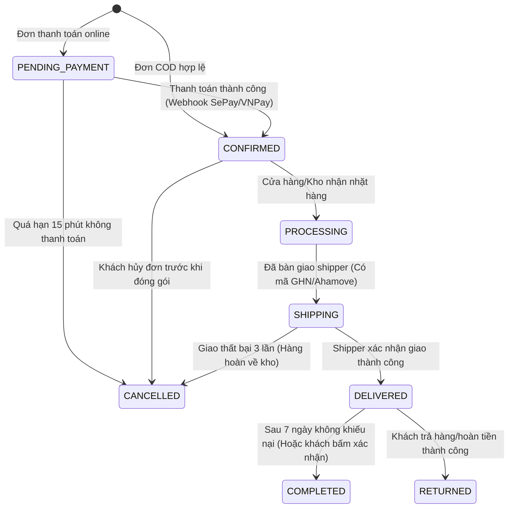

---

### 8.2 Sơ Đồ Trạng Thái Yêu Cầu Đổi Trả (RMA State Machine)

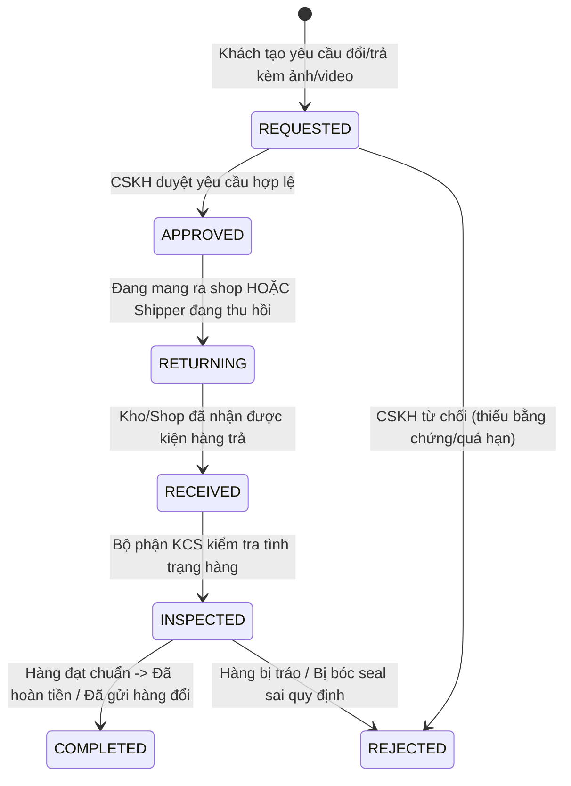

---

### 8.3 Bảng Mapping Trạng Thái Giữa 3PL Và GlowUp Core

Để đồng bộ dữ liệu chuẩn xác, Cloudflare Worker Consumer sẽ ánh xạ (map) trạng thái chi tiết của GHN và Ahamove về các trạng thái cốt lõi của GlowUp:

| Trạng thái Đối tác (GHN / Ahamove) | Ý nghĩa nghiệp vụ 3PL | Mapping Trạng thái `Shipment.status` | Mapping Trạng thái `Order.status` | Hành động kích hoạt tại GlowUp |
| :--- | :--- | :--- | :--- | :--- |
| **GHN:** `ready_to_pick`<br/>**Aha:** `ASSIGNING` | Đã tạo đơn trên hệ thống, chờ tài xế | `READY_TO_PICK` | `PROCESSING` | In nhãn đóng gói, sẵn sàng tại khu vực xuất hàng |
| **GHN:** `picking`<br/>**Aha:** `ACCEPTED` | Tài xế đang trên đường đến lấy hàng | `PICKING` | `PROCESSING` | Gửi thông báo: "Tài xế đang tới lấy hàng" |
| **GHN:** `picked` / `storing`<br/>**Aha:** `IN_PROCESS` | Đã lấy hàng, đang trung chuyển | `IN_TRANSIT` | `SHIPPING` | Bắt đầu tính SLA giao hàng, lưu thời điểm `handedOverAt` |
| **GHN:** `delivering`<br/>**Aha:** `IN_PROCESS` | Đang đi giao cho khách | `OUT_FOR_DELIVERY` | `SHIPPING` | Gửi Push App: "Đơn hàng đang trên đường giao tới bạn" |
| **GHN:** `delivered`<br/>**Aha:** `COMPLETED` | Giao hàng thành công | `DELIVERED` | `DELIVERED` | Lưu `deliveredAt`, gửi thông báo nhận hàng & hướng dẫn kiểm tra |
| **GHN:** `delivery_fail` | Giao không thành công lần $N$ | `DELIVERY_FAILED` | `SHIPPING` | Tăng `failedAttempts`, gửi SMS thông báo khách hẹn lại |
| **GHN:** `waiting_to_return` / `returning` | Bắt đầu chuyển hoàn về người gửi | `RETURNING` | `SHIPPING` | Cảnh báo CSKH liên hệ khách lần cuối |
| **GHN:** `returned` | Hàng đã hoàn trả về kho GlowUp | `RETURNED` | `CANCELLED` | Kiểm nhập kho hoàn, giải phóng tồn kho bị giam |
| **GHN:** `damage` / `lost` | Bưu kiện bị thất lạc hoặc hư hỏng | `EXCEPTION` | `PROCESSING` | Tạo đơn mới gửi bù cho khách + Tạo claim bồi thường 3PL |

---

## 9. Đặc Tả Kỹ Thuật API Contracts & Webhook Payload

### 9.1 Cloudflare Worker Ingress: Webhook GHN Endpoint

```typescript
// cloudflare-workers/src/handlers/ghn-webhook.ts
export interface GHNWebhookPayload {
  OrderCode: string;           // Mã vận đơn GHN (VD: 'LADFYR')
  ClientOrderCode: string;     // Mã đơn hàng GlowUp (VD: 'GLOW-20261115-001')
  Type: string;                // Loại sự kiện (VD: 'switch_status')
  Status: string;              // Mã trạng thái GHN (VD: 'delivered', 'delivering')
  Description: string;         // Diễn giải tiếng Việt
  Time: string;                // ISO 8601 Timestamp
  ReasonCode?: string;         // Mã nguyên nhân nếu giao thất bại
  Reason?: string;             // Diễn giải nguyên nhân
  TotalFee?: number;           // Cước phí thực tế
  Fee?: {
    CoDFee?: number;
    Insurance?: number;
    MainService?: number;
  };
}

export async function handleGHNWebhook(request: Request, env: Env): Promise<Response> {
  // 1. Xác thực bảo mật (Header Token hoặc Query Secret)
  const token = request.headers.get('X-GHN-Token');
  if (token !== env.GHN_WEBHOOK_SECRET) {
    return new Response(JSON.stringify({ error: 'UNAUTHORIZED' }), { status: 401 });
  }

  const payload: GHNWebhookPayload = await request.json();

  // 2. Chống trùng lặp (Deduplication) qua Cloudflare KV
  const dedupeKey = `ghn:${payload.OrderCode}:${payload.Status}:${payload.Time}`;
  const exists = await env.KV_DEDUPE.get(dedupeKey);
  if (exists) {
    // Đã nhận trước đó, trả 200 OK ngay để GHN không retry
    return new Response(JSON.stringify({ message: 'ALREADY_PROCESSED' }), { status: 200 });
  }
  await env.KV_DEDUPE.put(dedupeKey, '1', { expirationTtl: 86400 }); // Cache 24h

  // 3. Đẩy vào Cloudflare Queue để xử lý bất đồng bộ
  await env.LOGISTICS_WEBHOOK_QUEUE.send({
    carrier: 'GHN',
    trackingCode: payload.OrderCode,
    orderNumber: payload.ClientOrderCode,
    carrierStatus: payload.Status,
    timestamp: payload.Time,
    rawPayload: payload,
  });

  // 4. Trả về 200 OK tức thì cho GHN (< 20ms)
  return new Response(JSON.stringify({ code: 200, message: 'SUCCESS' }), {
    status: 200,
    headers: { 'Content-Type': 'application/json' },
  });
}
```

---

### 9.2 Cloudflare Worker Ingress: Webhook Ahamove Endpoint

```typescript
// cloudflare-workers/src/handlers/ahamove-webhook.ts
export interface AhamoveWebhookPayload {
  _id: string;                 // Mã đơn hàng Ahamove
  status: 'ASSIGNING' | 'ACCEPTED' | 'IN_PROCESS' | 'COMPLETED' | 'CANCELLED';
  service_id: string;          // 'SGN-BIKE', 'HAN-BIKE'
  supplier_id?: string;        // ID tài xế
  supplier_name?: string;      // Tên tài xế
  supplier_phone?: string;     // SĐT tài xế
  tracking_number?: string;    // Mã đơn GlowUp truyền vào
  shared_link?: string;        // Link bản đồ live tracking
  path: Array<{
    address: string;
    lat: number;
    lng: number;
    status?: string;
  }>;
}

export async function handleAhamoveWebhook(request: Request, env: Env): Promise<Response> {
  const apiKey = request.headers.get('apikey');
  if (apiKey !== env.AHAMOVE_WEBHOOK_API_KEY) {
    return new Response(JSON.stringify({ error: 'FORBIDDEN' }), { status: 403 });
  }

  const payload: AhamoveWebhookPayload = await request.json();

  // Đẩy vào Queue
  await env.LOGISTICS_WEBHOOK_QUEUE.send({
    carrier: 'AHAMOVE',
    trackingCode: payload._id,
    orderNumber: payload.tracking_number,
    carrierStatus: payload.status,
    driverInfo: {
      name: payload.supplier_name,
      phone: payload.supplier_phone,
      liveMapUrl: payload.shared_link,
    },
    rawPayload: payload,
  });

  return new Response(JSON.stringify({ code: 200, message: 'RECEIVED' }), { status: 200 });
}
```

---

### 9.3 Cấu Hình Cloudflare `wrangler.toml` Mẫu

```toml
name = "glowup-logistics-workers"
main = "src/index.ts"
compatibility_date = "2026-11-01"

# Cloudflare KV để chống trùng Webhook
kv_namespaces = [
  { binding = "KV_DEDUPE", id = "xxx_kv_id_dedupe" }
]

# Cloudflare Queues
[[queues.producers]]
binding = "ORDER_QUEUE"
queue = "glowup-order-fulfillment"

[[queues.producers]]
binding = "LOGISTICS_WEBHOOK_QUEUE"
queue = "glowup-logistics-webhooks"

# Queue Consumers
[[queues.consumers]]
queue = "glowup-logistics-webhooks"
max_batch_size = 20
max_batch_timeout = 5
max_retries = 3
dead_letter_queue = "glowup-logistics-webhooks-dlq"

# Cron Triggers (Auto-cancel & Auto-complete)
[triggers]
crons = ["*/5 * * * *", "0 * * * *"]
```

---

## 10. Chiến Lược Triển Khai (Roadmap) & Kịch Bản Kiểm Thử (E2E Test Matrix)

### 10.1 Lộ Trình Triển Khai 3 Giai Đoạn (Phased Rollout)

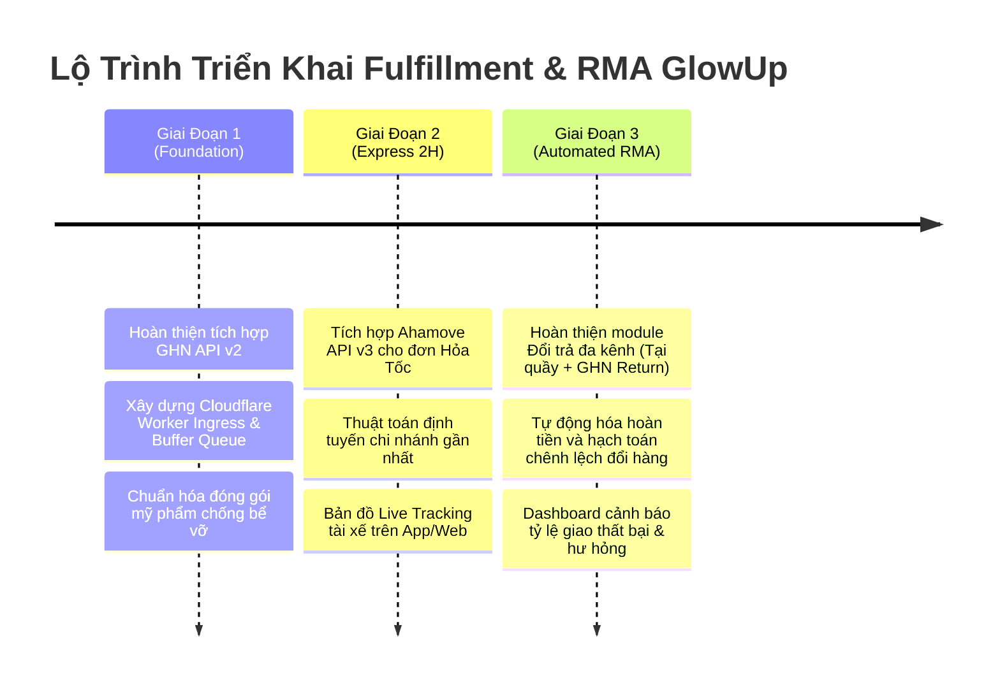

---

### 10.2 Ma Trận Kịch Bản Kiểm Thử Đầu Cuối (E2E Test Cases)

| Mã Test Case | Kịch bản kiểm thử | Dữ liệu đầu vào | Kỳ vọng hệ thống (Expected Result) | Mức độ |
| :--- | :--- | :--- | :--- | :--- |
| **TC-FUL-01** | Đặt đơn COD giao thường đi tỉnh | Khách ở Đà Nẵng, giỏ hàng 2 thỏi son | Định tuyến Tổng kho $\rightarrow$ Tạo đơn GHN thành công $\rightarrow$ Trả về mã vận đơn A6 và số tiền COD đúng tổng thanh toán. | **P0 (Critical)** |
| **TC-FUL-02** | Đặt đơn hỏa tốc 2H trong khung giờ | Khách ở Q10 TP.HCM, chọn giao 2H lúc 14:00 | Định tuyến Showroom Q10 $\rightarrow$ Nhân viên soạn hàng $\rightarrow$ Gọi Ahamove $\rightarrow$ Nhận mã tài xế và link live map hiển thị trên app. | **P0 (Critical)** |
| **TC-FUL-03** | Đặt đơn hỏa tốc 2H ngoài giờ hoạt động | Khách chọn giao 2H lúc 22:30 đêm | Báo lỗi hoặc hiển thị tùy chọn: *"Hẹn giao 2H sáng mai từ 08:30"*. Không gọi tài xế lúc nửa đêm. | **P1 (High)** |
| **TC-FUL-04** | Webhook GHN bắn dồn dập (Spike) | Gửi 500 webhook cùng lúc trong 1 giây | Cloudflare Worker tiếp nhận 100% không rớt, trả 200 OK $\le 30$ms, Cloudflare Queue đưa vào NestJS xử lý tuần tự không nghẽn DB. | **P0 (Critical)** |
| **TC-FUL-05** | Shipper giao thất bại lần 1 & lần 2 | Webhook `delivery_fail` gửi về | Cập nhật `failedAttempts = 1, 2` $\rightarrow$ Tự động gửi tin nhắn cho khách hẹn lại lịch $\rightarrow$ Chưa chuyển đơn về hoàn. | **P1 (High)** |
| **TC-FUL-06** | Shipper giao thất bại lần 3 (Bom hàng) | Webhook `returning` $\rightarrow$ `returned` | Chuyển đơn `CANCELLED`, hàng về kho kiểm tra và hoàn nhập số lượng tồn kho theo đúng Lô hàng ban đầu. | **P1 (High)** |
| **TC-FUL-07** | Yêu cầu trả hàng do vỡ chai serum | Khách upload video khui hộp + ảnh vỡ | CSKH duyệt $\rightarrow$ Tạo mã vận đơn thu hồi GHN Return miễn phí cho khách $\rightarrow$ Hàng về kho KCS xác nhận $\rightarrow$ Kích hoạt hoàn tiền. | **P0 (Critical)** |
| **TC-FUL-08** | Khách đổi son sang màu khác tại Showroom | Khách mang thỏi son nguyên seal ra chi nhánh | Nhân viên quét mã đơn $\rightarrow$ Kiểm tra seal $\rightarrow$ Chọn thỏi son màu mới $\rightarrow$ Hệ thống lập `ExchangeSettlement` 0đ bù trừ $\rightarrow$ Đóng đơn tại quầy. | **P0 (Critical)** |
| **TC-FUL-09** | Tự động hoàn tất đơn sau 7 ngày | Đơn đã giao ngày 08/11, hôm nay 15/11 | Cloudflare Cron quét $\rightarrow$ Chuyển `COMPLETED` $\rightarrow$ Cộng điểm GlowPoints $\rightarrow$ Mở khóa cho phép đánh giá. | **P1 (High)** |

---

## 11. Kết Luận & Khuyến Nghị Vận Hành

Tài liệu thiết kế trên đã bao quát toàn diện chu trình khép kín của một hệ thống bán lẻ mỹ phẩm đẳng cấp, giải quyết trọn vẹn 3 bài toán lớn:
1. **Ổn định & Chịu tải:** Sử dụng Cloudflare Workers & Queues làm bộ đệm tiếp nhận và xử lý phân tán, loại bỏ hoàn toàn nguy cơ nghẽn hệ thống lúc khuyến mãi lớn.
2. **Tốc độ & Trải nghiệm:** Kết hợp linh hoạt giữa GHN (phủ sóng tiết kiệm) và Ahamove (trải nghiệm hỏa tốc 2H như Hasaki NowFree với bản đồ trực tiếp).
3. **Minh bạch & Hậu mãi chuẩn chỉnh:** Quy trình RMA đa kênh (tại quầy hoặc tận nhà) với công thức tài chính bảo vệ quyền lợi khách hàng mà không làm thất thoát chi phí của doanh nghiệp.
