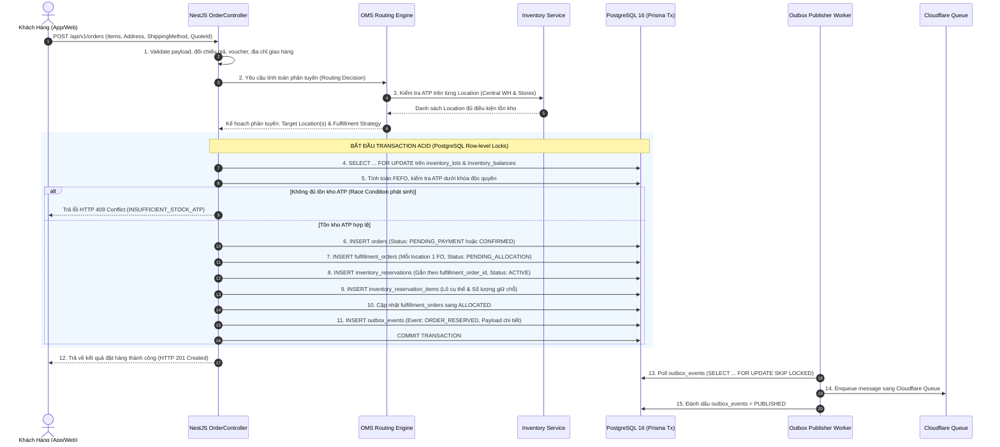
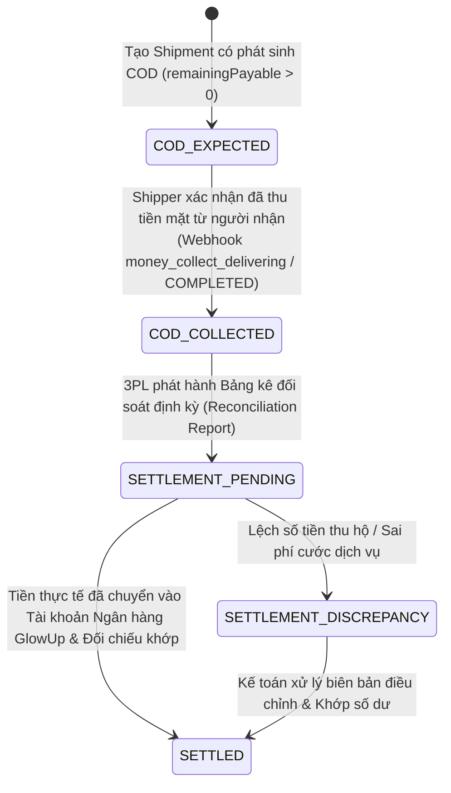
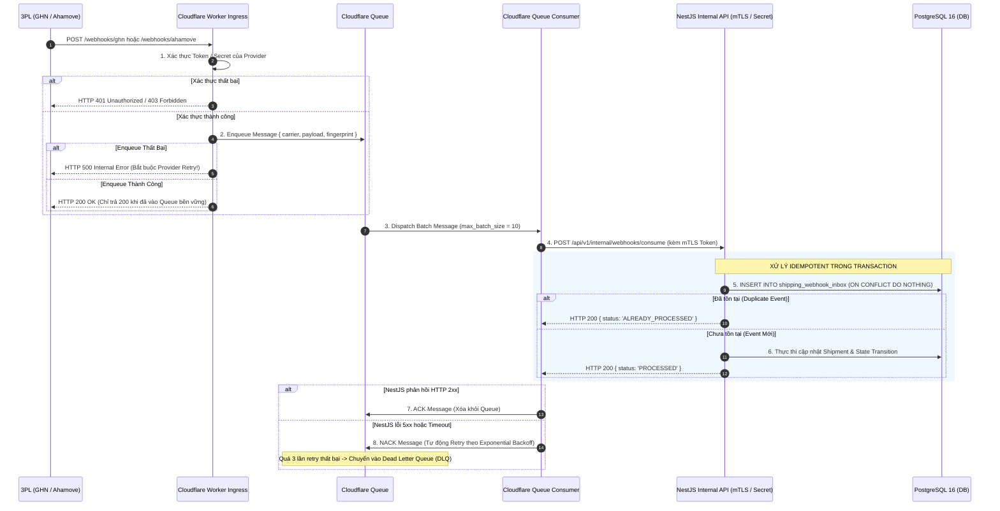
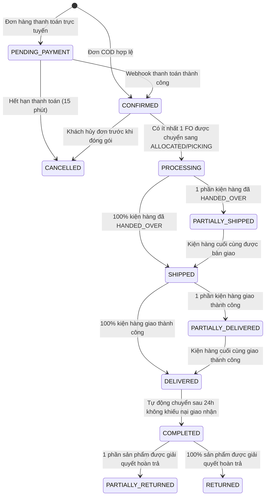
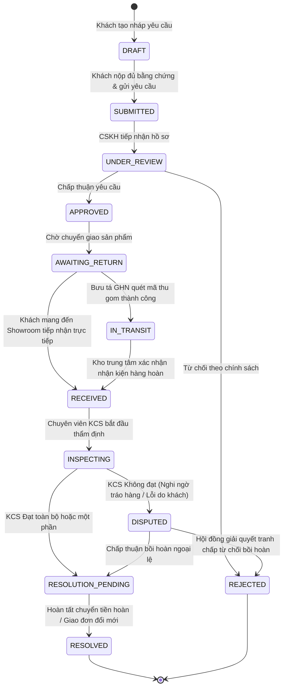
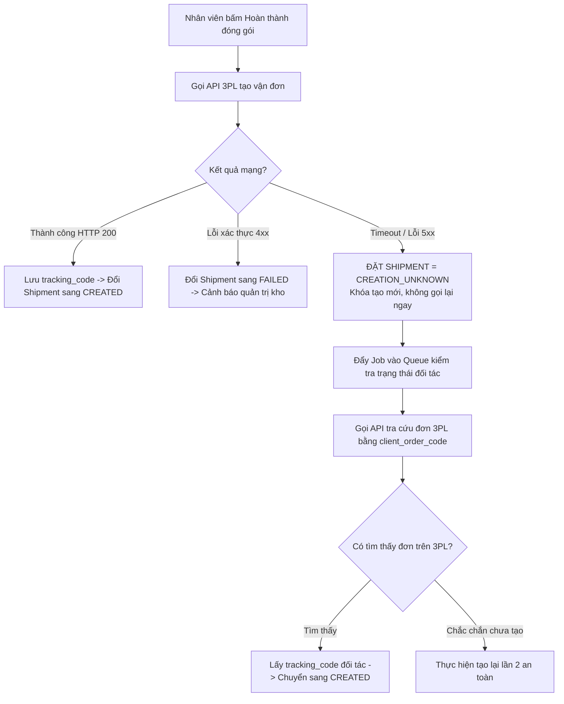

# Thiết Kế Chi Tiết Hệ Thống Fulfillment, Logistics Đa Đối Tác (GHN & Ahamove) Và Quản Lý Hậu Mãi (RMA) — GlowUp Omnichannel

> **Dự án:** GlowUp — Chuỗi Bán Lẻ Mỹ Phẩm Đa Kênh (Omnichannel Cosmetics Retail)  
> **Mã tài liệu:** `DES-05-FULFILLMENT-LOGISTICS-RMA`  
> **Phiên bản:** `3.1-ENTERPRISE` (Bản Tái Cấu Trúc Toàn Diện: Split Reservation, Decoupled State Machines & Exact 3PL Adapters)  
> **Ngày cập nhật:** 15/11/2026  
> **Trạng thái:** Bản Thiết Kế Chuẩn Doanh Nghiệp (Enterprise Production Specification)  
> **Backend:** NestJS (Modular Monolith) | **Database:** PostgreSQL 16 Enterprise + Prisma ORM  
> **Cache:** Upstash Redis (Cache-Aside duy nhất, không dùng Workers KV làm application cache)  
> **Hạ tầng bất đồng bộ:** Cloudflare Queues, Cloudflare Workers (Ingress & Consumer), Cloudflare Workflows, Cloudflare R2  
> **Đối tác giao vận:** GHN E-Commerce API v2 (Standard) & Ahamove On-Demand API (Express 2H)

---

## Mục Lục Tài Liệu

1. [Giới Thiệu, Phạm Vi & Quy Ước Nhãn Phân Loại (Introduction & Classification)](#1-giới-thiệu-phạm-vi--quy-ước-nhãn-phân-loại)
2. [Bối Cảnh Nghiệp Vụ & Thực Tiễn Tham Chiếu Đã Xác Minh (Grounding Facts)](#2-bối-cảnh-nghiệp-vụ--thực-tiễn-tham-chiếu-đã-xác-minh)
3. [Kiến Trúc Tổng Thể & Phân Định Trách Nhiệm (Architecture & Ownership Matrix)](#3-kiến-trúc-tổng-thể--phân-định-trách-nhiệm)
4. [Ma Trận Quy Tắc Nghiệp Vụ Hybrid Fulfillment (Business Rule Matrix)](#4-ma-trận-quy-tắc-nghiệp-vụ-hybrid-fulfillment)
5. [OMS & Thuật Toán Phân Tuyến Hỗn Hợp (Order Routing Engine)](#5-oms--thuật-toán-phân-tuyến-hỗn-hợp)
6. [Quản Lý Tồn Kho, Phân Bổ Lô FEFO & Mô Hình Reservation Đa Điểm](#6-quản-lý-tồn-kho-phân-bổ-lô-fefo--mô-hình-reservation-đa-điểm)
7. [Vận Hành Kho & Showroom: Picking, Packing & Handover (WMS Operations)](#7-vận-hành-kho--showroom-picking-packing--handover)
8. [Tích Hợp Đối Tác Vận Chuyển: GHN Standard & Ahamove Express 2H](#8-tích-hợp-đối-tác-vận-chuyển-ghn-standard--ahamove-express-2h)
9. [Theo Dõi Đơn Hàng, Vòng Đời Thu Hộ COD & Bảng Kê Đối Soát Tài Chính](#9-theo-dõi-đơn-hàng-vòng-đời-thu-hộ-cod--bảng-kê-đối-soát-tài-chính)
10. [Nghiệp Vụ Hậu Mãi Toàn Diện: Trả Hàng, Đổi Hàng & Hoàn Tiền (RMA Engine)](#10-nghiệp-vụ-hậu-mãi-toàn-diện-trả-hàng-đổi-hàng--hoàn-tiền)
11. [Logistics Thu Hồi, Thẩm Định Chất Lượng (QC) & Xử Lý Hàng Hoàn (Disposition)](#11-logistics-thu-hồi-thẩm-định-chất-lượng-qc--xử-lý-hàng-hoàn)
12. [Hạ Tầng Cloudflare Queues, Upstash Redis & Cơ Chế Khôi Phục Lỗi](#12-hạ-tầng-cloudflare-queues-upstash-redis--cơ-chế-khôi-phục-lỗi)
13. [Thiết Kế Cơ Sở Dữ Liệu Hoàn Chỉnh (Complete PostgreSQL DDL Specification)](#13-thiết-kế-cơ-sở-dữ-liệu-hoàn-chỉnh)
14. [Hệ Thống State Machines Miền Nghiệp Vụ & Ma Trận Chuyển Đổi (State Transitions)](#14-hệ-thống-state-machines-miền-nghiệp-vụ--ma-trận-chuyển-đổi)
15. [Thiết Kế Admin Action-Based Operations, Work Queues & RBAC Matrix](#15-thiết-kế-admin-action-based-operations-work-queues--rbac-matrix)
16. [Đặc Tả Kỹ Thuật API Contracts Toàn Diện (OMS, WMS, Shipping, RMA, Finance)](#16-đặc-tả-kỹ-thuật-api-contracts-toàn-diện)
17. [Đặc Tả Webhook Ingress & Bộ Chuyển Đổi Đối Tác Vận Chuyển (3PL Adapters)](#17-đặc-tả-webhook-ingress--bộ-chuyển-đổi-đối-tác-vận-chuyển)
18. [Bảo Mật, Quan Sát Hệ Thống (Observability) & Chiến Lược Khôi Phục Lỗi](#18-bảo-mật-quan-sát-hệ-thống-observability--chiến-lược-khôi-phục-lỗi)
19. [Ma Trận Kiểm Thử Đầu Cuối Toàn Diện (Comprehensive E2E Test Matrix - 51 Kịch Bản)](#19-ma-trận-kiểm-thử-đầu-cuối-toàn-diện)
20. [Lộ Trình Triển Khai Phân Kỳ (Phased Implementation Roadmap: P0 / P1 / P2)](#20-lộ-trình-triển-khai-phân-kỳ)
21. [Bảng Quyết Định Nghiệp Vụ Cần Thống Nhất (Open Decisions Log)](#21-bảng-quyết-định-nghiệp-vụ-cần-thống-nhất)
22. [Tài Liệu Tham Chiếu & Căn Cứ Nguồn Xác Minh (References)](#22-tài-liệu-tham-chiếu--căn-cứ-nguồn-xác-minh)

---

## 1. Giới Thiệu, Phạm Vi & Quy Ước Nhãn Phân Loại

### 1.1 Mục Đích & Phạm Vi Tài Liệu
Tài liệu `DES-05-FULFILLMENT-LOGISTICS-RMA v3.1` cung cấp bản thiết kế hệ thống chi tiết cho toàn bộ chu trình hoàn tất đơn hàng, tích hợp giao vận 3PL và xử lý hậu mãi đổi trả của **GlowUp**. Bản cập nhật v3.1 khắc phục hoàn toàn các điểm chưa tương thích trong mô hình dữ liệu (Reservation đa điểm khi tách đơn, Shipment đa mục đích, phân tách vòng đời Order và RMA, xử lý bất đồng bộ qua Cloudflare Queue và hợp đồng API chính thức của GHN/Ahamove).

### 1.2 Quy Ước Nhãn Phân Loại (Grounding Tag Convention)
Toàn bộ nhận định, quy tắc và chính sách trong tài liệu được gắn nhãn minh bạch:
* `[FACT]`: Thông tin đã được kiểm chứng từ tài liệu chính thức, API công khai hoặc quy định hiện hành.
* `[GLOWUP POLICY]`: Quy định nội bộ chính thức áp dụng cho chuỗi bán lẻ GlowUp.
* `[ASSUMPTION]`: Giả định kỹ thuật/vận hành, cần đo đạc và điều chỉnh trong quá trình triển khai.
* `[OPEN DECISION]`: Vấn đề nghiệp vụ đang chờ Hội đồng Quản trị / Giám đốc chức năng phê duyệt.
* `[LEGAL REQUIREMENT]`: Yêu cầu bắt buộc theo pháp luật Việt Nam (Luật Bảo vệ quyền lợi người tiêu dùng 2023, Nghị định TMĐT 52/2013/NĐ-CP & 85/2021/NĐ-CP).

---

## 2. Bối Cảnh Nghiệp Vụ & Thực Tiễn Tham Chiếu Đã Xác Minh

### 2.1 Thực Tiễn Xác Minh Từ Hasaki.vn
* `[FACT]` **Dịch Vụ Giao Nhanh 2H (NowFree):** Hasaki áp dụng mô hình phân bổ đơn hàng về chi nhánh gần nhất có đủ tồn kho. Dịch vụ chỉ khả dụng tại các khu vực nội thành có showroom hoạt động và trong khung giờ mở cửa quy định (thường 08:00 – 20:00) [Nguồn: hasaki.vn/chinh-sach-giao-hang-2h].
* `[FACT]` **Chính Sách Đồng Kiểm:** Hasaki áp dụng quy chuẩn không đồng kiểm lúc giao hàng; khách hàng được khuyến nghị quay video mở kiện hàng 6 mặt để làm căn cứ khiếu nại bể vỡ hoặc thiếu hàng [Nguồn: hasaki.vn/chinh-sach-giao-hang-2h].
* `[FACT]` **Đổi Trả Đa Kênh:** Khách hàng mua online được quyền mang sản phẩm ra bất kỳ chi nhánh showroom nào để kiểm tra và xử lý đổi trả trực tiếp [Nguồn: hasaki.vn/chinh-sach-doi-tra].

### 2.2 Thực Tiễn Xác Minh Từ Shopee Mall
* `[FACT]` **Cơ Chế Thu Hồi Hàng (Reverse Logistics):** Shopee cung cấp mã vận đơn chiều về cho 2 hình thức: (1) Shipper đến lấy tận nơi (Pick-up), hoặc (2) Khách nộp hàng tại bưu cục đối tác (Drop-off) [Nguồn: help.shopee.vn].
* `[FACT]` **Xử Lý Từng Phần (Partial Return):** Cho phép người mua chọn cụ thể từng sản phẩm và số lượng cần trả trong một đơn hàng có nhiều món [Nguồn: help.shopee.vn].

### 2.3 Phân Biệt Cốt Lõi: Chuỗi Bán Lẻ Sở Hữu (GlowUp) vs Sàn Thương Mại Điện Tử (Shopee)
* `[GLOWUP POLICY]` GlowUp là chuỗi bán lẻ một thương hiệu quản lý tập trung 100% kho vận và tồn kho.
* `[GLOWUP POLICY]` **Loại bỏ cơ chế Escrow giam tiền 7–15 ngày:** Khi shipper giao hàng thành công, giao dịch mua bán hoàn tất. Trạng thái đơn chuyển sang `DELIVERED`, sau đó tự động chuyển sang `COMPLETED` sau 24–48 giờ nếu không phát sinh khiếu nại giao nhận.
* `[GLOWUP POLICY]` Quyền đổi trả hậu mãi (Return Eligibility) là một cửa sổ chính sách độc lập (7 ngày đổi ý nguyên seal, 14 ngày lỗi sản xuất/kích ứng), **hoàn toàn không giữ trạng thái đơn hàng ở mức treo**.

---

## 3. Kiến Trúc Tổng Thể & Phân Định Trách Nhiệm

Hệ thống tuân thủ mô hình **Modular Monolith** trên NestJS, sử dụng PostgreSQL làm nguồn chân lý duy nhất (Single Source of Truth), Upstash Redis làm tầng Cache-Aside, và bộ công cụ Cloudflare làm tầng đệm biên và điều phối tiến trình dài hạn.

```mermaid
flowchart TB
    subgraph Clients ["1. Kênh Tương Tác (Clients)"]
        WebStore["Next.js Web Storefront"]
        MobileApp["Expo React Native Mobile App"]
        POSApp["GlowUp POS Terminal (Tại quầy)"]
        AdminPortal["Admin & Operations Portal"]
    end

    subgraph EdgeLayer ["2. Tầng Biên & Đệm Sự Kiện (Cloudflare & Upstash)"]
        CF_WAF["Cloudflare WAF / CDN"]
        UpstashRedis[("Upstash Redis<br/>Cache-Aside & Temp Locks")]
        CF_Worker_Ingress["Cloudflare Worker: Webhook Ingress"]
        CF_Queue_Logistics["Cloudflare Queue: logistics-webhook-queue"]
        CF_Queue_Outbox["Cloudflare Queue: order-outbox-queue"]
        CF_R2[("Cloudflare R2 Bucket<br/>Private Evidence Media")]
        CF_Workflows["Cloudflare Workflows<br/>RMA Orchestrator"]
    end

    subgraph CoreBackend ["3. Lớp Nghiệp Vụ Cốt Lõi (NestJS Modular Monolith)"]
        OMS_Module["OMS & Order Routing Module"]
        Inventory_Module["Inventory & FEFO Module"]
        WMS_Module["WMS & Fulfillment Module"]
        Shipping_Module["Shipping Integration Module"]
        RMA_Module["RMA & Reverse Logistics Module"]
        Payment_Module["Payment & Settlement Module"]
        Outbox_Relay["Transactional Outbox Relay"]
        Queue_Consumer["Internal Queue Consumer Service"]
    end

    subgraph StorageLayer ["4. Cơ Sở Dữ Liệu Bền Vững (PostgreSQL 16)"]
        PostgresDB[("PostgreSQL 16 Database<br/>ACID Transactions, Row Locks, Outbox")]
    end

    subgraph Carriers ["5. Đối Tác Vận Chuyển 3PL"]
        GHN_API["GHN E-Commerce API v2"]
        Ahamove_API["Ahamove On-Demand API v1/v3"]
    end

    Clients -->|HTTPS REST API| CF_WAF
    CF_WAF --> CoreBackend

    CoreBackend -->|Prisma Transactions / SQL Row Locks| PostgresDB
    CoreBackend <-->|Read Cache / Invalidate| UpstashRedis
    CoreBackend -->|Transactional Outbox Table| PostgresDB

    Outbox_Relay -->|Poll DB Outbox & Push| CF_Queue_Outbox
    CF_Queue_Outbox -->|Worker Consumer via mTLS| Queue_Consumer

    Shipping_Module -->|POST /shipping-order/create| GHN_API
    Shipping_Module -->|POST /v1/order/create| Ahamove_API

    GHN_API -.->|Webhook Event| CF_Worker_Ingress
    Ahamove_API -.->|Webhook Event| CF_Worker_Ingress
    CF_Worker_Ingress -->|Enqueue Bền Vững| CF_Queue_Logistics
    CF_Worker_Ingress -->>|HTTP 200 Sau Khi Enqueue OK| GHN_API
    CF_Worker_Ingress -->>|HTTP 200 Sau Khi Enqueue OK| Ahamove_API

    CF_Queue_Logistics -->|Batch Consumer via Internal API| Queue_Consumer
    Queue_Consumer -->|Ghi Webhook Inbox & Đổi Trạng Thái| PostgresDB

    RMA_Module -->|Issue Presigned URL| CF_R2
    RMA_Module -->|Trigger Saga Workflow| CF_Workflows
    CF_Workflows -->|Idempotent Callback Command| RMA_Module
```

### 3.1 Ma Trận Phân Định Trách Nhiệm Chi Tiết (Architecture Ownership Matrix)

| Lớp Kiến Trúc | Thành Phần | Quyền Sở Hữu (Ownership) | Trách Nhiệm Kỹ Thuật | Ràng Buộc Nghiêm Ngặt |
| :--- | :--- | :--- | :--- | :--- |
| **Core Monolith** | `NestJS Backend` | Core Engineering Team | Quản lý vòng đời Order, Routing, Inventory ATP, FEFO, Shipping Adapter, RMA, Payment, COD. | Là **nguồn chân lý nghiệp vụ duy nhất**. Toàn bộ logic giao dịch phải chạy qua PostgreSQL. |
| **Persistence** | `PostgreSQL 16` | DBA / Core Team | Lưu trữ dữ liệu quan hệ, bảng outbox, webhook inbox, lịch sử audit. | Thực thi Row-level Locks (`SELECT FOR UPDATE`), Check Constraints, Foreign Keys. |
| **Cache Layer** | `Upstash Redis` | Core Team / DevOps | Cache-Aside cho Policy, Cấu hình Shipping Service, Rate Limit, Khóa tạm ngắn hạn. | **CẤM:** Không lưu trữ số dư tồn kho, trạng thái đơn hàng hoặc kết quả thanh toán. |
| **Edge Ingress** | `Cloudflare Worker` | DevOps Team | Tiếp nhận Webhook từ GHN/Ahamove, kiểm tra Secret/Token, đẩy vào Queue. | **CẤM:** Không gọi DB trực tiếp, không chạy nghiệp vụ routing/tồn kho. Chỉ trả 200 khi Enqueue thành công. |
| **Message Queue**| `Cloudflare Queues`| DevOps Team | Đệm sự kiện webhook, điều tiết tải (Backpressure), retry tự động có backoff, DLQ. | Đảm bảo tính bền vững (Durable). Message lỗi quá 3 lần chuyển sang DLQ để cảnh báo. |
| **Object Store** | `Cloudflare R2` | Core / DevOps | Lưu trữ media bằng chứng mở hộp, ảnh đóng gói, ảnh thẩm định KCS. | Bucket hoàn toàn Private; truy cập thông qua Presigned Upload/Download URL có TTL ngắn. |
| **Orchestration**| `Cloudflare Workflows`| Core Team | Điều phối tiến trình RMA dài hạn (chờ khách gửi hàng 7 ngày, nhắc hạn SLA thẩm định). | Mọi bước trong Workflow phải gọi lại NestJS Internal API có Idempotency Key. |

---

## 4. Ma Trận Quy Tắc Nghiệp Vụ Hybrid Fulfillment

```
+------------------------------------------------------------------------------------------------------------------------+
|                                    MA TRẬN QUY TẮC PHÂN TUYẾN HYBRID FULFILLMENT                                       |
+-------------------+---------------------------+-----------------------------------+------------------------------------+
| PHƯƠNG THỨC SHIP  | ĐIỀU KIỆN ĐÁP ỨNG         | ĐỊA ĐIỂM HOÀN TẤT ƯU TIÊN          | HÀNH ĐỘNG KHI KHÔNG ĐỦ HÀNG        |
+-------------------+---------------------------+-----------------------------------+------------------------------------+
| EXPRESS_2H        | 1 Showroom duy nhất đáp   | Chi nhánh Showroom gần nhất thỏa  | [GLOWUP POLICY] CẤM TỰ ĐỘNG CHIA   |
| (Ahamove)         | ứng 100% giỏ hàng;        | mãn: cự ly <= R_max (mặc định     | ĐƠN. Thông báo khách hàng chuyển   |
|                   | Đang trong giờ mở cửa;    | 10km); còn công suất đóng gói     | sang Giao hàng Tiêu chuẩn.         |
|                   | Còn capacity xử lý.       | (capacity_per_day chưa vượt mức). |                                    |
+-------------------+---------------------------+-----------------------------------+------------------------------------+
| STANDARD_GHN      | Ưu tiên nguồn đơn lẻ      | 1. Tổng kho trung tâm (Central WH)| [GLOWUP POLICY] Kiểm tra cờ        |
| (Giao Tiêu Chuẩn) | đáp ứng 100% giỏ hàng;    | 2. Showroom đơn lẻ đáp ứng 100% có| allow_order_split: Nếu true, tách  |
|                   | Đánh giá tối ưu cước ship |    chi phí vận chuyển thấp nhất.   | tối đa 2 Fulfillment Orders;       |
|                   | và tồn kho bán lẻ.        |                                   | Nếu false, chuyển Backorder điều   |
|                   |                           |                                   | chuyển nội bộ trước khi giao.      |
+-------------------+---------------------------+-----------------------------------+------------------------------------+
```

---

## 5. OMS & Thuật Toán Phân Tuyến Hỗn Hợp

### 5.1 Quy Trình Phân Tuyến & Khởi Tạo Đơn Hàng (Order Routing Sequence)



---

## 6. Quản Lý Tồn Kho, Phân Bổ Lô FEFO & Mô Hình Reservation Đa Điểm

### 6.1 Mô Hình Phân Bổ Tồn Kho & Công Thức ATP
Tồn kho được theo dõi chính xác đến từng Vị trí (`location_id`), Phân loại (`product_variant_id`) và Lô hàng (`lot_id`).

$$\text{ATP (Available to Promise)} = \text{Sellable On Hand} - \text{Reserved Quantity} - \text{Safety Stock}$$

* **Physical On Hand:** Tổng lượng hàng có mặt thực tế tại vị trí kho/cửa hàng.
* **Reserved Quantity:** Tổng lượng hàng đã được giữ chỗ trong các đơn hàng chưa hoàn tất xuất kho.
* **Safety Stock:** Mức đệm an toàn chống sai lệch kiểm kê (Cấu hình theo Location & Category).
* **Quarantined / Damaged:** Hàng cách ly chờ KCS thẩm định hoặc hàng bể vỡ, loại khỏi luồng bán lẻ.

### 6.2 Thuật Toán Phân Bổ Lô Xuất Kho Theo Hạn Dùng (FEFO Engine)
1. **Kiểm Tra Hạn Dùng Tối Thiểu (Min Remaining Shelf Life):**
   * Sản phẩm chỉ được phân bổ nếu: $(\text{Lot.ExpiryDate} - \text{OrderDate}) \ge \text{ProductVariant.MinRemainingShelfLifeDays}$.
   * Nếu sản phẩm được gắn cờ xả hàng cận date (`is_clearance = true`), hệ thống cho phép xuất lô có hạn ngắn hơn theo quy định của chương trình.
2. **Thứ Tự Ưu Tiên Xuất Lô:** Sắp xếp các Lô thỏa mãn theo `expiry_date ASC`. Lô có ngày hết hạn gần nhất được trừ giữ chỗ trước cho đến khi đủ số lượng yêu cầu.

### 6.3 Tái Thiết Kế Reservation Tương Thích Hoàn Toàn Với Split Fulfillment
`[CRITICAL CORRECTION]` Nhằm khắc phục hạn chế của bản v3.0, bản v3.1 loại bỏ ràng buộc `UNIQUE(order_id)` và `location_id` đơn lẻ tại bảng header. Bảng `inventory_reservations` được liên kết trực tiếp với từng `fulfillment_order_id`:
* Nếu đơn hàng được xuất từ 1 điểm: Sinh ra 1 `fulfillment_order` và 1 `inventory_reservation`.
* Nếu đơn hàng bị tách xuất từ 2 điểm (Tổng kho + Chi nhánh): Sinh ra 2 `fulfillment_orders` độc lập, mỗi FO sở hữu 1 bản ghi `inventory_reservation` trỏ về đúng `location_id` tương ứng.
* Bảng `inventory_reservation_items` lưu chi tiết số lượng giữ chỗ gắn với từng `lot_id` cụ thể.
* **Đồng bộ trạng thái:** Khi tạo Reservation thành công trong transaction, `fulfillment_orders.status` chuyển từ `PENDING_ALLOCATION` sang `ALLOCATED`.

---

## 7. Vận Hành Kho & Showroom: Picking, Packing & Handover

### 7.1 Phân Định Trách Nhiệm Giữa Đóng Gói (Packing) Và Vận Đơn (Shipment)
1. **Nhặt Hàng (Picking):** Nhân viên dùng thiết bị quét mã vạch SKU và mã vạch Lô (`batch_code`). Hệ thống đối chiếu chính xác với `inventory_reservation_items`.
2. **Đóng Gói (Packing):**
   * Hàng hóa được đóng vào thùng carton có chèn xốp bóng khí (bubble wrap) tối thiểu 3 lớp đối với chất lỏng/thủy tinh.
   * Nhân viên đặt kiện hàng lên cân và đo kích thước, nhập số đo thực tế vào hệ thống: `actual_weight_grams`, `actual_length_cm`, `actual_width_cm`, `actual_height_cm`.
   * Hệ thống ghi nhận bản ghi `packages` và `package_items`. Một `FulfillmentOrder` có thể đóng thành **nhiều kiện hàng (`packages`)** nếu vượt quá trọng tải hoặc kích thước tối đa của đối tác giao hàng.
3. **Tạo Vận Đơn (Shipment Creation):**
   * Sau khi đóng gói hoàn tất, NestJS gọi API của đối tác 3PL (GHN hoặc Ahamove) để lấy mã vận đơn thực tế và link in nhãn.
4. **Bàn Giao (Handover) vs Tiếp Nhận (Pickup):**
   * `HANDED_OVER`: Trạng thái nội bộ do nhân viên kho/cửa hàng xác nhận trên hệ thống sau khi đã giao các kiện hàng cho tài xế và ký biên bản bàn giao.
   * `PICKED_UP`: Trạng thái đối tác 3PL gửi về qua Webhook, xác nhận bưu tá/tài xế đã quét mã tiếp nhận bưu kiện vào hệ thống mạng lưới của họ.

---

## 8. Tích Hợp Đối Tác Vận Chuyển: GHN Standard & Ahamove Express 2H

### 8.1 Ma Trận Năng Lực Đối Tác Giao Vận (Provider Capability Matrix)

```
+------------------------------------------------------------------------------------------------------------------------+
|                                    MA TRẬN NĂNG LỰC TÍCH HỢP ĐỐI TÁC VẬN CHUYỂN 3PL                                    |
+-----------------------------+---------------------------------------------+--------------------------------------------+
| TÍNH NĂNG / CAPABILITY      | GIAO HÀNG NHANH (GHN) API v2                | AHAMOVE ON-DEMAND API v1/v3                |
+-----------------------------+---------------------------------------------+--------------------------------------------+
| Endpoint Chính Thức         | https://online-gateway.ghn.vn/shiip/public- | https://partner-api.ahamove.com/v1/order/  |
|                             | api/v2/shipping-order/create                | create (Endpoint tạo đơn Partner chuẩn)    |
+-----------------------------+---------------------------------------------+--------------------------------------------+
| Xác Thực API (Auth)         | Header: Token & ShopId                      | Query/Header: apikey / Bearer Token        |
+-----------------------------+---------------------------------------------+--------------------------------------------+
| Báo Giá Trước (Fee Quote)   | CÓ (POST /shipping-order/fee)               | CÓ (POST /v1/order/estimated_fee)          |
+-----------------------------+---------------------------------------------+--------------------------------------------+
| In Nhãn Vận Đơn (Label PDF) | CÓ (Khổ in A6 qua /a5/gen-token)            | [FACT] KHÔNG CÓ API IN NHÃN CHUẨN A6.      |
|                             |                                             | GlowUp tự in Phiếu Giao Hàng nội bộ.      |
+-----------------------------+---------------------------------------------+--------------------------------------------+
| Live Tracking Map           | KHÔNG (Chỉ có tra cứu hành trình bưu cục)  | CÓ (Lấy link qua GET /v3/orders/{id}/      |
|                             |                                             | shared-link hiển thị trực tiếp cho khách)  |
+-----------------------------+---------------------------------------------+--------------------------------------------+
| Thu Hồi Đổi Trả (RMA Return)| CÓ (Tạo đơn đổi/trả qua API giao hàng ngược)| CÓ (Booking chiều ngược qua On-Demand Bike)|
+-----------------------------+---------------------------------------------+--------------------------------------------+
| Định Danh Mã Vận Đơn        | Mã GHN: OrderCode (VD: LADB78);             | Mã Ahamove: _id (VD: 22VMV54W);            |
|                             | Mã GlowUp: ClientOrderCode                  | Mã GlowUp: tracking_number                 |
+-----------------------------+---------------------------------------------+--------------------------------------------+
```

### 8.2 Tích Hợp GHN E-Commerce API v2 (Standard Delivery)
* **API Tạo Vận Đơn:** `POST https://online-gateway.ghn.vn/shiip/public-api/v2/shipping-order/create`
* **Request DTO Chuẩn Hóa:**
```json
{
  "payment_type_id": 1,
  "note": "Mỹ phẩm cao cấp - Không đồng kiểm - Quay video khui hàng",
  "required_note": "KHONGCHOXEMHANG",
  "client_order_code": "SHIP-20261115-0089",
  "to_name": "Nguyễn Văn A",
  "to_phone": "0901234567",
  "to_address": "7/28 Thành Thái, Phường 14, Quận 10",
  "to_ward_code": "20314",
  "to_district_id": 1444,
  "cod_amount": 350000,
  "weight": 420,
  "length": 18,
  "width": 12,
  "height": 8,
  "service_type_id": 2,
  "items": [
    {
      "name": "Serum Phục Hồi Da GlowUp B5 30ml",
      "code": "SKU-SERUM-B5",
      "quantity": 1,
      "price": 350000
    }
  ]
}
```

### 8.3 Tích Hợp Ahamove On-Demand Delivery API (Express 2H)
* **API Tạo Booking:** `POST https://partner-api.ahamove.com/v1/order/create`
* **Request DTO Chuẩn Hóa:**
```json
{
  "order_time": 0,
  "service_id": "SGN-BIKE",
  "payment_method": "BALANCE",
  "path": [
    {
      "address": "Showroom GlowUp Q10: 123 Đường 3/2, Phường 11, Quận 10",
      "name": "Kho Xuất Hàng GlowUp Q10",
      "mobile": "02873001234",
      "lat": 10.771234,
      "lng": 106.669876,
      "remarks": "Lấy kiện hàng mã SHIP-20261115-0089 tại quầy điều phối"
    },
    {
      "address": "7/28 Thành Thái, Phường 14, Quận 10, TP.HCM",
      "name": "Nguyễn Văn A",
      "mobile": "0901234567",
      "lat": 10.769753,
      "lng": 106.663661,
      "cod_amount": 0,
      "tracking_number": "SHIP-20261115-0089"
    }
  ]
}
```

---

## 9. Theo Dõi Đơn Hàng, Vòng Đời Thu Hộ COD & Bảng Kê Đối Soát Tài Chính

### 9.1 Vòng Đời COD 4 Giai Đoạn Độc Lập
`[CRITICAL CORRECTION]` Kiện hàng chuyển sang `DELIVERED` không đồng nghĩa với việc doanh thu COD đã hoàn tất hạch toán. Dòng tiền COD trải qua 4 giai đoạn độc lập:



### 9.2 Công Thức Phân Bổ COD Khi Tách Đơn (Split Fulfillment)
Khi một đơn hàng có giá trị còn phải thanh toán sau khi trừ tiền trả trước (`remainingPayable > 0`) bị tách thành nhiều kiện hàng xuất từ các kho khác nhau:

$$\text{Shipment}[k].\text{codAmount} = \text{Round}\left( \text{Order.remainingPayable} \times \frac{\text{PackageValue}[k]}{\sum \text{PackageValue}} \right)$$

* Khoản làm tròn số lẻ được cộng/trừ vào kiện hàng cuối cùng để bảo đảm: $\sum \text{Shipment.codAmount} \equiv \text{Order.remainingPayable}$.
* Không bao giờ thu dồn 100% COD vào kiện giao trước, tránh rủi ro khách từ chối nhận kiện giao sau.

---

## 10. Nghiệp Vụ Hậu Mãi Toàn Diện: Trả Hàng, Đổi Hàng & Hoàn Tiền

### 10.1 Quản Lý Chính Sách Đổi Trả Phiên Bản Hóa (Versioned Policy Engine)
Mỗi đơn hàng khi tạo thành công sẽ được liên kết cố định với một `policy_version_id`. Khi khách hàng gửi yêu cầu RMA, hệ thống đối chiếu điều kiện dựa trên phiên bản chính sách có hiệu lực tại thời điểm mua, ngăn chặn việc thay đổi chính sách làm sai lệch quyền lợi đã cam kết.

### 10.2 Phân Biệt Các Lý Do Đổi Trả & Yêu Cầu Bằng Chứng

```
+------------------------------------------------------------------------------------------------------------------------+
|                                    MA TRẬN LÝ DO ĐỔI TRẢ & NGUYÊN TẮC BẰNG CHỨNG                                       |
+---------------------+-----------------------+---------------------+-------------------+--------------------------------+
| LÝ DO ĐỔI TRẢ       | ĐIỀU KIỆN SẢN PHẨM    | BẰNG CHỨNG BẮT BUỘC | THỜI HẠN ÁP DỤNG  | TRÁCH NHIỆM PHÍ VẬN CHUYỂN     |
+---------------------+-----------------------+---------------------+-------------------+--------------------------------+
| KHÁCH ĐỔI Ý         | Nguyên seal 100%, vỏ  | Ảnh chụp 6 mặt bao  | 7 ngày kể từ khi  | Khách hàng chịu phí ship thu   |
| (CHANGE_OF_MIND)    | hộp không móp rách    | bì còn nguyên seal  | nhận hàng         | hồi (trừ vào tiền hoàn)        |
+---------------------+-----------------------+---------------------+-------------------+--------------------------------+
| HÀNG BỂ VỠ / LỖI    | Hư hỏng do vận chuyển | Video khui hộp hoặc | 48 giờ kể từ khi  | GlowUp chịu 100% chi phí       |
| VẬN CHUYỂN          | hoặc đổ tràn tinh chất| ảnh chụp chi tiết   | nhận hàng         | vận chuyển thu hồi & gửi bù    |
+---------------------+-----------------------+---------------------+-------------------+--------------------------------+
| GIAO SAI HÀNG       | Nhầm mã, nhầm phân loại| Ảnh chụp sản phẩm   | 7 ngày kể từ khi  | GlowUp chịu 100% chi phí       |
| (WRONG_ITEM)        | màu, thiếu phụ kiện   | thực nhận và bill   | nhận hàng         | đổi trả                        |
+---------------------+-----------------------+---------------------+-------------------+--------------------------------+
| LỖI SẢN XUẤT        | Biến chất, tách lớp,  | Ảnh/video mô tả lỗi | 14 ngày kể từ khi | GlowUp chịu 100% chi phí       |
| (MANUFACTURING)     | vòi xịt hỏng kỹ thuật | kỹ thuật của bao bì | nhận hàng         | thu hồi và đổi mới             |
+---------------------+-----------------------+---------------------+-------------------+--------------------------------+
| DỊ ỨNG / KÍCH ỨNG   | [OPEN DECISION] Xem   | Ảnh chụp phản ứng da| 14 ngày kể từ khi | GlowUp hỗ trợ thu hồi và tư vấn|
| DA (ALLERGIC)       | Mục 21. Không đòi hỏi | vùng sử dụng        | nhận hàng         | đổi sản phẩm lành tính         |
|                     | hồ sơ y tế đại trà    |                     |                   |                                |
+---------------------+-----------------------+---------------------+-------------------+--------------------------------+
```

### 10.3 Thuật Toán Hoàn Tiền Từng Phần (Partial Refund Allocation)
Tiền hoàn cho từng món hàng (`ReturnItem`) được tính toán dựa trên số tiền thực tế khách đã chi trả sau khi phân bổ đều các tầng giảm giá:

$$\text{UnitNetPrice} = \text{OriginalPrice} - \text{DiscountPerUnit} - \text{VoucherAllocPerUnit} - \text{PointsAllocPerUnit}$$

* **Giới Hạn Bất Biến (Invariant):**
  $$\text{TotalRefundAmount} \le \text{TotalCapturedCash}$$
  $$\text{PointsToRestore} \le \text{TotalPointsUsed}$$
* Nếu yêu cầu trả hàng do lỗi của GlowUp $\implies$ Hoàn trả toàn bộ tiền hàng + Phí ship ban đầu (nếu đơn chỉ có 1 món).
* Nếu yêu cầu trả hàng do khách đổi ý $\implies$ Hoàn tiền hàng theo `UnitNetPrice`, không hoàn phí ship ban đầu và khấu trừ phí vận chuyển thu hồi theo chính sách.

### 10.4 Cơ Chế Đổi Hàng Sang Sản Phẩm Khác (Exchange Settlement)
1. **Giá Trị Bảo Lưu (Return Credit):** Tổng giá trị thực tế của các sản phẩm được chấp thuận trả lại.
2. **Giá Trị Hàng Thay Thế (Replacement Payable):** Tính theo giá niêm yết hiện hành của sản phẩm mới được chọn đổi.
3. **Quyết Toán Bù Trừ:**
   * Nếu $\text{Replacement Payable} > \text{Return Credit} \implies$ Phát sinh `additionalDue`. Khách hàng thanh toán qua QR Code hoặc Shipper thu COD khi giao hàng mới.
   * Nếu $\text{Replacement Payable} < \text{Return Credit} \implies$ Phát sinh `refundDue`. Hệ thống tự động kích hoạt tiến trình hoàn phần chênh lệch về tài khoản của khách.
   * Nếu bằng nhau $\implies$ Quyết toán đổi ngang 0đ.
4. Đơn hàng đổi mới được tạo trong bảng `orders` với phân loại `order_type = 'EXCHANGE'` và liên kết khóa ngoại với `return_request_id` để hạch toán thuế và doanh thu chuẩn mực.

---

## 11. Logistics Thu Hồi, Thẩm Định Chất Lượng (QC) & Xử Lý Hàng Hoàn

### 11.1 Phân Biệt Hai Luồng Hàng Hoàn Về Kho

```mermaid
flowchart TD
    subgraph Flow_RTO ["1. Luồng RETURN TO ORIGIN (Giao Thất Bại Chuyển Hoàn)"]
        Fail3[Giao hàng không thành công sau các lượt quy định] --> CarrierReturning[3PL chuyển hoàn kiện hàng về điểm xuất phát]
        CarrierReturning --> WhReceiveRTO[Nhân viên kho quét nhận kiện hoàn RTO]
        WhReceiveRTO --> CheckSealPkg{Bao bì niêm phong còn nguyên vẹn?}
        CheckSealPkg -->|Nguyên seal| RestockRTO[Tự động nhập lại đúng Lô ban đầu vào Sellable Stock]
        CheckSealPkg -->|Rách nát / Bể vỡ| QuarantineRTO[Đưa vào QUARANTINE lập biên bản khiếu nại bồi thường 3PL]
    end

    subgraph Flow_CR ["2. Luồng CUSTOMER RETURN (Khách Hàng Đổi Trả Hậu Mãi)"]
        RMA_Approved[RMA được phê duyệt thu hồi] --> ChannelCheck{Phương thức thu hồi?}
        ChannelCheck -->|Mang ra Showroom| StoreDrop[Khách mang ra Cửa hàng gần nhất]
        ChannelCheck -->|Shipper lấy| ShipperReturn[Hệ thống tạo vận đơn thu gom RETURN_PICKUP]
        
        StoreDrop --> CreateReceipt[Lập phiếu tiếp nhận Return Receipt]
        ShipperReturn --> CreateReceipt
        CreateReceipt --> TempQuarantine[Chuyển ngay sản phẩm vào trạng thái QUARANTINE]
        
        TempQuarantine --> QC_Inspect[Chuyên viên KCS thẩm định chi tiết từng Return Item]
        QC_Inspect --> QC_Decision{Kết quả KCS từng món?}
        
        QC_Decision -->|ĐẠT (PASS)| DispRestock[DISPOSITION: RESTOCK -> Nhập kho bán lẻ]
        QC_Decision -->|HỎNG BAO BÌ| DispRepack[DISPOSITION: REPACK -> Xả kho Outlet/Thanh lý]
        QC_Decision -->|HỎNG / ĐÃ DÙNG| DispScrap[DISPOSITION: SCRAP -> Tiêu hủy]
        QC_Decision -->|GIẢ MẠO / TRÁO| DispReject[DISPOSITION: RETURN_TO_CUSTOMER -> Trả lại khách & Từ chối]
    end
```

### 11.2 Quy Trình Tiếp Nhận Đổi Trả Tại Chi Nhánh Khác (Cross-Store Drop-off)
* Khách hàng có thể mang hàng ra bất kỳ chi nhánh Showroom nào thuộc hệ thống GlowUp.
* Nhân viên cửa hàng quét mã RMA trên ứng dụng quản trị, chụp ảnh hiện trạng và tạo bản ghi `return_receipts`.
* **Nguyên tắc an toàn tồn kho tuyệt đối:** Toàn bộ sản phẩm tiếp nhận tại quầy được đưa ngay vào trạng thái **`QUARANTINED`** tại chi nhánh đó. Sản phẩm **chỉ được chuyển sang `Sellable Stock` sau khi có biên bản KCS phê duyệt đạt chuẩn (`PASSED`)**.

---

## 12. Hạ Tầng Cloudflare Queues, Upstash Redis & Cơ Chế Khôi Phục Lỗi

### 12.1 Kiến Trúc Xử Lý Message & Consumer Model
Hệ thống chốt duy nhất một mô hình xử lý: **Cloudflare Worker Consumer gọi NestJS Internal Command API**.



### 12.2 Tạo Dấu Vân Tay (Fingerprint Fallback) Khi Webhook Không Có Event ID
* `[PRACTICAL PROBLEM]` Một số nhà xe hoặc webhook không cung cấp trường `event_id` duy nhất.
* `[SOLUTION]` Nếu payload không chứa `event_id`, Worker tự động sinh mã băm Fingerprint xác định:
  $$\text{fingerprint} = \text{SHA256}(\text{carrierCode} + \text{trackingCode} + \text{carrierStatus} + \text{occurredTimestamp})$$
  Mã băm này được đưa vào cột `event_id` của bảng `shipping_webhook_inbox` để tận dụng ràng buộc `UNIQUE(carrier_code, event_id)` trong PostgreSQL.

---

## 13. Thiết Kế Cơ Sở Dữ Liệu Hoàn Chỉnh

Dưới đây là DDL hoàn chỉnh, chuẩn hóa 100% kiểu dữ liệu, khóa ngoại, ràng buộc và chỉ mục tối ưu trên PostgreSQL 16:

```sql
-- BẬT EXTENSION UUID NẾU CHƯA CÓ
CREATE EXTENSION IF NOT EXISTS "uuid-ossp";

-- =============================================================================
-- 1. FULFILLMENT, PACKAGING & WMS TABLES
-- =============================================================================

CREATE TABLE locations (
    id UUID PRIMARY KEY DEFAULT gen_random_uuid(),
    code VARCHAR(50) UNIQUE NOT NULL,
    name VARCHAR(150) NOT NULL,
    type VARCHAR(30) NOT NULL, -- 'CENTRAL_WAREHOUSE', 'RETAIL_STORE', 'TRANSIT_HUB'
    address JSONB NOT NULL,
    latitude DECIMAL(10, 7),
    longitude DECIMAL(10, 7),
    is_active BOOLEAN DEFAULT TRUE,
    fulfillment_capacity_per_day INT DEFAULT 500,
    created_at TIMESTAMPTZ DEFAULT NOW(),
    updated_at TIMESTAMPTZ DEFAULT NOW()
);

CREATE TABLE fulfillment_orders (
    id UUID PRIMARY KEY DEFAULT gen_random_uuid(),
    order_id UUID NOT NULL REFERENCES orders(id) ON DELETE RESTRICT,
    fulfillment_order_number VARCHAR(60) UNIQUE NOT NULL,
    source_location_id UUID NOT NULL REFERENCES locations(id),
    status VARCHAR(35) NOT NULL, -- 'PENDING_ALLOCATION', 'ALLOCATED', 'PICKING', 'PICKED', 'PACKING', 'PACKED', 'READY_FOR_HANDOVER', 'HANDED_OVER', 'COMPLETED', 'CANCELLED'
    shipping_service_code VARCHAR(50) NOT NULL,
    total_items_count INT NOT NULL CHECK (total_items_count > 0),
    assigned_picker_id UUID,
    allocated_at TIMESTAMPTZ,
    packed_at TIMESTAMPTZ,
    handed_over_at TIMESTAMPTZ,
    created_at TIMESTAMPTZ DEFAULT NOW(),
    updated_at TIMESTAMPTZ DEFAULT NOW()
);
CREATE INDEX idx_fo_location_status ON fulfillment_orders(source_location_id, status);

CREATE TABLE fulfillment_order_items (
    id UUID PRIMARY KEY DEFAULT gen_random_uuid(),
    fulfillment_order_id UUID NOT NULL REFERENCES fulfillment_orders(id) ON DELETE CASCADE,
    order_item_id UUID NOT NULL REFERENCES order_items(id),
    product_variant_id UUID NOT NULL REFERENCES product_variants(id),
    quantity_requested INT NOT NULL CHECK (quantity_requested > 0),
    quantity_fulfilled INT DEFAULT 0 CHECK (quantity_fulfilled >= 0),
    created_at TIMESTAMPTZ DEFAULT NOW()
);

CREATE TABLE packages (
    id UUID PRIMARY KEY DEFAULT gen_random_uuid(),
    fulfillment_order_id UUID NOT NULL REFERENCES fulfillment_orders(id) ON DELETE RESTRICT,
    package_code VARCHAR(60) UNIQUE NOT NULL,
    actual_weight_grams INT NOT NULL CHECK (actual_weight_grams > 0),
    length_cm INT NOT NULL CHECK (length_cm > 0),
    width_cm INT NOT NULL CHECK (width_cm > 0),
    height_cm INT NOT NULL CHECK (height_cm > 0),
    packed_by UUID NOT NULL,
    sealed_at TIMESTAMPTZ DEFAULT NOW(),
    created_at TIMESTAMPTZ DEFAULT NOW()
);

CREATE TABLE package_items (
    id UUID PRIMARY KEY DEFAULT gen_random_uuid(),
    package_id UUID NOT NULL REFERENCES packages(id) ON DELETE CASCADE,
    product_variant_id UUID NOT NULL REFERENCES product_variants(id),
    quantity INT NOT NULL CHECK (quantity > 0)
);

-- =============================================================================
-- 2. INVENTORY, BATCHES (FEFO) & RESERVATIONS (MULTI-LOCATION)
-- =============================================================================

CREATE TABLE inventory_balances (
    id UUID PRIMARY KEY DEFAULT gen_random_uuid(),
    location_id UUID NOT NULL REFERENCES locations(id),
    product_variant_id UUID NOT NULL REFERENCES product_variants(id),
    physical_on_hand INT NOT NULL DEFAULT 0 CHECK (physical_on_hand >= 0),
    reserved_quantity INT NOT NULL DEFAULT 0 CHECK (reserved_quantity >= 0),
    safety_stock INT NOT NULL DEFAULT 0 CHECK (safety_stock >= 0),
    quarantined_quantity INT NOT NULL DEFAULT 0 CHECK (quarantined_quantity >= 0),
    damaged_quantity INT NOT NULL DEFAULT 0 CHECK (damaged_quantity >= 0),
    updated_at TIMESTAMPTZ DEFAULT NOW(),
    CONSTRAINT uq_inv_balance UNIQUE (location_id, product_variant_id),
    CONSTRAINT chk_balances_logical CHECK (physical_on_hand >= (reserved_quantity + quarantined_quantity + damaged_quantity))
);
CREATE INDEX idx_inv_balances_lookup ON inventory_balances(location_id, product_variant_id);

CREATE TABLE inventory_lots (
    id UUID PRIMARY KEY DEFAULT gen_random_uuid(),
    location_id UUID NOT NULL REFERENCES locations(id),
    product_variant_id UUID NOT NULL REFERENCES product_variants(id),
    batch_code VARCHAR(100) NOT NULL,
    expiry_date DATE NOT NULL,
    quantity_on_hand INT NOT NULL DEFAULT 0 CHECK (quantity_on_hand >= 0),
    quantity_reserved INT NOT NULL DEFAULT 0 CHECK (quantity_reserved >= 0),
    created_at TIMESTAMPTZ DEFAULT NOW(),
    updated_at TIMESTAMPTZ DEFAULT NOW(),
    CONSTRAINT uq_lot_batch UNIQUE (location_id, product_variant_id, batch_code),
    CONSTRAINT chk_lot_quantities CHECK (quantity_on_hand >= quantity_reserved)
);
CREATE INDEX idx_inventory_lots_fefo ON inventory_lots(location_id, product_variant_id, expiry_date ASC);

CREATE TABLE inventory_reservations (
    id UUID PRIMARY KEY DEFAULT gen_random_uuid(),
    order_id UUID NOT NULL REFERENCES orders(id) ON DELETE CASCADE,
    fulfillment_order_id UUID NOT NULL UNIQUE REFERENCES fulfillment_orders(id) ON DELETE CASCADE,
    location_id UUID NOT NULL REFERENCES locations(id),
    status VARCHAR(30) NOT NULL, -- 'ACTIVE', 'CONFIRMED', 'RELEASED', 'EXPIRED'
    expires_at TIMESTAMPTZ NOT NULL,
    created_at TIMESTAMPTZ DEFAULT NOW(),
    updated_at TIMESTAMPTZ DEFAULT NOW()
);
CREATE INDEX idx_reservations_status_exp ON inventory_reservations(status, expires_at);

CREATE TABLE inventory_reservation_items (
    id UUID PRIMARY KEY DEFAULT gen_random_uuid(),
    reservation_id UUID NOT NULL REFERENCES inventory_reservations(id) ON DELETE CASCADE,
    product_variant_id UUID NOT NULL REFERENCES product_variants(id),
    lot_id UUID NOT NULL REFERENCES inventory_lots(id),
    quantity INT NOT NULL CHECK (quantity > 0)
);

CREATE TABLE inventory_transactions (
    id UUID PRIMARY KEY DEFAULT gen_random_uuid(),
    location_id UUID NOT NULL REFERENCES locations(id),
    product_variant_id UUID NOT NULL REFERENCES product_variants(id),
    lot_id UUID REFERENCES inventory_lots(id),
    transaction_type VARCHAR(50) NOT NULL, -- 'SALE_OUT', 'RESERVATION_HOLD', 'RESERVATION_RELEASE', 'RETURN_IN', 'ADJUSTMENT'
    quantity_delta INT NOT NULL,
    balance_after INT NOT NULL,
    reference_type VARCHAR(50) NOT NULL, -- 'ORDER', 'RMA', 'TRANSFER'
    reference_id UUID NOT NULL,
    created_by UUID,
    created_at TIMESTAMPTZ DEFAULT NOW()
);

-- =============================================================================
-- 3. SHIPPING & 3PL PROVIDER SCHEMA (POLYMORPHIC SHIPMENTS)
-- =============================================================================

CREATE TABLE shipping_providers (
    id UUID PRIMARY KEY DEFAULT gen_random_uuid(),
    code VARCHAR(50) UNIQUE NOT NULL, -- 'GHN', 'AHAMOVE'
    name VARCHAR(100) NOT NULL,
    is_active BOOLEAN DEFAULT TRUE,
    api_base_url TEXT NOT NULL,
    created_at TIMESTAMPTZ DEFAULT NOW()
);

CREATE TABLE shipping_services (
    id UUID PRIMARY KEY DEFAULT gen_random_uuid(),
    provider_id UUID NOT NULL REFERENCES shipping_providers(id),
    code VARCHAR(50) UNIQUE NOT NULL, -- 'GHN_STANDARD', 'AHAMOVE_EXPRESS_2H'
    name VARCHAR(100) NOT NULL,
    delivery_type VARCHAR(30) NOT NULL, -- 'STANDARD', 'EXPRESS_2H'
    is_active BOOLEAN DEFAULT TRUE
);

CREATE TABLE shipping_quotes (
    id UUID PRIMARY KEY DEFAULT gen_random_uuid(),
    quote_group_id UUID NOT NULL,
    carrier_code VARCHAR(50) NOT NULL,
    service_code VARCHAR(50) NOT NULL,
    source_location_id UUID NOT NULL REFERENCES locations(id),
    estimated_fee DECIMAL(12, 2) NOT NULL,
    estimated_delivery_time TIMESTAMPTZ NOT NULL,
    expires_at TIMESTAMPTZ NOT NULL,
    created_at TIMESTAMPTZ DEFAULT NOW()
);
CREATE INDEX idx_quotes_group ON shipping_quotes(quote_group_id, expires_at);

CREATE TABLE shipments (
    id UUID PRIMARY KEY DEFAULT gen_random_uuid(),
    shipment_code VARCHAR(60) UNIQUE NOT NULL,
    shipment_type VARCHAR(30) NOT NULL DEFAULT 'OUTBOUND', -- 'OUTBOUND', 'RETURN_PICKUP', 'INTER_STORE_TRANSFER'
    fulfillment_order_id UUID REFERENCES fulfillment_orders(id),
    return_request_id UUID REFERENCES return_requests(id),
    carrier_code VARCHAR(50) NOT NULL,
    carrier_service_code VARCHAR(50) NOT NULL,
    tracking_code VARCHAR(100) UNIQUE,
    carrier_reference_id VARCHAR(100),
    status VARCHAR(35) NOT NULL, -- 'PENDING_CREATION', 'CREATION_UNKNOWN', 'CREATED', 'DRIVER_ASSIGNED', 'PICKED_UP', 'IN_TRANSIT', 'OUT_FOR_DELIVERY', 'DELIVERED', 'DELIVERY_FAILED', 'RETURNING', 'RETURNED', 'CANCELLED'
    cod_amount DECIMAL(12, 2) DEFAULT 0,
    cod_status VARCHAR(30) DEFAULT 'COD_EXPECTED', -- 'COD_EXPECTED', 'COD_COLLECTED', 'SETTLEMENT_PENDING', 'SETTLED', 'SETTLEMENT_DISCREPANCY'
    actual_shipping_fee DECIMAL(12, 2) DEFAULT 0,
    shipping_label_url TEXT,
    tracking_url TEXT,
    failed_attempts_count INT DEFAULT 0,
    handed_over_at TIMESTAMPTZ,
    delivered_at TIMESTAMPTZ,
    created_at TIMESTAMPTZ DEFAULT NOW(),
    updated_at TIMESTAMPTZ DEFAULT NOW(),
    CONSTRAINT chk_shipment_type_ref CHECK (
        (shipment_type = 'OUTBOUND' AND fulfillment_order_id IS NOT NULL) OR
        (shipment_type = 'RETURN_PICKUP' AND return_request_id IS NOT NULL) OR
        (shipment_type = 'INTER_STORE_TRANSFER')
    )
);
CREATE INDEX idx_shipments_tracking ON shipments(carrier_code, tracking_code);

CREATE TABLE shipment_packages (
    id UUID PRIMARY KEY DEFAULT gen_random_uuid(),
    shipment_id UUID NOT NULL REFERENCES shipments(id) ON DELETE CASCADE,
    package_id UUID NOT NULL REFERENCES packages(id) ON DELETE RESTRICT,
    created_at TIMESTAMPTZ DEFAULT NOW(),
    CONSTRAINT uq_shipment_package UNIQUE (shipment_id, package_id)
);

CREATE TABLE shipment_attempts (
    id UUID PRIMARY KEY DEFAULT gen_random_uuid(),
    shipment_id UUID NOT NULL REFERENCES shipments(id) ON DELETE CASCADE,
    attempt_number INT NOT NULL,
    attempted_at TIMESTAMPTZ NOT NULL,
    failure_reason_code VARCHAR(50),
    failure_reason_detail TEXT,
    carrier_raw_status VARCHAR(50),
    created_at TIMESTAMPTZ DEFAULT NOW(),
    CONSTRAINT uq_shipment_attempt UNIQUE (shipment_id, attempt_number)
);

CREATE TABLE shipping_webhook_inbox (
    id UUID PRIMARY KEY DEFAULT gen_random_uuid(),
    carrier_code VARCHAR(50) NOT NULL,
    event_id VARCHAR(150) NOT NULL,
    event_type VARCHAR(80),
    tracking_code VARCHAR(100),
    payload JSONB NOT NULL,
    processed_status VARCHAR(30) DEFAULT 'PENDING', -- 'PENDING', 'PROCESSED', 'FAILED', 'IGNORED'
    error_message TEXT,
    received_at TIMESTAMPTZ DEFAULT NOW(),
    processed_at TIMESTAMPTZ,
    CONSTRAINT uq_webhook_carrier_event UNIQUE (carrier_code, event_id)
);

CREATE TABLE cod_reconciliations (
    id UUID PRIMARY KEY DEFAULT gen_random_uuid(),
    reconciliation_code VARCHAR(60) UNIQUE NOT NULL,
    carrier_code VARCHAR(50) NOT NULL,
    reconciliation_date DATE NOT NULL,
    total_cod_declared DECIMAL(14, 2) NOT NULL,
    total_cod_received DECIMAL(14, 2) NOT NULL,
    difference_amount DECIMAL(14, 2) DEFAULT 0,
    status VARCHAR(30) NOT NULL, -- 'PENDING_APPROVAL', 'APPROVED', 'DISCREPANCY_FLAGGED'
    bank_statement_ref VARCHAR(100),
    approved_by UUID,
    created_at TIMESTAMPTZ DEFAULT NOW()
);

CREATE TABLE cod_reconciliation_items (
    id UUID PRIMARY KEY DEFAULT gen_random_uuid(),
    reconciliation_id UUID NOT NULL REFERENCES cod_reconciliations(id) ON DELETE CASCADE,
    shipment_id UUID NOT NULL REFERENCES shipments(id),
    declared_cod_amount DECIMAL(12, 2) NOT NULL,
    carrier_paid_cod_amount DECIMAL(12, 2) NOT NULL,
    discrepancy_amount DECIMAL(12, 2) DEFAULT 0,
    carrier_fee_charged DECIMAL(12, 2) DEFAULT 0,
    status VARCHAR(30) NOT NULL -- 'MATCHED', 'DISCREPANCY'
);

-- =============================================================================
-- 4. RMA, RETURNS, EXCHANGES & REFUNDS SCHEMA
-- =============================================================================

CREATE TABLE return_policy_versions (
    id UUID PRIMARY KEY DEFAULT gen_random_uuid(),
    version_name VARCHAR(50) UNIQUE NOT NULL,
    effective_from TIMESTAMPTZ NOT NULL,
    effective_to TIMESTAMPTZ,
    is_active BOOLEAN DEFAULT TRUE,
    created_at TIMESTAMPTZ DEFAULT NOW()
);

CREATE TABLE return_policy_rules (
    id UUID PRIMARY KEY DEFAULT gen_random_uuid(),
    policy_version_id UUID NOT NULL REFERENCES return_policy_versions(id) ON DELETE CASCADE,
    reason_code VARCHAR(50) NOT NULL,
    category_id UUID,
    window_days INT NOT NULL,
    requires_original_seal BOOLEAN DEFAULT TRUE,
    shipping_fee_bearer VARCHAR(30) NOT NULL, -- 'GLOWUP', 'CUSTOMER'
    requires_evidence_video BOOLEAN DEFAULT FALSE,
    created_at TIMESTAMPTZ DEFAULT NOW()
);

CREATE TABLE return_requests (
    id UUID PRIMARY KEY DEFAULT gen_random_uuid(),
    return_code VARCHAR(60) UNIQUE NOT NULL,
    order_id UUID NOT NULL REFERENCES orders(id),
    customer_id UUID NOT NULL REFERENCES customers(id),
    policy_version_id UUID NOT NULL REFERENCES return_policy_versions(id),
    type VARCHAR(30) NOT NULL, -- 'REFUND_ONLY', 'RETURN_AND_REFUND', 'EXCHANGE'
    status VARCHAR(35) NOT NULL, -- 'DRAFT', 'SUBMITTED', 'UNDER_REVIEW', 'APPROVED', 'AWAITING_RETURN', 'IN_TRANSIT', 'RECEIVED', 'INSPECTING', 'RESOLUTION_PENDING', 'RESOLVED', 'REJECTED', 'CANCELLED'
    return_channel VARCHAR(30) NOT NULL, -- 'STORE_DROPOFF', 'CARRIER_PICKUP'
    pickup_address JSONB,
    dropoff_location_id UUID REFERENCES locations(id),
    total_refund_approved DECIMAL(12, 2) DEFAULT 0,
    admin_notes TEXT,
    created_at TIMESTAMPTZ DEFAULT NOW(),
    updated_at TIMESTAMPTZ DEFAULT NOW()
);
CREATE INDEX idx_return_requests_order ON return_requests(order_id, status);

CREATE TABLE return_items (
    id UUID PRIMARY KEY DEFAULT gen_random_uuid(),
    return_request_id UUID NOT NULL REFERENCES return_requests(id) ON DELETE CASCADE,
    order_item_id UUID NOT NULL REFERENCES order_items(id),
    product_variant_id UUID NOT NULL REFERENCES product_variants(id),
    quantity_requested INT NOT NULL CHECK (quantity_requested > 0),
    quantity_approved INT DEFAULT 0 CHECK (quantity_approved >= 0),
    quantity_received INT DEFAULT 0 CHECK (quantity_received >= 0),
    reason_code VARCHAR(50) NOT NULL,
    customer_note TEXT,
    refund_amount_per_unit DECIMAL(12, 2) NOT NULL,
    points_to_restore_per_unit INT DEFAULT 0,
    inspection_status VARCHAR(30) DEFAULT 'PENDING', -- 'PENDING', 'PASSED', 'FAILED', 'DISPUTED'
    disposition VARCHAR(30), -- 'RESTOCK', 'QUARANTINE', 'SCRAP', 'RETURN_TO_CUSTOMER'
    created_at TIMESTAMPTZ DEFAULT NOW()
);

CREATE TABLE return_receipts (
    id UUID PRIMARY KEY DEFAULT gen_random_uuid(),
    receipt_code VARCHAR(60) UNIQUE NOT NULL,
    return_request_id UUID NOT NULL REFERENCES return_requests(id),
    location_id UUID NOT NULL REFERENCES locations(id),
    received_by UUID NOT NULL,
    received_items_count INT NOT NULL CHECK (received_items_count > 0),
    package_condition_note TEXT,
    created_at TIMESTAMPTZ DEFAULT NOW()
);

CREATE TABLE return_inspections (
    id UUID PRIMARY KEY DEFAULT gen_random_uuid(),
    return_request_id UUID NOT NULL REFERENCES return_requests(id),
    inspector_id UUID NOT NULL,
    inspection_started_at TIMESTAMPTZ DEFAULT NOW(),
    inspection_completed_at TIMESTAMPTZ,
    overall_result VARCHAR(30) NOT NULL, -- 'PASSED', 'PARTIALLY_PASSED', 'FAILED'
    inspector_notes TEXT
);

CREATE TABLE return_inspection_items (
    id UUID PRIMARY KEY DEFAULT gen_random_uuid(),
    inspection_id UUID NOT NULL REFERENCES return_inspections(id) ON DELETE CASCADE,
    return_item_id UUID NOT NULL REFERENCES return_items(id),
    passed_quantity INT NOT NULL CHECK (passed_quantity >= 0),
    failed_quantity INT NOT NULL CHECK (failed_quantity >= 0),
    disposition VARCHAR(30) NOT NULL, -- 'RESTOCK', 'QUARANTINE', 'SCRAP', 'RETURN_TO_CUSTOMER'
    reason_detail TEXT,
    created_at TIMESTAMPTZ DEFAULT NOW()
);

CREATE TABLE inventory_dispositions (
    id UUID PRIMARY KEY DEFAULT gen_random_uuid(),
    location_id UUID NOT NULL REFERENCES locations(id),
    product_variant_id UUID NOT NULL REFERENCES product_variants(id),
    lot_id UUID REFERENCES inventory_lots(id),
    return_item_id UUID REFERENCES return_items(id),
    disposition_type VARCHAR(30) NOT NULL, -- 'RESTOCK', 'SCRAP', 'RETURN_TO_VENDOR'
    quantity INT NOT NULL CHECK (quantity > 0),
    executed_by UUID NOT NULL,
    executed_at TIMESTAMPTZ DEFAULT NOW()
);

CREATE TABLE refunds (
    id UUID PRIMARY KEY DEFAULT gen_random_uuid(),
    refund_code VARCHAR(60) UNIQUE NOT NULL,
    order_id UUID NOT NULL REFERENCES orders(id),
    return_request_id UUID REFERENCES return_requests(id),
    amount DECIMAL(12, 2) NOT NULL CHECK (amount > 0),
    points_restored INT DEFAULT 0 CHECK (points_restored >= 0),
    reason VARCHAR(100) NOT NULL,
    status VARCHAR(30) NOT NULL, -- 'REQUESTED', 'APPROVED', 'PROCESSING', 'COMPLETED', 'FAILED'
    payment_method VARCHAR(50) NOT NULL, -- 'ONLINE_REFUND', 'BANK_TRANSFER', 'STORE_CREDIT'
    bank_account_info JSONB,
    approved_by UUID,
    approved_at TIMESTAMPTZ,
    completed_at TIMESTAMPTZ,
    created_at TIMESTAMPTZ DEFAULT NOW(),
    updated_at TIMESTAMPTZ DEFAULT NOW()
);

CREATE TABLE refund_transactions (
    id UUID PRIMARY KEY DEFAULT gen_random_uuid(),
    refund_id UUID NOT NULL REFERENCES refunds(id) ON DELETE CASCADE,
    gateway VARCHAR(50) NOT NULL, -- 'SEPAY', 'VNPAY', 'MANUAL_BANK'
    gateway_transaction_id VARCHAR(100),
    amount DECIMAL(12, 2) NOT NULL,
    status VARCHAR(30) NOT NULL, -- 'SUCCESS', 'FAILED'
    error_message TEXT,
    transacted_at TIMESTAMPTZ DEFAULT NOW()
);

CREATE TABLE exchange_orders (
    id UUID PRIMARY KEY DEFAULT gen_random_uuid(),
    return_request_id UUID UNIQUE NOT NULL REFERENCES return_requests(id),
    replacement_order_id UUID UNIQUE NOT NULL REFERENCES orders(id),
    return_credit_amount DECIMAL(12, 2) NOT NULL,
    replacement_total_amount DECIMAL(12, 2) NOT NULL,
    additional_due DECIMAL(12, 2) DEFAULT 0,
    refund_due DECIMAL(12, 2) DEFAULT 0,
    settlement_status VARCHAR(30) NOT NULL, -- 'PENDING', 'SETTLED'
    created_at TIMESTAMPTZ DEFAULT NOW()
);

CREATE TABLE exchange_order_items (
    id UUID PRIMARY KEY DEFAULT gen_random_uuid(),
    exchange_order_id UUID NOT NULL REFERENCES exchange_orders(id) ON DELETE CASCADE,
    product_variant_id UUID NOT NULL REFERENCES product_variants(id),
    quantity INT NOT NULL CHECK (quantity > 0),
    unit_price DECIMAL(12, 2) NOT NULL
);

-- =============================================================================
-- 5. AUDIT, OUTBOX & DOMAIN STATUS HISTORIES
-- =============================================================================

CREATE TABLE outbox_events (
    id UUID PRIMARY KEY DEFAULT gen_random_uuid(),
    aggregate_type VARCHAR(60) NOT NULL, -- 'ORDER', 'FULFILLMENT_ORDER', 'SHIPMENT', 'RMA'
    aggregate_id UUID NOT NULL,
    event_type VARCHAR(80) NOT NULL,
    payload JSONB NOT NULL,
    status VARCHAR(30) DEFAULT 'PENDING', -- 'PENDING', 'PUBLISHED', 'FAILED'
    retry_count INT DEFAULT 0,
    published_at TIMESTAMPTZ,
    created_at TIMESTAMPTZ DEFAULT NOW()
);
CREATE INDEX idx_outbox_pending ON outbox_events(status, created_at);

CREATE TABLE domain_status_histories (
    id UUID PRIMARY KEY DEFAULT gen_random_uuid(),
    entity_type VARCHAR(50) NOT NULL, -- 'ORDER', 'FULFILLMENT_ORDER', 'SHIPMENT', 'RETURN_REQUEST'
    entity_id UUID NOT NULL,
    from_status VARCHAR(50) NOT NULL,
    to_status VARCHAR(50) NOT NULL,
    action_performed VARCHAR(80) NOT NULL,
    actor_type VARCHAR(30) NOT NULL, -- 'CUSTOMER', 'ADMIN_USER', 'SYSTEM_WORKER', 'CARRIER_WEBHOOK'
    actor_id VARCHAR(100),
    reason TEXT,
    metadata JSONB,
    occurred_at TIMESTAMPTZ DEFAULT NOW()
);
CREATE INDEX idx_domain_status_audit ON domain_status_histories(entity_type, entity_id, occurred_at DESC);
```

---

## 14. Hệ Thống State Machines Miền Nghiệp Vụ & Ma Trận Chuyển Đổi

### 14.1 State Machine Đơn Hàng (Order State Machine)
* `[CORE PRINCIPLE]` Trạng thái đơn hàng tổng hợp dựa trên kết quả của các Fulfillment Orders và Shipments thành phần.



### 14.2 State Machine Đổi Trả Hậu Mãi (RMA State Machine Chuẩn Hóa v3.1)
* `[KEY ENHANCEMENT]` Phân định rõ luồng tiếp nhận tại quầy (Store Drop-off) và thu gom qua bưu tá (Carrier Pickup), kèm giai đoạn giải quyết tài chính sau KCS (`RESOLUTION_PENDING`).



---

## 15. Thiết Kế Admin Action-Based Operations, Work Queues & RBAC Matrix

### 15.1 Ma Trận Phân Quyền Thao Tác Quản Trị (Admin RBAC Matrix)

```
+------------------------------------------------------------------------------------------------------------------------+
|                                    MA TRẬN QUYỀN HẠN & THAO TÁC QUẢN TRỊ (ADMIN RBAC)                                  |
+--------------------------+----------------------------------------------------+------------------+---------------------+
| THAO TÁC NGHIỆP VỤ       | ENDPOINT COMMAND                                   | ROLE CHO PHÉP    | PHẠM VI (LOCATION)  |
+--------------------------+----------------------------------------------------+------------------+---------------------+
| Bắt đầu nhặt hàng        | POST /api/v1/admin/fulfillment-orders/:id/         | STORE_STAFF,     | Chỉ tại Location    |
|                          | start-picking                                      | WH_OPERATOR      | được phân bổ        |
+--------------------------+----------------------------------------------------+------------------+---------------------+
| Hoàn thành nhặt hàng     | POST /api/v1/admin/fulfillment-orders/:id/         | STORE_STAFF,     | Chỉ tại Location    |
|                          | complete-picking                                   | WH_OPERATOR      | được phân bổ        |
+--------------------------+----------------------------------------------------+------------------+---------------------+
| Bắt đầu đóng gói         | POST /api/v1/admin/fulfillment-orders/:id/         | STORE_STAFF,     | Chỉ tại Location    |
|                          | start-packing                                      | WH_OPERATOR      | được phân bổ        |
+--------------------------+----------------------------------------------------+------------------+---------------------+
| Hoàn tất gói & Tạo vận đơn| POST /api/v1/admin/fulfillment-orders/:id/        | STORE_STAFF,     | Chỉ tại Location    |
|                          | complete-packing                                   | WH_OPERATOR      | được phân bổ        |
+--------------------------+----------------------------------------------------+------------------+---------------------+
| Thử lại tạo vận đơn      | POST /api/v1/admin/shipments/:id/                  | WH_SUPERVISOR,   | Toàn hệ thống       |
|                          | retry-shipment-creation                            | ADMIN            |                     |
+--------------------------+----------------------------------------------------+------------------+---------------------+
| Xác nhận bàn giao        | POST /api/v1/admin/fulfillment-orders/:id/         | STORE_STAFF,     | Chỉ tại Location    |
|                          | confirm-handover                                   | WH_OPERATOR      | được phân bổ        |
+--------------------------+----------------------------------------------------+------------------+---------------------+
| Phê duyệt hồ sơ RMA      | POST /api/v1/admin/returns/:id/approve             | CS_SPECIALIST,   | Toàn hệ thống       |
|                          |                                                    | CS_LEAD          |                     |
+--------------------------+----------------------------------------------------+------------------+---------------------+
| Tiếp nhận hàng hoàn tại shop| POST /api/v1/admin/returns/:id/receive          | STORE_STAFF,     | Chi nhánh tiếp nhận |
|                          |                                                    | WH_OPERATOR      |                     |
+--------------------------+----------------------------------------------------+------------------+---------------------+
| Hoàn tất thẩm định KCS   | POST /api/v1/admin/returns/:id/complete-inspection | QC_SPECIALIST    | Trung tâm QC / Kho  |
+--------------------------+----------------------------------------------------+------------------+---------------------+
| Giải quyết tranh chấp RMA| POST /api/v1/admin/returns/:id/resolve-dispute     | CS_LEAD,         | Toàn hệ thống       |
|                          |                                                    | OPERATIONS_MGR   |                     |
+--------------------------+----------------------------------------------------+------------------+---------------------+
| Báo cáo sai lệch COD     | POST /api/v1/admin/cod/report-discrepancy          | ACCOUNTANT,      | Toàn hệ thống       |
|                          |                                                    | FINANCE_LEAD     |                     |
+--------------------------+----------------------------------------------------+------------------+---------------------+
| Phê duyệt lệnh hoàn tiền | POST /api/v1/admin/refunds/:id/approve             | FINANCE_MGR      | Toàn hệ thống       |
+--------------------------+----------------------------------------------------+------------------+---------------------+
| Hoàn tất chuyển khoản    | POST /api/v1/admin/refunds/:id/complete-refund     | ACCOUNTANT       | Toàn hệ thống       |
+--------------------------+----------------------------------------------------+------------------+---------------------+
```

### 15.2 Cơ Chế Kiểm Soát Đồng Thời Lạc Quan (Optimistic Concurrency Control)
Để ngăn chặn trường hợp 2 nhân viên cùng bấm thao tác trên một đơn hàng gây xung đột dữ liệu:
* Mọi API Command của Admin bắt buộc gửi kèm trường `expectedVersion: number` (hoặc `lastUpdatedAt: string`).
* Nếu bản ghi trong cơ sở dữ liệu đã bị thay đổi bởi nhân viên khác, NestJS từ chối ngay lập tức với mã lỗi `HTTP 409 Conflict (CONCURRENT_MODIFICATION_DETECTED)`.

---

## 16. Đặc Tả Kỹ Thuật API Contracts Toàn Diện

### 16.1 OMS: Lấy Báo Giá Vận Chuyển Đa Điểm (Get Shipping Quotes)
* **Endpoint:** `POST /api/v1/shipping/quotes`
* **Xác thực:** Public hoặc Bearer Token (Client không truyền giá hay trọng lượng, Backend tự tính từ giỏ hàng trong DB).
* **Request DTO:**
```json
{
  "cartId": "cart_66667777-8888-9999-aaaa-bbbbccccdddd",
  "shippingAddress": {
    "city": "Hồ Chí Minh",
    "district": "Quận 10",
    "ward": "Phường 14",
    "addressLine": "7/28 Thành Thái",
    "latitude": 10.769753,
    "longitude": 106.663661
  }
}
```
* **Response DTO:**
```json
{
  "quoteGroupId": "qg_11112222-3333-4444-5555-666677778888",
  "expiresAt": "2026-11-15T22:30:00Z",
  "options": [
    {
      "optionId": "opt_aha_2h_001",
      "carrierCode": "AHAMOVE",
      "serviceCode": "SGN-BIKE",
      "serviceName": "Giao Hỏa Tốc 2H",
      "estimatedFee": 32000,
      "estimatedDeliveryTime": "2026-11-15T23:45:00Z",
      "isAvailable": true,
      "fulfillmentLocation": {
        "id": "loc_store_q10",
        "name": "Showroom GlowUp Q10",
        "type": "RETAIL_STORE"
      }
    },
    {
      "optionId": "opt_ghn_std_002",
      "carrierCode": "GHN",
      "serviceCode": "GHN_STANDARD",
      "serviceName": "Giao Hàng Tiêu Chuẩn",
      "estimatedFee": 22000,
      "estimatedDeliveryTime": "2026-11-17T18:00:00Z",
      "isAvailable": true,
      "fulfillmentLocation": {
        "id": "loc_wh_central",
        "name": "Tổng Kho Tân Bình",
        "type": "CENTRAL_WAREHOUSE"
      }
    }
  ]
}
```

---

## 17. Đặc Tả Webhook Ingress & Bộ Chuyển Đổi Đối Tác Vận Chuyển

### 17.1 Bộ Chuyển Đổi Trạng Thái Riêng Biệt Cho Từng Đối Tác (Status Mappers)

```typescript
// backend/src/modules/shipping/adapters/ghn-status.mapper.ts
export function mapGHNStatusToShipmentStatus(ghnStatus: string): string {
  switch (ghnStatus) {
    case 'ready_to_pick': return 'CREATED';
    case 'picking': return 'DRIVER_ASSIGNED';
    case 'picked':
    case 'storing':
    case 'sorting':
    case 'transporting': return 'IN_TRANSIT';
    case 'delivering':
    case 'money_collect_delivering': return 'OUT_FOR_DELIVERY';
    case 'delivered': return 'DELIVERED';
    case 'delivery_fail': return 'DELIVERY_FAILED';
    case 'waiting_to_return':
    case 'return':
    case 'return_transporting':
    case 'return_sorting':
    case 'returning': return 'RETURNING';
    case 'returned': return 'RETURNED';
    case 'cancel': return 'CANCELLED';
    default: return 'IN_TRANSIT';
  }
}

// backend/src/modules/shipping/adapters/ahamove-status.mapper.ts
export function mapAhamoveStatusToShipmentStatus(orderStatus: string, dropoffStatus?: string): string {
  if (orderStatus === 'CANCELLED') return 'CANCELLED';
  if (orderStatus === 'ASSIGNING') return 'CREATED';
  if (orderStatus === 'ACCEPTED') return 'DRIVER_ASSIGNED';
  
  if (orderStatus === 'IN_PROCESS') {
    if (dropoffStatus === 'DELIVERING') return 'OUT_FOR_DELIVERY';
    return 'PICKED_UP';
  }
  
  if (orderStatus === 'COMPLETED') {
    if (dropoffStatus === 'FAILED') return 'DELIVERY_FAILED';
    return 'DELIVERED';
  }
  
  return 'IN_TRANSIT';
}
```

---

## 18. Bảo Mật, Quan Sát Hệ Thống (Observability) & Chiến Lược Khôi Phục Lỗi

### 18.1 Chiến Lược Khôi Phục Lỗi Tạo Vận Đơn (Ambiguous Creation Recovery)



---

## 19. Ma Trận Kiểm Thử Đầu Cuối Toàn Diện (51 Kịch Bản)

| STT | Phân Nhóm | Mã Kịch Bản | Điều Kiện Tiên Quyết | Hành Động Kích Hoạt | Database State Kỳ Vọng | Inventory State Kỳ Vọng | Domain Status Kỳ Vọng | Sự Kiện Phát Sinh |
| :--- | :--- | :--- | :--- | :--- | :--- | :--- | :--- | :--- |
| 1 | **INVENTORY** | TC-INV-01 | SKU A có ATP = 1 | 2 khách checkout cùng lúc | 1 Reservation tạo thành công; 1 bị rollback | Physical: 1, Reserved: 1, ATP: 0 | User 1: CONFIRMED; User 2: 409 Conflict | ORDER_RESERVED phát sinh cho Khách 1 |
| 2 | **INVENTORY** | TC-INV-02 | Store 1 có Physical = 1 | POS quét bán, Online đặt 2H | Giao dịch POS commit trước | Physical: 0, Reserved: 0, ATP: 0 | POS: PAID; Online: Báo không đủ hàng hỏa tốc | POS_SALE_COMPLETED |
| 3 | **INVENTORY** | TC-INV-03 | Đơn PENDING_PAYMENT quá 15p | Worker quét reservation timeout | Reservation đổi status = EXPIRED | Reserved giảm về 0, ATP hoàn lại | Order: CANCELLED | RESERVATION_EXPIRED |
| 4 | **INVENTORY** | TC-INV-04 | Đơn CONFIRMED bị hủy | Gọi command `/orders/:id/cancel` | Reservation đổi status = RELEASED | Reserved giảm, ATP tăng | Order: CANCELLED | ORDER_CANCELLED |
| 5 | **INVENTORY** | TC-INV-05 | Lô 1 (EXP: 2027), Lô 2 (EXP: 2026)| Đặt mua hàng tiêu chuẩn | Gán lot_id của Lô 2 vào reservation items | Lot 2 reserved_quantity tăng | FO: ALLOCATED | FEFO_ALLOCATED |
| 6 | **INVENTORY** | TC-INV-06 | Lô 3 hết hạn | Đặt hàng tiêu chuẩn | Không chọn Lô 3 trong phép query FEFO | Lô 3 không đổi số lượng | FO: ALLOCATED (từ Lô hợp lệ)| - |
| 7 | **INVENTORY** | TC-INV-07 | 5 sản phẩm trong QUARANTINE | Đặt hàng | Không cộng 5 sp cách ly vào công thức ATP| Quarantined giữ nguyên | Tính đúng ATP sellable | - |
| 8 | **ROUTING** | TC-ROU-01 | Store Q10 đủ 100% giỏ, cách 4km | Khách chọn Giao hỏa tốc 2H | 1 FO tạo cho Store Q10 | Store Q10 giữ chỗ | FO: ALLOCATED | EXPRESS_ORDER_ROUTED |
| 9 | **ROUTING** | TC-ROU-02 | Store A đủ 2 món, Store B đủ 1 món| Khách chọn Giao hỏa tốc 2H | Chặn tạo đơn, trả lỗi nghiệp vụ | Không giữ chỗ | HTTP 422 (EXPRESS_UNAVAILABLE)| - |
| 10 | **ROUTING** | TC-ROU-03 | Tổng kho Central đủ 100% | Khách chọn Giao thường GHN | 1 FO tạo cho Tổng kho Central | Central WH giữ chỗ | FO: ALLOCATED | STANDARD_ORDER_ROUTED |
| 11 | **ROUTING** | TC-ROU-04 | Central thiếu hàng, Store 1 đủ | Khách chọn Giao thường GHN | 1 FO tạo cho Store 1 đóng thay Central | Store 1 giữ chỗ | FO: ALLOCATED | STORE_FALLBACK_ROUTED |
| 12 | **ROUTING** | TC-ROU-05 | Không nguồn nào đủ, split=false | Khách đặt đơn tiêu chuẩn | Đơn chuyển chờ điều chuyển nội bộ | Giữ chỗ tại các điểm chờ gom | Order: PENDING_INTERNAL_TRANSFER | TRANSFER_REQUESTED |
| 13 | **ROUTING** | TC-ROU-06 | Split=true, đơn giá trị cao | Khách đặt đơn tiêu chuẩn | Tạo 2 FO độc lập (Central + Store 1) | Cả 2 điểm đều tạo reservation | FO 1 & FO 2: ALLOCATED | ORDER_SPLIT_ROUTED |
| 14 | **ROUTING** | TC-ROU-07 | Store gần nhất quá tải capacity | Khách chọn Giao 2H | Bỏ qua Store quá tải, tìm Store kế tiếp | Store kế tiếp giữ chỗ nếu <= 10km | FO: ALLOCATED (Store 2) | CAPACITY_DIVERTED |
| 15 | **QUEUES** | TC-QUE-01 | Outbox publish thất bại tạm thời| DB commit outbox_events, mạng lỗi | Bản ghi outbox giữ nguyên PENDING | Không ảnh hưởng DB | Outbox: PENDING (Retry count = 1) | - |
| 16 | **QUEUES** | TC-QUE-02 | Consumer nhận event trùng 2 lần | Queue gửi lại message cũ | Inbox chặn bằng Unique Constraint | Dữ liệu không bị nhân đôi | Shipment giữ nguyên trạng thái | WEBHOOK_DUPLICATE_IGNORED |
| 17 | **QUEUES** | TC-QUE-03 | Worker timeout lúc đang xử lý | Đang gọi NestJS thì worker crash | Message không được ACK | Queue giữ message để redeliver | An toàn dữ liệu | - |
| 18 | **QUEUES** | TC-QUE-04 | Message lỗi vĩnh viễn | Payload sai schema không parse được| Retry quá 3 lần thất bại | Message chuyển sang *-dlq | Alert phát cảnh báo Slack | DLQ_ALERT_TRIGGERED |
| 19 | **QUEUES** | TC-QUE-05 | Webhook enqueue thất bại | Cloudflare Queue bị gián đoạn | Webhook Ingress bắt được lỗi | Không lưu DB | Trả HTTP 500 cho Provider | - |
| 20 | **QUEUES** | TC-QUE-06 | Webhook gửi trùng lặp | GHN bắn 2 lần webhook delivered | Ghi inbox bản ghi 2 bị trùng | Không chạy lại logic transition | Trả HTTP 200 OK | - |
| 21 | **QUEUES** | TC-QUE-07 | Webhook gửi sai thứ tự | Nhận delivered trước in_transit | State machine kiểm tra guard | Không chuyển lùi trạng thái | Trạng thái bảo toàn tính đơn điệu | - |
| 22 | **QUEUES** | TC-QUE-08 | Lưu lượng webhook tăng vọt | 5.000 webhook gửi về trong 1 phút | Queue hấp thụ đệm toàn bộ an toàn | Rút batch 10 msg có kiểm soát | DB Connection pool ổn định | - |
| 23 | **SHIPPING**| TC-SHI-01 | GHN tính phí bị timeout | Khách checkout xem cước | Trả về cước fallback theo bảng giá tĩnh | Không lưu cước lỗi | Trả phí ước tính tiêu chuẩn | - |
| 24 | **SHIPPING**| TC-SHI-02 | Ahamove tính phí timeout | Khách chọn 2H | Vô hiệu hóa tùy chọn hỏa tốc | Không tạo quote | Báo tạm thời bảo trì giao 2H | - |
| 25 | **SHIPPING**| TC-SHI-03 | Tạo shipment 3PL bị timeout | Nhân viên bấm hoàn tất gói | Shipment lưu status = CREATION_UNKNOWN | Giữ nguyên kiện hàng | Shipment: CREATION_UNKNOWN | SHIPMENT_CREATION_AMBIGUOUS |
| 26 | **SHIPPING**| TC-SHI-04 | Hãng tạo đơn nhưng đứt mạng | Worker tra cứu qua client_code | Tìm thấy đơn trên hãng -> Cập nhật tracking| Gắn tracking_code | Shipment: CREATED | SHIPMENT_RECONCILED |
| 27 | **SHIPPING**| TC-SHI-05 | Không tìm được tài xế Ahamove | Quá 20 phút không ai nhận chuyến | Webhook báo timeout tìm tài xế | Cảnh báo điều phối viên can thiệp | Shipment: DISPATCH_FAILED | DISPATCH_ESCALATED |
| 28 | **SHIPPING**| TC-SHI-06 | Tài xế Ahamove hủy chuyến | Tài xế bấm hủy vì sự cố xe | Webhook báo CANCELLED | Hệ thống gọi booking lại tự động | Shipment: DRIVER_REASSIGNING | DRIVER_REASSIGNED |
| 29 | **SHIPPING**| TC-SHI-07 | Giao thất bại lần 1 | Khách không nghe máy | Ghi nhận bản ghi shipment_attempts (lần 1) | Tăng failed_attempts_count = 1 | Shipment: DELIVERY_FAILED | DELIVERY_RETRY_SCHEDULED |
| 30 | **SHIPPING**| TC-SHI-08 | Giao thất bại vượt số lượt quy định| Hãng xác nhận chuyển hoàn | Đổi trạng thái sang RETURNING | Kiện hàng trên đường về | Shipment: RETURNING | RETURN_TO_ORIGIN_STARTED |
| 31 | **SHIPPING**| TC-SHI-09 | COD chưa đối soát | Khách đã nhận kiện hàng | Đổi cod_status sang COD_COLLECTED | Chưa hạch toán tài khoản ngân hàng | Shipment: DELIVERED | COD_COLLECTED_CONFIRMED |
| 32 | **SHIPPING**| TC-SHI-10 | Đơn 2 kiện giao lệch ngày | Kiện 1 giao xong, kiện 2 đang đi | Kiện 1 chuyển DELIVERED; kiện 2 IN_TRANSIT | Order đổi sang PARTIALLY_DELIVERED | Order: PARTIALLY_DELIVERED | ORDER_PARTIALLY_DELIVERED |
| 33 | **RMA** | TC-RMA-01 | Trả 1 sản phẩm trong đơn 2 món | Khách chỉ nộp RMA cho SKU A | Tạo ReturnItem cho SKU A; SKU B giữ nguyên | Không ảnh hưởng SKU B | Return: SUBMITTED | RETURN_REQUEST_CREATED |
| 34 | **RMA** | TC-RMA-02 | Trả 1 phần số lượng của SKU | Mua 3 chai kem, trả 1 chai | ReturnItem quantity_requested = 1 | Không vượt quá số lượng mua | Return: SUBMITTED | - |
| 35 | **RMA** | TC-RMA-03 | Tạo trùng RMA cho cùng SKU | Đang có RMA PENDING cho SKU đó | Chặn bằng DB constraint kiểm tra số lượng | Không tạo bản ghi trùng | HTTP 409 Conflict | - |
| 36 | **RMA** | TC-RMA-04 | Hàng bể vỡ khi nhận hàng | Khách upload video mở hộp thấy chai vỡ | CS phê duyệt RMA | Đổi return sang APPROVED | Return: APPROVED | RETURN_APPROVED_FREE_SHIP |
| 37 | **RMA** | TC-RMA-05 | Khách đổi ý nhưng rách seal | Khách không thích mùi hương | KCS kiểm tra ghi nhận seal rách | ReturnItem inspection = FAILED | Return: DISPUTED -> REJECTED | RMA_REJECTED_SEAL_BROKEN |
| 38 | **RMA** | TC-RMA-06 | Hàng bóc seal nhưng phát hiện lỗi | Kem bị biến chất tách lớp | KCS xác nhận lỗi sản xuất | ReturnItem disposition = SCRAP | Return: RESOLUTION_PENDING | RMA_APPROVED_MANUFACTURING |
| 39 | **RMA** | TC-RMA-07 | Trả hàng tại Showroom khác | Mua online, mang ra Showroom Q3 | Nhân viên quầy lập return_receipts | Đưa vào QUARANTINE tại Showroom Q3 | Return: RECEIVED | RETURN_STORE_RECEIVED |
| 40 | **RMA** | TC-RMA-08 | Thu hồi hàng qua Shipper | Khách chọn bưu tá lấy tận nhà | Tạo Shipment loại RETURN_PICKUP | Gắn tracking_code chiều thu gom | Shipment: CREATED | RETURN_PICKUP_BOOKED |
| 41 | **RMA** | TC-RMA-09 | QC Đạt chuẩn -> Restock | Hàng nguyên vẹn, seal hoàn hảo | Ghi nhận inventory_dispositions = RESTOCK | Nhập lại Lô bán lẻ ban đầu | Disposition: RESTOCK | INVENTORY_RESTOCKED |
| 42 | **RMA** | TC-RMA-10 | QC Thất bại -> Chuyển hủy | Hàng đổ tràn hư hại | Ghi nhận inventory_dispositions = SCRAP | Không nhập lại kho bán | Disposition: SCRAP | SCRAP_RECORDED |
| 43 | **RMA** | TC-RMA-11 | Cổng thanh toán hoàn tiền lỗi | Cổng SePay/VNPay báo lỗi kết nối | Bản ghi refund_transactions = FAILED | Giữ nguyên trạng thái chờ duyệt lại | Refund: FAILED | REFUND_GATEWAY_ERROR |
| 44 | **RMA** | TC-RMA-12 | Thao tác bấm hoàn tiền 2 lần | Bấm click đúp nút duyệt hoàn tiền | Giao dịch chặn bằng Idempotency Key | Chỉ thực thi 1 lệnh ngân hàng | 1 Refund duy nhất | - |
| 45 | **RMA** | TC-RMA-13 | Đổi sản phẩm bằng giá | Đổi Son màu 01 sang Son màu 02 | Tạo exchange_orders có additionalDue = 0 | Đổi ngang 0đ | Replacement: CONFIRMED | EXCHANGE_ORDER_CREATED |
| 46 | **RMA** | TC-RMA-14 | Đổi sản phẩm giá cao hơn | Hàng cũ 300k, hàng mới 450k | additionalDue = 150.000đ | Replacement Order có COD = 150k | Replacement: CONFIRMED | EXCHANGE_ADDITIONAL_DUE |
| 47 | **RMA** | TC-RMA-15 | Đổi sản phẩm giá thấp hơn | Hàng cũ 500k, hàng mới 400k | refundDue = 100.000đ | Tạo bản ghi Refund 100k cho khách | Replacement: CONFIRMED | EXCHANGE_REFUND_DUE |
| 48 | **RMA** | TC-RMA-16 | Sản phẩm đổi hết hàng | Hàng mới khách muốn đổi vừa hết | Kiểm tra ATP sản phẩm mới = 0 | Chặn tạo đơn đổi | Báo lỗi hết hàng thay thế | EXCHANGE_ITEM_OUT_OF_STOCK |
| 49 | **RMA** | TC-RMA-17 | Hoàn tiền đơn có voucher tỉ lệ | Đơn 1 triệu giảm 100k voucher | Khách trả món 200k -> Hoàn đúng 180k | Tính khấu trừ voucher chính xác | Hoàn 180.000đ | PARTIAL_REFUND_CALCULATED |
| 50 | **RMA** | TC-RMA-18 | RMA quá 7 ngày khách không gửi | Duyệt xong quá hạn khách không gửi | Workflow timeout kích hoạt | Hủy yêu cầu RMA | Return: CANCELLED | RMA_EXPIRED_CANCELLED |
| 51 | **RMA** | TC-RMA-19 | Bưu kiện chiều thu hồi thất lạc | Hãng GHN làm mất bưu kiện thu hồi | Webhook báo mất hàng chiều về | Kích hoạt bồi thường từ 3PL; vẫn hoàn tiền | Return: RESOLVED | CARRIER_CLAIM_INITIATED |

---

## 20. Lộ Trình Triển Khai Phân Kỳ (P0 / P1 / P2)

### 20.1 Giai Đoạn P0: Nền Tảng Hoàn Tất Đơn Hàng & Vận Chuyển Cốt Lõi
* **Phạm vi triển khai:**
  1. Database Schema cốt lõi: `locations`, `inventory_balances`, `inventory_lots`, `inventory_reservations` (đa điểm), `fulfillment_orders`, `packages`, `shipments`, `outbox_events`, `shipping_webhook_inbox`.
  2. OMS Routing Engine: Thuật toán định tuyến kho đơn lẻ/tách đơn và FEFO Allocation có khóa transaction PostgreSQL.
  3. Tích hợp GHN Standard API v2 và Ahamove On-Demand Delivery API chuẩn hóa.
  4. Durable Webhook Ingress qua Cloudflare Worker và Cloudflare Queues buffer.
  5. Xử lý timeout `CREATION_UNKNOWN` khi kết nối hãng vận chuyển.
  6. Vận hành quy trình kho: Picking, Packing (cân đo thực tế) và Handover.

### 20.2 Giai Đoạn P1: Hệ Thống Hậu Mãi Toàn Diện (RMA & Reverse Logistics)
* **Phạm vi triển khai:**
  1. Database Schema RMA: `return_requests`, `return_items`, `return_receipts`, `return_inspections`, `inventory_dispositions`, `refunds`, `exchange_orders`.
  2. Tích hợp Cloudflare R2: Lưu trữ bằng chứng video khui hộp, ảnh đóng gói và ảnh KCS.
  3. Kênh tiếp nhận đổi trả đa điểm: Showroom Drop-off và GHN Return Pickup tận nhà.
  4. Thuật toán phân bổ hoàn tiền từng phần (Partial Refund) và quyết toán đổi hàng (Exchange Settlement).
  5. Đối soát COD đa giai đoạn và xử lý sai lệch thanh toán.

### 20.3 Giai Đoạn P2: Tự Động Hóa Nâng Cao & Tối Ưu Vận Hành
* **Phạm vi triển khai:**
  1. Triển khai Cloudflare Workflows: Tự động hóa điều phối quy trình RMA kéo dài nhiều ngày.
  2. Dashboard giám sát vận hành thời gian thực: Tỷ lệ giao thất bại, SLA hỏa tốc 2H, lệch cước COD.
  3. Hệ thống phát hiện hành vi gian lận / lạm dụng đổi trả (Return Abuse Detection).

---

## 21. Bảng Quyết Định Nghiệp Vụ Cần Thống Nhất

| Mã Quyết Định | Nội Dung Quyết Định | Phương Án Đề Xuất Của Bản Thiết Kế | Trạng Thái Phê Duyệt | Thẩm Quyền Phê Duyệt |
| :--- | :--- | :--- | :--- | :--- |
| `[OPEN DECISION]` **DEC-01** | Bán kính tối đa phục vụ giao hỏa tốc 2H | Mặc định $R_{max} = 10\text{ km}$ tính theo tọa độ định tuyến đường bộ thực tế | Đang Chờ Duyệt | Giám đốc Vận hành (COO) |
| `[OPEN DECISION]` **DEC-02** | Ngưỡng cho phép chia tách đơn hàng (Order Split) | Chỉ tách đơn khi giá trị đơn hàng $\ge 500.000\text{ đ}$ và chênh lệch cước $\le 35.000\text{ đ}$ | Đang Chờ Duyệt | Trưởng phòng Chuỗi Cung Ứng (SCM) |
| `[OPEN DECISION]` **DEC-03** | Thời hạn gửi yêu cầu đổi trả diện đổi ý | 7 ngày kể từ khi kiện hàng chuyển sang `DELIVERED`, yêu cầu nguyên seal 100% | Đang Chờ Duyệt | Trưởng phòng CSKH & Pháp chế |
| `[OPEN DECISION]` **DEC-04** | Trách nhiệm chịu phí ship thu hồi khi đổi ý | Khách hàng chịu chi phí vận chuyển thu hồi ($20.000 - 30.000\text{ đ}$ trừ vào tiền hoàn) | Đang Chờ Duyệt | Giám đốc Kinh doanh (CCO) |
| `[OPEN DECISION]` **DEC-05** | Quy định bồi hoàn kích ứng da mỹ phẩm | Yêu cầu ảnh chụp thực tế vùng da kích ứng; **không bắt buộc giấy viện nếu mua chính hãng**; lượng hao hụt $\le 20\%$ | Đang Chờ Duyệt | Ban Chuyên môn Dược Mỹ Phẩm |

---

## 22. Tài Liệu Tham Chiếu & Căn Cứ Nguồn Xác Minh

1. **Hasaki.vn:**
   * Dịch vụ NowFree 2H & Chính sách giao vận: `https://hasaki.vn/chinh-sach-giao-hang-2h`
   * Quy định đổi trả hàng hóa: `https://hasaki.vn/chinh-sach-doi-tra`
2. **Shopee Việt Nam:**
   * Chính sách Trả hàng & Hoàn tiền Shopee Mall: `https://help.shopee.vn/portal/article/77244`
3. **Giao Hàng Nhanh (GHN):**
   * Tài liệu tích hợp API v2 chính thức: `https://api.ghn.vn/home/docs.html`
   * Danh mục mã trạng thái và Webhook bưu kiện: GHN Shiip Developer Portal.
4. **Ahamove:**
   * Tài liệu Ahamove On-Demand Delivery API: `https://developers.ahamove.com/`
   * API v1 Order Create & v3 Shared Link Tracking: Ahamove Developer Docs.
5. **Cloudflare Developer Documentation:**
   * Cloudflare Queues: `https://developers.cloudflare.com/queues/`
   * Cloudflare Workflows: `https://developers.cloudflare.com/workflows/`
   * Cloudflare R2 Object Storage: `https://developers.cloudflare.com/r2/`
6. **Văn Bản Pháp Quy:**
   * Luật Bảo vệ quyền lợi người tiêu dùng Việt Nam số 19/2023/QH15.
   * Nghị định số 52/2013/NĐ-CP và Nghị định số 85/2021/NĐ-CP về Thương mại điện tử.
