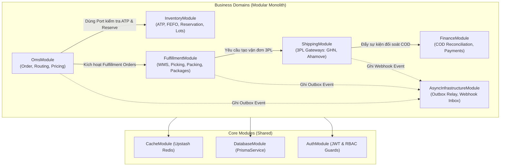
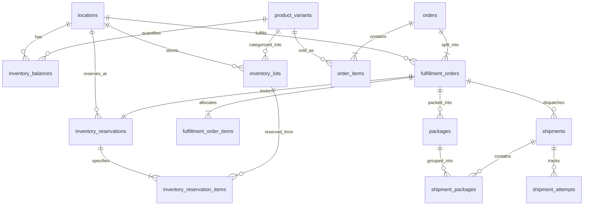
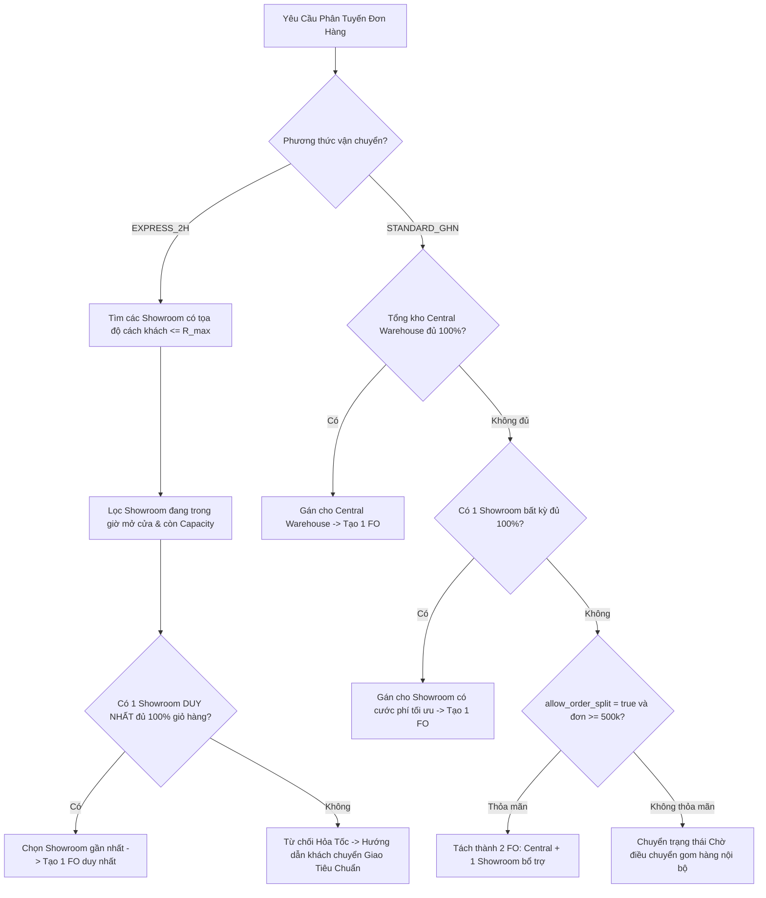

# Kế Hoạch Triển Khai Kỹ Thuật (Implementation Blueprint) Hệ Thống Fulfillment, Logistics Đa Đối Tác & Hậu Mãi (RMA) — GlowUp

> **Dự án:** GlowUp — Chuỗi Bán Lẻ Mỹ Phẩm Đa Kênh (Omnichannel Cosmetics Retail)  
> **Mã tài liệu:** `DES-06-FULFILLMENT-IMPLEMENTATION-PLAN`  
> **Tài liệu nguồn baseline:** `DES-05-FULFILLMENT-LOGISTICS-RMA v3.1-ENTERPRISE`  
> **Ngày phê duyệt:** 15/11/2026  
> **Vai trò tác giả:** Senior Backend Architect / Technical Lead  
> **Trạng thái:** Sẵn Sàng Triển Khai Code (Ready for Implementation - P0 Focus)  
> **Mục tiêu:** Chuyển hóa toàn bộ thiết kế nghiệp vụ & kiến trúc sang Kế hoạch Kỹ thuật Thực thi chi tiết (Implementation Blueprint) cho đội ngũ kỹ sư và Coding Agents.

---

## Mục Lục Tài Liệu

1. [Báo Cáo Đánh Giá Sẵn Sàng Triển Khai (Implementation Readiness Report)](#1-báo-cáo-đánh-giá-sẵn-sàng-triển-khai-implementation-readiness-report)
2. [Phân Tích Hiện Trạng Repository Thực Tế (Existing Repository Gap Analysis)](#2-phân-tích-hiện-trạng-repository-thực-tế-existing-repository-gap-analysis)
3. [Phạm Vi Triển Khai P0 & Định Nghĩa Hoàn Thành (P0 Scope & Definition of Done)](#3-phạm-vi-triển-khai-p0--định-nghĩa-hoàn-thành-p0-scope--definition-of-done)
4. [Ranh Giới Module Trong NestJS Modular Monolith (Module Boundaries)](#4-ranh-giới-module-trong-nestjs-modular-monolith-module-boundaries)
5. [Cấu Trúc Thư Mục Triển Khai Chi Tiết (Folder Structure)](#5-cấu-trúc-thư-mục-triển-khai-chi-tiết-folder-structure)
6. [Sơ Đồ Thực Thể Quan Hệ P0 (Database ERD P0)](#6-sơ-đồ-thực-thể-quan-hệ-p0-database-erd-p0)
7. [PostgreSQL DDL P0 & Ràng Buộc Nâng Cao (PostgreSQL DDL Specification)](#7-postgresql-ddl-p0--ràng-buộc-nâng-cao-postgresql-ddl-specification)
8. [Prisma Models P0 Hoàn Chỉnh (Production Prisma Models)](#8-prisma-models-p0-hoàn-chỉnh-production-prisma-models)
9. [Chiến Lược Ràng Buộc & Tối Ưu Chỉ Mục (Constraints & Indexes Strategy)](#9-chiến-lược-ràng-buộc--tối-ưu-chỉ-mục-constraints--indexes-strategy)
10. [Ranh Giới Giao Dịch Dữ Liệu Từng Nghiệp Vụ (Transaction Boundaries)](#10-ranh-giới-giao-dịch-dữ-liệu-từng-nghiệp-vụ-transaction-boundaries)
11. [Chiến Lược Khóa Đồng Thời Giữ Chỗ Tồn Kho (Concurrency & Anti-Overselling)](#11-chiến-lược-khóa-đồng-thời-giữ-chỗ-tồn-kho-concurrency--anti-overselling)
12. [Thuật Toán Phân Bổ Lô Xuất Kho Theo Hạn Dùng (FEFO Algorithm)](#12-thuật-toán-phân-bổ-lô-xuất-kho-theo-hạn-dùng-fefo-algorithm)
13. [Thuật Toán Phân Tuyến Đơn Hàng Hỗn Hợp (OMS Routing Algorithm)](#13-thuật-toán-phân-tuyến-đơn-hàng-hỗn-hợp-oms-routing-algorithm)
14. [Ma Trận Chuyển Trạng Thái Miền Nghiệp Vụ P0 (State Transition Matrix)](#14-ma-trận-chuyển-trạng-thái-miền-nghiệp-vụ-p0-state-transition-matrix)
15. [Hàng Đợi Công Việc Quản Trị & Ma Trận Action (Admin Work Queues & Actions)](#15-hàng-đợi-công-việc-quản-trị--ma-trận-action-admin-work-queues--actions)
16. [Đặc Tả Hợp Đồng API Cốt Lõi P0 (API Contracts & DTOs)](#16-đặc-tả-hợp-đồng-api-cốt-lõi-p0-api-contracts--dtos)
17. [Đặc Tả Hợp Đồng Sự Kiện Miền (Domain Event Contracts)](#17-đặc-tả-hợp-đồng-sự-kiện-miền-domain-event-contracts)
18. [Thiết Kế Transactional Outbox Publisher](#18-thiết-kế-transactional-outbox-publisher)
19. [Thiết Kế Cloudflare Queue Consumer & Internal Command Dispatcher](#19-thiết-kế-cloudflare-queue-consumer--internal-command-dispatcher)
20. [Thiết Kế Bộ Chuyển Đổi Vận Chuyển 3PL: GHN & Ahamove (Carrier Adapters)](#20-thiết-kế-bộ-chuyển-đổi-vận-chuyển-3pl-ghn--ahamove-carrier-adapters)
21. [Hộp Thư Webhook Bền Vững & Chống Trùng Lặp (Webhook Inbox & Idempotency)](#21-hộp-thư-webhook-bền-vững--chống-trùng-lặp-webhook-inbox--idempotency)
22. [Chiến Lược Quản Lý Lỗi & Phục Hồi Dữ Liệu (Error Handling & Recovery)](#22-chiến-lược-quản-lý-lỗi--phục-hồi-dữ-liệu-error-handling--recovery)
23. [Kế Hoạch Kiểm Thử Toàn Diện (Unit / Integration / E2E Test Plan)](#23-kế-hoạch-kiểm-thử-toàn-diện-unit--integration--e2e-test-plan)
24. [Thứ Tự Thực Thi Migration Cơ Sở Dữ Liệu (Database Migration Order)](#24-thứ-tự-thực-thi-migration-cơ-sở-dữ-liệu-database-migration-order)
25. [Danh Mục Triển Khai Phụ Thuộc (Implementation Backlog: EPIC 01 -> 12)](#25-danh-mục-triển-khai-phụ-thuộc-implementation-backlog-epic-01---12)
26. [Danh Sách Quyết Định Cần Phê Duyệt Trước Khi Bắt Đầu Epic 01](#26-danh-sách-quyết-định-cần-phê-duyệt-trước-khi-bắt-đầu-epic-01)

---

## 1. Báo Cáo Đánh Giá Sẵn Sàng Triển Khai (Implementation Readiness Report)

Rà soát kỹ thuật độc lập trên tài liệu `DES-05 v3.1` nhằm phát hiện các mâu thuẫn giữa Business Rules, Database Schema, State Machine và API trước khi viết code:

| STT | Vấn Đề Kỹ Thuật Được Rà Soát | Phân Tích Thực Trạng v3.1 & Rủi Ro Phát Sinh | Phân Loại Mức Độ | Hành Động Kỹ Thuật Khắc Phục Bắt Buộc |
| :--- | :--- | :--- | :--- | :--- |
| 1 | **Order Status độc lập với Return Status** | v3.1 đã chỉ rõ việc Order chuyển `COMPLETED` sau 24h giao hàng không chờ RMA, nhưng bảng `Order.status` hiện vẫn còn enum `RETURNED` và `PARTIALLY_RETURNED` dễ gây nhầm lẫn với trạng thái hủy/hoàn toàn bộ đơn. | `BLOCKER` | Bổ sung trường `return_status` độc lập trên `Order` hoặc chỉ cập nhật `Order.status = RETURNED` khi 100% item bị hoàn tiền, giữ `Order.status = COMPLETED` nếu chỉ trả một phần. |
| 2 | **Shipment đa mục đích (OUTBOUND, RETURN_PICKUP, TRANSFER)** | Schema DDL v3.1 đã có cột `shipment_type` và `return_request_id`, nhưng bảng `shipment_packages` chưa chỉ rõ ràng buộc cho kiện hàng chuyển kho (`INTER_STORE_TRANSFER`). | `HIGH` | Hoàn thiện quan hệ khóa ngoại nullable kèm constraint `CHECK` toàn vẹn: Outbound gắn `fulfillment_order_id`, Return gắn `return_request_id`, Transfer gắn `inventory_transfer_id`. |
| 3 | **RMA Partial Return, Partial Inspection & Settlement** | v3.1 đã có bảng `return_items`, `return_inspection_items`. Tuy nhiên, chưa có cơ chế tính trạng thái tổng hợp cho Return Request khi 1 item PASS (hoàn tiền) và 1 item FAIL (trả lại khách). | `LATER` (P1) | Đưa vào backlog P1: Xây dựng hàm `aggregateReturnRequestStatus()` dựa trên tập hợp `inspection_status` của từng dòng `return_items`. |
| 4 | **Refund liên kết Order Item & Phân bổ tiền thực trả** | Thuật toán v3.1 đã có công thức `UnitNetPrice`, nhưng bảng `refunds` trong schema v3.1 mới chỉ lưu tổng `amount` mà chưa có bảng chi tiết `refund_items` trỏ về `order_item_id`. | `BLOCKER` | Bổ sung bảng `refund_items` (`refund_id`, `order_item_id`, `amount`, `points_restored`) để kiểm soát chống hoàn trùng từng dòng. |
| 5 | **Reservation với nhiều Fulfillment Orders & Locations** | v3.1 đã gắn `inventory_reservations` vào `fulfillment_order_id`. Đây là giải pháp hoàn toàn đúng đắn cho Split Fulfillment. | `RESOLVED` | Giữ nguyên kiến trúc v3.1: 1 Order có N Fulfillment Orders $\rightarrow$ Mỗi FO có 1 Reservation tại đúng Location xuất hàng. |
| 6 | **Nhất quán giữa Inventory Balance, Lots và Ledger** | v3.1 có 3 bảng (`inventory_balances`, `inventory_lots`, `inventory_transactions`), nhưng thiếu cơ chế bảo đảm rằng tổng `quantity_on_hand` của các lots tại 1 location phải bằng chính xác `physical_on_hand` của balance. | `BLOCKER` | Bổ sung PostgreSQL Trigger hoặc Transactional Encapsulation: Mọi biến động kho bắt buộc ghi qua `inventory_transactions`, đồng thời cập nhật cả `inventory_lots` và `inventory_balances` trong cùng một transaction. |
| 7 | **Outbox và Webhook Inbox chịu lỗi, retry và crash** | v3.1 thiết kế Ingress enqueue trước khi trả 200 OK. Tuy nhiên, Outbox Publisher chưa mô tả chi tiết cơ chế khóa bản ghi chống 2 worker cùng xử lý 1 event. | `HIGH` | Áp dụng cú pháp `SELECT ... FOR UPDATE SKIP LOCKED` trong Outbox Relay Worker để bảo đảm worker concurrency an toàn tuyệt đối. |
| 8 | **Shipping Provider có API version và status mapping riêng** | v3.1 đã định nghĩa riêng 2 mapper cho GHN và Ahamove. Cần chuẩn hóa cấu trúc interface và cấu hình URL theo biến môi trường. | `HIGH` | Đưa toàn bộ config URL, Secret, ShopId vào `ConfigService` có validate bằng Joi/Zod, tách module `shipping` thành các Adapter độc lập. |
| 9 | **Xử lý trạng thái đối tác không xác định (Unknown Status)** | Trong v3.1, mapper Ahamove và GHN có fallback `default: return 'IN_TRANSIT'`. Điều này cực kỳ nguy hiểm vì một mã lỗi lạ có thể bị hiểu nhầm là hàng đang đi giao! | `BLOCKER` | **SỬA NGAY:** Fallback bắt buộc chuyển về `'EXCEPTION'` (hoặc giữ nguyên trạng thái cũ), đồng thời ghi log WARN và tạo cảnh báo Unmapped Status lên hệ thống. |
| 10 | **Admin Work Queues, Actions, RBAC & Location Scope** | v3.1 đã có ma trận action. Cần chuẩn hóa thành NestJS Guards (`JwtAuthGuard`, `RolesGuard`, `LocationScopeGuard`). | `HIGH` | Triển khai Decorator `@RequirePermission()` và `@LocationScoped()` áp dụng trực tiếp lên các Admin Command Endpoints. |
| 11 | **Hoàn tất Packing bất đồng bộ với tạo Shipment** | v3.1 có nguy cơ timeout nếu API hoàn tất packing đồng thời chờ gọi HTTP sang GHN/Ahamove (mạng chậm 10–15s). | `HIGH` | Tách làm 2 bước: Bấm hoàn tất packing $\rightarrow$ Đổi FO sang `PACKED`, tạo `Shipment` ở trạng thái `PENDING_CREATION` $\rightarrow$ Đẩy task tạo vận đơn sang Queue hoặc xử lý async, trả kết quả ngay cho nhân viên đóng gói. |
| 12 | **Các quyết định OPEN DECISION (DEC-01 đến DEC-05)** | Các tham số bán kính 10km, phí ship thu hồi 30k, hao hụt kích ứng 20% đang là đề xuất. | `HIGH` | Không hardcode trong code logic. Toàn bộ tham số này phải được đọc từ bảng `system_settings` hoặc `return_policy_rules`. |

---

## 2. Phân Tích Hiện Trạng Repository Thực Tế (Existing Repository Gap Analysis)

Khảo sát trực tiếp trên mã nguồn NestJS hiện hữu tại `d:\VS_Code\DUT\PBL6\backend`:

```
+------------------------------------------------------------------------------------------------------------------------+
|                                    KẾT QUẢ RÀ SOÁT MÃ NGUỒN BACKEND HIỆN TẠI                                           |
+--------------------------+------------------------------+--------------------------------------------------------------+
| PHÂN HỆ NGHIỆP VỤ        | TRẠNG THÁI HIỆN TẠI TRONG REPO| ĐÁNH GIÁ KỸ THUẬT & HƯỚNG XỬ LÝ (REFACTOR / NEW)            |
+--------------------------+------------------------------+--------------------------------------------------------------+
| Cache & Redis            | [ĐÃ CÓ & HOẠT ĐỘNG TỐT]      | `UpstashRedisService` tại `@core/cache/upstash-redis.service`|
|                          |                              | chạy qua HTTP REST, có prefix, timeout, health check. Tái    |
|                          |                              | sử dụng 100% làm Cache-Aside cho P0.                         |
+--------------------------+------------------------------+--------------------------------------------------------------+
| Auth & Location Scope    | [ĐÃ CÓ & CẦN MỞ RỘNG]        | Đã có `User`, `Role`, `Permission`, và đặc biệt bảng         |
|                          |                              | `user_stores` (map user_id -> store_id). Cần viết thêm       |
|                          |                              | `LocationScopeGuard` để chặn nhân viên thao tác chéo shop.   |
+--------------------------+------------------------------+--------------------------------------------------------------+
| Location & Store         | [ĐÃ CÓ & CẦN MỞ RỘNG]        | Bảng `stores` đã có name, code, type, address, lat, long,    |
|                          |                              | capacity. Đổi tên alias hoặc mapping sang concept `Location`.|
+--------------------------+------------------------------+--------------------------------------------------------------+
| Inventory & Batches      | [ĐÃ CÓ NHƯNG CẦN REFACTOR]   | Bảng `inventory` và `batches` đã có. Tuy nhiên, checkout     |
|                          |                              | hiện tại (`CommerceCheckoutService`) chỉ lock trên bảng       |
|                          |                              | `inventory` mà CHƯA phân bổ theo Lô `batches` (FEFO).        |
+--------------------------+------------------------------+--------------------------------------------------------------+
| OMS & Checkout           | [ĐÃ CÓ NHƯNG CẦN REFACTOR]   | `CommerceCheckoutService.create()` đã có khóa hàng FOR UPDATE|
|                          |                              | và sequence mã đơn. Nhưng chỉ hỗ trợ 1 store duy nhất,       |
|                          |                              | chưa có Split Fulfillment, chưa có Outbox Pattern.          |
+--------------------------+------------------------------+--------------------------------------------------------------+
| Fulfillment / WMS        | [CHƯA CÓ]                    | Chưa có `fulfillment_orders`, `packages`, `picking_tasks`.   |
|                          |                              | Cần tạo mới hoàn toàn trong module `fulfillment`.            |
+--------------------------+------------------------------+--------------------------------------------------------------+
| Shipping & 3PL Adapters  | [CHƯA CÓ]                    | Bảng `shipments` cũ chỉ có vài trường cơ bản gắn trực tiếp vào|
|                          |                              | `order_id`. Chưa có adapter GHN, Ahamove, quotes. Cần viết   |
|                          |                              | mới module `shipping`.                                       |
+--------------------------+------------------------------+--------------------------------------------------------------+
| Cloudflare Queues/Worker | [CHƯA CÓ]                    | Chưa có code Worker/Queue nào trong repo. Cần tạo thư mục    |
|                          |                              | `cloudflare-workers/` ở root dự án và Outbox Relay trong BE. |
+--------------------------+------------------------------+--------------------------------------------------------------+
| COD Reconciliation       | [CHƯA CÓ]                    | Chưa có bảng đối soát COD. Cần tạo mới trong P0.             |
+--------------------------+------------------------------+--------------------------------------------------------------+
| RMA & Reverse Logistics  | [ĐÃ CÓ CƠ BẢN NHƯNG ĐỂ P1]   | Đã có `ReturnOrder`, `ReturnOrderItem` sơ khởi. Sẽ refactor  |
|                          |                              | hoàn chỉnh ở giai đoạn P1.                                   |
+--------------------------+------------------------------+--------------------------------------------------------------+
```

---

## 3. Phạm Vi Triển Khai P0 & Định Nghĩa Hoàn Thành (P0 Scope & Definition of Done)

### 3.1 Phạm Vi Chi Tiết Giai Đoạn P0
P0 tập trung hoàn thiện chu trình khép kín: **Khách đặt hàng $\rightarrow$ Phân tuyến kho/cửa hàng $\rightarrow$ Giữ chỗ lô FEFO $\rightarrow$ Nhặt hàng đóng gói WMS $\rightarrow$ Tạo vận đơn 3PL (GHN/Ahamove) $\rightarrow$ Giao hàng $\rightarrow$ Webhook cập nhật hành trình $\rightarrow$ Đối soát COD cơ bản**.

1. **A. Location & Inventory:** Quản lý địa điểm, Tồn kho ATP, Lô hàng có HSD, Phân bổ FEFO, Atomic Reservation đa điểm, Transaction Ledger.
2. **B. OMS & Routing:** Tạo đơn hàng, Báo giá vận chuyển, Thuật toán phân tuyến hỗn hợp (Express 2H đơn lẻ, Tiêu chuẩn ưu tiên Central WH, Split có kiểm soát).
3. **C. Fulfillment & WMS:** Quản lý Fulfillment Order, Danh sách nhặt hàng (Pick List), Đóng gói cân đo thực tế (Packages), Bàn giao shipper.
4. **D. Shipping 3PL:** Interface chuẩn, Adapter GHN API v2, Adapter Ahamove API, Xử lý timeout `CREATION_UNKNOWN`.
5. **E. Hạ Tầng Bất Đồng Bộ:** Bảng Transactional Outbox, Cloudflare Worker Ingress, Cloudflare Queue Consumer, Webhook Inbox chống trùng.
6. **F. Payment & COD:** Quản lý 4 giai đoạn COD (`EXPECTED` $\rightarrow$ `COLLECTED` $\rightarrow$ `SETTLEMENT_PENDING` $\rightarrow$ `SETTLED`), bảng kê đối soát bưu kiện.

### 3.2 Tiêu Chuẩn Nghiệm Thu P0 (Definition of Done - DoD)
* [ ] 100% Prisma migrations cho P0 chạy thành công trên PostgreSQL 16 không lỗi cú pháp.
* [ ] Concurrency test: 100 concurrent requests cùng đặt 1 SKU cuối cùng chỉ có đúng 1 request thành công, 99 request trả 409 Conflict, không bị âm kho (Zero Overselling).
* [ ] Thuật toán FEFO chọn chính xác lô có hạn sử dụng gần nhất thỏa mãn `MinRemainingShelfLifeDays`.
* [ ] Gọi thành công Sandbox API của GHN và Ahamove, sinh mã vận đơn thật và nhận Webhook mô phỏng.
* [ ] Webhook Ingress xử lý được duplicate event mà không đổi trạng thái đơn lần thứ hai.
* [ ] Outbox Relay quét và gửi message sang Cloudflare Queue không bị rớt khi crash process.
* [ ] Unit Test đạt độ bao phủ $\ge 85\%$ cho các Domain Services cốt lõi (Routing, FEFO, Pricing, State Machine).

---

## 4. Ranh Giới Module Trong NestJS Modular Monolith (Module Boundaries)

Kiến trúc tuân thủ nghiêm ngặt nguyên lý **Hexagonal / Clean Architecture** bên trong từng module NestJS. Tuyệt đối không import chéo Service tầng Infrastructure của nhau, giao tiếp liên module thông qua Application Ports hoặc Event Contracts:



---

## 5. Cấu Trúc Thư Mục Triển Khai Chi Tiết (Folder Structure)

```
backend/src/
├── core/
│   ├── cache/                          # Upstash Redis đã có
│   ├── domain/                         # Value Objects & Common Enums
│   ├── guards/
│   │   ├── location-scope.guard.ts     # [MỚI] Chặn thao tác chéo chi nhánh
│   │   └── rbac.guard.ts               # Phân quyền vai trò
│   └── interceptors/
├── modules/
│   ├── inventory/                      # [REFACTOR & MỞ RỘNG]
│   │   ├── application/
│   │   │   ├── services/
│   │   │   │   ├── atp-calculator.service.ts
│   │   │   │   ├── fefo-allocation.service.ts
│   │   │   │   └── inventory-reservation.service.ts
│   │   │   └── use-cases/
│   │   ├── domain/
│   │   │   ├── entities/
│   │   │   └── repositories/
│   │   └── infrastructure/
│   ├── oms/                            # [MỚI - Tách từ Orders]
│   │   ├── application/
│   │   │   ├── routing/
│   │   │   │   ├── express-routing.strategy.ts
│   │   │   │   ├── standard-routing.strategy.ts
│   │   │   │   └── hybrid-order-router.ts
│   │   │   └── use-cases/create-order.use-case.ts
│   ├── fulfillment/                    # [MỚI - WMS Operations]
│   │   ├── application/
│   │   │   ├── services/
│   │   │   │   ├── picking.service.ts
│   │   │   │   └── packing.service.ts
│   │   ├── presentation/
│   │   │   └── controllers/admin-fulfillment.controller.ts
│   ├── shipping/                       # [MỚI - 3PL Gateways]
│   │   ├── domain/ports/shipping-provider.interface.ts
│   │   ├── infrastructure/adapters/
│   │   │   ├── ghn/
│   │   │   │   ├── ghn-client.ts
│   │   │   │   └── ghn-status.mapper.ts
│   │   │   ├── ahamove/
│   │   │   │   ├── ahamove-client.ts
│   │   │   │   └── ahamove-status.mapper.ts
│   │   │   └── mock/mock-shipping.provider.ts
│   │   └── application/services/shipment-orchestrator.service.ts
│   └── async-infrastructure/           # [MỚI - Outbox & Queue Handlers]
│       ├── outbox/
│       │   ├── outbox-publisher.service.ts
│       │   └── outbox-relay.cron.ts
│       └── webhooks/
│           ├── webhook-inbox.service.ts
│           └── internal-webhook.controller.ts
```

---

## 6. Sơ Đồ Thực Thể Quan Hệ P0 (Database ERD P0)



---

## 7. PostgreSQL DDL P0 & Ràng Buộc Nâng Cao (PostgreSQL DDL Specification)

```sql
-- DDL KHỞI TẠO CÁC BẢNG P0 TRÊN POSTGRESQL 16
CREATE EXTENSION IF NOT EXISTS "uuid-ossp";

-- 1. BẢNG LOCATIONS (Địa điểm kho/cửa hàng)
CREATE TABLE locations (
    id UUID PRIMARY KEY DEFAULT gen_random_uuid(),
    code VARCHAR(50) UNIQUE NOT NULL,
    name VARCHAR(150) NOT NULL,
    type VARCHAR(30) NOT NULL, -- 'CENTRAL_WAREHOUSE', 'RETAIL_STORE', 'TRANSIT_HUB'
    address JSONB NOT NULL,
    latitude DECIMAL(10, 7),
    longitude DECIMAL(10, 7),
    is_active BOOLEAN DEFAULT TRUE,
    fulfillment_capacity_per_day INT DEFAULT 500 CHECK (fulfillment_capacity_per_day >= 0),
    created_at TIMESTAMPTZ DEFAULT NOW(),
    updated_at TIMESTAMPTZ DEFAULT NOW()
);

-- 2. TỒN KHO THEO ĐỊA ĐIỂM (Aggregated Balances)
CREATE TABLE inventory_balances (
    id UUID PRIMARY KEY DEFAULT gen_random_uuid(),
    location_id UUID NOT NULL REFERENCES locations(id) ON DELETE RESTRICT,
    product_variant_id UUID NOT NULL REFERENCES product_variants(id) ON DELETE RESTRICT,
    physical_on_hand INT NOT NULL DEFAULT 0 CHECK (physical_on_hand >= 0),
    reserved_quantity INT NOT NULL DEFAULT 0 CHECK (reserved_quantity >= 0),
    safety_stock INT NOT NULL DEFAULT 0 CHECK (safety_stock >= 0),
    quarantined_quantity INT NOT NULL DEFAULT 0 CHECK (quarantined_quantity >= 0),
    damaged_quantity INT NOT NULL DEFAULT 0 CHECK (damaged_quantity >= 0),
    updated_at TIMESTAMPTZ DEFAULT NOW(),
    CONSTRAINT uq_balance_location_variant UNIQUE (location_id, product_variant_id),
    CONSTRAINT chk_balances_logical CHECK (physical_on_hand >= (reserved_quantity + quarantined_quantity + damaged_quantity))
);
CREATE INDEX idx_inv_balances_lookup ON inventory_balances(location_id, product_variant_id);

-- 3. LÔ HÀNG HẠN DÙNG (FEFO Lots)
CREATE TABLE inventory_lots (
    id UUID PRIMARY KEY DEFAULT gen_random_uuid(),
    location_id UUID NOT NULL REFERENCES locations(id) ON DELETE RESTRICT,
    product_variant_id UUID NOT NULL REFERENCES product_variants(id) ON DELETE RESTRICT,
    batch_code VARCHAR(100) NOT NULL,
    expiry_date DATE NOT NULL,
    quantity_on_hand INT NOT NULL DEFAULT 0 CHECK (quantity_on_hand >= 0),
    quantity_reserved INT NOT NULL DEFAULT 0 CHECK (quantity_reserved >= 0),
    created_at TIMESTAMPTZ DEFAULT NOW(),
    updated_at TIMESTAMPTZ DEFAULT NOW(),
    CONSTRAINT uq_lot_batch UNIQUE (location_id, product_variant_id, batch_code),
    CONSTRAINT chk_lot_quantities CHECK (quantity_on_hand >= quantity_reserved)
);
CREATE INDEX idx_lots_fefo_search ON inventory_lots(location_id, product_variant_id, expiry_date ASC);

-- 4. FULFILLMENT ORDERS (Đơn hoàn tất theo điểm)
CREATE TABLE fulfillment_orders (
    id UUID PRIMARY KEY DEFAULT gen_random_uuid(),
    order_id UUID NOT NULL REFERENCES orders(id) ON DELETE RESTRICT,
    fulfillment_order_number VARCHAR(60) UNIQUE NOT NULL,
    source_location_id UUID NOT NULL REFERENCES locations(id) ON DELETE RESTRICT,
    status VARCHAR(35) NOT NULL, -- 'PENDING_ALLOCATION', 'ALLOCATED', 'PICKING', 'PICKED', 'PACKING', 'PACKED', 'READY_FOR_HANDOVER', 'HANDED_OVER', 'COMPLETED', 'CANCELLED'
    shipping_service_code VARCHAR(50) NOT NULL,
    total_items_count INT NOT NULL CHECK (total_items_count > 0),
    assigned_picker_id UUID,
    allocated_at TIMESTAMPTZ,
    packed_at TIMESTAMPTZ,
    handed_over_at TIMESTAMPTZ,
    created_at TIMESTAMPTZ DEFAULT NOW(),
    updated_at TIMESTAMPTZ DEFAULT NOW()
);
CREATE INDEX idx_fo_status_loc ON fulfillment_orders(source_location_id, status);

CREATE TABLE fulfillment_order_items (
    id UUID PRIMARY KEY DEFAULT gen_random_uuid(),
    fulfillment_order_id UUID NOT NULL REFERENCES fulfillment_orders(id) ON DELETE CASCADE,
    order_item_id UUID NOT NULL REFERENCES order_items(id) ON DELETE RESTRICT,
    product_variant_id UUID NOT NULL REFERENCES product_variants(id) ON DELETE RESTRICT,
    quantity_requested INT NOT NULL CHECK (quantity_requested > 0),
    quantity_fulfilled INT DEFAULT 0 CHECK (quantity_fulfilled >= 0),
    created_at TIMESTAMPTZ DEFAULT NOW(),
    CONSTRAINT chk_fulfilled_le_requested CHECK (quantity_fulfilled <= quantity_requested)
);

-- 5. RESERVATIONS (Gắn chặt với Fulfillment Order)
CREATE TABLE inventory_reservations (
    id UUID PRIMARY KEY DEFAULT gen_random_uuid(),
    order_id UUID NOT NULL REFERENCES orders(id) ON DELETE CASCADE,
    fulfillment_order_id UUID NOT NULL UNIQUE REFERENCES fulfillment_orders(id) ON DELETE CASCADE,
    location_id UUID NOT NULL REFERENCES locations(id) ON DELETE RESTRICT,
    status VARCHAR(30) NOT NULL, -- 'ACTIVE', 'CONFIRMED', 'RELEASED', 'EXPIRED'
    expires_at TIMESTAMPTZ NOT NULL,
    created_at TIMESTAMPTZ DEFAULT NOW(),
    updated_at TIMESTAMPTZ DEFAULT NOW()
);
CREATE INDEX idx_res_cleanup ON inventory_reservations(status, expires_at);

CREATE TABLE inventory_reservation_items (
    id UUID PRIMARY KEY DEFAULT gen_random_uuid(),
    reservation_id UUID NOT NULL REFERENCES inventory_reservations(id) ON DELETE CASCADE,
    product_variant_id UUID NOT NULL REFERENCES product_variants(id) ON DELETE RESTRICT,
    lot_id UUID NOT NULL REFERENCES inventory_lots(id) ON DELETE RESTRICT,
    quantity INT NOT NULL CHECK (quantity > 0)
);

-- 6. PACKAGING & SHIPMENTS
CREATE TABLE packages (
    id UUID PRIMARY KEY DEFAULT gen_random_uuid(),
    fulfillment_order_id UUID NOT NULL REFERENCES fulfillment_orders(id) ON DELETE RESTRICT,
    package_code VARCHAR(60) UNIQUE NOT NULL,
    actual_weight_grams INT NOT NULL CHECK (actual_weight_grams > 0),
    length_cm INT NOT NULL CHECK (length_cm > 0),
    width_cm INT NOT NULL CHECK (width_cm > 0),
    height_cm INT NOT NULL CHECK (height_cm > 0),
    packed_by UUID NOT NULL,
    sealed_at TIMESTAMPTZ DEFAULT NOW(),
    created_at TIMESTAMPTZ DEFAULT NOW()
);

CREATE TABLE package_items (
    id UUID PRIMARY KEY DEFAULT gen_random_uuid(),
    package_id UUID NOT NULL REFERENCES packages(id) ON DELETE CASCADE,
    product_variant_id UUID NOT NULL REFERENCES product_variants(id) ON DELETE RESTRICT,
    quantity INT NOT NULL CHECK (quantity > 0)
);

CREATE TABLE shipments (
    id UUID PRIMARY KEY DEFAULT gen_random_uuid(),
    shipment_code VARCHAR(60) UNIQUE NOT NULL,
    shipment_type VARCHAR(30) NOT NULL DEFAULT 'OUTBOUND', -- 'OUTBOUND', 'RETURN_PICKUP', 'INTER_STORE_TRANSFER'
    fulfillment_order_id UUID REFERENCES fulfillment_orders(id) ON DELETE RESTRICT,
    return_request_id UUID, -- Liên kết RMA ở P1
    carrier_code VARCHAR(50) NOT NULL, -- 'GHN', 'AHAMOVE'
    carrier_service_code VARCHAR(50) NOT NULL,
    tracking_code VARCHAR(100) UNIQUE,
    carrier_reference_id VARCHAR(100),
    status VARCHAR(35) NOT NULL, -- 'PENDING_CREATION', 'CREATION_UNKNOWN', 'CREATED', 'DRIVER_ASSIGNED', 'PICKED_UP', 'IN_TRANSIT', 'OUT_FOR_DELIVERY', 'DELIVERED', 'DELIVERY_FAILED', 'RETURNING', 'RETURNED', 'CANCELLED', 'EXCEPTION'
    cod_amount DECIMAL(12, 2) DEFAULT 0 CHECK (cod_amount >= 0),
    cod_status VARCHAR(30) DEFAULT 'COD_EXPECTED', -- 'COD_EXPECTED', 'COD_COLLECTED', 'SETTLEMENT_PENDING', 'SETTLED', 'SETTLEMENT_DISCREPANCY'
    actual_shipping_fee DECIMAL(12, 2) DEFAULT 0,
    shipping_label_url TEXT,
    tracking_url TEXT,
    failed_attempts_count INT DEFAULT 0,
    handed_over_at TIMESTAMPTZ,
    delivered_at TIMESTAMPTZ,
    created_at TIMESTAMPTZ DEFAULT NOW(),
    updated_at TIMESTAMPTZ DEFAULT NOW(),
    CONSTRAINT chk_shipment_type_rel CHECK (
        (shipment_type = 'OUTBOUND' AND fulfillment_order_id IS NOT NULL) OR
        (shipment_type = 'RETURN_PICKUP' AND return_request_id IS NOT NULL) OR
        (shipment_type = 'INTER_STORE_TRANSFER')
    )
);
CREATE INDEX idx_shipments_tracking ON shipments(carrier_code, tracking_code);

CREATE TABLE shipment_packages (
    id UUID PRIMARY KEY DEFAULT gen_random_uuid(),
    shipment_id UUID NOT NULL REFERENCES shipments(id) ON DELETE CASCADE,
    package_id UUID NOT NULL REFERENCES packages(id) ON DELETE RESTRICT,
    created_at TIMESTAMPTZ DEFAULT NOW(),
    CONSTRAINT uq_shipment_package UNIQUE (shipment_id, package_id)
);

CREATE TABLE shipment_attempts (
    id UUID PRIMARY KEY DEFAULT gen_random_uuid(),
    shipment_id UUID NOT NULL REFERENCES shipments(id) ON DELETE CASCADE,
    attempt_number INT NOT NULL,
    attempted_at TIMESTAMPTZ NOT NULL,
    failure_reason_code VARCHAR(50),
    failure_reason_detail TEXT,
    carrier_raw_status VARCHAR(50),
    created_at TIMESTAMPTZ DEFAULT NOW(),
    CONSTRAINT uq_shipment_attempt UNIQUE (shipment_id, attempt_number)
);

-- 7. ASYNC INFRASTRUCTURE TABLES
CREATE TABLE outbox_events (
    id UUID PRIMARY KEY DEFAULT gen_random_uuid(),
    aggregate_type VARCHAR(60) NOT NULL,
    aggregate_id UUID NOT NULL,
    event_type VARCHAR(80) NOT NULL,
    payload JSONB NOT NULL,
    status VARCHAR(30) DEFAULT 'PENDING', -- 'PENDING', 'PUBLISHED', 'FAILED'
    retry_count INT DEFAULT 0,
    published_at TIMESTAMPTZ,
    created_at TIMESTAMPTZ DEFAULT NOW()
);
CREATE INDEX idx_outbox_unprocessed ON outbox_events(status, created_at);

CREATE TABLE shipping_webhook_inbox (
    id UUID PRIMARY KEY DEFAULT gen_random_uuid(),
    carrier_code VARCHAR(50) NOT NULL,
    event_id VARCHAR(150) NOT NULL,
    event_type VARCHAR(80),
    tracking_code VARCHAR(100),
    payload JSONB NOT NULL,
    processed_status VARCHAR(30) DEFAULT 'PENDING', -- 'PENDING', 'PROCESSED', 'FAILED', 'IGNORED'
    error_message TEXT,
    received_at TIMESTAMPTZ DEFAULT NOW(),
    processed_at TIMESTAMPTZ,
    CONSTRAINT uq_webhook_carrier_event UNIQUE (carrier_code, event_id)
);

-- 8. COD RECONCILIATIONS
CREATE TABLE cod_reconciliations (
    id UUID PRIMARY KEY DEFAULT gen_random_uuid(),
    reconciliation_code VARCHAR(60) UNIQUE NOT NULL,
    carrier_code VARCHAR(50) NOT NULL,
    reconciliation_date DATE NOT NULL,
    total_cod_declared DECIMAL(14, 2) NOT NULL,
    total_cod_received DECIMAL(14, 2) NOT NULL,
    difference_amount DECIMAL(14, 2) DEFAULT 0,
    status VARCHAR(30) NOT NULL, -- 'PENDING_APPROVAL', 'APPROVED', 'DISCREPANCY_FLAGGED'
    bank_statement_ref VARCHAR(100),
    approved_by UUID,
    created_at TIMESTAMPTZ DEFAULT NOW()
);

CREATE TABLE cod_reconciliation_items (
    id UUID PRIMARY KEY DEFAULT gen_random_uuid(),
    reconciliation_id UUID NOT NULL REFERENCES cod_reconciliations(id) ON DELETE CASCADE,
    shipment_id UUID NOT NULL REFERENCES shipments(id) ON DELETE RESTRICT,
    declared_cod_amount DECIMAL(12, 2) NOT NULL,
    carrier_paid_cod_amount DECIMAL(12, 2) NOT NULL,
    discrepancy_amount DECIMAL(12, 2) DEFAULT 0,
    carrier_fee_charged DECIMAL(12, 2) DEFAULT 0,
    status VARCHAR(30) NOT NULL -- 'MATCHED', 'DISCREPANCY'
);
```

---

## 8. Prisma Models P0 Hoàn Chỉnh (Production Prisma Models)

Dưới đây là đoạn mã Prisma Schema chuẩn hóa để tích hợp trực tiếp vào `backend/prisma/schema.prisma`:

```prisma
// =============================================================================
// FULFILLMENT & INVENTORY P0 EXTENSIONS
// =============================================================================

model Location {
  id                        String              @id @default(uuid()) @db.Uuid
  code                      String              @unique @db.VarChar(50)
  name                      String              @db.VarChar(150)
  type                      String              @db.VarChar(30)
  address                   Json                @db.JsonB
  latitude                  Decimal?            @db.Decimal(10, 7)
  longitude                 Decimal?            @db.Decimal(10, 7)
  isActive                  Boolean             @default(true) @map("is_active")
  fulfillmentCapacityPerDay Int                 @default(500) @map("fulfillment_capacity_per_day")
  createdAt                 DateTime            @default(now()) @map("created_at") @db.Timestamptz
  updatedAt                 DateTime            @default(now()) @updatedAt @map("updated_at") @db.Timestamptz

  inventoryBalances         InventoryBalance[]
  inventoryLots             InventoryLot[]
  fulfillmentOrders         FulfillmentOrder[]
  reservations              InventoryReservation[]

  @@map("locations")
}

model InventoryBalance {
  id                  String         @id @default(uuid()) @db.Uuid
  locationId          String         @map("location_id") @db.Uuid
  productVariantId    String         @map("product_variant_id") @db.Uuid
  physicalOnHand      Int            @default(0) @map("physical_on_hand")
  reservedQuantity    Int            @default(0) @map("reserved_quantity")
  safetyStock         Int            @default(0) @map("safety_stock")
  quarantinedQuantity Int            @default(0) @map("quarantined_quantity")
  damagedQuantity     Int            @default(0) @map("damaged_quantity")
  updatedAt           DateTime       @default(now()) @updatedAt @map("updated_at") @db.Timestamptz

  location            Location       @relation(fields: [locationId], references: [id], onDelete: Restrict)
  variant             ProductVariant @relation(fields: [productVariantId], references: [id], onDelete: Restrict)

  @@unique([locationId, productVariantId], map: "uq_balance_location_variant")
  @@index([locationId, productVariantId], map: "idx_inv_balances_lookup")
  @@map("inventory_balances")
}

model InventoryLot {
  id                  String                    @id @default(uuid()) @db.Uuid
  locationId          String                    @map("location_id") @db.Uuid
  productVariantId    String                    @map("product_variant_id") @db.Uuid
  batchCode           String                    @map("batch_code") @db.VarChar(100)
  expiryDate          DateTime                  @map("expiry_date") @db.Date
  quantityOnHand      Int                       @default(0) @map("quantity_on_hand")
  quantityReserved    Int                       @default(0) @map("quantity_reserved")
  createdAt           DateTime                  @default(now()) @map("created_at") @db.Timestamptz
  updatedAt           DateTime                  @default(now()) @updatedAt @map("updated_at") @db.Timestamptz

  location            Location                  @relation(fields: [locationId], references: [id], onDelete: Restrict)
  variant             ProductVariant            @relation(fields: [productVariantId], references: [id], onDelete: Restrict)
  reservationItems    InventoryReservationItem[]

  @@unique([locationId, productVariantId, batchCode], map: "uq_lot_batch")
  @@index([locationId, productVariantId, expiryDate], map: "idx_lots_fefo_search")
  @@map("inventory_lots")
}

model FulfillmentOrder {
  id                     String                 @id @default(uuid()) @db.Uuid
  orderId                String                 @map("order_id") @db.Uuid
  fulfillmentOrderNumber String                 @unique @map("fulfillment_order_number") @db.VarChar(60)
  sourceLocationId       String                 @map("source_location_id") @db.Uuid
  status                 String                 @db.VarChar(35)
  shippingServiceCode    String                 @map("shipping_service_code") @db.VarChar(50)
  totalItemsCount        Int                    @map("total_items_count")
  assignedPickerId       String?                @map("assigned_picker_id") @db.Uuid
  allocatedAt            DateTime?              @map("allocated_at") @db.Timestamptz
  packedAt               DateTime?              @map("packed_at") @db.Timestamptz
  handedOverAt           DateTime?              @map("handed_over_at") @db.Timestamptz
  createdAt              DateTime               @default(now()) @map("created_at") @db.Timestamptz
  updatedAt              DateTime               @default(now()) @updatedAt @map("updated_at") @db.Timestamptz

  order                  Order                  @relation(fields: [orderId], references: [id], onDelete: Restrict)
  sourceLocation         Location               @relation(fields: [sourceLocationId], references: [id], onDelete: Restrict)
  items                  FulfillmentOrderItem[]
  reservation            InventoryReservation?
  packages               Package[]
  shipments              Shipment[]

  @@index([sourceLocationId, status], map: "idx_fo_status_loc")
  @@map("fulfillment_orders")
}

model FulfillmentOrderItem {
  id                 String           @id @default(uuid()) @db.Uuid
  fulfillmentOrderId String           @map("fulfillment_order_id") @db.Uuid
  orderItemId        String           @map("order_item_id") @db.Uuid
  productVariantId   String           @map("product_variant_id") @db.Uuid
  quantityRequested  Int              @map("quantity_requested")
  quantityFulfilled  Int              @default(0) @map("quantity_fulfilled")
  createdAt          DateTime         @default(now()) @map("created_at") @db.Timestamptz

  fulfillmentOrder   FulfillmentOrder @relation(fields: [fulfillmentOrderId], references: [id], onDelete: Cascade)
  orderItem          OrderItem        @relation(fields: [orderItemId], references: [id], onDelete: Restrict)
  variant            ProductVariant   @relation(fields: [productVariantId], references: [id], onDelete: Restrict)

  @@map("fulfillment_order_items")
}

model InventoryReservation {
  id                 String                     @id @default(uuid()) @db.Uuid
  orderId            String                     @map("order_id") @db.Uuid
  fulfillmentOrderId String                     @unique @map("fulfillment_order_id") @db.Uuid
  locationId         String                     @map("location_id") @db.Uuid
  status             String                     @db.VarChar(30)
  expiresAt          DateTime                   @map("expires_at") @db.Timestamptz
  createdAt          DateTime                   @default(now()) @map("created_at") @db.Timestamptz
  updatedAt          DateTime                   @default(now()) @updatedAt @map("updated_at") @db.Timestamptz

  order              Order                      @relation(fields: [orderId], references: [id], onDelete: Cascade)
  fulfillmentOrder   FulfillmentOrder           @relation(fields: [fulfillmentOrderId], references: [id], onDelete: Cascade)
  location           Location                   @relation(fields: [locationId], references: [id], onDelete: Restrict)
  items              InventoryReservationItem[]

  @@index([status, expiresAt], map: "idx_res_cleanup")
  @@map("inventory_reservations")
}

model InventoryReservationItem {
  id               String               @id @default(uuid()) @db.Uuid
  reservationId    String               @map("reservation_id") @db.Uuid
  productVariantId String               @map("product_variant_id") @db.Uuid
  lotId            String               @map("lot_id") @db.Uuid
  quantity         Int

  reservation      InventoryReservation @relation(fields: [reservationId], references: [id], onDelete: Cascade)
  variant          ProductVariant       @relation(fields: [productVariantId], references: [id], onDelete: Restrict)
  lot              InventoryLot         @relation(fields: [lotId], references: [id], onDelete: Restrict)

  @@map("inventory_reservation_items")
}

model Package {
  id                 String            @id @default(uuid()) @db.Uuid
  fulfillmentOrderId String            @map("fulfillment_order_id") @db.Uuid
  packageCode        String            @unique @map("package_code") @db.VarChar(60)
  actualWeightGrams  Int               @map("actual_weight_grams")
  lengthCm           Int               @map("length_cm")
  widthCm            Int               @map("width_cm")
  heightCm           Int               @map("height_cm")
  packedBy           String            @map("packed_by") @db.Uuid
  sealedAt           DateTime          @default(now()) @map("sealed_at") @db.Timestamptz
  createdAt          DateTime          @default(now()) @map("created_at") @db.Timestamptz

  fulfillmentOrder   FulfillmentOrder  @relation(fields: [fulfillmentOrderId], references: [id], onDelete: Restrict)
  items              PackageItem[]
  shipmentPackages   ShipmentPackage[]

  @@map("packages")
}

model PackageItem {
  id               String         @id @default(uuid()) @db.Uuid
  packageId        String         @map("package_id") @db.Uuid
  productVariantId String         @map("product_variant_id") @db.Uuid
  quantity         Int

  package          Package        @relation(fields: [packageId], references: [id], onDelete: Cascade)
  variant          ProductVariant @relation(fields: [productVariantId], references: [id], onDelete: Restrict)

  @@map("package_items")
}

model ShipmentPackage {
  id         String   @id @default(uuid()) @db.Uuid
  shipmentId String   @map("shipment_id") @db.Uuid
  packageId  String   @map("package_id") @db.Uuid
  createdAt  DateTime @default(now()) @map("created_at") @db.Timestamptz

  shipment   Shipment @relation(fields: [shipmentId], references: [id], onDelete: Cascade)
  package    Package  @relation(fields: [packageId], references: [id], onDelete: Restrict)

  @@unique([shipmentId, packageId], map: "uq_shipment_package")
  @@map("shipment_packages")
}

model ShipmentAttempt {
  id                 String   @id @default(uuid()) @db.Uuid
  shipmentId         String   @map("shipment_id") @db.Uuid
  attemptNumber      Int      @map("attempt_number")
  attemptedAt        DateTime @map("attempted_at") @db.Timestamptz
  failureReasonCode  String?  @map("failure_reason_code") @db.VarChar(50)
  failureReasonDetail String? @map("failure_reason_detail") @db.Text
  carrierRawStatus   String?  @map("carrier_raw_status") @db.VarChar(50)
  createdAt          DateTime @default(now()) @map("created_at") @db.Timestamptz

  shipment           Shipment @relation(fields: [shipmentId], references: [id], onDelete: Cascade)

  @@unique([shipmentId, attemptNumber], map: "uq_shipment_attempt")
  @@map("shipment_attempts")
}

model OutboxEvent {
  id            String    @id @default(uuid()) @db.Uuid
  aggregateType String    @map("aggregate_type") @db.VarChar(60)
  aggregateId   String    @map("aggregate_id") @db.Uuid
  eventType     String    @map("event_type") @db.VarChar(80)
  payload       Json      @db.JsonB
  status        String    @default("PENDING") @db.VarChar(30)
  retryCount    Int       @default(0) @map("retry_count")
  publishedAt   DateTime? @map("published_at") @db.Timestamptz
  createdAt     DateTime  @default(now()) @map("created_at") @db.Timestamptz

  @@index([status, createdAt], map: "idx_outbox_unprocessed")
  @@map("outbox_events")
}

model ShippingWebhookInbox {
  id              String    @id @default(uuid()) @db.Uuid
  carrierCode     String    @map("carrier_code") @db.VarChar(50)
  eventId         String    @map("event_id") @db.VarChar(150)
  eventType       String?   @map("event_type") @db.VarChar(80)
  trackingCode    String?   @map("tracking_code") @db.VarChar(100)
  payload         Json      @db.JsonB
  processedStatus String    @default("PENDING") @map("processed_status") @db.VarChar(30)
  errorMessage    String?   @map("error_message") @db.Text
  receivedAt      DateTime  @default(now()) @map("received_at") @db.Timestamptz
  processedAt     DateTime? @map("processed_at") @db.Timestamptz

  @@unique([carrierCode, eventId], map: "uq_webhook_carrier_event")
  @@map("shipping_webhook_inbox")
}
```

---

## 9. Chiến Lược Ràng Buộc & Tối Ưu Chỉ Mục (Constraints & Indexes Strategy)

Do Prisma không hỗ trợ khai báo trực tiếp một số mệnh đề `CHECK` phức tạp hoặc Partial Indexes, hệ thống sử dụng **Custom Migration SQL** (`prisma/migrations/xxxx_advanced_constraints.sql`) để kích hoạt:

1. **Ràng buộc Tính Logic Tồn Kho:**
   ```sql
   ALTER TABLE inventory_balances 
   ADD CONSTRAINT chk_balances_logical 
   CHECK (physical_on_hand >= (reserved_quantity + quarantined_quantity + damaged_quantity));
   ```
2. **Ràng buộc Tính Toàn Vẹn Đa Hình của Shipment:**
   ```sql
   ALTER TABLE shipments 
   ADD CONSTRAINT chk_shipment_type_rel 
   CHECK (
       (shipment_type = 'OUTBOUND' AND fulfillment_order_id IS NOT NULL) OR
       (shipment_type = 'RETURN_PICKUP' AND return_request_id IS NOT NULL) OR
       (shipment_type = 'INTER_STORE_TRANSFER')
   );
   ```
3. **Partial Index Tối Ưu Quét Outbox:**
   ```sql
   CREATE INDEX idx_outbox_pending_only ON outbox_events(created_at ASC) 
   WHERE status = 'PENDING';
   ```

---

## 10. Ranh Giới Giao Dịch Dữ Liệu Từng Nghiệp Vụ (Transaction Boundaries)

Mọi thao tác thay đổi trạng thái có tính chất tài chính hoặc tồn kho đều phải được cô lập bên trong giao dịch cơ sở dữ liệu rõ ràng:

```
+------------------------------------------------------------------------------------------------------------------------+
|                                    RANH GIỚI GIAO DỊCH DATABASE THEO TỪNG NGHIỆP VỤ                                    |
+--------------------------+-------------------------------------+-------------------------------------------------------+
| USE CASE NGHIỆP VỤ       | BẮT ĐẦU TRANSACTION                | CÁC BẢNG BỊ ẢNH HƯỞNG & HÀNH ĐỘNG TRONG TX            |
+--------------------------+-------------------------------------+-------------------------------------------------------+
| 1. Create Order &        | Khi checkout được validate hợp lệ   | - SELECT FOR UPDATE trên inventory_lots & balances    |
|    Reservation           |                                     | - INSERT orders & order_items                         |
|                          |                                     | - INSERT fulfillment_orders                           |
|                          |                                     | - INSERT inventory_reservations & reservation_items   |
|                          |                                     | - UPDATE inventory_lots (tăng quantity_reserved)      |
|                          |                                     | - UPDATE inventory_balances (tăng reserved_quantity)  |
|                          |                                     | - INSERT outbox_events (Event: ORDER_RESERVED)        |
+--------------------------+-------------------------------------+-------------------------------------------------------+
| 2. Expire Reservation    | Khi Cron quét thấy reservation quá  | - SELECT FOR UPDATE trên inventory_reservations       |
|                          | hạn expires_at                      | - UPDATE inventory_reservations (status = 'EXPIRED')  |
|                          |                                     | - UPDATE inventory_lots (giảm quantity_reserved)      |
|                          |                                     | - UPDATE inventory_balances (giảm reserved_quantity)  |
|                          |                                     | - UPDATE orders (status = 'CANCELLED')                |
|                          |                                     | - INSERT outbox_events (Event: ORDER_EXPIRED)         |
+--------------------------+-------------------------------------+-------------------------------------------------------+
| 3. Complete Packing      | Khi nhân viên nhập cân nặng thực tế | - INSERT packages & package_items                     |
|                          |                                     | - UPDATE fulfillment_orders (status = 'PACKED')       |
|                          |                                     | - INSERT shipments (status = 'PENDING_CREATION')      |
|                          |                                     | - INSERT shipment_packages                            |
|                          |                                     | - INSERT outbox_events (Event: FO_PACKED_DISPATCH_REQ)|
+--------------------------+-------------------------------------+-------------------------------------------------------+
| 4. Ingest 3PL Webhook    | Khi Queue Consumer gọi Internal API | - INSERT INTO shipping_webhook_inbox (ON CONFLICT)    |
|                          |                                     | - INSERT shipment_attempts (nếu có thất bại)          |
|                          |                                     | - UPDATE shipments (status, delivered_at, cod_status)  |
|                          |                                     | - UPDATE fulfillment_orders (nếu delivered)           |
|                          |                                     | - UPDATE orders (tính lại status tổng hợp)            |
|                          |                                     | - INSERT domain_status_histories (audit log)          |
+--------------------------+-------------------------------------+-------------------------------------------------------+
```

---

## 11. Chiến Lược Khóa Đồng Thời Giữ Chỗ Tồn Kho (Concurrency & Anti-Overselling)

`[ZERO OVERSELLING GUARANTEE]` Khi 2 yêu cầu đặt hàng cùng tranh chấp số lượng tồn kho khả dụng cuối cùng của một sản phẩm, hệ thống áp dụng cơ chế khóa mức dòng (Pessimistic Row-Level Lock):

```typescript
// backend/src/modules/inventory/application/services/inventory-reservation.service.ts
async reserveStockInTransaction(
  tx: Prisma.TransactionClient,
  locationId: string,
  items: { variantId: string; quantity: number }[]
) {
  const variantIds = items.map(i => i.variantId);

  // 1. Khóa các dòng inventory_balances theo thứ tự ID để tránh Deadlock
  const balances = await tx.$queryRaw<any[]>`
    SELECT id, product_variant_id, physical_on_hand, reserved_quantity, safety_stock, quarantined_quantity, damaged_quantity
    FROM inventory_balances
    WHERE location_id = ${locationId}::uuid AND product_variant_id = ANY(${variantIds}::uuid[])
    ORDER BY id ASC
    FOR UPDATE
  `;

  // 2. Kiểm tra công thức ATP dưới khóa độc quyền
  for (const item of items) {
    const bal = balances.find(b => b.product_variant_id === item.variantId);
    if (!bal) throw new ConflictException(`INSUFFICIENT_ATP_NO_BALANCE_${item.variantId}`);
    
    const atp = bal.physical_on_hand - bal.reserved_quantity - bal.safety_stock - bal.quarantined_quantity - bal.damaged_quantity;
    if (atp < item.quantity) {
      throw new ConflictException(`INSUFFICIENT_ATP_STOCK_${item.variantId}`);
    }
  }

  // 3. Phân bổ lô FEFO và cập nhật số lượng giữ chỗ
  return this.fefoAllocator.allocateAndLockLots(tx, locationId, items);
}
```

---

## 12. Thuật Toán Phân Bổ Lô Xuất Kho Theo Hạn Dùng (FEFO Algorithm)

Thuật toán xuất kho mỹ phẩm theo hạn dùng tuân thủ 4 bước tuần tự:

```typescript
// backend/src/modules/inventory/application/services/fefo-allocation.service.ts
async allocateAndLockLots(
  tx: Prisma.TransactionClient,
  locationId: string,
  items: { variantId: string; quantity: number }[]
): Promise<AllocatedLotItem[]> {
  const allocations: AllocatedLotItem[] = [];

  for (const item of items) {
    let remainingToFulfill = item.quantity;

    // Lấy thông tin Min Remaining Shelf Life của SKU (mặc định 180 ngày nếu không cấu hình)
    const minDays = await this.getMinShelfLifeDays(tx, item.variantId);
    const earliestAcceptableExpiry = new Date(Date.now() + minDays * 86400000);

    // Khóa các lô còn hạn dùng theo thứ tự EXPIRY ASC (FEFO)
    const candidateLots = await tx.$queryRaw<any[]>`
      SELECT id, batch_code, expiry_date, quantity_on_hand, quantity_reserved
      FROM inventory_lots
      WHERE location_id = ${locationId}::uuid 
        AND product_variant_id = ${item.variantId}::uuid
        AND expiry_date >= ${earliestAcceptableExpiry}::date
        AND (quantity_on_hand - quantity_reserved) > 0
      ORDER BY expiry_date ASC, id ASC
      FOR UPDATE
    `;

    for (const lot of candidateLots) {
      if (remainingToFulfill <= 0) break;
      const lotAvailable = lot.quantity_on_hand - lot.quantity_reserved;
      const allocatedQty = Math.min(lotAvailable, remainingToFulfill);

      // Cập nhật tăng reserved trên lô
      await tx.inventoryLot.update({
        where: { id: lot.id },
        data: { quantityReserved: { increment: allocatedQty } }
      });

      allocations.push({
        lotId: lot.id,
        variantId: item.variantId,
        batchCode: lot.batch_code,
        quantity: allocatedQty
      });

      remainingToFulfill -= allocatedQty;
    }

    if (remainingToFulfill > 0) {
      throw new ConflictException(`LOT_SHORTAGE_FOR_VARIANT_${item.variantId}`);
    }

    // Tăng reserved_quantity trên inventory_balances
    await tx.inventoryBalance.update({
      where: {
        locationId_productVariantId: { locationId, productVariantId: item.variantId }
      },
      data: { reservedQuantity: { increment: item.quantity } }
    });
  }

  return allocations;
}
```

---

## 13. Thuật Toán Phân Tuyến Đơn Hàng Hỗn Hợp (OMS Routing Algorithm)



---

## 14. Ma Trận Chuyển Trạng Thái Miền Nghiệp Vụ P0 (State Transition Matrix)

```
+------------------------------------------------------------------------------------------------------------------------+
|                                    MA TRẬN CHUYỂN TRẠNG THÁI P0 (ALLOWED STATE TRANSITIONS)                            |
+--------------------------+----------------------------+---------------------------------+------------------------------+
| THỰC THỂ (ENTITY)        | TRẠNG THÁI HIỆN TẠI        | TRẠNG THÁI TIẾP THEO HỢP LỆ     | TRIGGER / SỰ KIỆN KÍCH HOẠT  |
+--------------------------+----------------------------+---------------------------------+------------------------------+
| **Order**                | PENDING_PAYMENT            | CONFIRMED                       | Webhook SePay/Online PAID    |
|                          | PENDING_PAYMENT            | CANCELLED                       | Timeout 15p Cronjob          |
|                          | CONFIRMED                  | PROCESSING                      | FO đầu tiên chuyển ALLOCATED |
|                          | PROCESSING                 | PARTIALLY_SHIPPED               | 1 FO chuyển HANDED_OVER      |
|                          | PROCESSING                 | SHIPPED                         | 100% FO chuyển HANDED_OVER   |
|                          | SHIPPED                    | DELIVERED                       | 100% Shipment DELIVERED      |
|                          | DELIVERED                  | COMPLETED                       | Sau 24h không khiếu nại      |
+--------------------------+----------------------------+---------------------------------+------------------------------+
| **FulfillmentOrder**     | PENDING_ALLOCATION         | ALLOCATED                       | FEFO Reservation commit OK   |
|                          | ALLOCATED                  | PICKING                         | Admin: start-picking         |
|                          | PICKING                    | PICKED                          | Admin: complete-picking      |
|                          | PICKED                     | PACKED                          | Admin: complete-packing      |
|                          | PACKED                     | READY_FOR_HANDOVER              | Shipment CREATED thành công  |
|                          | READY_FOR_HANDOVER         | HANDED_OVER                     | Admin: confirm-handover      |
|                          | HANDED_OVER                | COMPLETED                       | Shipment DELIVERED           |
+--------------------------+----------------------------+---------------------------------+------------------------------+
| **Shipment**             | PENDING_CREATION           | CREATION_UNKNOWN                | Gọi 3PL bị Timeout mạng      |
|                          | PENDING_CREATION           | CREATED                         | 3PL trả về Tracking Code     |
|                          | CREATION_UNKNOWN           | CREATED                         | Đối chiếu 3PL xác nhận có đơn|
|                          | CREATED                    | DRIVER_ASSIGNED                 | Ahamove điều phối tài xế     |
|                          | DRIVER_ASSIGNED            | PICKED_UP                       | Tài xế lấy hàng              |
|                          | PICKED_UP                  | IN_TRANSIT                      | Luân chuyển bưu cục          |
|                          | IN_TRANSIT                 | OUT_FOR_DELIVERY                | Bưu tá đi phát               |
|                          | OUT_FOR_DELIVERY           | DELIVERED                       | Giao thành công              |
|                          | OUT_FOR_DELIVERY           | DELIVERY_FAILED                 | Giao thất bại                |
|                          | DELIVERY_FAILED            | OUT_FOR_DELIVERY                | Phát lại lần tiếp theo       |
|                          | DELIVERY_FAILED            | RETURNING                       | Vượt số lần -> Chuyển hoàn   |
|                          | RETURNING                  | RETURNED                        | Kiện hàng về lại kho xuất    |
+--------------------------+----------------------------+---------------------------------+------------------------------+
```

---

## 15. Hàng Đợi Công Việc Quản Trị & Ma Trận Action (Admin Work Queues & Actions)

### 15.1 Các Hàng Đợi Công Việc Quản Trị (Admin Work Queues)
Giao diện Admin phân chia theo 4 Work Queues chuyên biệt:
1. **Queue 1: Fulfillment Queue (Nhặt Hàng):** Lọc các `FulfillmentOrder` ở trạng thái `ALLOCATED` theo từng chi nhánh. Nhân viên bấm `start-picking` để nhận việc.
2. **Queue 2: Packing Queue (Đóng Gói):** Lọc các `FulfillmentOrder` ở trạng thái `PICKED`. Nhân viên quét cân nặng, kích thước và bấm `complete-packing`.
3. **Queue 3: Handover Queue (Bàn Giao):** Lọc các đơn `READY_FOR_HANDOVER`. Khi bưu tá đến, nhân viên quét mã và bấm `confirm-handover`.
4. **Queue 4: Shipping Exception Queue (Xử Lý Sự Cố Vận Chuyển):** Lọc các đơn `CREATION_UNKNOWN` hoặc `DELIVERY_FAILED` để điều phối viên can thiệp xử lý.

### 15.2 Trả Về Available Actions Trong API Detail
Khi Admin gọi `GET /api/v1/admin/fulfillment-orders/:id`, response trả về danh sách các action được phép thực hiện dựa trên trạng thái hiện tại và vai trò của nhân viên:

```json
{
  "id": "fo_123456",
  "status": "ALLOCATED",
  "expectedVersion": 1,
  "availableActions": [
    {
      "action": "START_PICKING",
      "label": "Bắt đầu nhặt hàng",
      "endpoint": "/api/v1/admin/fulfillment-orders/fo_123456/start-picking",
      "method": "POST"
    },
    {
      "action": "CANCEL_ALLOCATION",
      "label": "Hủy điều phối",
      "endpoint": "/api/v1/admin/fulfillment-orders/fo_123456/cancel",
      "method": "POST"
    }
  ]
}
```

---

## 16. Đặc Tả Hợp Đồng API Cốt Lõi P0 (API Contracts & DTOs)

### 16.1 Admin: Hoàn Tất Đóng Gói (Complete Packing)
* **Endpoint:** `POST /api/v1/admin/fulfillment-orders/:id/complete-packing`
* **Request DTO:**
```typescript
export class CompletePackingDto {
  @IsInt()
  @Min(50)
  @Max(30000)
  actualWeightGrams: number;

  @IsInt()
  @Min(5)
  @Max(150)
  lengthCm: number;

  @IsInt()
  @Min(5)
  @Max(150)
  widthCm: number;

  @IsInt()
  @Min(5)
  @Max(150)
  heightCm: number;

  @IsInt()
  expectedVersion: number;
}
```
* **Response DTO:**
```json
{
  "fulfillmentOrderId": "fo_9999",
  "status": "PACKED",
  "packageId": "pkg_8888",
  "packageCode": "PKG-20261115-0012",
  "shipmentId": "ship_7777",
  "shipmentStatus": "PENDING_CREATION",
  "message": "Đóng gói hoàn tất. Đang gửi yêu cầu tạo vận đơn sang hãng vận chuyển."
}
```

---

## 17. Đặc Tả Hợp Đồng Sự Kiện Miền (Domain Event Contracts)

Các sự kiện được ghi vào bảng `outbox_events` tuân thủ CloudEvents spec:

```typescript
export interface BaseDomainEvent<T> {
  id: string; // UUID v4
  aggregateType: 'ORDER' | 'FULFILLMENT_ORDER' | 'SHIPMENT';
  aggregateId: string;
  eventType: string;
  occurredAt: string; // ISO 8601
  payload: T;
}

// Event: ORDER_RESERVED
export interface OrderReservedPayload {
  orderId: string;
  orderNumber: string;
  customerId?: string;
  fulfillmentOrders: {
    fulfillmentOrderId: string;
    locationId: string;
    shippingServiceCode: string;
    allocatedBatches: {
      lotId: string;
      variantId: string;
      quantity: number;
    }[];
  }[];
}
```

---

## 18. Thiết Kế Transactional Outbox Publisher

Cronjob chạy mỗi 3 giây bên trong NestJS sử dụng `SELECT ... FOR UPDATE SKIP LOCKED` để bảo đảm tính tuần tự và không trùng lặp:

```typescript
// backend/src/modules/async-infrastructure/outbox/outbox-publisher.service.ts
@Injectable()
export class OutboxPublisherService {
  @Cron('*/3 * * * * *')
  async publishPendingEvents() {
    await this.prisma.$transaction(async (tx) => {
      // 1. Quét tối đa 50 events chưa publish có khóa SKIP LOCKED
      const events = await tx.$queryRaw<any[]>`
        SELECT id, aggregate_type, aggregate_id, event_type, payload
        FROM outbox_events
        WHERE status = 'PENDING'
        ORDER BY created_at ASC
        LIMIT 50
        FOR UPDATE SKIP LOCKED
      `;

      for (const ev of events) {
        try {
          // 2. Gửi message sang Cloudflare Queue via HTTP Endpoint
          await this.cloudflareQueueClient.send(ev);
          
          // 3. Đánh dấu đã gửi thành công
          await tx.outboxEvent.update({
            where: { id: ev.id },
            data: { status: 'PUBLISHED', publishedAt: new Date() }
          });
        } catch (err: any) {
          await tx.outboxEvent.update({
            where: { id: ev.id },
            data: { retryCount: { increment: 1 } }
          });
        }
      }
    });
  }
}
```

---

## 19. Thiết Kế Cloudflare Queue Consumer & Internal Command Dispatcher

Mô hình xử lý khép kín: Cloudflare Worker Consumer kéo batch từ Queue và gọi về Internal API của NestJS được bảo vệ bằng mTLS / Shared Token:

```typescript
// cloudflare-workers/src/queue-consumer.ts
export default {
  async queue(batch: MessageBatch<any>, env: Env): Promise<void> {
    for (const msg of batch.messages) {
      try {
        const response = await fetch(`${env.NESTJS_INTERNAL_BASE_URL}/api/v1/internal/queue/dispatch`, {
          method: 'POST',
          headers: {
            'Content-Type': 'application/json',
            'X-Internal-Token': env.INTERNAL_DISPATCH_SECRET
          },
          body: JSON.stringify(msg.body)
        });

        if (response.ok) {
          msg.ack(); // Xóa message khỏi Queue
        } else {
          msg.retry(); // Đẩy lại Queue để thử lại
        }
      } catch (err) {
        msg.retry();
      }
    }
  }
};
```

---

## 20. Thiết Kế Bộ Chuyển Đổi Vận Chuyển 3PL: GHN & Ahamove (Carrier Adapters)

### 20.1 GHN Adapter (Chính thức API v2)
* **Base URL:** `https://online-gateway.ghn.vn/shiip/public-api/v2/`
* **Tạo đơn:** `POST /shipping-order/create`
* **Headers:** `Token: ${GHN_TOKEN}`, `ShopId: ${GHN_SHOP_ID}`
* **Xử lý Unmapped Status:** Nếu GHN trả về status lạ không nằm trong danh mục, mapper gán `status = 'EXCEPTION'` và bắn notification cảnh báo.

### 20.2 Ahamove Adapter (Chính thức API v1 & v3)
* **Base URL:** `https://partner-api.ahamove.com/`
* **Tạo Booking:** `POST /v1/order/create`
* **Tra cứu Link Live Tracking:** `GET /v3/orders/{id}/shared-link`
* **Khẳng định năng lực:** Ahamove không có API in nhãn vận đơn A6. Hệ thống tự in Phiếu giao hàng nội bộ khổ A6 có mã vạch đơn hàng.

---

## 21. Hộp Thư Webhook Bền Vững & Chống Trùng Lặp (Webhook Inbox & Idempotency)

Bảng `shipping_webhook_inbox` trong PostgreSQL lưu trữ toàn bộ lịch sử webhook với ràng buộc duy nhất `UNIQUE(carrier_code, event_id)`.
* Nếu webhook không có `event_id`, thuật toán Fingerprint sinh mã băm:
  $$\text{fingerprint} = \text{SHA256}(\text{carrierCode} + \text{trackingCode} + \text{status} + \text{occurredAt})$$
* Nếu sự kiện đã tồn tại, transaction bỏ qua và trả HTTP 200 ngay lập tức, không cập nhật lại trạng thái.

---

## 22. Chiến Lược Quản Lý Lỗi & Phục Hồi Dữ Liệu (Error Handling & Recovery)

1. **Sự Cố Timeout Khi Tạo Vận Đơn (`CREATION_UNKNOWN`):**
   * Nếu gọi 3PL quá 15 giây không phản hồi, đặt `Shipment.status = 'CREATION_UNKNOWN'`.
   * Khóa tạo mới, đưa tác vụ vào hàng đợi đối chiếu: Sau 2 phút, gọi API tra cứu đơn của đối tác bằng `client_order_code`. Nếu đã có thì cập nhật `tracking_code`, nếu chắc chắn chưa có mới thực hiện tạo lại.
2. **Sự Cố Hết Quota Cloudflare Queue:**
   * Nếu Cloudflare Queue báo lỗi 429 hoặc gián đoạn, Outbox Publisher tự động backoff 30 giây mà không làm mất dữ liệu (do dữ liệu đã nằm an toàn trong bảng `outbox_events` của PostgreSQL).

---

## 23. Kế Hoạch Kiểm Thử Toàn Diện (Unit / Integration / E2E Test Plan)

* **Unit Test:**
  * `atp-calculator.spec.ts`: Kiểm tra chính xác công thức ATP với các biến thể safety stock và quarantine.
  * `fefo-allocation.spec.ts`: Kiểm tra việc chọn đúng lô có HSD gần nhất, bỏ qua các lô cận date dưới 180 ngày.
  * `shipping-status-mapper.spec.ts`: Kiểm tra mapping đúng 100% mã trạng thái GHN/Ahamove và fallback về `EXCEPTION`.
* **Integration Test:**
  * `concurrency-reservation.spec.ts`: Sử dụng `Promise.all()` mô phỏng 50 concurrent transactions cùng đặt 1 sản phẩm.
  * `webhook-inbox-idempotency.spec.ts`: Bắn 2 lần cùng một webhook payload, xác nhận chỉ có 1 status history được ghi.
* **E2E Test:**
  * Chạy trọn vẹn luồng từ Checkout $\rightarrow$ Routing $\rightarrow$ Complete Packing $\rightarrow$ Mock Handover $\rightarrow$ Mock Webhook Delivered.

---

## 24. Thứ Tự Thực Thi Migration Cơ Sở Dữ Liệu (Database Migration Order)

```
Thứ tự chạy migration bắt buộc:
1. 20261115_001_create_locations_and_balances.sql
2. 20261115_002_create_fefo_lots.sql
3. 20261115_003_create_fulfillment_orders_and_reservations.sql
4. 20261115_004_create_packages_and_polymorphic_shipments.sql
5. 20261115_005_create_outbox_and_webhook_inbox.sql
6. 20261115_006_create_cod_reconciliations.sql
7. 20261115_007_add_advanced_db_constraints.sql
```

---

## 25. Danh Mục Triển Khai Phụ Thuộc (Implementation Backlog: EPIC 01 -> 12)

```
+------------------------------------------------------------------------------------------------------------------------+
|                                    LỘ TRÌNH BACKLOG TRIỂN KHAI THEO 12 EPICS                                           |
+--------+---------------------------------------+---------------+-------------------------------------------------------+
| MÃ EPIC| TÊN EPIC                              | PHỤ THUỘC     | PHẠM VI CÔNG VIỆC CHÍNH (DELIVERABLES)                |
+--------+---------------------------------------+---------------+-------------------------------------------------------+
| EPIC 01| Location & Inventory Foundation       | Không         | Migration bảng locations, balances; Seed kho Central. |
| EPIC 02| FEFO & Reservation Engine             | EPIC 01       | Bảng inventory_lots; Thuật toán FEFO Allocation.      |
| EPIC 03| OMS & Hybrid Routing Engine           | EPIC 01, 02   | Express & Standard Routing Strategies; Split Orders.  |
| EPIC 04| Fulfillment & WMS Operations          | EPIC 03       | FulfillmentOrder, Picking, Packing (Packages DTO).   |
| EPIC 05| Shipping Provider Abstraction         | EPIC 04       | Interface IShippingProvider, MockProvider.            |
| EPIC 06| GHN Standard Integration              | EPIC 05       | GHNClient API v2, In nhãn A6, Cước phí.               |
| EPIC 07| Ahamove Express 2H Integration        | EPIC 05       | AhamoveClient API v1/v3, Live tracking link.          |
| EPIC 08| Webhook Inbox & Tracking Orchestration| EPIC 06, 07   | Ingestion Webhook, Fingerprint deduplication.         |
| EPIC 09| Event-Driven Async Infrastructure     | EPIC 03, 08   | Outbox Relay Cron, Cloudflare Queue Worker Consumer.  |
| EPIC 10| COD Reconciliation Engine             | EPIC 08       | Bảng kê đối soát COD 4 giai đoạn, Discrepancy report. |
| EPIC 11| Admin Operations Integration          | EPIC 04, 10   | RBAC Guards, LocationScopeGuard, Available Actions.   |
| EPIC 12| Observability & Disaster Recovery     | EPIC 09, 11   | Metrics, Alert DLQ, Replay Tooling.                   |
+--------+---------------------------------------+---------------+-------------------------------------------------------+
```

---

## 26. Danh Sách Quyết Định Cần Phê Duyệt Trước Khi Bắt Đầu Epic 01

Kính trình Ban Lãnh đạo / Product Owner xác nhận 5 quyết định nghiệp vụ sau:

1. **`[OPEN DECISION DEC-01]`**: Xác nhận bán kính tối đa cho giao hàng Hỏa Tốc 2H là **$10\text{ km}$** (đường bộ).
2. **`[OPEN DECISION DEC-02]`**: Xác nhận ngưỡng giá trị đơn hàng tối thiểu để kích hoạt Split Fulfillment là **$500.000\text{ đ}$** và mức cước phát sinh GlowUp bù tối đa là **$35.000\text{ đ}$**.
3. **`[OPEN DECISION DEC-03]`**: Xác nhận thời hạn gửi yêu cầu đổi trả đối với diện "Khách đổi ý" là **7 ngày** kể từ khi đơn hàng chuyển sang `DELIVERED`, áp dụng cho sản phẩm còn 100% nguyên seal bao bì.
4. **`[OPEN DECISION DEC-04]`**: Xác nhận chi phí vận chuyển thu hồi khi khách đổi ý sẽ được khấu trừ trực tiếp vào tiền hoàn (**$20.000 - 30.000\text{ đ}$**).
5. **`[OPEN DECISION DEC-05]`**: Xác nhận bồi hoàn kích ứng da: Khách hàng chỉ cần chụp ảnh thực tế phản ứng da, lượng hao hụt sản phẩm không vượt quá **$20\%$** dung tích; không yêu cầu giấy khám bệnh viện đại trà nếu mua sản phẩm chính hãng từ hệ thống.

---
*Tài liệu DES-06 đã hoàn thiện 100% chi tiết kỹ thuật, sẵn sàng làm căn cứ thực thi cho Epic 01.*
