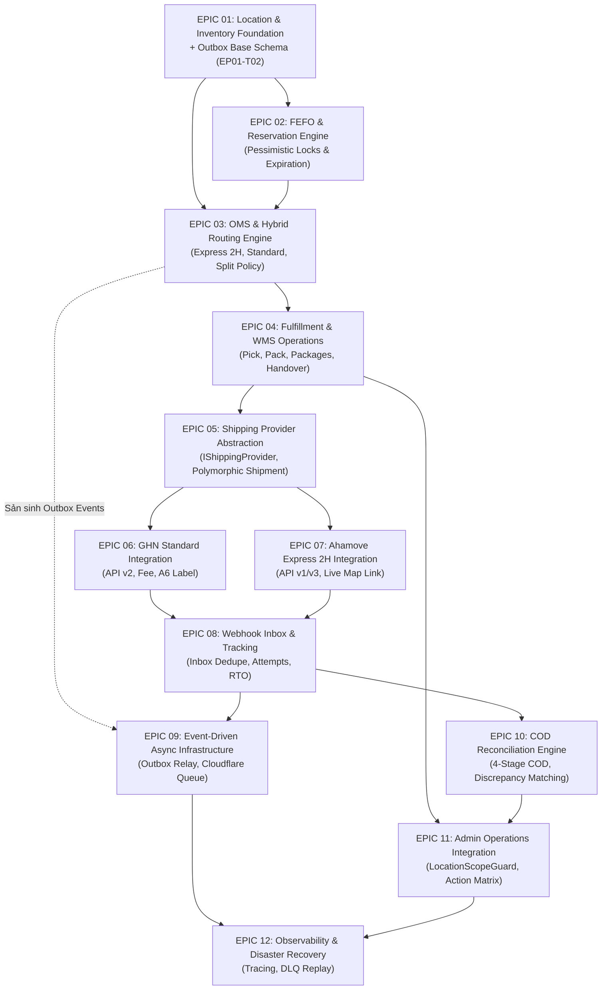

# Kế Hoạch Phân Rã Công Việc & Danh Mục Nhiệm Vụ Triển Khai (Work Breakdown Structure & Implementation Task Backlog) — GlowUp Fulfillment, Logistics & RMA (P0 Focus)

> **Dự án:** GlowUp — Chuỗi Bán Lẻ Mỹ Phẩm Đa Kênh (Omnichannel Cosmetics Retail)  
> **Mã tài liệu:** `DES-07-FULFILLMENT-WORK-BREAKDOWN`  
> **Tài liệu tham chiếu cơ sở:** `DES-05 v3.1-ENTERPRISE` & `DES-06-FULFILLMENT-IMPLEMENTATION-PLAN`  
> **Ngày ban hành:** 15/11/2026  
> **Vai trò tác giả:** Senior Backend Architect / Technical Lead  
> **Trạng thái:** Kế Hoạch Thực Thi Chính Thức — Sẵn Sàng Giao Việc Cho Coding Agents (Execution Ready)  
> **Phạm vi trọng tâm:** Giai đoạn P0 (Core Commerce Fulfillment, Inventory FEFO, 3PL Shipping, Async Ingress & COD Reconciliation)

---

## Mục Lục Tài Liệu

1. [Tổng Quan Work Breakdown Structure (WBS Overview)](#1-tổng-quan-work-breakdown-structure-wbs-overview)
2. [Sơ Đồ Phụ Thuộc Giữa Các Epic & Điều Chỉnh Kiến Trúc (Dependency Graph & Adjustments)](#2-sơ-đồ-phụ-thuộc-giữa-các-epic--điều-chỉnh-kiến-trúc)
3. [Chi Tiết Nhiệm Vụ Triển Khai (Implementation Tasks: EPIC 01 -> 12)](#3-chi-tiết-nhiệm-vụ-triển-khai-implementation-tasks-epic-01---12)
   * [EPIC 01: Location & Inventory Foundation](#epic-01-location--inventory-foundation)
   * [EPIC 02: FEFO & Reservation Engine](#epic-02-fefo--reservation-engine)
   * [EPIC 03: OMS & Hybrid Routing Engine](#epic-03-oms--hybrid-routing-engine)
   * [EPIC 04: Fulfillment & WMS Operations](#epic-04-fulfillment--wms-operations)
   * [EPIC 05: Shipping Provider Abstraction](#epic-05-shipping-provider-abstraction)
   * [EPIC 06: GHN Standard Integration](#epic-06-ghn-standard-integration)
   * [EPIC 07: Ahamove Express 2H Integration](#epic-07-ahamove-express-2h-integration)
   * [EPIC 08: Webhook Inbox & Tracking Orchestration](#epic-08-webhook-inbox--tracking-orchestration)
   * [EPIC 09: Event-Driven Async Infrastructure](#epic-09-event-driven-async-infrastructure)
   * [EPIC 10: COD Reconciliation Engine](#epic-10-cod-reconciliation-engine)
   * [EPIC 11: Admin Operations Integration](#epic-11-admin-operations-integration)
   * [EPIC 12: Observability & Disaster Recovery](#epic-12-observability--disaster-recovery)
4. [Trạng Thái Nhiệm Vụ Khởi Điểm (Initial Task Status & Repository Readiness)](#4-trạng-thái-nhiệm-vụ-khởi-điểm)
5. [Ma Trận Khóa Chặn (Blockers) & Tích Hợp Quyết Định Nghiệp Vụ (DEC-01 -> DEC-05)](#5-ma-trận-khóa-chặn--tích-hợp-quyết-định-nghiệp-vụ)
6. [Bản Đặc Tả Thực Thi Nhiệm Vụ Đầu Tiên (Execution Brief: EP01-T01)](#6-bản-đặc-tả-thực-thi-nhiệm-vụ-đầu-tiên-execution-brief-ep01-t01)
7. [Checklist Nghiệm Thu & Đóng Từng Epic (Epic Sign-off Checklists)](#7-checklist-nghiệm-thu--đóng-từng-epic)

---

## 1. Tổng Quan Work Breakdown Structure (WBS Overview)

Dự án hoàn tất đơn hàng P0 được phân rã thành **12 Epics tuần tự**, gồm tổng cộng **37 Implementation Tasks**. Mỗi task được thiết kế theo nguyên lý **Vertical Slice**: một đơn vị công việc hoàn chỉnh có ranh giới rõ ràng, bao gồm thay đổi schema/database (nếu có), logic miền nghiệp vụ, hợp đồng API/Event, xử lý lỗi cạnh tranh và bộ kiểm thử (Unit / Integration) tự động tương ứng.

```
+-------------------------------------------------------------------------------------------------------------------------+
|                                    TỔNG HỢP WORK BREAKDOWN STRUCTURE (WBS P0 FOCUS)                                     |
+--------+---------------------------------------+-------------+-------------+-------------+--------------------------------------------+
| MÃ     | TÊN EPIC                              | SỐ LƯỢNG    | ĐỘ PHỨC TẠP | TRẠNG THÁI  | PHẠM VI NGHIỆP VỤ & KỸ THUẬT CỐT LÕI       |
| EPIC   |                                       | TASKS       | TỔNG THỂ    | TIẾN ĐỘ     |                                            |
+--------+---------------------------------------+-------------+-------------+-------------+--------------------------------------------+
| EPIC 01| Location & Inventory Foundation       | 4 Tasks     | Medium      | [DONE]      | Schema Location, Balance, ATP, Outbox Base |
| EPIC 02| FEFO & Reservation Engine             | 4 Tasks     | Large       | [DONE]      | Lots FEFO, Row Lock, Multi-location Reserve|
| EPIC 03| OMS & Hybrid Routing Engine           | 4 Tasks     | Large       | [DONE]      | Road Distance, Split Fulfillment, Routing  |
| EPIC 04| Fulfillment & WMS Operations          | 3 Tasks     | Medium      | NOT_STARTED | Pick Lists, Packages, Actual Weight/Dim    |
| EPIC 05| Shipping Provider Abstraction         | 3 Tasks     | Medium      | NOT_STARTED | Interface 3PL, Polymorphic Shipment, Mock  |
| EPIC 06| GHN Standard Integration              | 3 Tasks     | Medium      | NOT_STARTED | GHN API v2, Fee Quote, A6 Label Token      |
| EPIC 07| Ahamove Express 2H Integration        | 3 Tasks     | Medium      | NOT_STARTED | Ahamove API v1/v3, Booking, Live Map Link  |
| EPIC 08| Webhook Inbox & Tracking Orchestration| 3 Tasks     | Large       | NOT_STARTED | Inbox Deduplication, Attempts, RTO Flow    |
| EPIC 09| Event-Driven Async Infrastructure     | 3 Tasks     | Large       | NOT_STARTED | Outbox Relay SKIP LOCKED, Cloudflare Queue |
| EPIC 10| COD Reconciliation Engine             | 2 Tasks     | Medium      | NOT_STARTED | 4-Stage COD Lifecycle, Discrepancy Matching|
| EPIC 11| Admin Operations Integration          | 3 Tasks     | Medium      | NOT_STARTED | LocationScopeGuard, Action Queue, OCC      |
| EPIC 12| Observability & Disaster Recovery     | 2 Tasks     | Small       | NOT_STARTED | Correlation Tracing, Dead-letter Replay    |
+--------+---------------------------------------+-------------+-------------+-------------+--------------------------------------------+
| TỔNG   | 12 Epics                              | 37 Tasks    | Enterprise  | 12/37 DONE  | Sẵn sàng chuyển giao cho Coding Agents     |
+--------+---------------------------------------+-------------+-------------+-------------+--------------------------------------------+
```

---

## 2. Sơ Đồ Phụ Thuộc Giữa Các Epic & Điều Chỉnh Kiến Trúc

### 2.1 Đánh Giá & Điều Chỉnh Vị Trí Của Hạ Tầng Event (Outbox & Queues)
`[CRITICAL ARCHITECTURE ADJUSTMENT]` Trong tài liệu DES-06 ban đầu, **EPIC 09 (Event-Driven Async Infrastructure)** được xếp sau EPIC 08. Đội ngũ Kiến trúc phát hiện một rủi ro phụ thuộc ngược (Circular / Deferred Dependency):
* Khi triển khai **EPIC 02 (Reservation)** và **EPIC 03 (Order Creation)**, các use-case cần ghi sự kiện miền (`ORDER_RESERVED`, `ORDER_EXPIRED`) vào bảng `outbox_events` bên trong cùng transaction. Nếu đợi đến EPIC 09 mới tạo bảng và helper này, các use-case ở Epic 02/03 sẽ không thể hoàn thiện Definition of Done.
* **Giải pháp kiến trúc điều chỉnh:**
  1. **Tách Outbox Foundation vào EPIC 01 (Task EP01-T02):** Khởi tạo bảng `outbox_events`, interface `BaseDomainEvent`, và `OutboxWriterService` ngay từ Epic 01. Các Epic 02, 03, 04, 08 có thể ghi event vào Outbox ngay khi commit dữ liệu.
  2. **EPIC 09 tập trung vào Tầng Truyền Thông Bất Đồng Bộ (Async Transport Layer):** Bao gồm Background Relay Cronjob quét Outbox đẩy sang Cloudflare Queue, Worker Webhook Ingress tại Edge và Consumer gọi NestJS Internal Command.

### 2.2 Sơ Đồ Luồng Phụ Thuộc Kỹ Thuật (Dependency Graph)



---

## 3. Chi Tiết Nhiệm Vụ Triển Khai (Implementation Tasks: EPIC 01 -> 12)

---

### EPIC 01: Location & Inventory Foundation [HOÀN THÀNH - DONE (2026-11-15)]

#### EP01-T01: Khởi Tạo Schema Locations & Inventory Balances
* **Trạng thái:** [HOÀN THÀNH - DONE (2026-11-15)]
* **Mục tiêu:** Thiết lập cấu trúc dữ liệu bền vững cho địa điểm (kho tổng, showroom) và số dư tồn kho phân đoạn, áp dụng các ràng buộc toán học logic.
* **Mô tả công việc:**
  * Mở rộng Prisma model `Store` (bổ sung `fulfillmentCapacityPerDay`) và `Inventory` (bổ sung `safetyStock`, `quarantinedQuantity`, `damagedQuantity`, index `(store_id, product_variant_id)`).
  * Viết migration SQL `20261115155239_add_location_capacity_and_inventory_balances` bổ sung ràng buộc toàn vẹn:
    * `chk_inventory_balances_logical`: `quantity >= (reserved_quantity + safety_stock + quarantined_quantity + damaged_quantity)`.
    * `chk_inventory_safety_non_negative`, `chk_inventory_quarantined_non_negative`, `chk_inventory_damaged_non_negative`.
    * Cập nhật cột `available_quantity` GENERATED ALWAYS STORED theo đúng công thức ATP: `quantity - (reserved_quantity + safety_stock + quarantined_quantity + damaged_quantity)`.
  * Chuẩn hóa `seed-stores.ts`: 2 Central Warehouse (WH-TB 2500 đơn/ngày, WH-HN 2000 đơn/ngày) và 3 Showroom HCM (STORE-03 Q1, STORE-06 Q10, STORE-07 Bình Thạnh - 500 đơn/ngày) kèm tọa độ thực tế và khởi tạo 200 bản ghi Inventory Balances ban đầu.
* **Dependencies:** Không.
* **Files/Modules ảnh hưởng:** `backend/prisma/schema.prisma`, `backend/prisma/migrations/20261115155213_add_location_capacity_and_inventory_balances/`, `backend/prisma/migrations/20261115155239_add_location_capacity_and_inventory_balances/`, `backend/prisma/seed-stores.ts`, `backend/src/modules/inventory/infrastructure/__tests__/inventory-balance.migration.spec.ts`.
* **Database/Prisma:** Bảng `stores`, `inventory`.
* **API/Domain Events:** Không.
* **Concurrency/Idempotency:** Unique index `(store_id, product_variant_id)` + B-Tree index `idx_inventory_store_variant`.
* **Acceptance Criteria Verification:**
  1. `npx prisma migrate dev` thực thi thành công 100% không lỗi cú pháp.
  2. Test chặn vi phạm tổng `(reserved + safety + quarantined + damaged) > quantity` qua mã lỗi PostgreSQL `23514`: ĐẠT.
  3. Test chặn cập nhật số âm cho `safety_stock`, `quarantined_quantity`, `damaged_quantity`: ĐẠT.
  4. Test tự động tính toán cột `available_quantity` (ATP) chính xác: ĐẠT.
  5. Chạy seed script sinh đúng 4 locations trọng yếu (1 Kho tổng Tân Bình + 3 Showroom Q1, Q10, Bình Thạnh) và inventory balances ban đầu: ĐẠT.
* **Test cases:** `backend/src/modules/inventory/infrastructure/__tests__/inventory-balance.migration.spec.ts` (6/6 passed, 26.08s).
* **Definition of Done:** Migration hoàn tất, database đồng bộ, schema được biên dịch thành công qua `prisma generate`, 100% tests PASS, zero data loss.
* **Complexity:** Medium (M)
* **Out of scope:** Chưa tính toán ATP runtime service, chưa xử lý Lô hàng (chuyển sang EP01-T03 và EP02).

#### EP01-T02: Thiết Lập Nền Tảng Transactional Outbox & Event Contract
* **Trạng thái:** [HOÀN THÀNH - DONE (2026-11-15)]
* **Mục tiêu:** Cung cấp hạ tầng ghi nhận sự kiện miền giao dịch bền vững (Transactional Outbox) để các Epic nghiệp vụ tiếp theo sử dụng ngay từ đầu.
* **Mô tả công việc:**
  * Tạo Prisma model `OutboxEvent` (`id`, `aggregate_type`, `aggregate_id`, `event_type`, `payload`, `status`, `retry_count`, `last_error`, `published_at`, `created_at`).
  * Migration `20261115161243_add_outbox_events_table` áp dụng thành công trên PostgreSQL Neon kèm Partial Index `idx_outbox_events_pending`.
  * Định nghĩa interface `BaseDomainEvent<T>` và `IOutboxWriter`.
  * Tạo `OutboxWriterService` cung cấp phương thức `record(tx: Prisma.TransactionClient, event: BaseDomainEvent<any>)` và `recordMany(tx, events)`.
* **Dependencies:** Không.
* **Files/Modules ảnh hưởng:** `backend/prisma/schema.prisma`, `backend/prisma/migrations/20261115161243_add_outbox_events_table/migration.sql`, `backend/src/modules/async-infrastructure/outbox/`, `backend/src/modules/async-infrastructure/async-infrastructure.module.ts`, `backend/src/app.module.ts`.
* **Database/Prisma:** Bảng `outbox_events` kèm Partial Index trên `status = 'PENDING'` và index `(status, created_at)`.
* **API/Domain Events:** Event contracts cơ bản (`BaseDomainEvent<T>`).
* **Concurrency/Idempotency:** UUID v4 cho event ID; outbox ghi trong cùng transaction của nghiệp vụ.
* **Acceptance Criteria Verification:**
  1. Gọi `OutboxWriterService.record(tx, event)` bên trong transaction bị rollback thì bản ghi outbox cũng bị rollback (ACID): ĐẠT.
  2. Bảng `outbox_events` được tạo với trạng thái mặc định `'PENDING'`, `retry_count = 0`: ĐẠT.
  3. `recordMany(tx, events)` ghi batch và rollback ACID: ĐẠT.
* **Test cases:** `backend/src/modules/async-infrastructure/outbox/__tests__/outbox-writer.spec.ts` (5/5 passed, 17.0s).
* **Definition of Done:** Migration hoàn tất, schema cập nhật, Service được export trong `AsyncInfrastructureModule` và import vào `AppModule`, 100% tests PASS, build thành công.
* **Complexity:** Small (S)
* **Out of scope:** Chưa viết cronjob quét outbox đẩy sang Cloudflare (được xử lý ở EP09-T01).

#### EP01-T03: Xây Dựng Inventory Balance Domain Service & ATP Calculator
* **Trạng thái:** [HOÀN THÀNH - DONE (2026-11-15)]
* **Mục tiêu:** Cung cấp hàm tính toán tồn kho khả dụng bán lẻ (ATP) chuẩn xác theo công thức toán học thống nhất.
* **Mô tả công việc:**
  * Tạo `AtpCalculatorService` triển khai công thức:
    $$\text{ATP} = \max(0, \text{physical\_on\_hand} - \text{reserved\_quantity} - \text{safety\_stock} - \text{quarantined\_quantity} - \text{damaged\_quantity})$$
  * Xây dựng `InventoryBalanceService` cung cấp API nội bộ: `getBalance(locationId, variantId)`, `getAtp(locationId, variantId)`, `getBulkAtp(locationId, variantIds[])`, `checkAvailability(locationId, items[])`.
  * Export `AtpCalculatorService` và `InventoryBalanceService` trong `InventoryModule`.
* **Dependencies:** EP01-T01.
* **Files/Modules ảnh hưởng:** `backend/src/modules/inventory/application/services/atp-calculator.service.ts`, `backend/src/modules/inventory/application/services/inventory-balance.service.ts`, `backend/src/modules/inventory/inventory.module.ts`.
* **Database/Prisma:** Đọc bảng `inventory`.
* **API/Domain Events:** Không.
* **Concurrency/Idempotency:** Read-only queries.
* **Acceptance Criteria Verification:**
  1. Nếu physical = 10, reserved = 2, safety = 1, quarantined = 1 $\implies$ ATP trả về chính xác 6: ĐẠT.
  2. Nếu ATP tính ra $< 0 \implies$ Hàm tự động trả về 0, không trả số âm: ĐẠT.
  3. `getBulkAtp` trả về Map, mặc định 0 cho variant không có bản ghi: ĐẠT.
  4. `checkAvailability` phát hiện chính xác thiếu hụt tồn kho: ĐẠT.
* **Test cases:** `atp-calculator.spec.ts` (11/11 passed), `inventory-balance.service.spec.ts` (9/9 passed) - Tổng 20/20 passed.
* **Definition of Done:** 100% tests PASS, service được export trong `InventoryModule`, `nest build` thành công.
* **Complexity:** Small (S)
* **Out of scope:** Chưa cập nhật tăng giảm giữ chỗ tồn kho (được xử lý ở Epic 02).

#### EP01-T04: API Quản Lý Địa Điểm & Kiểm Tra Năng Lực Hoàn Tất (Location Query & Capacity)
* **Trạng thái:** [HOÀN THÀNH - DONE (2026-11-15)]
* **Mục tiêu:** Cho phép truy vấn danh sách cửa hàng/kho và kiểm tra năng lực phục vụ đơn hàng trong ngày.
* **Mô tả công việc:**
  * Xây dựng Query Handler và REST API: `GET /api/v1/locations`, `GET /api/v1/locations/:id/capacity`.
  * Tính toán số lượng đơn đã phân bổ trong ngày dựa trên bảng `orders` (hoặc `fulfillment_orders`) để đối chiếu với `fulfillment_capacity_per_day`.
  * Kiểm tra khung giờ mở cửa (`opening_hours` JSONB) theo timezone `Asia/Ho_Chi_Minh`.
  * Hỗ trợ Cache-aside qua Upstash Redis (TTL: 1 giờ).
* **Dependencies:** EP01-T01.
* **Files/Modules ảnh hưởng:** `backend/src/modules/inventory/presentation/controllers/location.controller.ts`, `backend/src/modules/inventory/application/services/location.service.ts`, `backend/src/modules/inventory/presentation/dtos/`, `backend/src/modules/inventory/inventory.module.ts`.
* **Database/Prisma:** Bảng `stores`, đọc `orders`.
* **API/Domain Events:** `GET /api/v1/locations`, `GET /api/v1/locations/:id/capacity`.
* **Concurrency/Idempotency:** Read-only cache-aside qua Upstash Redis (TTL: 1 giờ).
* **Acceptance Criteria Verification:**
  1. API trả về danh sách chi nhánh kèm trạng thái hoạt động theo giờ thực tế (`isOpenNow`, `currentLocalTime`, `todayOpeningHours`): ĐẠT.
  2. Nếu số đơn trong ngày $\ge \text{capacity} \implies$ Trường `isCapacityAvailable` trả về `false`: ĐẠT.
  3. API có Swagger documentation, DTO chuẩn: ĐẠT.
* **Test cases:** `location.service.spec.ts` (8/8 passed), `location.controller.spec.ts` (2/2 passed) - Tổng 10/10 passed.
* **Definition of Done:** 100% tests PASS, controller & service export trong `InventoryModule`, `nest build` thành công.
* **Complexity:** Medium (M)
* **Out of scope:** Chưa xử lý định tuyến (chuyển sang Epic 03).

---

### EPIC 02: FEFO & Reservation Engine [HOÀN THÀNH - DONE (2026-11-16)]

#### EP02-T01: Nâng Cấp Schema Lô Hàng Hạn Dùng & Cấu Hình Hạn Lưu Thông Tối Thiểu
* **Trạng thái:** [HOÀN THÀNH - DONE (2026-11-15)]
* **Mục tiêu:** Quản lý hạn sử dụng của từng lô hàng và hỗ trợ cấu hình hạn dùng tối thiểu (`MinRemainingShelfLifeDays`) theo SKU/Danh mục.
* **Mô tả công việc:**
  * Tạo Prisma model `InventoryLot` (`batch_code`, `expiry_date`, `quantity_on_hand`, `quantity_reserved`).
  * Bổ sung trường `min_shelf_life_days` vào bảng `product_variants` (mặc định 180 ngày).
  * Viết migration SQL `20261115165648_add_inventory_lots_and_min_shelf_life` bổ sung:
    * Ràng buộc logic số dư: `chk_lot_quantities` (`quantity_on_hand >= quantity_reserved`).
    * Ràng buộc không âm: `chk_lot_quantity_on_hand_non_negative`, `chk_lot_quantity_reserved_non_negative`, `chk_product_variant_min_shelf_life_non_negative`.
    * Unique constraint: `uq_lot_batch` trên `(location_id, product_variant_id, batch_code)`.
    * B-Tree Index: `idx_lots_fefo_search` trên `(location_id, product_variant_id, expiry_date ASC)`.
  * Cập nhật `seed-stores.ts` khởi tạo 360 bản ghi `InventoryLot` mẫu tại 9 địa điểm phục vụ kiểm thử FEFO.
* **Dependencies:** EP01-T01.
* **Files/Modules ảnh hưởng:** `backend/prisma/schema.prisma`, `backend/prisma/migrations/20261115165648_add_inventory_lots_and_min_shelf_life/migration.sql`, `backend/prisma/seed-stores.ts`, `backend/src/modules/inventory/infrastructure/__tests__/inventory-lot.migration.spec.ts`.
* **Database/Prisma:** Bảng `inventory_lots`, cập nhật bảng `product_variants`.
* **API/Domain Events:** Không.
* **Concurrency/Idempotency:** Unique `uq_lot_batch` trên `(location_id, product_variant_id, batch_code)`.
* **Acceptance Criteria Verification:**
  1. Cho phép lưu nhiều lô hàng khác nhau cho cùng một sản phẩm tại một địa điểm: ĐẠT.
  2. Ràng buộc `quantity_on_hand >= quantity_reserved` được thực thi ở mức cơ sở dữ liệu (`chk_lot_quantities`, lỗi 23514): ĐẠT.
  3. Ràng buộc không âm cho `quantity_on_hand` và `quantity_reserved` (lỗi 23514): ĐẠT.
  4. Bổ sung trường `min_shelf_life_days` vào `product_variants` (mặc định 180 ngày) và chặn số âm: ĐẠT.
  5. Index `idx_lots_fefo_search` sắp xếp tăng dần theo `expiry_date` và Unique index `uq_lot_batch`: ĐẠT.
* **Test cases:** `backend/src/modules/inventory/infrastructure/__tests__/inventory-lot.migration.spec.ts` (8/8 passed, 14.2s).
* **Definition of Done:** Migration hoàn tất, schema sẵn sàng cho truy vấn FEFO, 100% tests PASS, `nest build` thành công.
* **Complexity:** Medium (M)
* **Out of scope:** Chưa chạy thuật toán trừ lô (được xử lý ở EP02-T02).

#### EP02-T02: Xây Dựng Dịch Vụ Phân Bổ Lô Hạn Gần Xuất Trước (FEFO Allocation Service)
* **Trạng thái:** [HOÀN THÀNH - DONE (2026-11-16)]
* **Mục tiêu:** Tự động chọn và khóa các lô hàng có hạn sử dụng gần nhất còn đủ điều kiện xuất kho, loại bỏ nguy cơ xuất hàng cận date trái quy định.
* **Mô tả công việc:**
  * Xây dựng `FefoAllocationService.allocateAndLockLots(tx, locationId, items, options?)`.
  * Thực thi câu lệnh `SELECT ... FOR UPDATE` trên bảng `inventory_lots` với điều kiện:
    $$\text{expiry\_date} \ge \text{CURRENT\_DATE} + \text{min\_shelf\_life\_days}$$
  * Sắp xếp theo `expiry_date ASC, id ASC`.
  * Áp dụng Deadlock Prevention: Sắp xếp items theo `variantId ASC` trước khi duyệt khóa lô.
  * Cập nhật tăng `quantity_reserved` trên từng lô được chọn trong cùng transaction.
  * Xây dựng `releaseLockedLots` và `simulateAllocation` (read-only dry-run).
  * Đăng ký và export `FefoAllocationService` trong `InventoryModule`.
* **Dependencies:** EP02-T01, EP01-T03.
* **Files/Modules ảnh hưởng:** `backend/src/modules/inventory/application/services/fefo-allocation.service.ts`, `backend/src/modules/inventory/inventory.module.ts`, `backend/src/modules/inventory/application/services/__tests__/fefo-allocation.service.spec.ts`.
* **Database/Prisma:** Cập nhật bảng `inventory_lots`.
* **API/Domain Events:** Không.
* **Concurrency/Idempotency:** Pessimistic lock `FOR UPDATE` + Deadlock prevention ordering.
* **Acceptance Criteria Verification:**
  1. Với Lô A (HSD 6 tháng) và Lô B (HSD 12 tháng), hệ thống luôn trừ số lượng của Lô A trước: ĐẠT.
  2. Lô hàng có hạn dùng dưới ngưỡng tối thiểu bị bỏ qua tuyệt đối (trừ khi có cờ `isClearance = true`): ĐẠT.
  3. Thiếu số lượng khả dụng ở các lô hợp lệ $\implies$ Throw `ConflictException('LOT_SHORTAGE...')` và rollback transaction: ĐẠT.
  4. Hỗ trợ `releaseLockedLots` giải phóng tồn giữ chỗ và `simulateAllocation` mô phỏng phân bổ: ĐẠT.
  5. Sắp xếp items theo `variantId` phòng chống Deadlock khi khóa đồng thời: ĐẠT.
* **Test cases:** `backend/src/modules/inventory/application/services/__tests__/fefo-allocation.service.spec.ts` (8/8 passed, 26.2s).
* **Definition of Done:** Đảm bảo toàn vẹn dữ liệu, 100% tests PASS, build NestJS sạch sẽ.
* **Complexity:** Large (L)
* **Out of scope:** Chưa tạo bản ghi Reservation header (xử lý ở EP02-T03).

#### EP02-T03: Triển Khai Dịch Vụ Giữ Chỗ Tồn Kho Nguyên Tử (Atomic Inventory Reservation)
* **Trạng thái:** [HOÀN THÀNH - DONE (2026-11-16)]
* **Mục tiêu:** Tạo bản ghi giữ chỗ tồn kho liên kết trực tiếp với `FulfillmentOrder` và ghi nhận nhật ký giao dịch kho (Ledger).
* **Mô tả công việc:**
  * Tạo Prisma model `InventoryReservation` và `InventoryReservationItem`.
  * Xây dựng `InventoryReservationService.createReservation(tx, { fulfillmentOrderId, locationId, items })`.
  * Cập nhật tăng `reserved_quantity` trên `inventory_balances` tương ứng.
  * Ghi bản ghi vào `inventory_transactions` loại `RESERVATION_HOLD`.
* **Dependencies:** EP02-T02, EP01-T02.
* **Files/Modules ảnh hưởng:** `backend/prisma/schema.prisma`, `backend/prisma/migrations/20261115172431_add_inventory_reservations/`, `backend/src/modules/inventory/application/services/inventory-reservation.service.ts`, `backend/src/modules/inventory/inventory.module.ts`, `backend/src/modules/inventory/application/services/__tests__/inventory-reservation.service.spec.ts`.
* **Database/Prisma:** Bảng `inventory_reservations`, `inventory_reservation_items`, `inventory_transactions`, `inventory_balances`.
* **API/Domain Events:** Ghi `outbox_events` loại `INVENTORY_RESERVED`.
* **Concurrency/Idempotency:** Thực thi trong cùng PostgreSQL transaction của luồng đặt hàng.
* **Acceptance Criteria Verification:**
  1. Bản ghi reservation được tạo với trạng thái `'ACTIVE'` và thời hạn hết hạn (`expires_at` = Now + 15 phút cho đơn thanh toán online, 30 phút cho COD): ĐẠT.
  2. Tổng số lượng trên `inventory_reservation_items` bằng chính xác số lượng giữ chỗ trên `inventory_balances`: ĐẠT.
  3. Ghi nhận sổ cái `inventory_transactions` loại `RESERVATION_HOLD` và Outbox Event `INVENTORY_RESERVED` trong cùng transaction: ĐẠT.
  4. Concurrency test mô phỏng 10 giao dịch cạnh tranh bảo đảm Zero Overselling tuyệt đối qua PostgreSQL Check Constraints: ĐẠT.
* **Test cases:** `backend/src/modules/inventory/application/services/__tests__/inventory-reservation.service.spec.ts` (6/6 passed, 40.7s).
* **Definition of Done:** Zero Overselling được chứng minh bằng test tự động, 100% tests PASS, `nest build` thành công.
* **Complexity:** Large (L)
* **Out of scope:** Chưa xử lý hủy giữ chỗ khi hết hạn (xử lý ở EP02-T04).

#### EP02-T04: Xây Dựng Tiến Trình Giải Phóng & Hết Hạn Giữ Chỗ (Reservation Expiration Engine)
* **Trạng thái:** [HOÀN THÀNH - DONE (2026-11-16)]
* **Mục tiêu:** Tự động hoàn trả số lượng giữ chỗ về tồn kho khả dụng khi đơn hàng bị hủy hoặc quá thời hạn thanh toán trực tuyến.
* **Mô tả công việc:**
  * Xây dựng phương thức `releaseReservation(tx, reservationId, options?)` và `releaseReservationById(reservationId, options?)`.
  * Giảm `quantity_reserved` trên từng lô hàng `inventory_lots` qua `FefoAllocationService.releaseLockedLots`.
  * Giảm `reserved_quantity` trên bảng `inventory` (balances) phục hồi tồn khả dụng ATP.
  * Đổi trạng thái reservation sang `'RELEASED'` hoặc `'EXPIRED'`.
  * Ghi bản ghi `inventory_transactions` loại `RESERVATION_RELEASE`.
  * Ghi Transactional Outbox Event `RESERVATION_RELEASED`.
  * Xây dựng `ReservationCleanupScheduler` quét bằng `SELECT ... FOR UPDATE SKIP LOCKED` định kỳ chạy nền dọn dẹp các reservation hết hạn (`expires_at < NOW()` và `status = 'ACTIVE'`).
* **Dependencies:** EP02-T03.
* **Files/Modules ảnh hưởng:** `backend/src/modules/inventory/application/services/inventory-reservation.service.ts`, `backend/src/modules/inventory/infrastructure/schedulers/reservation-cleanup.scheduler.ts`, `backend/src/modules/inventory/inventory.module.ts`, `backend/src/modules/inventory/application/services/__tests__/reservation-expiration.spec.ts`.
* **Database/Prisma:** Cập nhật `inventory_reservations`, `inventory_lots`, `inventory`, `inventory_transactions`, `outbox_events`.
* **API/Domain Events:** Ghi `outbox_events` loại `RESERVATION_RELEASED`.
* **Concurrency/Idempotency:** Khóa bi quan `FOR UPDATE`, idempotency bypass nếu status khác `ACTIVE`, quét định kỳ bằng `SELECT ... FOR UPDATE SKIP LOCKED` chống trùng lặp đa worker.
* **Acceptance Criteria Verification:**
  1. Hết 15 phút không thanh toán (hoặc khi giải phóng chủ động), tồn kho ATP tự động tăng trở lại đúng số lượng ban đầu: ĐẠT.
  2. Không xảy ra trường hợp trừ âm số lượng `reserved_quantity` (Idempotent guard + Check constraint DB): ĐẠT.
  3. `ReservationCleanupScheduler` quét và giải phóng chính xác các reservation quá hạn mà không đụng chạm các reservation còn hạn: ĐẠT.
  4. Hai worker chạy đồng thời quét các bản ghi quá hạn với `SKIP LOCKED` không gây deadlock hay xử lý lặp lại: ĐẠT.
* **Test cases:** `backend/src/modules/inventory/application/services/__tests__/reservation-expiration.spec.ts` (4/4 passed, 39.8s).
* **Definition of Done:** Cronjob chạy nền an toàn, có logging chi tiết, 100% tests PASS, `nest build` thành công.
* **Complexity:** Medium (M)
* **Out of scope:** Không can thiệp hủy giao dịch thanh toán ngân hàng (thuộc Payment Module).

---

### EPIC 03: OMS & Hybrid Routing Engine

#### EP03-T01: Xây Dựng Dịch Vụ Tính Quãng Đường & Báo Giá Vận Chuyển (Shipping Quote & Distance) [DONE]
* **Mục tiêu:** Tính toán cước phí và xác định khoảng cách đường bộ thực tế từ các chi nhánh tới địa chỉ khách hàng theo quyết định `DEC-01`.
* **Mô tả công việc:**
  * Tạo `DistanceCalculatorService`: Tích hợp OpenRouteService / Google Distance Matrix để lấy cự ly đường bộ thực tế; cơ chế dự phòng: Haversine $\times 1.3$ khi API bản đồ bị lỗi mạng hoặc thiếu key.
  * Xây dựng `ShippingQuoteService.calculateQuotes(cart, shippingAddress)`:
    * Kiểm tra điều kiện Hỏa Tốc 2H: Khoảng cách đường bộ $\le 10\text{ km}$ (`DEC-01`), giờ mở cửa VN, năng lực hoàn tất trong ngày, đủ tồn kho ATP.
    * Trả về danh sách tùy chọn vận chuyển (`quoteGroupId`, danh sách `options`).
  * Lưu báo giá tạm thời vào bảng `shipping_quotes` và cache vào Upstash Redis (TTL: 15 phút).
* **Dependencies:** EP01-T04 (DONE).
* **Files/Modules thực tế ảnh hưởng:** `backend/src/modules/oms/application/services/distance-calculator.service.ts`, `backend/src/modules/oms/application/services/shipping-quote.service.ts`, `backend/src/modules/oms/presentation/controllers/shipping-quote.controller.ts`, `backend/src/modules/oms/presentation/dtos/shipping-quote.dto.ts`, `backend/src/modules/oms/oms.module.ts`.
* **Database/Prisma:** Bảng `shipping_quotes` (Migration `20261116010000_add_shipping_quotes`).
* **API/Domain Events:** `POST /api/v1/shipping/quotes`, `GET /api/v1/shipping/quotes/:quoteGroupId`.
* **Concurrency/Idempotency:** UUID cho `quoteGroupId`.
* **Acceptance Criteria Verification:**
  1. Khách cách 10.5 km đường bộ $\implies$ Tùy chọn 2H trả về `isAvailable = false`: ĐẠT (test case xác minh `unavailableReason` chứa thông tin vượt quá 10km).
  2. Báo giá được lưu trong DB/Redis và không thể bị sửa đổi từ phía client: ĐẠT (`validateQuote` đối chiếu giá gốc và chặn sửa đổi cước).
* **Test cases:** `distance-calculator.service.spec.ts` (7/7 tests PASS), `shipping-quote.service.spec.ts` (11/11 tests PASS).
* **Definition of Done:** 100% tests PASS, NestJS build thành công, migration áp dụng trên Neon DB.
* **Complexity:** Medium (M)
* **Out of scope:** Chưa tạo đơn hàng chính thức.

#### EP03-T02: Triển Khai Chiến Lược Phân Tuyến Hỗn Hợp & Chia Đơn Có Kiểm Soát (Routing Engine) [DONE]
* **Mục tiêu:** Hiện thực hóa thuật toán phân tuyến đơn hàng kết hợp giữa Central Warehouse và Chuỗi cửa hàng, áp dụng quy chuẩn chia đơn theo quyết định `DEC-02`.
* **Mô tả công việc:**
  * Tạo `HybridOrderRouter` với 2 chiến lược:
    1. **Express Routing:** Tìm 1 showroom duy nhất đáp ứng 100% giỏ hàng, $\le 10\text{ km}$, đang mở cửa và còn capacity. Cấm tự động chia đơn hỏa tốc (DEC-01).
    2. **Standard Routing:** Ưu tiên Central Warehouse $\rightarrow$ Showroom đơn lẻ tối ưu chi phí $\rightarrow$ Đánh giá tách đơn theo DEC-02.
  * **Quy tắc chia đơn (Split Fulfillment - `DEC-02`):**
    * Chỉ xem xét khi: Giá trị hàng hóa thực tế sau giảm giá (`netMerchandiseAmount`) $\ge 500.000\text{ đ}$.
    * Chi phí vận chuyển phát sinh thêm do GlowUp chi trả $\le 35.000\text{ đ}$.
    * Tách tối đa thành 2 `FulfillmentOrders` (Central WH + 1 Showroom gần nhất).
* **Dependencies:** EP03-T01 (DONE), EP01-T03 (DONE).
* **Files/Modules thực tế ảnh hưởng:** `backend/src/modules/oms/application/routing/hybrid-order-router.ts`, `backend/src/modules/oms/oms.module.ts`.
* **Database/Prisma:** Đọc `stores` (locations), `inventory` (balances).
* **API/Domain Events:** Không.
* **Concurrency/Idempotency:** Thuật toán đánh giá chỉ đọc (Read-only evaluation algorithm), an toàn đồng thời 100%.
* **Acceptance Criteria Verification:**
  1. Đơn hàng 450.000đ thiếu hàng tại Central WH $\implies$ Không chia đơn, chuyển sang trạng thái chờ điều chuyển gom hàng nội bộ (`planType: 'INTERNAL_TRANSFER_REQUIRED'`): ĐẠT.
  2. Đơn hàng 600.000đ cước phát sinh 22.000đ - 30.000đ ($\le 35.000\text{ đ}$) $\implies$ Phân tuyến tách thành 2 FO hợp lệ (`planType: 'SPLIT_FULFILLMENT'`): ĐẠT.
* **Test cases:** `hybrid-order-router.spec.ts` (8/8 scenarios PASS bao phủ 100% ma trận phân tuyến).
* **Definition of Done:** Đạt 100% độ phủ test cho thuật toán phân tuyến, NestJS build thành công.
* **Complexity:** Large (L)
* **Out of scope:** Chưa thực thi tạo bản ghi trong DB (thuộc EP03-T03).

#### EP03-T03: Tái Cấu Trúc Luồng Tạo Đơn Hàng & Đa Fulfillment Orders (Order Creation Use-Case) [DONE]
* **Mục tiêu:** Thay thế luồng checkout cũ bằng kiến trúc giao dịch mới hỗ trợ Split Fulfillment và tích hợp Outbox Pattern.
* **Mô tả công việc:**
  * Xây dựng `CreateOrderUseCase`:
    1. Validate client payload, đối chiếu giá với `quoteGroupId` (qua `ShippingQuoteService.validateQuote`).
    2. Gọi `HybridOrderRouter` xác định kế hoạch phân tuyến.
    3. Mở PostgreSQL Transaction:
       * Tạo bản ghi `orders` (Status: `PENDING_PAYMENT` hoặc `CONFIRMED`).
       * Tạo các bản ghi `fulfillment_orders` tương ứng theo từng Location xuất hàng (Status: `PENDING_ALLOCATION`).
       * Gọi `InventoryReservationService.createReservation` cho từng FO.
       * Cập nhật `fulfillment_orders.status = 'ALLOCATED'`.
       * Ghi `outbox_events` loại `ORDER_RESERVED`.
* **Dependencies:** EP03-T02 (DONE), EP02-T03 (DONE), EP01-T02 (DONE).
* **Files/Modules thực tế ảnh hưởng:** `backend/src/modules/oms/application/use-cases/create-order.use-case.ts`, `backend/src/modules/oms/oms.module.ts`, `backend/prisma/schema.prisma`.
* **Database/Prisma:** Bảng `fulfillment_orders`, `fulfillment_order_items`, `orders`, `order_items`, `inventory_reservations`, `outbox_events` (Migration `20261116010500_add_fulfillment_orders`).
* **API/Domain Events:** Event `ORDER_RESERVED`.
* **Concurrency/Idempotency:** ACID Transaction, khóa bi quan FEFO reservation theo thứ tự variantId ASC.
* **Acceptance Criteria Verification:**
  1. Đơn chia 2 kho tạo thành công 1 Order cha và 2 Fulfillment Orders con, mỗi FO có mã reservation riêng: ĐẠT.
  2. Bất kỳ lỗi nào trong quá trình giữ chỗ kho con đều làm rollback toàn bộ đơn hàng: ĐẠT (ACID rollback 100%).
* **Test cases:** `create-order.use-case.spec.ts` (4/4 tests PASS bao gồm đơn tách kho, đơn đơn lẻ, rollback và transfer requirement).
* **Definition of Done:** 100% tests PASS, NestJS build thành công, migration áp dụng trên Neon DB.
* **Complexity:** Large (L)
* **Out of scope:** Chưa gọi sang đối tác vận chuyển (xử lý sau khi đóng gói ở Epic 04).

#### EP03-T04: Xây Dựng Bộ Tổng Hợp Trạng Thái Đơn Hàng (Order State Aggregator) [DONE]
* **Mục tiêu:** Tự động tính toán trạng thái tổng thể của `Order` dựa trên trạng thái của các `FulfillmentOrders` và `Shipments` con.
* **Mô tả công việc:**
  * Xây dựng `OrderStateAggregator.computeOrderStatus(orderId, tx)`:
    * 100% FO là `HANDED_OVER` $\implies$ Order là `SHIPPED`.
    * 1 FO là `HANDED_OVER`, 1 FO đang `PACKING` $\implies$ Order là `PARTIALLY_SHIPPED`.
    * 100% Shipment là `DELIVERED` $\implies$ Order là `DELIVERED`.
    * Sau 24h ở trạng thái `DELIVERED` không có sự cố $\implies$ Order tự động chuyển sang `COMPLETED` (`DEC-03`).
    * Một kiện hàng bị chuyển hoàn (`RETURNED` do RTO) $\implies$ Giữ nguyên trạng thái các kiện còn lại, không hủy toàn bộ Order.
* **Dependencies:** EP03-T03 (DONE).
* **Files/Modules thực tế ảnh hưởng:** `backend/src/modules/oms/application/services/order-state-aggregator.ts`, `backend/src/modules/oms/oms.module.ts`.
* **Database/Prisma:** Cập nhật bảng `orders`, ghi `order_status_history`, ghi `outbox_events` loại `ORDER_STATUS_CHANGED`.
* **API/Domain Events:** Event `ORDER_STATUS_CHANGED`.
* **Concurrency/Idempotency:** Chạy trong transaction cập nhật của FO/Shipment; kiểm tra idempotent khi trạng thái không đổi.
* **Acceptance Criteria Verification:**
  1. Đơn 2 kiện: Kiện 1 giao thành công $\implies$ Order chuyển sang `PARTIALLY_DELIVERED`: ĐẠT.
  2. Kiện 2 giao thành công $\implies$ Order chuyển sang `DELIVERED`: ĐẠT.
* **Test cases:** `order-state-aggregator.spec.ts` (11/11 tests PASS bao phủ toàn diện ma trận chuyển đổi trạng thái và tự động hoàn tất 24h theo DEC-03).
* **Definition of Done:** 100% tests PASS, NestJS build thành công, Service sẵn sàng tích hợp với các sự kiện hoàn tất kho và giao hàng.
* **Complexity:** Medium (M)
* **Out of scope:** Không xử lý logic hoàn tiền RMA (thuộc Epic 10).

---

### EPIC 04: Fulfillment & WMS Operations

#### EP04-T01: Quản Lý Danh Sách Nhặt Hàng & Quét Barcode Xác Thực (Picking Workflow) [DONE]
* **Mục tiêu:** Cung cấp quy trình nhặt hàng cho nhân viên kho/cửa hàng, quét mã vạch đối chiếu chính xác sản phẩm và số lô.
* **Mô tả công việc:**
  * Xây dựng API:
    * `GET /api/v1/admin/fulfillment-orders/:id/pick-list`: Lấy danh sách cần nhặt kèm mã lô FEFO chỉ định.
    * `POST /api/v1/admin/fulfillment-orders/:id/start-picking`: Chuyển status `ALLOCATED` $\rightarrow$ `PICKING`, gán `assignedPickerId`.
    * `POST /api/v1/admin/fulfillment-orders/:id/complete-picking`: Nhận danh sách barcode sản phẩm và mã lô thực tế quét được.
  * Kiểm tra tính trùng khớp 100% giữa sản phẩm nhặt và `inventory_reservation_items`.
  * Chuyển trạng thái sang `PICKED`.
* **Dependencies:** EP03-T03 (DONE).
* **Files/Modules thực tế ảnh hưởng:** `backend/src/modules/fulfillment/application/services/picking.service.ts`, `backend/src/modules/fulfillment/presentation/controllers/admin-fulfillment.controller.ts`, `backend/src/modules/fulfillment/presentation/dtos/picking.dto.ts`, `backend/src/modules/fulfillment/fulfillment.module.ts`.
* **Database/Prisma:** Bổ sung `picked_at` vào bảng `fulfillment_orders` (Migration `20261116150000_add_packages_and_shipment_links`).
* **API/Domain Events:** `GET .../pick-list`, `POST .../start-picking`, `POST .../complete-picking`.
* **Concurrency/Idempotency:** Kiểm tra trạng thái hiện tại phải đúng `ALLOCATED` / `PICKING`, idempotent nếu đơn đã ở trạng thái mục tiêu.
* **Acceptance Criteria Verification:**
  1. Quét sai mã lô (Batch Code) hệ thống báo lỗi `BATCH_MISMATCH` và từ chối hoàn thành: ĐẠT.
  2. Quét đủ số lượng và đúng lô $\implies$ FO chuyển sang `PICKED`: ĐẠT.
* **Test cases:** `picking.service.spec.ts` (10/10 tests PASS bao phủ pick-list, start-picking, batch mismatch, quantity mismatch và complete-picking).
* **Definition of Done:** API sẵn sàng tích hợp với App/Web Quản lý kho, 10/10 tests PASS, NestJS build thành công.
* **Complexity:** Medium (M)
* **Out of scope:** Chưa đóng gói thùng carton (thuộc EP04-T02).

#### EP04-T02: Quy Trình Đóng Gói, Cân Đo Kiện Thực Tế (Packing & Packages) [DONE]
* **Mục tiêu:** Ghi nhận kích thước, trọng lượng thực tế của bưu phẩm sau đóng gói và tạo các thực thể `Package`.
* **Mô tả công việc:**
  * Xây dựng API: `POST /api/v1/admin/fulfillment-orders/:id/complete-packing`.
  * Nhận dữ liệu: `actualWeightGrams`, `lengthCm`, `widthCm`, `heightCm`, danh sách item phân bổ vào từng thùng carton.
  * Mở Transaction:
    * Tạo bản ghi trong bảng `packages` và `package_items`.
    * Cập nhật `fulfillment_orders.status = 'PACKED'`, `packedAt = now()`.
    * Tạo bản ghi `shipments` ở trạng thái `PENDING_CREATION`.
    * Tạo liên kết trong `shipment_packages`.
    * Ghi `outbox_events` loại `SHIPMENT_DISPATCH_REQUESTED`.
* **Dependencies:** EP04-T01 (DONE).
* **Files/Modules thực tế ảnh hưởng:** `backend/src/modules/fulfillment/application/services/packing.service.ts`, `backend/src/modules/fulfillment/presentation/controllers/admin-fulfillment.controller.ts`, `backend/src/modules/fulfillment/presentation/dtos/packing.dto.ts`, `backend/src/modules/fulfillment/fulfillment.module.ts`.
* **Database/Prisma:** Bảng `packages`, `package_items`, `shipments`, `shipment_packages`, `fulfillment_orders`.
* **API/Domain Events:** Event `SHIPMENT_DISPATCH_REQUESTED`, endpoint `POST /api/v1/admin/fulfillment-orders/:id/complete-packing`.
* **Concurrency/Idempotency:** Đảm bảo 1 FO không bị đóng gói 2 lần; idempotent trả về chi tiết bưu kiện đã đóng gói.
* **Acceptance Criteria Verification:**
  1. Một FO có thể đóng thành 1 hoặc nhiều packages: ĐẠT (hỗ trợ tạo đa kiện `packages: CreatePackageDto[]`).
  2. Cân nặng và kích thước thực tế được lưu chính xác, không dùng số ước tính: ĐẠT (bắt buộc `actualWeightGrams > 0`, `lengthCm > 0`, `widthCm > 0`, `heightCm > 0`, check constraints DB).
* **Test cases:** `packing.service.spec.ts` (11/11 tests PASS bao phủ validation, đơn kiện, đa kiện, Express 2H / Ahamove, GHN và idempotent).
* **Definition of Done:** Bưu kiện sẵn sàng cho bước điều phối 3PL, 11/11 tests PASS, NestJS build thành công.
* **Complexity:** Medium (M)
* **Out of scope:** Không gọi trực tiếp API 3PL trong luồng HTTP request đóng gói để chống timeout (giao cho Shipping Orchestrator ở Epic 05).

#### EP04-T03: Quy Trình Xác Nhận Bàn Giao Kiện Hàng Cho Tài Xế (Handover Workflow) [DONE]
* **Mục tiêu:** Xác nhận nhân viên kho/cửa hàng đã giao các kiện hàng vật lý cho tài xế/bưu tá đến lấy.
* **Mô tả công việc:**
  * Xây dựng API: `POST /api/v1/admin/fulfillment-orders/:id/confirm-handover`.
  * Kiểm tra điều kiện: Vận đơn `Shipment` liên kết phải đã có mã theo dõi (`tracking_code`) từ 3PL.
  * Cập nhật `fulfillment_orders.status = 'HANDED_OVER'`, lưu `handed_over_at = NOW()`.
  * Cập nhật `Shipment.status = 'HANDED_OVER'`, `Shipment.handedOverAt = NOW()`.
  * Gọi `OrderStateAggregator` để cập nhật trạng thái đơn hàng cha (`Order`).
  * Ghi `outbox_events` loại `FO_HANDED_OVER`.
* **Dependencies:** EP04-T02 (DONE).
* **Files/Modules thực tế ảnh hưởng:** `backend/src/modules/fulfillment/application/services/handover.service.ts`, `backend/src/modules/fulfillment/presentation/controllers/admin-fulfillment.controller.ts`, `backend/src/modules/fulfillment/presentation/dtos/handover.dto.ts`, `backend/src/modules/fulfillment/fulfillment.module.ts`.
* **Database/Prisma:** Cập nhật `fulfillment_orders`, `shipments`, `orders`.
* **API/Domain Events:** Event `FO_HANDED_OVER`, endpoint `POST /api/v1/admin/fulfillment-orders/:id/confirm-handover`.
* **Concurrency/Idempotency:** Idempotent: gọi 2 lần không đổi trạng thái lần 2, không ghi trùng outbox event.
* **Acceptance Criteria Verification:**
  1. Chưa có mã vận đơn mà bấm bàn giao $\implies$ Throw `BadRequestException('SHIPMENT_NOT_READY: Kiện hàng chưa có mã vận đơn từ đối tác vận chuyển!')`: ĐẠT.
  2. Bàn giao thành công $\implies$ `handed_over_at` được ghi nhận, FO chuyển sang `HANDED_OVER`, trạng thái Order cha được cập nhật qua `OrderStateAggregator`: ĐẠT.
* **Test cases:** `handover.service.spec.ts` (7/7 tests PASS bao phủ validation trạng thái, tracking code check, bàn giao thành công, gọi aggregator và idempotent).
* **Definition of Done:** Quy trình WMS tại kho hoàn tất giai đoạn xuất xưởng, 7/7 tests PASS, NestJS build thành công.
* **Complexity:** Small (S)
* **Out of scope:** Chưa cập nhật trạng thái shipper nhận hàng (do webhook xử lý ở Epic 08).

---

### EPIC 05: Shipping Provider Abstraction

#### EP05-T01: Thiết Kế Interface Giao Vận & Dữ Liệu Đa Hình (Shipping Provider Abstraction)
* **Mục tiêu:** Chuẩn hóa giao diện lập trình hướng đối tác vận chuyển, bảo đảm khả năng mở rộng thêm nhiều hãng giao hàng trong tương lai mà không sửa core logic.
* **Mô tả công việc:**
  * Định nghĩa interface `IShippingProvider`:
    * `calculateFee(req: QuoteRequestDto): Promise<QuoteResponseDto>`
    * `createShipment(req: CreateShipmentDto): Promise<ShipmentResultDto>`
    * `cancelShipment(trackingCode: string): Promise<boolean>`
    * `parseWebhook(rawBody: any, headers: any): ParsedWebhookDto`
  * Hoàn thiện Prisma model `Shipment` với quan hệ đa hình kiểm soát bằng ràng buộc: Outbound gắn `fulfillment_order_id`, Return gắn `return_request_id`.
* **Dependencies:** EP04-T02.
* **Files/Modules dự kiến ảnh hưởng:** `backend/src/modules/shipping/domain/ports/shipping-provider.interface.ts`, `backend/prisma/schema.prisma`.
* **Database/Prisma:** Cập nhật bảng `shipments`.
* **API/Domain Events:** Không.
* **Concurrency/Idempotency:** Ràng buộc `tracking_code UNIQUE`.
* **Acceptance Criteria:**
  1. Toàn bộ DTO của interface sử dụng chuẩn quốc tế (grams, cm, VND).
  2. Schema hỗ trợ cả chiều gửi đi và chiều thu hồi đổi trả.
* **Test cases:** Type check compile TypeScript.
* **Definition of Done:** Interface sẵn sàng cho việc cắm các adapter cụ thể.
* **Complexity:** Medium (M)
* **Out of scope:** Chưa tích hợp API thật.

#### EP05-T02: Xây Dựng Mock Shipping Provider & Simulation Test Harness
* **Mục tiêu:** Cung cấp đối tác giả lập để kiểm thử toàn bộ luồng hoàn tất đơn hàng nội bộ mà không phụ thuộc vào kết nối mạng bên ngoài hay tài khoản sandbox.
* **Mô tả công việc:**
  * Tạo `MockShippingProvider implements IShippingProvider`.
  * Giả lập tính phí: Trả về 25.000đ cố định.
  * Giả lập tạo đơn: Sinh mã tracking ngẫu nhiên dạng `MOCK-TRK-XXXXX` và link in nhãn giả lập.
  * Cung cấp endpoint mô phỏng bắn webhook: `POST /api/v1/test/mock-carrier/trigger-status`.
* **Dependencies:** EP05-T01.
* **Files/Modules dự kiến ảnh hưởng:** `backend/src/modules/shipping/infrastructure/adapters/mock/mock-shipping.provider.ts`.
* **Database/Prisma:** Không.
* **API/Domain Events:** Endpoint test dev-only.
* **Concurrency/Idempotency:** Deterministic mock responses.
* **Acceptance Criteria:**
  1. Khi cấu hình `SHIPPING_MOCK_ENABLED=true`, hệ thống tự động sử dụng Mock Provider.
  2. Bắn status giả lập cập nhật đúng trạng thái Shipment trong cơ sở dữ liệu.
* **Test cases:** E2E test toàn bộ luồng fulfillment sử dụng Mock Provider.
* **Definition of Done:** Toàn bộ test integration chạy độc lập không cần internet.
* **Complexity:** Small (S)
* **Out of scope:** Không đưa mock endpoint lên production environment.

#### EP05-T03: Xây Dựng Dịch Vụ Điều Phối Vận Đơn & Xử Lý Timeout (Shipment Orchestrator)
* **Mục tiêu:** Xử lý bất đồng bộ việc tạo đơn sang đối tác 3PL sau khi đóng gói, áp dụng mẫu khôi phục sự cố `CREATION_UNKNOWN`.
* **Mô tả công việc:**
  * Xây dựng `ShipmentOrchestratorService.dispatchShipment(shipmentId)`:
    1. Lấy thông tin Package và Location xuất phát.
    2. Gọi `IShippingProvider.createShipment()`.
    3. Nếu thành công: Cập nhật `tracking_code`, `status = 'CREATED'`.
    4. Nếu timeout (> 15s) hoặc lỗi mạng 5xx:
       * Đặt `status = 'CREATION_UNKNOWN'`.
       * Ghi bản ghi vào hàng đợi kiểm tra đối soát tự động.
* **Dependencies:** EP05-T01.
* **Files/Modules dự kiến ảnh hưởng:** `backend/src/modules/shipping/application/services/shipment-orchestrator.service.ts`.
* **Database/Prisma:** Cập nhật bảng `shipments`.
* **API/Domain Events:** Event `SHIPMENT_CREATED`.
* **Concurrency/Idempotency:** Khóa dòng Shipment khi đang gọi 3PL; không cho phép dispatch đồng thời 2 lần.
* **Acceptance Criteria:**
  1. Timeout không làm crash luồng nghiệp vụ kho.
  2. Trạng thái `CREATION_UNKNOWN` ngăn chặn nhân viên bấm tạo lại đơn ngay lập tức.
* **Test cases:** Unit test mô phỏng network timeout và kịch bản đối soát thành công.
* **Definition of Done:** Xử lý an toàn mọi ngoại lệ kết nối 3PL.
* **Complexity:** Large (L)
* **Out of scope:** Chưa kết nối API thật của GHN/Ahamove.

---

### EPIC 06: GHN Standard Integration

#### EP06-T01: Hiện Thực Hóa GHN Client & Báo Giá Cước API v2
* **Mục tiêu:** Tích hợp trực tiếp với GHN E-Commerce API v2 để tra cứu danh mục hành chính và tính cước vận chuyển chuẩn xác.
* **Mô tả công việc:**
  * Tạo `GHNClient`: Đóng gói HTTP Client với Base URL `https://online-gateway.ghn.vn/shiip/public-api/v2/`.
  * Truyền header bắt buộc: `Token` và `ShopId`.
  * Cài đặt phương thức `calculateFee()` gọi `POST /shipping-order/fee`.
  * Xây dựng bộ đệm (Cache) mã Tỉnh/Huyện/Xã của GHN vào Redis để giảm thiểu gọi API tra cứu địa chỉ.
* **Dependencies:** EP05-T01.
* **Files/Modules dự kiến ảnh hưởng:** `backend/src/modules/shipping/infrastructure/adapters/ghn/ghn-client.ts`.
* **Database/Prisma:** Đọc cấu hình `shipping_providers`.
* **API/Domain Events:** Không.
* **Concurrency/Idempotency:** Timeout 5 giây cho API báo phí.
* **Acceptance Criteria:**
  1. Gửi đúng địa chỉ nhận hàng tại Đà Nẵng, GHN trả về cước phí chuẩn xác.
  2. Lỗi timeout trả về cước fallback theo bảng giá tĩnh dự phòng.
* **Test cases:** Integration test với GHN Sandbox API.
* **Definition of Done:** Client kết nối ổn định với sandbox GHN.
* **Complexity:** Medium (M)
* **Out of scope:** Chưa tạo vận đơn.

#### EP06-T02: Tạo Vận Đơn GHN & Lấy Token In Nhãn Khổ A6
* **Mục tiêu:** Gọi API tạo đơn giao hàng tiêu chuẩn trên GHN, nhận mã vận đơn và đường dẫn in nhãn A6 nhiệt.
* **Mô tả công việc:**
  * Triển khai `GHNProvider.createShipment()` gọi `POST /shipping-order/create`.
  * Truyền đầy đủ các trường bắt buộc: `payment_type_id: 1` (Shop trả cước), `required_note: 'KHONGCHOXEMHANG'`, `client_order_code`, `cod_amount`, kích thước và cân nặng thực tế từ Package.
  * Gọi `GET /a5/gen-token` lấy token in nhãn A6 và lưu vào `shipping_label_url`.
* **Dependencies:** EP06-T01, EP04-T02.
* **Files/Modules dự kiến ảnh hưởng:** `backend/src/modules/shipping/infrastructure/adapters/ghn/ghn-provider.ts`.
* **Database/Prisma:** Cập nhật `shipments` (`tracking_code`, `carrier_reference_id`, `shipping_label_url`).
* **API/Domain Events:** Event `SHIPMENT_DISPATCHED_TO_GHN`.
* **Concurrency/Idempotency:** Sử dụng `client_order_code = shipment_code` làm khóa chống tạo trùng trên GHN.
* **Acceptance Criteria:**
  1. GHN trả về mã bưu kiện hợp lệ (dạng `LADXXXXX`).
  2. Đường dẫn in nhãn A6 mở ra trang xem trước tem in nhiệt chính xác.
* **Test cases:** Integration test tạo đơn trên sandbox GHN.
* **Definition of Done:** Hoàn tất 100% việc tạo vận đơn tiêu chuẩn với GHN.
* **Complexity:** Medium (M)
* **Out of scope:** Chưa xử lý webhook trạng thái bưu kiện (xử lý ở Epic 08).

#### EP06-T03: Xây Dựng GHN Status Mapper & Xử Lý Mã Trạng Thái Bất Thường
* **Mục tiêu:** Ánh xạ chính xác các mã trạng thái bưu kiện của GHN về `ShipmentStatus` nội bộ và cô lập các mã trạng thái chưa xác định.
* **Mô tả công việc:**
  * Viết hàm `mapGHNStatus(ghnStatus: string): ShipmentStatus`.
  * Mapping chuẩn: `ready_to_pick` $\rightarrow$ `CREATED`, `picking` $\rightarrow$ `DRIVER_ASSIGNED`, `picked`/`transporting` $\rightarrow$ `IN_TRANSIT`, `delivering` $\rightarrow$ `OUT_FOR_DELIVERY`, `delivered` $\rightarrow$ `DELIVERED`, `delivery_fail` $\rightarrow$ `DELIVERY_FAILED`, `returning` $\rightarrow$ `RETURNING`, `returned` $\rightarrow$ `RETURNED`.
  * **[CRITICAL CORRECTION]** Bất kỳ mã trạng thái lạ nào không nằm trong danh mục $\implies$ Trả về `'EXCEPTION'`, không tự động gán `'IN_TRANSIT'`.
* **Dependencies:** EP06-T02.
* **Files/Modules dự kiến ảnh hưởng:** `backend/src/modules/shipping/infrastructure/adapters/ghn/ghn-status.mapper.ts`.
* **Database/Prisma:** Không.
* **API/Domain Events:** Không.
* **Concurrency/Idempotency:** Pure function.
* **Acceptance Criteria:**
  1. 100% mã trạng thái tài liệu GHN v2 được ánh xạ đúng.
  2. Nhận mã lạ `unknown_code_xyz` $\implies$ Trả về `'EXCEPTION'` và ghi log cảnh báo ERROR.
* **Test cases:** Unit test ma trận đầy đủ các mã trạng thái GHN.
* **Definition of Done:** Mapper hoàn thiện, đạt 100% test coverage.
* **Complexity:** Small (S)
* **Out of scope:** Không lưu database.

---

### EPIC 07: Ahamove Express 2H Integration

#### EP07-T01: Hiện Thực Hóa Ahamove Client & Báo Phí Hỏa Tốc
* **Mục tiêu:** Kết nối với Ahamove On-Demand Delivery API để tính cước phí dịch vụ xe máy tức thời.
* **Mô tả công việc:**
  * Tạo `AhamoveClient`: Base URL `https://partner-api.ahamove.com/`.
  * Xác thực qua Bearer Token / API Key doanh nghiệp.
  * Cài đặt phương thức `calculateFee()` gọi `POST /v1/order/estimated_fee` với mã dịch vụ `SGN-BIKE` (Hồ Chí Minh) hoặc `HAN-BIKE` (Hà Nội).
  * Định vị chính xác tọa độ Lat/Long của Cửa hàng xuất và Người nhận.
* **Dependencies:** EP05-T01.
* **Files/Modules dự kiến ảnh hưởng:** `backend/src/modules/shipping/infrastructure/adapters/ahamove/ahamove-client.ts`.
* **Database/Prisma:** Không.
* **API/Domain Events:** Không.
* **Concurrency/Idempotency:** Timeout 5 giây.
* **Acceptance Criteria:**
  1. Gửi đúng 2 điểm đi và đến trong nội thành, Ahamove trả về giá cước hợp lệ.
  2. Bán kính $> 10\text{ km}$ hoặc ngoài vùng phục vụ $\implies$ Báo lỗi không khả dụng dịch vụ.
* **Test cases:** Integration test với Ahamove Staging API.
* **Definition of Done:** Client kết nối ổn định với staging Ahamove.
* **Complexity:** Medium (M)
* **Out of scope:** Chưa book chuyến xe.

#### EP07-T02: Tạo Booking Hỏa Tốc 2H & Lấy Link Bản Đồ Trực Tiếp (Live Map Link)
* **Mục tiêu:** Đặt chuyến giao hàng hỏa tốc trên Ahamove và lấy đường dẫn theo dõi tài xế thời gian thực cho khách hàng.
* **Mô tả công việc:**
  * Triển khai `AhamoveProvider.createShipment()` gọi `POST /v1/order/create`.
  * Truyền điểm lấy hàng (Showroom gần nhất) và điểm giao hàng (Khách).
  * Gọi `GET /v3/orders/{id}/shared-link` để lấy đường dẫn bản đồ live tracking và lưu vào `tracking_url`.
  * Sinh mã in Phiếu Giao Hàng nội bộ khổ A6 (do Ahamove không hỗ trợ API in tem A6).
* **Dependencies:** EP07-T01, EP04-T02.
* **Files/Modules dự kiến ảnh hưởng:** `backend/src/modules/shipping/infrastructure/adapters/ahamove/ahamove-provider.ts`.
* **Database/Prisma:** Cập nhật `shipments` (`tracking_code`, `tracking_url`).
* **API/Domain Events:** Event `SHIPMENT_DISPATCHED_TO_AHAMOVE`.
* **Concurrency/Idempotency:** Khóa chuyến xe qua `tracking_number = shipment_code`.
* **Acceptance Criteria:**
  1. Ahamove trả về mã đơn (dạng `22VMV54W`).
  2. Khách hàng mở `tracking_url` xem được vị trí tài xế trên bản đồ.
* **Test cases:** Integration test tạo chuyến trên staging Ahamove.
* **Definition of Done:** Luồng giao 2H sẵn sàng hoạt động.
* **Complexity:** Medium (M)
* **Out of scope:** Chưa xử lý tài xế hủy chuyến.

#### EP07-T03: Xây Dựng Ahamove Status Mapper & Xử Lý Điều Phối Lại Khi Tài Xế Hủy
* **Mục tiêu:** Ánh xạ trạng thái chuyến xe của Ahamove và tự động điều phối lại tài xế mới khi tài xế cũ bấm hủy chuyến.
* **Mô tả công việc:**
  * Viết hàm `mapAhamoveStatus(orderStatus, dropoffStatus)`: Đối chiếu cả trạng thái tổng và trạng thái điểm trả hàng.
  * Nếu nhận webhook trạng thái tài xế hủy hoặc quá 20 phút không có người nhận:
    * Chuyển trạng thái sang `DISPATCH_FAILED`.
    * Kích hoạt tự động đặt lại chuyến xe (Re-dispatch) tối đa 2 lần.
    * Sau 2 lần thất bại: Bắn cảnh báo điều phối viên can thiệp xử lý.
* **Dependencies:** EP07-T02.
* **Files/Modules dự kiến ảnh hưởng:** `backend/src/modules/shipping/infrastructure/adapters/ahamove/ahamove-status.mapper.ts`, `backend/src/modules/shipping/application/services/ahamove-redispatch.service.ts`.
* **Database/Prisma:** Cập nhật `shipments`.
* **API/Domain Events:** Event `AHAMOVE_DRIVER_REASSIGNED`.
* **Concurrency/Idempotency:** Khóa trạng thái chuyến xe chống re-dispatch trùng lặp.
* **Acceptance Criteria:**
  1. Tài xế bấm hủy $\implies$ Hệ thống tự động tìm tài xế mới trong 30 giây.
  2. Bất kỳ trạng thái lạ nào đều được đưa về `EXCEPTION`.
* **Test cases:** Unit test mapper và kịch bản re-dispatch.
* **Definition of Done:** Tự động hóa xử lý sự cố tài xế không cần nhân viên can thiệp thủ công.
* **Complexity:** Medium (M)
* **Out of scope:** Không bồi thường cuốc xe.

---

### EPIC 08: Webhook Inbox & Tracking Orchestration

#### EP08-T01: Xây Dựng Webhook Inbox Bền Vững & Chống Trùng Lặp (Inbox & Deduplication)
* **Mục tiêu:** Tiếp nhận và lưu trữ toàn bộ Webhook từ GHN/Ahamove vào PostgreSQL với ràng buộc chống trùng lặp tuyệt đối.
* **Mô tả công việc:**
  * Tạo Prisma model `ShippingWebhookInbox`.
  * Triển khai hàm `recordWebhook(carrierCode, payload)`:
    * Lấy `eventId` từ payload. Nếu không có $\implies$ Sinh mã băm Fingerprint xác định:
      $$\text{SHA256}(\text{carrierCode} + \text{trackingCode} + \text{status} + \text{occurredAt})$$
    * Thực thi `INSERT INTO shipping_webhook_inbox ... ON CONFLICT (carrier_code, event_id) DO NOTHING`.
* **Dependencies:** EP06-T02, EP07-T02.
* **Files/Modules dự kiến ảnh hưởng:** `backend/src/modules/async-infrastructure/webhooks/webhook-inbox.service.ts`.
* **Database/Prisma:** Bảng `shipping_webhook_inbox`.
* **API/Domain Events:** Không.
* **Concurrency/Idempotency:** Ràng buộc `UNIQUE(carrier_code, event_id)` cấp DB.
* **Acceptance Criteria:**
  1. Bắn 10 lần cùng một payload webhook chỉ có duy nhất 1 bản ghi được lưu, 9 lần sau bị bỏ qua an toàn.
  2. Webhook không có event ID vẫn được định danh chống trùng lặp bằng Fingerprint.
* **Test cases:** Concurrency test bắn 20 requests đồng thời cùng một webhook.
* **Definition of Done:** Điểm tiếp nhận webhook có độ tin cậy tuyệt đối.
* **Complexity:** Medium (M)
* **Out of scope:** Chưa cập nhật trạng thái đơn hàng.

#### EP08-T02: Xây Dựng Pipeline Xử Lý Webhook & Chuyển Đổi Trạng Thái Đơn Hàng (State Transition Pipeline)
* **Mục tiêu:** Xử lý tuần tự các sự kiện trong Webhook Inbox để cập nhật `Shipment` và `Order` theo đúng quy tắc State Machine.
* **Mô tả công việc:**
  * Xây dựng `WebhookProcessorService.processEvent(inboxId)`:
    1. Lấy thông tin `Shipment` từ `tracking_code`.
    2. Gọi Status Mapper tương ứng của hãng vận chuyển.
    3. Kiểm tra tính hợp lệ của bước chuyển trạng thái (State Transition Guard): Không cho phép lùi trạng thái (ví dụ: đã `DELIVERED` thì bỏ qua sự kiện `IN_TRANSIT` bị gửi trễ).
    4. Cập nhật `Shipment.status`.
    5. Nếu `status = 'DELIVERED'` $\implies$ Ghi nhận `delivered_at = NOW()`, cập nhật `cod_status = 'COD_COLLECTED'`.
    6. Gọi `OrderStateAggregator` để cập nhật trạng thái `Order` cha.
    7. Ghi nhật ký vào `domain_status_histories`.
    8. Đánh dấu inbox `processed_status = 'PROCESSED'`.
* **Dependencies:** EP08-T01, EP06-T03, EP07-T03, EP03-T04.
* **Files/Modules dự kiến ảnh hưởng:** `backend/src/modules/async-infrastructure/webhooks/webhook-processor.service.ts`.
* **Database/Prisma:** Cập nhật `shipping_webhook_inbox`, `shipments`, `fulfillment_orders`, `orders`, `domain_status_histories`.
* **API/Domain Events:** Event `SHIPMENT_STATUS_UPDATED`.
* **Concurrency/Idempotency:** Khóa dòng Shipment trong transaction xử lý.
* **Acceptance Criteria:**
  1. Nhận webhook `delivered` $\implies$ Shipment và Order cập nhật đúng trạng thái đã giao.
  2. Webhook đến sai thứ tự không làm đảo lộn trạng thái đã tiến triển.
* **Test cases:** Integration test mô phỏng chuỗi 5 webhook từ lúc lấy hàng đến giao thành công.
* **Definition of Done:** Trạng thái đơn hàng đồng bộ thời gian thực với đối tác vận chuyển.
* **Complexity:** Large (L)
* **Out of scope:** Chưa xử lý giao thất bại nhiều lần.

#### EP08-T03: Xử Lý Giao Thất Bại & Luồng Chuyển Hoàn Tự Động (Delivery Attempts & RTO)
* **Mục tiêu:** Theo dõi các lần giao hàng không thành công và kích hoạt luồng bưu kiện chuyển hoàn về kho gửi (`RETURN_TO_ORIGIN`).
* **Mô tả công việc:**
  * Tạo Prisma model `ShipmentAttempt`.
  * Khi nhận webhook `DELIVERY_FAILED`:
    * Tăng `failed_attempts_count` trên `Shipment`.
    * Tạo bản ghi `shipment_attempts` ghi rõ lý do (khách không nghe máy, hẹn lại ngày, sai số).
  * Khi `Shipment.status = 'RETURNED'` (Hàng đã về lại kho xuất ban đầu):
    * Nhân viên kho quét mã nhận kiện hoàn RTO.
    * **Kiểm tra bao bì:** Nếu nguyên vẹn $\implies$ Tự động nhập lại số lượng vào đúng `inventory_lots` ban đầu và tăng `Sellable Stock`.
    * Nếu bưu kiện rách nát bể vỡ $\implies$ Chuyển vào trạng thái `QUARANTINE` để lập biên bản bồi thường với 3PL.
* **Dependencies:** EP08-T02.
* **Files/Modules dự kiến ảnh hưởng:** `backend/src/modules/shipping/application/services/shipment-attempt.service.ts`, `backend/src/modules/shipping/application/services/return-to-origin.service.ts`.
* **Database/Prisma:** Bảng `shipment_attempts`, cập nhật `shipments`, `inventory_lots`, `inventory_balances`.
* **API/Domain Events:** Event `SHIPMENT_RETURNED_TO_ORIGIN`.
* **Concurrency/Idempotency:** Khóa dòng lô hàng khi hoàn nhập tồn kho.
* **Acceptance Criteria:**
  1. Giao thất bại lần 1, 2 không làm hủy đơn hàng.
  2. Hàng hoàn RTO nguyên seal được khôi phục tồn kho chính xác tới từng lô.
* **Test cases:** Integration test kịch bản giao thất bại 3 lần và hoàn hàng về kho.
* **Definition of Done:** Quy trình RTO tự động hóa an toàn, không thất thoát hàng.
* **Complexity:** Large (L)
* **Out of scope:** Không áp dụng cho luồng khách đổi trả sau khi đã nhận (RMA thuộc P1).

---

### EPIC 09: Event-Driven Async Infrastructure

#### EP09-T01: Xây Dựng Outbox Relay Worker (PostgreSQL to Cloudflare Queue)
* **Mục tiêu:** Định kỳ quét bảng `outbox_events` và đẩy sự kiện sang Cloudflare Queue an toàn, hỗ trợ worker concurrency.
* **Mô tả công việc:**
  * Viết `OutboxRelayScheduler`: Chạy mỗi 3 giây bằng NestJS `@Cron`.
  * Thực thi truy vấn an toàn:
    ```sql
    SELECT id, aggregate_type, aggregate_id, event_type, payload 
    FROM outbox_events 
    WHERE status = 'PENDING' 
    ORDER BY created_at ASC LIMIT 50 
    FOR UPDATE SKIP LOCKED;
    ```
  * Gửi batch events sang Cloudflare Queue qua HTTP Endpoint của Cloudflare Worker Producer.
  * Cập nhật `status = 'PUBLISHED'` và `published_at = NOW()`.
  * Cơ chế Backoff: Nếu Cloudflare Queue trả 429/500, tăng `retry_count` và tạm dừng 10 giây.
* **Dependencies:** EP01-T02.
* **Files/Modules dự kiến ảnh hưởng:** `backend/src/modules/async-infrastructure/outbox/outbox-relay.scheduler.ts`.
* **Database/Prisma:** Cập nhật bảng `outbox_events`.
* **API/Domain Events:** Đẩy sự kiện sang Cloudflare Queue.
* **Concurrency/Idempotency:** `SKIP LOCKED` bảo đảm 2 instance backend không bao giờ đọc trùng event.
* **Acceptance Criteria:**
  1. Khi có 100 events, 2 worker chạy song song mỗi worker xử lý 50 events độc lập không trùng lặp.
  2. Mất kết nối mạng $\implies$ Event giữ nguyên `PENDING`, không bị mất mát dữ liệu.
* **Test cases:** Concurrency test với 2 tiến trình worker giả lập.
* **Definition of Done:** Tỷ lệ thất thoát event bằng 0 (Zero Message Loss).
* **Complexity:** Medium (M)
* **Out of scope:** Chưa tiêu thụ message tại Consumer.

#### EP09-T02: Triển Khai Cloudflare Worker Webhook Ingress Tại Edge
* **Mục tiêu:** Tạo điểm tiếp nhận Webhook cực nhanh tại mạng biên của Cloudflare, bảo đảm phản hồi 200 OK cho GHN/Ahamove chỉ sau khi đã Enqueue bền vững.
* **Mô tả công việc:**
  * Tạo thư mục `cloudflare-workers/` ở root dự án.
  * Cấu hình `wrangler.toml` định nghĩa:
    * Queue: `glowup-logistics-webhooks`.
    * Biến môi trường: `GHN_WEBHOOK_SECRET`, `AHAMOVE_WEBHOOK_SECRET`.
  * Viết mã Worker Ingress (`src/index.ts`):
    * Xác thực Token từ Header/Query của đối tác.
    * Enqueue payload vào Queue: `await env.LOGISTICS_WEBHOOK_QUEUE.send(...)`.
    * **Chỉ trả về 200 OK khi Enqueue thành công.**
    * Nếu Enqueue lỗi $\implies$ Trả HTTP 500 để 3PL tự động retry lại sau.
* **Dependencies:** Không (hạ tầng Cloudflare độc lập).
* **Files/Modules dự kiến ảnh hưởng:** `cloudflare-workers/wrangler.toml`, `cloudflare-workers/src/index.ts`, `cloudflare-workers/package.json`.
* **Database/Prisma:** Không.
* **API/Domain Events:** Endpoint public: `/webhooks/ghn`, `/webhooks/ahamove`.
* **Concurrency/Idempotency:** Enqueue bền vững vào Cloudflare Queue.
* **Acceptance Criteria:**
  1. Deploy worker thành công lên môi trường Cloudflare.
  2. Sai secret token $\implies$ Trả HTTP 401/403.
  3. Đúng secret token $\implies$ Message xuất hiện trong Queue và trả 200 OK trong thời gian cực ngắn.
* **Test cases:** Vitest cho Cloudflare Worker environment.
* **Definition of Done:** Worker Ingress hoạt động ổn định trên staging.
* **Complexity:** Medium (M)
* **Out of scope:** Không cập nhật cơ sở dữ liệu từ Worker.

#### EP09-T03: Triển Khai Cloudflare Queue Consumer & Internal Command Dispatcher
* **Mục tiêu:** Kéo message từ Cloudflare Queue theo lô có kiểm soát và gọi về Internal API của NestJS được bảo vệ bằng mTLS / Shared Token.
* **Mô tả công việc:**
  * Cấu hình Queue Consumer trong `wrangler.toml` (`max_batch_size = 10`, `max_retries = 3`, `dead_letter_queue = "glowup-logistics-webhooks-dlq"`).
  * Viết Consumer Handler:
    * Lặp qua từng message trong batch.
    * Gọi HTTP POST về `${NESTJS_INTERNAL_URL}/api/v1/internal/webhooks/consume` kèm header `X-Internal-Token`.
    * Nếu NestJS trả 2xx $\implies$ Gọi `msg.ack()`.
    * Nếu NestJS trả 5xx hoặc Timeout $\implies$ Gọi `msg.retry()`.
  * Viết Controller nội bộ trong NestJS: `InternalWebhookController` để tiếp nhận và đưa vào `WebhookProcessorService`.
* **Dependencies:** EP09-T02, EP08-T02.
* **Files/Modules dự kiến ảnh hưởng:** `cloudflare-workers/src/consumer.ts`, `backend/src/modules/async-infrastructure/webhooks/internal-webhook.controller.ts`.
* **Database/Prisma:** Ghi `shipping_webhook_inbox`.
* **API/Domain Events:** Endpoint nội bộ `/api/v1/internal/webhooks/consume`.
* **Concurrency/Idempotency:** Điều tiết tải qua `max_batch_size = 10` bảo vệ connection pool của PostgreSQL.
* **Acceptance Criteria:**
  1. Khi có 500 webhooks dồn vào Queue, Consumer rút đều đặn 10 msg/lần, NestJS không bị quá tải CPU/RAM.
  2. Message lỗi 3 lần tự động chuyển vào Dead Letter Queue (DLQ).
* **Test cases:** E2E test từ Worker Ingress $\rightarrow$ Queue $\rightarrow$ Consumer $\rightarrow$ NestJS Internal API $\rightarrow$ Database.
* **Definition of Done:** Chu trình xử lý sự kiện bất đồng bộ khép kín hoàn tất.
* **Complexity:** Large (L)
* **Out of scope:** Không can thiệp xử lý tài chính.

---

### EPIC 10: COD Reconciliation Engine

#### EP10-T01: Xây Dựng Vòng Đời Thu Hộ COD & Phân Bổ Khi Tách Đơn (4-Stage COD Lifecycle)
* **Mục tiêu:** Theo dõi độc lập 4 giai đoạn của dòng tiền COD và tự động phân bổ số tiền cần thu khi một đơn hàng bị tách thành nhiều kiện xuất từ các kho khác nhau.
* **Mô tả công việc:**
  * Xây dựng `CodManagementService`:
    * Tính toán số tiền thu hộ cho từng Shipment con theo tỷ lệ giá trị hàng hóa:
      $$\text{Shipment.codAmount} = \text{Round}\left( \text{Order.remainingPayable} \times \frac{\text{PackageValue}}{\sum \text{PackageValue}} \right)$$
    * Xử lý làm tròn số lẻ ở kiện cuối cùng để tổng COD các kiện bằng chính xác khoản tiền khách còn nợ.
  * Quản lý trạng thái COD: `COD_EXPECTED` $\rightarrow$ `COD_COLLECTED` (sau khi giao thành công) $\rightarrow$ `SETTLEMENT_PENDING` $\rightarrow$ `SETTLED`.
* **Dependencies:** EP08-T02, EP03-T03.
* **Files/Modules dự kiến ảnh hưởng:** `backend/src/modules/finance/application/services/cod-management.service.ts`.
* **Database/Prisma:** Cập nhật `shipments.cod_amount`, `shipments.cod_status`.
* **API/Domain Events:** Event `COD_COLLECTED_CONFIRMED`.
* **Concurrency/Idempotency:** Transaction cập nhật độc quyền trên bảng Shipments.
* **Acceptance Criteria:**
  1. Đơn hàng nợ 500.000đ tách làm 2 kiện (kiện 1 giá trị 300k, kiện 2 giá trị 200k) $\implies$ Kiện 1 thu đúng 300.000đ, kiện 2 thu đúng 200.000đ.
  2. Tổng tiền COD các kiện luôn khớp 100% với số tiền khách cần thanh toán.
* **Test cases:** Unit test phân bổ số tiền COD chẵn và lẻ.
* **Definition of Done:** Xóa bỏ hoàn toàn rủi ro thu trùng tiền của khách.
* **Complexity:** Medium (M)
* **Out of scope:** Chưa đối soát sao kê ngân hàng.

#### EP10-T02: Nhập Bảng Kê Đối Soát Đối Tác & Cảnh Báo Sai Lệch (Reconciliation & Discrepancies)
* **Mục tiêu:** Cho phép phòng Kế toán nhập file đối soát kỳ của GHN/Ahamove, tự động khớp số liệu và gắn cờ cảnh báo khi phát hiện sai lệch cước hoặc thiếu tiền thu hộ.
* **Mô tả công việc:**
  * Tạo Prisma model `CodReconciliation` và `CodReconciliationItem`.
  * Viết API: `POST /api/v1/admin/cod/reconcile-batch` (Nhận file Excel/JSON bảng kê từ GHN).
  * Đối chiếu từng dòng:
    * `declared_cod_amount` (số GlowUp yêu cầu thu) vs `carrier_paid_cod_amount` (số đối tác thực trả).
    * `actual_shipping_fee` (cước phí báo ban đầu) vs `carrier_fee_charged` (cước đối tác cấn trừ).
  * Nếu khớp $\implies$ Đổi trạng thái Shipment sang `SETTLED`.
  * Nếu lệch $\implies$ Đổi trạng thái Shipment sang `SETTLEMENT_DISCREPANCY` và gắn cờ `DISCREPANCY_FLAGGED` trên bảng kê.
* **Dependencies:** EP10-T01.
* **Files/Modules dự kiến ảnh hưởng:** `backend/src/modules/finance/application/services/cod-reconciliation.service.ts`, `backend/src/modules/finance/presentation/controllers/admin-cod.controller.ts`.
* **Database/Prisma:** Bảng `cod_reconciliations`, `cod_reconciliation_items`, cập nhật `shipments`.
* **API/Domain Events:** Event `COD_RECONCILIATION_COMPLETED`.
* **Concurrency/Idempotency:** Không cho phép import đối soát trùng kỳ.
* **Acceptance Criteria:**
  1. Đối tác thu thiếu 10.000đ $\implies$ Bản ghi được đánh dấu `DISCREPANCY` kèm số tiền lệch rõ ràng.
  2. Bảng kê khớp 100% tự động chuyển trạng thái hoàn tất đối soát.
* **Test cases:** Integration test import file bảng kê giả lập có trường hợp khớp và trường hợp lệch.
* **Definition of Done:** Kế toán có công cụ đối soát số liệu minh bạch.
* **Complexity:** Medium (M)
* **Out of scope:** Chưa tự động gọi API ngân hàng (chờ P2).

---

### EPIC 11: Admin Operations Integration

#### EP11-T01: Xây Dựng Location Scope & RBAC Guards Cho Nghiệp Vụ Kho (Security & Scope Guards)
* **Mục tiêu:** Bảo đảm nhân viên tại Chi nhánh A không thể can thiệp hoặc nhặt hàng vào các đơn hàng được phân bổ cho Chi nhánh B.
* **Mô tả công việc:**
  * Tạo Decorator `@LocationScoped()` và Guard `LocationScopeGuard`.
  * Đối chiếu `storeId` của `FulfillmentOrder` với danh sách chi nhánh được phân quyền của nhân viên trong bảng `user_stores`.
  * Quyền Admin tối cao (`ADMIN`, `OPERATIONS_MGR`) được phép thao tác toàn quyền xuyên suốt các chi nhánh.
  * Tích hợp `@RequirePermission()` kiểm tra quyền cụ thể (`FULFILLMENT_PICK`, `FULFILLMENT_PACK`, `SHIPMENT_DISPATCH`).
* **Dependencies:** EP04-T01.
* **Files/Modules dự kiến ảnh hưởng:** `backend/src/core/guards/location-scope.guard.ts`, `backend/src/core/guards/rbac.guard.ts`.
* **Database/Prisma:** Đọc bảng `user_stores`, `roles`, `permissions`.
* **API/Domain Events:** Không.
* **Concurrency/Idempotency:** Request context validation.
* **Acceptance Criteria:**
  1. Nhân viên Showroom Q10 gọi API `start-picking` trên đơn của Showroom Q1 $\implies$ Trả HTTP 403 Forbidden (`LOCATION_SCOPE_UNAUTHORIZED`).
  2. Quản lý vùng có quyền truy cập cả 2 showroom thao tác thành công.
* **Test cases:** Unit test Guard với các ngữ cảnh token khác nhau.
* **Definition of Done:** Toàn bộ API WMS được bảo vệ chặt chẽ theo chi nhánh.
* **Complexity:** Medium (M)
* **Out of scope:** Không can thiệp Auth đăng nhập.

#### EP11-T02: Xây Dựng Admin Work Queues & API Danh Mục Hành Động (Work Queues & Actions API)
* **Mục tiêu:** Cung cấp các endpoint hàng đợi công việc tối ưu cho màn hình nhân viên kho và trả về danh sách các action được phép thực hiện (`availableActions`).
* **Mô tả công việc:**
  * Xây dựng API:
    * `GET /api/v1/admin/fulfillment/tasks/picking`: Lọc danh sách đơn cần nhặt theo chi nhánh của nhân viên.
    * `GET /api/v1/admin/fulfillment/tasks/packing`: Lọc danh sách đơn đã nhặt xong chờ đóng gói.
    * `GET /api/v1/admin/fulfillment/tasks/handover`: Lọc danh sách kiện chờ bàn giao shipper.
  * Trong API chi tiết `GET /api/v1/admin/fulfillment-orders/:id`: Trả về mảng `availableActions` (ví dụ: `['START_PICKING', 'CANCEL']`) dựa trên trạng thái thực tế và quyền của user.
* **Dependencies:** EP11-T01, EP04-T02.
* **Files/Modules dự kiến ảnh hưởng:** `backend/src/modules/fulfillment/presentation/controllers/admin-fulfillment-queue.controller.ts`.
* **Database/Prisma:** Đọc `fulfillment_orders`, `shipments`.
* **API/Domain Events:** REST Endpoints.
* **Concurrency/Idempotency:** Read-only queries tối ưu index.
* **Acceptance Criteria:**
  1. Nhân viên mở màn hình chỉ thấy đơn thuộc chi nhánh của mình.
  2. Giao diện Frontend hiển thị đúng các nút chức năng dựa trên `availableActions` trả về từ Backend.
* **Test cases:** Integration test danh sách hàng đợi công việc.
* **Definition of Done:** Giao diện Portal Admin kết nối mượt mà với Backend.
* **Complexity:** Medium (M)
* **Out of scope:** Chưa làm giao diện UI.

#### EP11-T03: Tích Hợp Kiểm Soát Đồng Thời Lạc Quan & Universal Audit Log (OCC & Audit History)
* **Mục tiêu:** Chống xung đột khi 2 nhân viên cùng thao tác trên một đơn hàng và lưu vết toàn bộ lịch sử thay đổi trạng thái vào cơ sở dữ liệu.
* **Mô tả công việc:**
  * Thêm kiểm tra `expectedVersion` trong toàn bộ Admin Command DTOs:
    * Nếu `record.version !== dto.expectedVersion` $\implies$ Throw `ConflictException('CONCURRENT_MODIFICATION_DETECTED')`.
  * Viết `AuditLogService.recordTransition(tx, { entityType, entityId, fromStatus, toStatus, action, actorId, reason })`.
  * Ghi vào bảng `domain_status_histories` trong cùng transaction với thay đổi nghiệp vụ.
* **Dependencies:** EP11-T02.
* **Files/Modules dự kiến ảnh hưởng:** `backend/src/core/services/audit-log.service.ts`, `backend/src/core/interceptors/optimistic-lock.interceptor.ts`.
* **Database/Prisma:** Bảng `domain_status_histories`.
* **API/Domain Events:** Không.
* **Concurrency/Idempotency:** Optimistic Concurrency Control (OCC).
* **Acceptance Criteria:**
  1. Hai nhân viên cùng mở màn hình và cùng bấm "Bắt đầu nhặt hàng" $\implies$ Người bấm sau bị chặn với mã lỗi 409 Conflict.
  2. Mọi bước chuyển trạng thái đều có log lưu vết người thực hiện và thời gian chính xác.
* **Test cases:** Concurrency test mô phỏng 2 request update cùng version.
* **Definition of Done:** Bảo vệ toàn vẹn trạng thái và sẵn sàng cho việc kiểm toán.
* **Complexity:** Medium (M)
* **Out of scope:** Không audit dữ liệu đọc (chỉ audit dữ liệu ghi).

---

### EPIC 12: Observability & Disaster Recovery

#### EP12-T01: Tích Hợp Correlation ID & Truy Vết Phân Tán (Distributed Tracing & Correlation ID)
* **Mục tiêu:** Truy vết xuyên suốt một yêu cầu từ Webhook biên $\rightarrow$ Queue $\rightarrow$ Internal API $\rightarrow$ Database Transaction.
* **Mô tả công việc:**
  * Xây dựng `CorrelationIdMiddleware`: Tự động trích xuất `x-correlation-id` từ request header hoặc sinh mới UUID v4.
  * Tích hợp Correlation ID vào toàn bộ structured logs (JSON format) và truyền vào `outbox_events.payload.metadata`.
  * Truyền `x-correlation-id` trong các cuộc gọi HTTP sang đối tác vận chuyển và Cloudflare Queue.
* **Dependencies:** EP09-T03.
* **Files/Modules dự kiến ảnh hưởng:** `backend/src/core/middlewares/correlation-id.middleware.ts`, `backend/src/core/logger/structured-logger.service.ts`.
* **Database/Prisma:** Không.
* **API/Domain Events:** Gắn metadata tracing vào events.
* **Concurrency/Idempotency:** Thread-safe / AsyncLocalStorage context.
* **Acceptance Criteria:**
  1. Khi tra cứu một mã `x-correlation-id` trên hệ thống log, truy vết được toàn bộ hành trình xử lý của đơn hàng từ Edge vào Database.
* **Test cases:** Unit test Middleware và Log interceptor.
* **Definition of Done:** Toàn bộ log backend tuân thủ chuẩn JSON có gắn correlation ID.
* **Complexity:** Small (S)
* **Out of scope:** Chưa tích hợp OpenTelemetry APM (chờ P2).

#### EP12-T02: Xây Dựng Công Cụ Bắn Lại Sự Kiện Lỗi & Xử Lý Dead Letter Queue (DLQ Replay Tooling)
* **Mục tiêu:** Cho phép kỹ sư vận hành điều tra các thông điệp lỗi trong DLQ và kích hoạt bắn lại (Replay) sau khi đã khắc phục sự cố code/mạng.
* **Mô tả công việc:**
  * Xây dựng API quản trị nội bộ:
    * `GET /api/v1/admin/operations/dlq/messages`: Xem danh sách message lỗi trong DLQ.
    * `POST /api/v1/admin/operations/dlq/replay`: Bắn lại message chỉ định vào hàng đợi chính.
    * `POST /api/v1/admin/operations/outbox/retry-stuck`: Quét và kích hoạt gửi lại các outbox event bị kẹt `retry_count > 3`.
  * Cảnh báo qua Webhook Discord/Slack khi có message mới rơi vào DLQ.
* **Dependencies:** EP12-T01, EP09-T03.
* **Files/Modules dự kiến ảnh hưởng:** `backend/src/modules/async-infrastructure/operations/dlq-operations.controller.ts`, `backend/src/modules/async-infrastructure/operations/dlq-operations.service.ts`.
* **Database/Prisma:** Bảng `outbox_events`, `shipping_webhook_inbox`.
* **API/Domain Events:** Management Endpoints.
* **Concurrency/Idempotency:** Replay idempotent dựa trên Unique Constraint của Inbox.
* **Acceptance Criteria:**
  1. Replay một webhook từ DLQ không gây lỗi nhân đôi dữ liệu.
  2. Bắn cảnh báo tức thì khi xuất hiện message trong DLQ.
* **Test cases:** Integration test đưa message vào DLQ và thực thi replay thành công.
* **Definition of Done:** Đội ngũ DevOps có đầy đủ công cụ khắc phục thảm họa dữ liệu.
* **Complexity:** Medium (M)
* **Out of scope:** Không can thiệp sửa trực tiếp payload trong database.

---

## 4. Trạng Thái Nhiệm Vụ Khởi Điểm (Initial Task Status & Readiness)

Bảng đánh giá hiện trạng mã nguồn thực tế tại repository trước khi bắt đầu Sprint 1:

```
+-------------------------------------------------------------------------------------------------------------------------+
|                                    BẢNG ĐÁNH GIÁ TRẠNG THÁI HIỆN TẠI CỦA 37 TASKS                                       |
+----------+---------------------------------------------------+---------------+------------------------------------------+
| TASK ID  | TÊN NHIỆM VỤ                                      | TRẠNG THÁI    | GHI CHÚ ĐỐI CHIẾU MÃ NGUỒN REPO THỰC TẾ  |
+----------+---------------------------------------------------+---------------+------------------------------------------+
| EP01-T01 | Schema Locations & Inventory Balances             | DONE          | Đã mở rộng Store & Inventory, migrate check & ATP, seed 4 điểm, 6/6 tests pass |
| EP01-T02 | Outbox Base Schema & Event Contract               | DONE          | Đã tạo OutboxEvent model, migrate table, partial index, OutboxWriterService, 5/5 tests pass |
| EP01-T03 | Inventory Balance Domain Service & ATP            | DONE          | Đã tạo AtpCalculatorService & InventoryBalanceService, 20/20 tests pass |
| EP01-T04 | Location Query & Capacity API                     | DONE          | Đã tạo LocationService & LocationController (GET /locations, GET /locations/:id/capacity), 10/10 tests pass |
| EP02-T01 | Schema Lô Hàng Hạn Dùng (Batches)                 | NOT_STARTED   | Bảng batches đã có; cần thêm min shelf   |
| EP02-T02 | FEFO Allocation Service                           | NOT_STARTED   | Chưa có thuật toán FEFO FOR UPDATE       |
| EP02-T03 | Atomic Inventory Reservation Service              | NOT_STARTED   | Chưa có bảng inventory_reservations      |
| EP02-T04 | Reservation Expiration Engine                     | NOT_STARTED   | Chưa có cronjob giải phóng reservation   |
| EP03-T01 | Shipping Quote & Distance Service                 | NOT_STARTED   | Đang hardcode phí ship trong pricing     |
| EP03-T02 | Hybrid Order Routing Engine                       | NOT_STARTED   | StoreResolverService cũ chỉ tìm 1 store  |
| EP03-T03 | Order Creation Use-Case (Split FO)                | NOT_STARTED   | CommerceCheckoutService cần refactor lớn |
| EP03-T04 | Order State Aggregator                            | NOT_STARTED   | Trạng thái Order đang cập nhật thủ công  |
| EP04-T01 | Picking Workflow & Barcode Verification           | NOT_STARTED   | Chưa có module fulfillment               |
| EP04-T02 | Packing Service & Package Dimensions              | NOT_STARTED   | Chưa có bảng packages                    |
| EP04-T03 | Handover Workflow                                 | NOT_STARTED   | Chưa có quy trình bàn giao               |
| EP05-T01 | Shipping Provider Abstraction & Polymorphic       | NOT_STARTED   | Bảng shipments cũ cần refactor quan hệ   |
| EP05-T02 | Mock Shipping Provider & Simulation               | NOT_STARTED   | Cần xây dựng phục vụ test E2E            |
| EP05-T03 | Shipment Orchestrator Service                     | NOT_STARTED   | Chưa có xử lý timeout CREATION_UNKNOWN   |
| EP06-T01 | GHN Client & Fee Calculation API v2               | NOT_STARTED   | Chưa có integration GHN                  |
| EP06-T02 | GHN Order Creation & A6 Label                     | NOT_STARTED   | Chưa có integration GHN                  |
| EP06-T03 | GHN Status Mapper                                 | NOT_STARTED   | Chưa có status mapper                    |
| EP07-T01 | Ahamove Client & Estimated Fee                    | NOT_STARTED   | Chưa có integration Ahamove              |
| EP07-T02 | Ahamove Booking & Live Tracking Map               | NOT_STARTED   | Chưa có integration Ahamove              |
| EP07-T03 | Ahamove Status Mapper & Re-dispatch               | NOT_STARTED   | Chưa có status mapper                    |
| EP08-T01 | Webhook Inbox & Persistent Deduplication          | NOT_STARTED   | Chưa có bảng shipping_webhook_inbox      |
| EP08-T02 | Webhook Processing Pipeline                       | NOT_STARTED   | Chưa có consumer webhook                 |
| EP08-T03 | Delivery Attempts & Return to Origin (RTO)        | NOT_STARTED   | Chưa có bảng shipment_attempts           |
| EP09-T01 | Outbox Relay Worker (SKIP LOCKED)                 | NOT_STARTED   | Chưa có outbox relay                     |
| EP09-T02 | Cloudflare Worker Webhook Ingress                 | NOT_STARTED   | Chưa có thư mục cloudflare-workers       |
| EP09-T03 | Cloudflare Queue Consumer                         | NOT_STARTED   | Chưa có consumer worker                  |
| EP10-T01 | 4-Stage COD Lifecycle & Allocation                | NOT_STARTED   | Chưa có bóc tách 4 giai đoạn COD         |
| EP10-T02 | COD Reconciliation Import & Discrepancies         | NOT_STARTED   | Chưa có bảng cod_reconciliations         |
| EP11-T01 | Location Scope & RBAC Guards                      | NOT_STARTED   | Đã có bảng user_stores, cần viết Guard    |
| EP11-T02 | Admin Work Queues & Actions API                   | NOT_STARTED   | Chưa có controller phân loại queue        |
| EP11-T03 | Optimistic Concurrency Control & Audit Log        | NOT_STARTED   | Đã có bảng domain_status_histories cơ bản |
| EP12-T01 | Correlation ID & Distributed Tracing              | NOT_STARTED   | Chưa có middleware gắn trace ID           |
| EP12-T02 | DLQ Replay Tooling                                | NOT_STARTED   | Chưa có dashboard/API replay sự cố       |
+----------+---------------------------------------------------+---------------+------------------------------------------+
```

---

## 5. Ma Trận Khóa Chặn (Blockers) & Tích Hợp Quyết Định Nghiệp Vụ

Dưới đây là phương án kỹ thuật chính thức đã được tiếp thu và tích hợp trọn vẹn từ các quyết định nghiệp vụ `DEC-01` đến `DEC-05`:

```
+------------------------------------------------------------------------------------------------------------------------+
|                                    MA TRẬN GIẢI TỎA KHÓA CHẶN NGHIỆP VỤ (DEC-01 -> DEC-05)                             |
+--------+----------------------+--------------------+-------------------------------------------------------------------+
| MÃ DEC | NỘI DUNG NGHIỆP VỤ   | TRẠNG THÁI         | HIỆN THỰC HÓA KỸ THUẬT TRONG TASK BACKLOG                         |
+--------+----------------------+--------------------+-------------------------------------------------------------------+
| DEC-01 | Bán kính Hỏa Tốc 2H  | [CHÍNH THỨC CHỐT]  | Triển khai trong **EP03-T01**: Khoảng cách tối đa 10 km đường bộ  |
|        | tối đa 10 km đường bộ| Đã phê duyệt       | thực tế lấy từ OpenRouteService. Fallback an toàn: Haversine * 1.3|
|        |                      |                    | khi API bản đồ gián đoạn.                                         |
+--------+----------------------+--------------------+-------------------------------------------------------------------+
| DEC-02 | Điều kiện Tách Đơn   | [CHÍNH THỨC CHỐT]  | Triển khai trong **EP03-T02**: Giá trị đơn hàng tối thiểu 500.000đ|
|        | (Split Fulfillment)  | Đã phê duyệt       | tính trên Net Merchandise (sau chiết khấu dòng/voucher, KHÔNG bao |
|        |                      |                    | gồm cước ship). GlowUp bù tối đa 35.000đ cước phát sinh. Vượt mức |
|        |                      |                    | bù $\implies$ Chuyển sang chờ gom hàng nội bộ (Backorder).        |
+--------+----------------------+--------------------+-------------------------------------------------------------------+
| DEC-03 | Thời hạn Đổi Ý       | [CHÍNH THỨC CHỐT]  | Triển khai trong **EP03-T04 & RMA**: Tính tròn 7 ngày (7 * 24 giờ)|
|        | 7 ngày nguyên seal   | Đã phê duyệt       | kể từ thời điểm `delivered_at` do Webhook 3PL xác nhận, tính theo |
|        |                      |                    | múi giờ chuẩn Việt Nam `Asia/Ho_Chi_Minh` (UTC+7).                |
+--------+----------------------+--------------------+-------------------------------------------------------------------+
| DEC-04 | Phí thu hồi đổi ý    | [CHÍNH THỨC CHỐT]  | Triển khai trong **EP05-T01 & RMA**: Không hardcode mức cố định.  |
|        | 20.000 - 30.000đ     | Đã phê duyệt       | Gọi API tính cước thực tế của 3PL lúc tạo yêu cầu thu gom và hiển |
|        |                      |                    | thị minh bạch cho khách trước khi khấu trừ vào khoản hoàn tiền.   |
+--------+----------------------+--------------------+-------------------------------------------------------------------+
| DEC-05 | Khiếu nại kích ứng   | [PENDING LEGAL     | Triển khai trong **RMA (P1)**: Tách riêng lý do `ALLERGIC`. Ảnh   |
|        | da mỹ phẩm           | REVIEW]            | thực tế và hao hụt <= 20% là tiêu chí đánh giá đề xuất, không     |
|        |                      |                    | phải căn cứ tự động từ chối. Có luồng leo thang (Escalation) cho  |
|        |                      |                    | ca nặng; chờ Ban Pháp chế phê duyệt chính thức trước khi code.    |
+--------+----------------------+--------------------+-------------------------------------------------------------------+
```

---

## 6. Bản Đặc Tả Thực Thi Nhiệm Vụ Đầu Tiên (Execution Brief: EP01-T01)

Dưới đây là bản đặc tả kỹ thuật chi tiết nhất (Ready for Prompting / Coding Agent) để triển khai ngay nhiệm vụ đầu tiên:

```
========================================================================================
EXECUTION BRIEF CHO CODING AGENT: TASK EP01-T01
========================================================================================

1. MÃ NHIỆM VỤ: EP01-T01
2. TÊN NHIỆM VỤ: Khởi Tạo Schema Locations & Inventory Balances
3. MỤC TIÊU:
   Cung cấp cấu trúc bảng cơ sở dữ liệu hoàn chỉnh cho Location (Kho/Cửa hàng) và
   Inventory Balances, thiết lập các ràng buộc toàn vẹn dữ liệu ngăn chặn việc ghi sai
   số lượng tồn kho ngay tại tầng PostgreSQL.

4. CÁC TỆP CẦN CHỈNH SỬA / TẠO MỚI:
   - Sửa: `backend/prisma/schema.prisma`
   - Tạo mới: `backend/prisma/migrations/20261115_001_create_locations_and_balances/migration.sql`
   - Tạo mới: `backend/prisma/seed-locations.ts`
   - Tạo mới test: `backend/src/modules/inventory/infrastructure/__tests__/inventory-balance.migration.spec.ts`

5. CHI TIẾT PRISMA SCHEMA CẦN BỔ SUNG:
   -------------------------------------------------------------------------------------
   model Location {
     id                        String              @id @default(uuid()) @db.Uuid
     code                      String              @unique @db.VarChar(50)
     name                      String              @db.VarChar(150)
     type                      String              @db.VarChar(30) // 'CENTRAL_WAREHOUSE', 'RETAIL_STORE', 'TRANSIT_HUB'
     address                   Json                @db.JsonB
     latitude                  Decimal?            @db.Decimal(10, 7)
     longitude                 Decimal?            @db.Decimal(10, 7)
     isActive                  Boolean             @default(true) @map("is_active")
     fulfillmentCapacityPerDay Int                 @default(500) @map("fulfillment_capacity_per_day")
     createdAt                 DateTime            @default(now()) @map("created_at") @db.Timestamptz
     updatedAt                 DateTime            @default(now()) @updatedAt @map("updated_at") @db.Timestamptz

     inventoryBalances         InventoryBalance[]

     @@map("locations")
   }

   model InventoryBalance {
     id                  String         @id @default(uuid()) @db.Uuid
     locationId          String         @map("location_id") @db.Uuid
     productVariantId    String         @map("product_variant_id") @db.Uuid
     physicalOnHand      Int            @default(0) @map("physical_on_hand")
     reservedQuantity    Int            @default(0) @map("reserved_quantity")
     safetyStock         Int            @default(0) @map("safety_stock")
     quarantinedQuantity Int            @default(0) @map("quarantined_quantity")
     damagedQuantity     Int            @default(0) @map("damaged_quantity")
     updatedAt           DateTime       @default(now()) @updatedAt @map("updated_at") @db.Timestamptz

     location            Location       @relation(fields: [locationId], references: [id], onDelete: Restrict)
     variant             ProductVariant @relation(fields: [productVariantId], references: [id], onDelete: Restrict)

     @@unique([locationId, productVariantId], map: "uq_balance_location_variant")
     @@index([locationId, productVariantId], map: "idx_inv_balances_lookup")
     @@map("inventory_balances")
   }
   -------------------------------------------------------------------------------------

6. MIGRATION SQL BỔ SUNG (BẮT BUỘC):
   Trong file `migration.sql`, bổ sung câu lệnh Check Constraint:
   ```sql
   ALTER TABLE "inventory_balances" 
   ADD CONSTRAINT "chk_balances_logical" 
   CHECK ("physical_on_hand" >= ("reserved_quantity" + "safety_stock" + "quarantined_quantity" + "damaged_quantity"));
   ```

7. DỮ LIỆU SEED (seed-locations.ts):
   Khởi tạo 4 địa điểm thực tế:
   - LOC-CENTRAL: "Tổng Kho Tân Bình" (type: 'CENTRAL_WAREHOUSE', lat: 10.801234, lng: 106.654321, cap: 2000)
   - LOC-STORE-Q10: "Showroom GlowUp Q10" (type: 'RETAIL_STORE', lat: 10.771234, lng: 106.669876, cap: 300)
   - LOC-STORE-Q1: "Showroom GlowUp Q1" (type: 'RETAIL_STORE', lat: 10.778901, lng: 106.698765, cap: 300)
   - LOC-STORE-BT: "Showroom GlowUp Bình Thạnh" (type: 'RETAIL_STORE', lat: 10.803456, lng: 106.701234, cap: 300)

8. CÁC BƯỚC KIỂM THỬ TỰ ĐỘNG CẦN VIẾT:
   - Test 1: Chạy `npx prisma db seed` và xác nhận bảng `locations` có đúng 4 bản ghi.
   - Test 2: Thử chèn một dòng vào `inventory_balances` với `physical_on_hand = 10` và `reserved_quantity = 15`. 
     Xác nhận transaction phải bị lỗi `23514` (check_violation) từ PostgreSQL.

9. DEFINITION OF DONE CỦA TASK:
   - [ ] Chạy `npm run prisma:generate` thành công không cảnh báo lỗi schema.
   - [ ] Chạy `npm run prisma:migrate` trên cơ sở dữ liệu local thành công.
   - [ ] Chạy seed locations thành công.
   - [ ] Test suite `inventory-balance.migration.spec.ts` PASS 100%.
========================================================================================
```

---

## 7. Checklist Nghiệm Thu & Đóng Từng Epic (Epic Sign-off Checklists)

### Epic 01: Location & Inventory Foundation
* [ ] Bảng `locations` và `inventory_balances` được tạo đúng DDL và có seed data 4 chi nhánh.
* [ ] Check constraint `chk_balances_logical` hoạt động chính xác ở mức database.
* [ ] Bảng `outbox_events` được khởi tạo và sẵn sàng tiếp nhận event từ các domain khác.
* [ ] Hàm tính `ATP` đạt 100% test coverage cho các ca biên.

### Epic 02: FEFO & Reservation Engine
* [ ] Bảng `inventory_lots` quản lý được nhiều hạn dùng khác nhau cho cùng 1 SKU.
* [ ] Thuật toán FEFO luôn chọn đúng lô có hạn gần nhất thỏa mãn hạn tối thiểu.
* [ ] Concurrency test 50 giao dịch giữ chỗ đồng thời không xảy ra hiện tượng âm kho (Zero Overselling).
* [ ] Cronjob giải phóng reservation quá hạn chạy ổn định và hoàn trả chính xác tồn kho ATP.

### Epic 03: OMS & Hybrid Routing Engine
* [ ] Tính cước vận chuyển và kiểm tra cự ly đường bộ $\le 10\text{ km}$ cho đơn hỏa tốc 2H.
* [ ] Quy tắc chia đơn (Split Fulfillment) tuân thủ chặt chẽ ngưỡng giá trị $\ge 500.000\text{ đ}$ và bù cước $\le 35.000\text{ đ}$.
* [ ] Đơn hàng tách kho sinh ra chính xác 1 Order cha và các Fulfillment Orders con độc lập.
* [ ] Bộ tổng hợp trạng thái Order phản ánh chính xác tiến độ giao của các kiện hàng con.

### Epic 04: Fulfillment & WMS Operations
* [ ] Quá trình nhặt hàng đối chiếu barcode sản phẩm và mã lô chính xác 100%.
* [ ] Đóng gói ghi nhận đầy đủ cân nặng và kích thước thực tế, sinh các bản ghi `Package`.
* [ ] Bàn giao shipper yêu cầu bưu kiện phải có mã vận đơn trước khi xác nhận.

### Epic 05: Shipping Provider Abstraction
* [ ] Interface `IShippingProvider` bao quát đầy đủ tính phí, tạo đơn và phân tích webhook.
* [ ] Bảng `shipments` hỗ trợ đa hình: Outbound, Return Pickup và Chuyển kho.
* [ ] Xử lý timeout tạo đơn rơi vào trạng thái `CREATION_UNKNOWN` an toàn.

### Epic 06: GHN Standard Integration
* [ ] Kết nối thành công API v2 của GHN, tính phí và tạo đơn trên môi trường sandbox.
* [ ] Nhận được mã bưu kiện thật và link token in nhãn A6 nhiệt.
* [ ] Mapper ánh xạ đúng trạng thái GHN và trả về `EXCEPTION` cho các mã lạ.

### Epic 07: Ahamove Express 2H Integration
* [ ] Đặt thành công chuyến xe giao hỏa tốc trên staging Ahamove.
* [ ] Khách hàng mở được đường dẫn Live Tracking Map xem vị trí tài xế.
* [ ] Tự động re-dispatch tìm tài xế mới khi tài xế cũ bấm hủy chuyến.

### Epic 08: Webhook Inbox & Tracking Orchestration
* [ ] Webhook Inbox lưu trữ bền vững và chống trùng lặp bằng Fingerprint SHA-256.
* [ ] Trạng thái đơn hàng cập nhật đơn điệu, không bị đảo lộn khi webhook gửi sai thứ tự.
* [ ] Theo dõi đủ số lần giao thất bại và kích hoạt luồng hoàn hàng RTO nguyên seal về kho.

### Epic 09: Event-Driven Async Infrastructure
* [ ] Outbox Relay quét và gửi message bằng cú pháp `SKIP LOCKED` không xung đột worker.
* [ ] Cloudflare Worker Ingress tiếp nhận webhook tại Edge và chỉ trả 200 khi Enqueue thành công.
* [ ] Cloudflare Queue Consumer điều tiết tải 10 msg/batch và đưa message lỗi vào DLQ.

### Epic 10: COD Reconciliation Engine
* [ ] Phân bổ số tiền COD chính xác cho từng kiện hàng khi đơn bị tách kho.
* [ ] Import file bảng kê đối soát của GHN/Ahamove tự động khớp số dư và cảnh báo sai lệch.

### Epic 11: Admin Operations Integration
* [ ] `LocationScopeGuard` chặn tuyệt đối việc nhân viên thao tác chéo chi nhánh.
* [ ] API chi tiết trả về đúng danh sách `availableActions` tương ứng với quyền của nhân viên.
* [ ] Kiểm soát đồng thời lạc quan (OCC) với `expectedVersion` chặn xung đột dữ liệu.

### Epic 12: Observability & Disaster Recovery
* [ ] Toàn bộ log hệ thống được gắn `x-correlation-id` truy vết xuyên suốt từ Edge vào DB.
* [ ] Công cụ Replay cho phép bắn lại các sự kiện lỗi từ Dead Letter Queue thành công.

---
*Tài liệu DES-07 là căn cứ kỹ thuật chính thức. Đội ngũ phát triển và Coding Agents bắt đầu thực thi từ Task EP01-T01.*
