# Kế Hoạch Triển Khai Kỹ Thuật & Phân Rã Nhiệm Vụ Giai Đoạn P1 & P2 (Implementation Roadmap & Task Backlog) — GlowUp RMA, Reverse Logistics & Advanced Optimization

> **Dự án:** GlowUp — Chuỗi Bán Lẻ Mỹ Phẩm Đa Kênh (Omnichannel Cosmetics Retail Platform)  
> **Mã tài liệu:** `DES-08-P1-P2-IMPLEMENTATION-ROADMAP`  
> **Tài liệu nguồn căn cứ:**  
> - `docs/2-design/05_thiet_ke_fulfillment_logistics_rma.md` (Phiên bản v3.1-ENTERPRISE)  
> - `docs/2-design/DES-06-FULFILLMENT-IMPLEMENTATION-PLAN.md`  
> - `docs/2-design/DES-07-FULFILLMENT-WORK-BREAKDOWN.md`  
> - `docs/2-design/IMPLEMENTATION-HANDOFF.md` & `IMPLEMENTATION-LOG.md`  
> - `docs/1-requirement/07_functional_requirements.md` (FR-04.06, FR-07.06, FR-09)  
> - `docs/3-planning/fe/05_decision_log.md`  
> **Tác giả:** Senior Backend Architect / Technical Lead  
> **Trạng thái:** Sẵn Sàng Trình Duyệt (Architecture & Planning Phase — No Code Execution)  
> **Mục tiêu:** Đánh giá độc lập hiện trạng hoàn tất P0, định hình toàn diện phạm vi P1 & P2, thiết lập ma trận phụ thuộc, phân rã backlog theo Vertical Slice và chuẩn bị kế hoạch thực thi có kiểm soát.

---

## Mục Lục Tài Liệu

1. [Đánh Giá Hoàn Thành Giai Đoạn P0 (P0 Completion Assessment)](#1-đánh-giá-hoàn-thành-giai-đoạn-p0-p0-completion-assessment)
2. [Đánh Giá Phạm Vi Giai Đoạn P1 (P1 Scope & Domain Evaluation)](#2-đánh-giá-phạm-vi-giai-đoạn-p1-p1-scope--domain-evaluation)
3. [Đánh Giá Phạm Vi Giai Đoạn P2 (P2 Scope & Advanced Automation)](#3-đánh-giá-phạm-vi-giai-đoạn-p2-p2-scope--advanced-automation)
4. [Sơ Đồ Phụ Thuộc & Tính Sẵn Sàng (Dependency Graph & Readiness)](#4-sơ-đồ-phụ-thuộc--tính-sẵn-sàng-dependency-graph--readiness)
5. [Danh Mục Nhiệm Vụ Triển Khai Chi Tiết (Implementation Task Backlog)](#5-danh-mục-nhiệm-vụ-triển-khai-chi-tiết-implementation-task-backlog)
6. [Quyết Định Nghiệp Vụ & Ma Trận Khóa Chặn (Business Decisions & Blockers)](#6-quyết-định-nghiệp-vụ--ma-trận-khóa-chặn-business-decisions--blockers)
7. [Chiến Lược Migration & Tiến Hóa CSDL (Database Migration Strategy)](#7-chiến-lược-migration--tiến-hóa-csdl-database-migration-strategy)
8. [Chiến Lược Kiểm Thử Toàn Diện (Testing Strategy & RMA Matrix)](#8-chiến-lược-kiểm-thử-toàn-diện-testing-strategy--rma-matrix)
9. [Tiêu Chuẩn Nghiệm Thu Từng Epic (Epic Completion Criteria)](#9-tiêu-chuẩn-nghiệm-thu-từng-epic-epic-completion-criteria)
10. [Đề Xuất Epic P1 Đầu Tiên & Kế Hoạch Khởi Động (First P1 Epic Recommendation)](#10-đề-xuất-epic-p1-đầu-tiên--kế-hoạch-khởi-động-first-p1-epic-recommendation)

---

## 1. Đánh Giá Hoàn Thành Giai Đoạn P0 (P0 Completion Assessment)

### 1.1 Hiện Trạng Mã Nguồn Thực Tế (Source Code & Build Verification)
* **Git Repository:**
  - Nhánh làm việc: `feat/be-fulfillment`.
  - Trạng thái: `working tree clean` (Không có tệp chưa commit, không có unstaged changes).
  - Lịch sử Git: Đã commit tuần tự 4 đợt triển khai cốt lõi (`7672417` Epic 1, `bbbe887` Epic 2-4, `a8933e1` Epic 5-9, `5129402` Epic 10-12).
* **Biên Dịch Hệ Thống (NestJS Build):**
  - Đã xác thực thực tế qua lệnh `nest build` trên Node.js v22.
  - Kết quả: `SUCCESS` (Exit code 0, không có lỗi cú pháp TypeScript, không có lỗi thiếu import/export giữa các module).
* **Bộ Kiểm Thử Tự Động (Automated Test Suites):**
  - Đã thực thi kiểm thử trên các test suites tích hợp (`epic-01-integrated-flow.spec.ts` $\rightarrow$ `epic-12-integrated-flow.spec.ts`).
  - 11/12 integrated test suites và 100% unit test suites then chốt đạt **`PASS`**:
    - Zero Overselling Concurrency Test (`inventory-reservation.service.spec.ts`): Đạt 100%.
    - Outbox ACID Rollback Test (`outbox-writer.spec.ts`): Đạt 100%.
    - FEFO Expiry Sorting & Clearance Bypass (`fefo-allocation.service.spec.ts`): Đạt 100%.
    - 3PL Timeout `CREATION_UNKNOWN` Handling (`shipment-orchestrator.service.spec.ts`): Đạt 100%.
    - State Transition Guard & Deduplication (`webhook-processor.service.spec.ts`, `webhook-inbox.service.spec.ts`): Đạt 100%.
    - COD 4-Stage Allocation & Reconciliation (`cod-management.service.spec.ts`, `cod-reconciliation.service.spec.ts`): Đạt 100%.
    - LocationScopeGuard & OCC Collision (`location-scope.guard.spec.ts`, `concurrency-occ.spec.ts`): Đạt 100%.
    - Distributed Tracing & DLQ Replay (`outbox-tracing.spec.ts`, `dlq-operations.service.spec.ts`): Đạt 100%.
  - *Phát hiện lỗi kiểm thử cô lập (Test-Harness Gap):* Suite `epic-03-integrated-flow.spec.ts` gặp lỗi `Nest can't resolve dependencies of the CloudflareQueueClient (ConfigService)` trong môi trường test cô lập do `AsyncInfrastructureModule` chưa import tường minh `ConfigModule` (xem chi tiết mục 1.3).

### 1.2 Ma Trận Nghiệm Thu 12 Epics P0

| Mã Epic | Tên Epic Nghiệp Vụ P0 | Số Tasks | Trạng Thái Kỹ Thuật | Đánh Giá Acceptance Criteria | Trạng Thái Báo Cáo Nghiệm Thu |
| :--- | :--- | :---: | :---: | :---: | :---: |
| **EPIC 01** | Location & Inventory Foundation | 4 Tasks | Hoàn thành | Đạt 100% AC (Schema, Outbox base, ATP, Capacity API) | **`PASS`** (`EPIC-COMPLETION-REVIEW-EPIC-01.md`) |
| **EPIC 02** | FEFO & Reservation Engine | 4 Tasks | Hoàn thành | Đạt 100% AC (Lots FEFO, Row Lock, Atomic Reserve, Expiration) | **`PASS`** (`EPIC-COMPLETION-REVIEW-EPIC-02.md`) |
| **EPIC 03** | OMS & Hybrid Routing Engine | 4 Tasks | Hoàn thành | Đạt 100% AC (Haversine 1.3, Quote, Split Routing, Aggregator) | **`PASS`** (`EPIC-COMPLETION-REVIEW-EPIC-03.md`) |
| **EPIC 04** | Fulfillment & WMS Operations | 3 Tasks | Hoàn thành | Đạt 100% AC (Pick List barcode, Pack weight/dim, Handover) | **`PASS`** (`EPIC-COMPLETION-REVIEW-EPIC-04.md`) |
| **EPIC 05** | Shipping Provider Abstraction | 3 Tasks | Hoàn thành | Đạt 100% AC (IShippingProvider, Polymorphic Shipment, Timeout) | **`PASS`** (`EPIC-COMPLETION-REVIEW-EPIC-05.md`) |
| **EPIC 06** | GHN Standard Integration | 3 Tasks | Hoàn thành | Đạt 100% AC (API v2 client, Fee calc, A6 label, Status mapper) | **`PASS`** (`EPIC-COMPLETION-REVIEW-EPIC-06.md`) |
| **EPIC 07** | Ahamove Express 2H Integration | 3 Tasks | Hoàn thành | Đạt 100% AC (API v1/v3, Booking, Live map, Auto re-dispatch) | **`PASS`** (`EPIC-COMPLETION-REVIEW-EPIC-07.md`) |
| **EPIC 08** | Webhook Inbox & Tracking Orchestration | 3 Tasks | Hoàn thành | Đạt 100% AC (SHA-256 dedupe, State guard, Attempts, RTO flow) | **`PASS`** (`EPIC-COMPLETION-REVIEW-EPIC-08.md`) |
| **EPIC 09** | Event-Driven Async Infrastructure | 3 Tasks | Hoàn thành | Đạt 100% AC (Outbox Relay SKIP LOCKED, Cloudflare Ingress/Queue) | **`PASS`** (`EPIC-COMPLETION-REVIEW-EPIC-09.md`) |
| **EPIC 10** | COD Reconciliation Engine | 2 Tasks | Hoàn thành | Đạt 100% AC (4-stage COD lifecycle, Split allocation, CSV match) | **`PASS`** (`EPIC-COMPLETION-REVIEW-EPIC-10.md`) |
| **EPIC 11** | Admin Operations Integration | 3 Tasks | Hoàn thành | Đạt 100% AC (LocationScopeGuard, 3 queues, OCC, Audit log) | **`PASS`** (`EPIC-COMPLETION-REVIEW-EPIC-11.md`) |
| **EPIC 12** | Observability & Disaster Recovery | 2 Tasks | Hoàn thành | Đạt 100% AC (Correlation Context, Structured Log, DLQ replay) | **`PASS`** (`EPIC-COMPLETION-REVIEW-EPIC-12.md`) |
| **TỔNG** | **12 Epics P0** | **37 Tasks** | **37/37 DONE** | **Đạt 100% Tiêu Chí Kỹ Thuật** | **12/12 Epics Đã Nghiệm Thu Đạt** |

### 1.3 Kết Quả Rà Soát, Dọn Dẹp & Đồng Bộ Hạ Tầng Sau 12 Epics
1. **Dọn Dẹp Module Trùng Lặp `modules/shipments` (Sprint 3 Artifact - ĐÃ GIẢI QUYẾT):**
   - Đã gỡ bỏ hoàn toàn thư mục `backend/src/modules/shipments/` và loại bỏ khỏi `AppModule`.
   - Triệt tiêu 100% hiện tượng xung đột định tuyến (Route Collision) trên `GET /api/v1/admin/shipments` giữa `ShipmentAdminController` cũ và `AdminShippingController` mới.
   - Toàn bộ nghiệp vụ vận chuyển, webhook, tracking và handover hiện do `ShippingModule` và `FulfillmentModule` đảm nhiệm duy nhất.
2. **Nối Mắt Xích Tự Động Hóa Checkout $\rightarrow$ WMS Allocation (ĐÃ GIẢI QUYẾT):**
   - Đã cập nhật `commerce-checkout.service.ts`: Ngay trong transaction commit đơn hàng, hệ thống tự động tạo `FulfillmentOrder` ở trạng thái `ALLOCATED`.
   - Kết quả: Đơn hàng mới đặt lập tức xuất hiện trên Hàng Đợi Nhặt Hàng (`/admin/fulfillment/tasks/picking`) của Epic 04 & Epic 11.
3. **Đồng Bộ Dependency Injection Cho Test Suites Cô Lập (ĐÃ GIẢI QUYẾT):**
   - Đã khai báo tường minh `ConfigModule`, `PrismaModule`, `PermissionsModule` trong `AsyncInfrastructureModule` và `PermissionsModule`.
   - Kết quả: Lỗi cô lập module trước đó tại `epic-03-integrated-flow.spec.ts` đã được giải quyết triệt để. Toàn bộ **12/12 Integrated Test Suites** hiện đạt **100% PASS**.
4. **Tồn Đọng Cần Lưu Ý Cho Triển Khai Thực Địa:**
   - *Branch Divergence:* Các thay đổi dọn dẹp và kết nối trên đang nằm trên working tree nhánh `feat/be-fulfillment` (cần commit trước khi tạo branch cho P1).
   - *External Staging End-to-End:* Cần test với webhook callback thật từ 3PL ngoài môi trường sandbox mock.
   - *Neon Connection Batching:* Bắt buộc dùng `createMany` / `updateMany` khi thao tác batch trên Neon Postgres.

### 1.4 Thành Phần P0 Tái Sử Dụng Trực Tiếp Trong P1/P2
* **`Store` & `Inventory` Balances:** Cấu trúc phân đoạn tồn kho (`quarantinedQuantity`, `damagedQuantity`, `available_quantity` STORED) là nền tảng trực tiếp để tiếp nhận hàng hoàn tại quầy và cách ly KCS.
* **`InventoryLot` & FEFO Ledger:** Tái sử dụng để nhập lại hàng hoàn đạt chuẩn (`RESTOCK`) vào đúng lô có hạn sử dụng phù hợp.
* **Polymorphic `Shipment`:** Đã có sẵn cột `shipment_type` (`RETURN_PICKUP`), `return_order_id`, sẵn sàng gắn kết với bưu tá thu gom GHN Reverse.
* **Transactional Outbox & Event Contracts:** `OutboxWriterService` và `outbox_events` được tái sử dụng để phát các sự kiện miền RMA (`RMA_REQUESTED`, `RMA_INSPECTED`, `REFUND_PROCESSED`).
* **Cloudflare Queue & Webhook Inbox:** Tái sử dụng để nhận webhook đảo chiều từ 3PL khi thu gom hàng hoàn.
* **LocationScopeGuard & Optimistic Concurrency Control (OCC):** Tái sử dụng để phân lập chi nhánh tiếp nhận hàng hoàn và bảo vệ dữ liệu RMA trước thao tác đồng thời.
* **Distributed Tracing (`CorrelationContext`):** Lan truyền mã `x-correlation-id` xuyên suốt quy trình đổi trả từ lúc khách nộp đơn đến khi hoàn tiền.

> [!IMPORTANT]
> **KẾT LUẬN NGHIỆM THU P0:** Toàn bộ 12 Epics và 37 Tasks của giai đoạn P0 đã **ĐỦ ĐIỀU KIỆN KỸ THUẬT** để nghiệm thu đóng pha và chuyển tiếp sang giai đoạn P1. Không có blocker CRITICAL nào ở P0 cản trở việc thiết kế và lập kế hoạch P1.

---

## 2. Đánh Giá Phạm Vi Giai Đoạn P1 (P1 Scope & Domain Evaluation)

Giai đoạn P1 tập trung vào phân hệ **Hậu Mãi Toàn Diện (RMA & Reverse Logistics)** và **Quyết Toán Tài Chính Đổi Trả (Settlement & Refunds)**. Dựa trên phân tích đối chiếu tài liệu baseline (`DES-05 v3.1`, `DES-06`, `07_functional_requirements.md`), các mảng nghiệp vụ cốt lõi P1 được xác lập như sau:

```
+---------------------------------------------------------------------------------------------------------------------+
|                                          MA TRẬN CÁC MẢNG NGHIỆP VỤ GIAI ĐOẠN P1                                     |
+----+-----------------------------+------------------------------------+------------------+--------------------------+
| STT| MẢNG NGHIỆP VỤ              | TÍNH CHẤT TRONG P1                 | MODULE LIÊN QUAN | QUY TẮC CỐT LÕI (RULES)  |
+----+-----------------------------+------------------------------------+------------------+--------------------------+
| 1  | Return Policy Versioning    | BẮT BUỘC (Cốt lõi tính hợp lệ RMA) | `returns`        | Đơn đóng băng theo policy|
| 2  | Customer Return (Portal)    | BẮT BUỘC (Giao diện & API khách)   | `returns`        | Bằng chứng ảnh/video     |
| 3  | Return-to-Origin (RTO)      | BẮT BUỘC (Tách biệt hoàn toàn RMA) | `fulfillment`    | Giao hỏng hoàn về kho    |
| 4  | Reverse Logistics (Pickup)  | BẮT BUỘC (GHN Return Pickup & Drop)| `shipping`, `ret`| Tạo vận đơn thu hồi      |
| 5  | Partial Return              | BẮT BUỘC (Đơn nhiều món/trả 1 phần)| `returns`        | Tính trạng thái tổng hợp |
| 6  | Return Inspection / QC      | BẮT BUỘC (Thẩm định KCS mỹ phẩm)   | `returns`        | Phân loại chất lượng seal|
| 7  | Inventory Disposition       | BẮT BUỘC (Xử lý hàng sau thẩm định)| `inventory`, `ret`| RESTOCK / SCRAP / QUARAN |
| 8  | Partial Refund Allocation   | BẮT BUỘC (Quyết toán hoàn tiền)    | `finance`, `ret` | Phân bổ voucher/points   |
| 9  | Exchange / Replacement Order| BẮT BUỘC (Đổi sản phẩm mới)        | `oms`, `returns` | Bù trừ chênh lệch giá    |
| 10 | Admin RMA Operations        | BẮT BUỘC (Work queues & OCC)       | `returns`        | Ma trận hành động admin  |
+----+-----------------------------+------------------------------------+------------------+--------------------------+
```

### 2.1 Đặc Tả Chi Tiết 10 Mảng Nghiệp Vụ P1

#### 1. Quản Lý Chính Sách Đổi Trả Phiên Bản Hóa (Return Policy Versioning)
* **Yêu cầu nghiệp vụ:** Mỗi đơn hàng khi tạo thành công ở P0 được gắn với một `policyVersionId`. Khi khách gửi yêu cầu RMA, hệ thống đối chiếu điều kiện dựa trên phiên bản chính sách có hiệu lực tại thời điểm mua, ngăn chặn việc sửa đổi chính sách làm ảnh hưởng quyền lợi đã cam kết.
* **Dependencies từ P0:** `Order.createdAt`, `ProductVariant.categoryId`.
* **Database Models:** Bổ sung `ReturnPolicyVersion`, `ReturnPolicyRule`.
* **Quy tắc:** Không hardcode số ngày hay loại trừ danh mục trong code; đọc động từ cấu hình versioned rules.

#### 2. Tiếp Nhận Yêu Cầu Đổi Trả Khách Hàng (Customer Return Portal & Claims)
* **Yêu cầu nghiệp vụ:** Khách hàng nộp yêu cầu đổi/trả trực tiếp trên Web/App cho đơn hàng đã giao (`DELIVERED`/`COMPLETED`). Cho phép chọn danh sách mặt hàng, số lượng, lý do (`CHANGE_OF_MIND`, `WRONG_ITEM`, `DEFECTIVE`, `EXPIRED`, `ALLERGIC`), ghi chú và tải lên bằng chứng (ảnh/video).
* **Dependencies từ P0:** `Order`, `OrderItem`, `Customer`, `UploadsService` (lưu trữ S3/R2).
* **API Endpoints:** `POST /api/v1/returns/claims`, `GET /api/v1/customers/me/returns`.
* **State Machine:** `DRAFT` $\rightarrow$ `SUBMITTED` $\rightarrow$ `UNDER_REVIEW`.

#### 3. Phân Lập Rạch Ròi Giữa Customer Return (RMA) Và Return-to-Origin (RTO)
* **Nguyên tắc kiến trúc bất biến:**
  - **Return-to-Origin (RTO):** Là luồng vận chuyển giao hàng thất bại quá số lượt quy định (failed attempts $\ge 3$). Kiện hàng do bưu tá 3PL tự động quay đầu về kho xuất phát. Không phát sinh hồ sơ khiếu nại của khách. Đơn hàng chuyển sang `RETURNING` $\rightarrow$ `RETURNED`. Đã được xử lý ở mức bưu kiện trong P0 (`return-to-origin.service.ts`).
  - **Customer Return (RMA):** Là quy trình hậu mãi phát sinh sau khi khách đã nhận hàng thành công (`DELIVERED`/`COMPLETED`). Có sự tham gia của CSKH duyệt hồ sơ, tiếp nhận tại cửa hàng hoặc bưu tá thu gom, chuyên viên KCS kiểm định, xuất kho thay thế hoặc hoàn tiền.
  - **TUYỆT ĐỐI KHÔNG GỘP CHUNG:** Bảng `return_orders` (hoặc `return_requests`) chỉ phục vụ Customer Return. Không dùng RMA để biểu diễn trạng thái kiện hàng giao không thành công.

#### 4. Vận Chuyển Thu Hồi Đa Phương Thức (Reverse Logistics: Store Drop-off & Carrier Pickup)
* **Yêu cầu nghiệp vụ:** Sau khi RMA được duyệt (`APPROVED`), hỗ trợ 2 kênh chuyển giao hàng trả:
  1. *Kênh Mang Đến Cửa Hàng (Store Drop-off):* Khách mang ra bất kỳ chi nhánh Showroom nào. Nhân viên cửa hàng quét mã RMA, lập phiếu tiếp nhận `ReturnReceipt`, đưa hàng ngay vào phân đoạn `QUARANTINED` tại cửa hàng đó.
  2. *Kênh Bưu Tá Thu Gom Tận Nhà (Carrier Return Pickup):* Hệ thống tự động tạo vận đơn thu hồi với GHN Reverse API (gắn `shipment_type = 'RETURN_PICKUP'`, trỏ về `return_order_id`). Bưu tá đến địa chỉ của khách lấy hàng và giao về Trung tâm KCS/Tổng kho.
* **Dependencies từ P0:** `Shipment` đa hình, `IShippingProvider` (GHN Client v2), `LocationScopeGuard`.

#### 5. Đổi Trả Từng Phần & Bộ Tổng Hợp Trạng Thái (Partial Return & Aggregation Engine)
* **Yêu cầu nghiệp vụ:** Đơn hàng gồm $N$ sản phẩm, khách có quyền trả 1 sản phẩm hoặc trả $k < \text{quantity}$ của một dòng sản phẩm.
* **Quy tắc kiến trúc:**
  - Không biến RMA thành một trạng thái của Order. Khi giao hàng thành công, Order chuyển sang `COMPLETED` sau 24h. Sự tồn tại của RMA không kéo lùi Order về trạng thái cũ.
  - Xây dựng hàm `aggregateReturnRequestStatus(returnOrderId)`: Khi trong cùng một đơn đổi trả có sản phẩm đạt KCS (cho hoàn tiền) và có sản phẩm rách seal/không đạt (từ chối/trả lại khách), hệ thống chuyển trạng thái tổng thể sang `RESOLUTION_PENDING` (nếu có ít nhất 1 item được duyệt bồi hoàn) hoặc `DISPUTED` (nếu có tranh chấp).

#### 6. Thẩm Định Chất Lượng KCS Mỹ Phẩm (Return Inspection / QC)
* **Yêu cầu nghiệp vụ:** Chuyên viên KCS tại Tổng kho/Showroom mở kiện hàng hoàn, kiểm tra thực tế từng món hàng:
  - Kiểm tra tem niêm phong (seal), vỏ hộp, vòi xịt, hạn sử dụng trên thân chai.
  - Đối với lý do dị ứng da (`ALLERGIC`): Kiểm tra dung tích còn lại (hao hụt $\le 20\%$).
  - Ghi nhận biên bản KCS: `ReturnInspection` và chi tiết từng dòng `ReturnInspectionItem`.
  - Kết quả kiểm định: `PASSED`, `PARTIALLY_PASSED`, `FAILED`, `DISPUTED`.

#### 7. Xử Lý Tồn Kho Hàng Hoàn Sau KCS (Inventory Disposition)
* **Nguyên tắc an toàn tồn kho tuyệt đối:** **HÀNG ĐỔI TRẢ KHÔNG BAO GIỜ ĐƯỢC TỰ ĐỘNG CHUYỂN VỀ SELLABLE STOCK KHI MỚI TIẾP NHẬN**.
* Khi tiếp nhận $\implies$ Phải nằm ở `quarantined_quantity`.
* Chỉ sau khi KCS phê duyệt `PASSED`, nhân viên kho mới thực hiện thao tác quyết định xử lý (Disposition):
  - `RESTOCK`: Chỉ áp dụng cho hàng nguyên seal, bao bì không móp rách, hạn dùng còn thỏa mãn $\implies$ Nhập lại vào đúng `InventoryLot` và chuyển từ `quarantined_quantity` sang `quantity` khả dụng bán.
  - `SCRAP`: Hàng hỏng bao bì, biến chất, đã mở seal, hàng khiếu nại dị ứng $\implies$ Chuyển sang `damaged_quantity` hoặc lập biên bản tiêu hủy, cấm bán lại.
  - `RETURN_TO_CUSTOMER`: Hàng không đạt KCS do khách tráo hàng hoặc làm vỡ $\implies$ Đóng gói gửi trả lại khách, không nhập kho.

#### 8. Thuật Toán Phân Bổ Hoàn Tiền Từng Phần (Partial Refund Allocation)
* **Công thức toán học bất biến:**
  $$\text{UnitNetPrice} = \text{OriginalPrice} - \text{DiscountPerUnit} - \text{VoucherAllocPerUnit} - \text{PointsAllocPerUnit}$$
* **Ràng buộc toàn vẹn tài chính:**
  $$\sum \text{RefundAmount} \le \text{TotalCapturedCash}$$
  $$\sum \text{PointsRestored} \le \text{TotalPointsUsed}$$
* Bổ sung bảng `refund_items` (`refund_id`, `order_item_id`, `amount`, `points_restored`) để lưu vết số tiền đã hoàn cho từng dòng, chặn triệt để nguy cơ hoàn trùng vượt quá giá trị thực trả.
* Cổng hoàn tiền: Tích hợp hoàn tiền tự động qua cổng thanh toán Online (VNPay / SePay) hoặc tạo phiếu chi thủ công (Manual Bank Transfer).

#### 9. Quyết Toán Đổi Sản Phẩm Mới (Exchange Settlement & Replacement Order)
* **Quy trình nghiệp vụ:**
  1. Tính toán giá trị bảo lưu hàng trả (`returnCredit`).
  2. Khách chọn sản phẩm mới thay thế $\implies$ Tính tổng tiền hàng mới (`replacementPayable`).
  3. Bù trừ công nợ:
     - Nếu `replacementPayable > returnCredit`: Phát sinh `additionalDue`. Tạo đơn đổi mới với COD = số tiền chênh lệch hoặc yêu cầu thanh toán online.
     - Nếu `replacementPayable < returnCredit`: Phát sinh `refundDue`. Tạo lệnh hoàn lại số tiền thừa cho khách.
     - Nếu bằng nhau: Quyết toán đổi ngang 0đ.
  4. Đơn hàng mới được sinh ra trong bảng `orders` với phân loại `order_type = 'EXCHANGE'` và trỏ khóa ngoại về `return_order_id`.
  5. Đơn hàng đổi mới được nạp vào luồng Fulfillment P0 (định tuyến kho, giữ chỗ FEFO, đóng gói, giao hàng). Kiểm tra ATP sản phẩm mới: nếu hết hàng $\implies$ chặn tạo đơn đổi và thông báo khách hàng chọn sản phẩm khác (TC-RMA-16).

#### 10. Vận Hành Quản Trị Đổi Trả Đa Cấp (Admin RMA Operations & Work Queues)
* **Hàng đợi công việc:**
  - Hàng đợi CSKH thẩm tra hồ sơ: Đơn `SUBMITTED` cần duyệt hoặc yêu cầu bổ sung bằng chứng.
  - Hàng đợi tiếp nhận tại quầy: Đơn `APPROVED` chờ khách mang tới Showroom.
  - Hàng đợi KCS kiểm định: Hàng đã về kho (`RECEIVED`) chờ chuyên viên KCS giám định.
  - Hàng đợi giải quyết tài chính: Đơn `INSPECTED` chờ Trưởng phòng Tài chính duyệt hoàn tiền.
* **Bảo vệ dữ liệu:** Áp dụng `LocationScopeGuard` cho Showroom và `Optimistic Concurrency Control (OCC)` với trường `version` chống va chạm khi 2 nhân viên cùng thao tác.

### 2.2 Chiến Lược Tái Cấu Trúc & Loại Bỏ Module Cũ Chưa Hoàn Chỉnh (Clean-Slate Rebuild Strategy)

> [!CAUTION]
> **BÀI HỌC TỪ MODULE `shipments` SPRINT 3:**  
> Việc tồn tại song song module cũ `modules/shipments` đã gây ra xung đột định tuyến (Route Collision) nghiêm trọng trên `/api/v1/admin/shipments` và làm sai lệch kiến trúc WMS.  
> Tương tự, qua rà soát toàn diện, phân hệ Đổi Trả hiện tại đang bị **phân mảnh và tồn tại nhiều nợ kỹ thuật nghiêm trọng**:

1. **Hiện Trạng Module `backend/src/modules/returns/` (Sprint 3/4 Artifact):**
   - File `restock.helper.ts` can thiệp trực tiếp vào bảng cũ `batches` và `inventory.quantity`. Điều này **hoàn toàn phá vỡ kiến trúc tồn kho phân đoạn P0**, vi phạm Check constraint `chk_inventory_balances_logical` và bỏ qua cột tự sinh `available_quantity` STORED.
   - Chưa tích hợp với `InventoryLot` (FEFO) và không hỗ trợ 4 phân loại xử lý tồn kho (`RESTOCK`, `SCRAP`, `QUARANTINE`, `RETURN_TO_CUSTOMER`).
   - Chưa tích hợp `Shipment` đa hình (`RETURN_PICKUP`), không liên kết GHN Reverse API, không ghi Outbox Events.
   - Các API Admin đang dùng phương thức `@Put` thay vì `@Post` và không có `expectedVersion` OCC.
2. **Hiện Trạng Phân Mảnh Tại `backend/src/modules/customer-commerce/`:**
   - Dịch vụ `ReturnsService` và `ReturnImageStorage` đang bị "nhồi nhét" trong `customer-commerce.module.ts`, tách rời hoàn toàn khỏi `modules/returns`.
   - Sử dụng chính sách đổi trả hardcode trong bộ nhớ (`domain/policy.ts`), không đồng bộ với CSDL phiên bản hóa.
3. **ĐỀ XUẤT KIẾN TRÚC THỐNG NHẤT: XÓA VÀ LÀM LẠI SẠCH SẼ (CLEAN-SLATE REBUILD):**
   - **Xóa bỏ hoàn toàn thư mục cũ:** Xóa bỏ `backend/src/modules/returns/` sơ khai và bóc tách các file liên quan đến return ra khỏi `customer-commerce`.
   - **Tái thiết kế `ReturnsModule` mới duy nhất:** Chuẩn hóa theo Clean Architecture (Domain, Application, Infrastructure, Presentation) đồng bộ 100% với 12 Epics P0.
   - **Nguyên tắc bảo toàn:** Giữ lại các bảng CSDL Prisma cốt lõi (`return_orders`, `return_order_items`, `refunds`), chỉ mở rộng schema và viết mới toàn bộ tầng Application / Domain / Infrastructure để bảo đảm không bị lặp lại dead code và triệt tiêu mọi rủi ro route collision.

---

## 3. Đánh Giá Phạm Vi Giai Đoạn P2 (P2 Scope & Advanced Automation)

Dựa trên tài liệu thiết kế gốc `05_thiet_ke_fulfillment_logistics_rma.md` Mục 20.3 và `07_functional_requirements.md`, giai đoạn P2 tập trung vào **Tự động hóa dài hạn, Quan sát thời gian thực và Tối ưu hóa vận hành sâu**:

```
+---------------------------------------------------------------------------------------------------------------------+
|                                          MA TRẬN CÁC PHÂN HỆ GIAI ĐOẠN P2                                            |
+----+-----------------------------+--------------------+------------------+------------------------------------------+
| STT| PHÂN HỆ NGHIỆP VỤ P2        | NGUỒN TÀI LIỆU     | PHÂN LOẠI CHUẨN  | MỤC TIÊU VẬN HÀNH & KỸ THUẬT             |
+----+-----------------------------+--------------------+------------------+------------------------------------------+
| 1  | Cloudflare Workflows RMA    | Mục 20.3 (DES-05)  | OFFICIAL P2      | Điều phối tiến trình RMA kéo dài nhiều ngày|
| 2  | Real-Time Ops Dashboard     | Mục 20.3 (DES-05)  | OFFICIAL P2      | Giám sát SLA hỏa tốc 2H, lệch cước COD   |
| 3  | Return Abuse Detection      | Mục 20.3 (DES-05)  | OFFICIAL P2      | Phát hiện gian lận, tráo hàng, blacklist |
| 4  | Advanced BI & Analytics     | FR-09 (Doc 07)     | OFFICIAL P2      | Báo cáo tỷ lệ hoàn theo thương hiệu/lô hàng|
| 5  | AI Skin Diagnosis RMA Triage| Đề xuất mở rộng    | [PROPOSED]       | Phân tích tự động ảnh kích ứng da qua AI |
| 6  | Dynamic Carrier Auto-Failover| Đề xuất mở rộng   | [PROPOSED]       | Tự động chuyển hãng khi 3PL quá tải/lỗi  |
+----+-----------------------------+--------------------+------------------+------------------------------------------+
```

### 3.1 Chi Tiết Các Chức Năng Chính Thức P2 (Official P2 Scope)

#### 1. Điều Phối Tiến Trình RMA Kéo Dài Bằng Cloudflare Workflows (OFFICIAL P2)
* **Mục tiêu:** Quy trình RMA thường kéo dài từ 3 đến 14 ngày (chờ khách gửi hàng, chờ bưu tá lấy, chờ KCS). Triển khai Durable Workflows tại Edge để quản lý trạng thái bền vững thay vì dùng các cronjob quét nặng nề trong backend.
* **Kịch bản tự động hóa:**
  - *Timer Timeout 7 Ngày:* Sau khi RMA chuyển sang `APPROVED`, kích hoạt timer 7 ngày. Nếu khách không mang hàng ra showroom hoặc bưu tá không nhận được hàng $\implies$ Tự động hủy yêu cầu RMA với trạng thái `CANCELLED` (TC-RMA-18).
  - *SLA Cảnh Báo KCS 48h:* Sau khi kho nhận hàng (`RECEIVED`), nếu sau 48h chưa có biên bản KCS $\implies$ Tự động gửi cảnh báo khẩn cấp đến Trưởng bộ phận Kho & CSKH.
  - *Tự Động Bồi Thường Khi Mất Hàng Chiều Về:* Nếu Webhook GHN thông báo bưu kiện thu gom bị thất lạc (`LOST`) $\implies$ Tự động kích hoạt luồng hoàn tiền cho khách, đồng thời tạo hồ sơ yêu cầu 3PL bồi hoàn (TC-RMA-19).

#### 2. Dashboard Giám Sát Vận Hành Thời Gian Thực (Real-time Operations Dashboard - OFFICIAL P2)
* **Mục tiêu:** Cung cấp cho Ban Giám đốc Vận hành (COO) và Quản lý Kho cái nhìn toàn cảnh về tình trạng đơn hàng và logistics.
* **Chỉ số thời gian thực (Real-time Metrics):**
  - Tỷ lệ giao hàng thành công lần đầu (First-attempt Delivery Rate).
  - Tỷ lệ vi phạm cam kết giao hỏa tốc 2H (SLA Breach Rate).
  - Bản đồ nhiệt (Heatmap) sai lệch đối soát COD giữa các bưu cục GHN/Ahamove.
  - Năng suất nhặt hàng và đóng gói theo từng kho/cửa hàng.

#### 3. Hệ Thống Phát Hiện Gian Lận & Lạm Dụng Đổi Trả (Return Abuse Detection Engine - OFFICIAL P2)
* **Mục tiêu:** Ngăn chặn tình trạng mua mỹ phẩm về dùng thử rồi lợi dụng chính sách "Đổi ý 7 ngày" hoặc khiếu nại dị ứng giả mạo để trục lợi.
* **Cơ chế nhận diện:**
  - Tính điểm rủi ro khách hàng (`CustomerReturnRiskScore`) dựa trên: Tần suất đổi trả, tỷ lệ đơn trả trên tổng đơn mua, lịch sử bị từ chối KCS do tráo hàng.
  - Phát hiện trùng lặp hình ảnh/video mở hộp qua thuật toán so khớp mã hash ảnh (Perceptual Hashing).
  - Đưa vào danh sách cảnh báo (Watchlist) hoặc yêu cầu nộp hồ sơ y tế bắt buộc đối với tài khoản có nguy cơ cao.

#### 4. Báo Cáo Phân Tích Chuyên Sâu Về Hàng Hoàn & Chất Lượng Lô Hàng (Advanced BI & Analytics - FR-09)
* **Mục tiêu:** Phân tích nguyên nhân trả hàng theo từng thương hiệu, dòng sản phẩm và mã lô sản xuất (`lot_number`).
* **Giá trị kinh doanh:** Phát hiện sớm các lô hàng mỹ phẩm bị lỗi biến chất hàng loạt để kịp thời thu hồi khỏi kệ hàng toàn hệ thống và yêu cầu nhà cung cấp đền bù.

### 3.2 Các Tính Năng Đề Xuất Bổ Sung (Marked as [PROPOSED])
* `[PROPOSED]` **AI Skin Diagnosis RMA Triage:** Ứng dụng mô hình thị giác máy tính phân tích ảnh chụp vùng da kích ứng của khách để phân loại sơ bộ mức độ nghiêm trọng (Ban Chuyên môn Dược Mỹ Phẩm duyệt cuối cùng).
* `[PROPOSED]` **Dynamic Carrier Auto-Failover:** Khi GHN hoặc Ahamove gặp sự cố gián đoạn dịch vụ diện rộng (API timeout > 30%), hệ thống tự động định tuyến toàn bộ đơn sang đối tác dự phòng (Viettel Post / GHTK) mà không cần can thiệp thủ công.

---

## 4. Sơ Đồ Phụ Thuộc & Tính Sẵn Sàng (Dependency Graph & Readiness)

### 4.1 Sơ Đồ Phụ Thuộc Tổng Thể Từ P0 Sang P1 Và P2

```mermaid
flowchart TD
    subgraph P0_COMPLETED ["Giai Đoạn P0: Nền Tảng Fulfillment & Logistics (100% DONE)"]
        EP01["EPIC 01: Location & Inventory Foundation"]
        EP02["EPIC 02: FEFO Lots & Atomic Reservation"]
        EP03["EPIC 03: OMS Routing & Split Policy"]
        EP04["EPIC 04: WMS Picking, Packing & Handover"]
        EP05["EPIC 05: Shipping Abstraction & Polymorphic Shipment"]
        EP06["EPIC 06: GHN Standard Integration"]
        EP07["EPIC 07: Ahamove Express 2H Integration"]
        EP08["EPIC 08: Webhook Inbox & RTO Engine"]
        EP09["EPIC 09: Outbox Relay & Cloudflare Queue"]
        EP10["EPIC 10: COD 4-Stage Reconciliation"]
        EP11["EPIC 11: Location Scope, Queues & OCC"]
        EP12["EPIC 12: Correlation Tracing & DLQ Recovery"]
    end

    subgraph P1_PHASE ["Giai Đoạn P1: Hệ Thống Hậu Mãi & Quyết Toán (RMA & Settlement)"]
        EP13["EPIC 13: Policy Versioning & RMA Claims Engine (DONE)"]
        EP14["EPIC 14: Multi-Channel Reverse Logistics (Store & GHN) (DONE)"]
        EP15["EPIC 15: QC Inspection & Inventory Disposition (DONE)"]
        EP16["EPIC 16: Partial Refund Allocation & Settlement (DONE)"]
        EP17["EPIC 17: Exchange Order & Replacement Fulfillment (DONE)"]
        EP18["EPIC 18: Admin RMA Operations & Work Queues"]
    end

    subgraph P2_PHASE ["Giai Đoạn P2: Tự Động Hóa & Tối Ưu Nâng Cao"]
        EP19["EPIC 19: Long-Running RMA Cloudflare Workflows"]
        EP20["EPIC 20: Real-Time Ops & Logistics Dashboard"]
        EP21["EPIC 21: Return Abuse & Fraud Detection Engine [OFFICIAL]"]
        EP22["EPIC 22: Advanced BI & Lot Quality Analytics"]
    end

    %% P0 -> P1 Dependencies
    EP01 -->|Mở rộng cấu trúc chính sách & Quarantined| EP13
    EP03 -->|Đối chiếu đơn mua & trạng thái COMPLETED| EP13
    EP05 -->|Tái sử dụng RETURN_PICKUP Shipment| EP14
    EP06 -->|Tích hợp GHN Reverse API| EP14
    EP11 -->|LocationScope cho Store Drop-off| EP14
    EP01 -->|Chuyển Quarantined sang Lots/Damaged| EP15
    EP02 -->|FEFO Lot Allocation cho hàng đổi| EP17
    EP03 -->|Tạo đơn loại EXCHANGE| EP17
    EP10 -->|Đối soát dòng tiền hoàn & công nợ| EP16
    EP11 -->|Khung OCC & Work Queues cho Admin RMA| EP18
    EP12 -->|Trace correlation cho toàn bộ luồng RMA| EP18

    %% P1 Internal Dependencies
    EP13 --> EP14
    EP14 --> EP15
    EP15 --> EP16
    EP15 --> EP17
    EP16 --> EP18
    EP17 --> EP18

    %% P1 -> P2 Dependencies
    EP14 -.->|Orchestrate thời hạn 7 ngày & SLA| EP19
    EP15 -.->|Thu thập dữ liệu KCS & lý do hoàn| EP21
    EP16 -.->|Dữ liệu doanh thu hoàn & COD| EP20
    EP17 -.->|Dữ liệu đơn đổi hàng| EP20
    EP15 -.->|Chất lượng lô hàng theo ngày hết hạn| EP22
```



### 4.2 Đánh Giá Tính Sẵn Sàng Kỹ Thuật (Readiness Evaluation)

| Tiêu Chí Sẵn Sàng | Trạng Thái Đánh Giá | Chi Tiết Phân Tích Kỹ Thuật | Hành Động Chuẩn Bị Trước Khi Code |
| :--- | :---: | :--- | :--- |
| **Cơ Sở Dữ Liệu & Migration** | **SẴN SÀNG CÓ ĐIỀU KIỆN** | Bảng `return_orders`, `return_order_items`, `refunds` đã có sơ khởi trong schema. Cần 1 migration mới để bổ sung `policy_version_id`, `return_receipts`, `return_inspections`, `return_inspection_items`, `inventory_dispositions`, `refund_items`. | Thiết kế migration DDL mở rộng schema mà không làm đứt gãy quan hệ với `orders` và `shipments`. |
| **Ranh Giới Module NestJS** | **HOÀN TOÀN SẴN SÀNG** | `returns` module đã có khung cơ bản. Cần tái cấu trúc theo Clean Architecture (Domain, Application, Infrastructure, Presentation) tương tự `fulfillment` và `shipping`. | Tách bạch Application Ports giữa `ReturnsModule`, `InventoryModule`, `OmsModule`, và `FinanceModule`. |
| **Hạ Tầng Sự Kiện (Outbox & Ingress)** | **HOÀN TOÀN SẴN SÀNG** | `AsyncInfrastructureModule` từ P0 đã cung cấp đầy đủ `OutboxWriterService`, partial index tối ưu, Cloudflare Ingress và Webhook Inbox chống trùng. | Định nghĩa thêm các Event Contract mới cho RMA (`RMA_REQUESTED`, `RMA_RECEIVED`, `RMA_INSPECTED`, `REFUND_PROCESSED`). |
| **Đối Tác Giao Vận Đảo Chiều (3PL)** | **SẴN SÀNG CÓ ĐIỀU KIỆN** | `IShippingProvider` đã hỗ trợ tham số `shipmentType = 'RETURN_PICKUP'`. GHN Client v2 cần bổ sung hàm gọi endpoint tạo đơn thu hồi bưu kiện của GHN. | Cấu hình tham số Shop Return Address và mã dịch vụ GHN Return trong `ConfigService`. |
| **Lưu Trữ Bằng Chứng Media (R2/S3)** | **CHƯA ĐỦ ĐIỀU KIỆN** | Upload ảnh hiện tại chỉ phục vụ catalog sản phẩm. Chưa có private bucket/URL presigned có thời hạn để bảo mật video khui hộp và ảnh da kích ứng của khách. | Bổ sung presigned upload URL trong `UploadsModule` có bảo mật quyền sở hữu. |
| **Phê Duyệt Quyết Định Nghiệp Vụ** | **ĐANG BỊ CHẶN (BLOCKER)** | Quyết định `DEC-03`, `DEC-04`, và đặc biệt `DEC-05` (Khiếu nại kích ứng da) chưa có văn bản phê duyệt chính thức từ Ban Giám đốc và Phòng Pháp chế. | **Không hardcode quy tắc trong code**. Triển khai động qua bảng `return_policy_rules`. |

---

## 5. Danh Mục Nhiệm Vụ Triển Khai Chi Tiết (Implementation Task Backlog)

Phân rã giai đoạn P1 thành **6 Epics tuần tự** (EPIC 13 $\rightarrow$ EPIC 18) gồm **18 Implementation Tasks** theo nguyên lý **Vertical Slice**:

---

### EPIC 13: Policy Versioning & RMA Claims Engine
*Trọng tâm: Cơ chế chính sách đổi trả phiên bản hóa, đóng băng điều khoản theo đơn mua, cổng tiếp nhận yêu cầu đổi trả đa lý do kèm bằng chứng media có xác thực.*

#### EP13-T01: Khởi Tạo Schema Return Policy Versions & Rules
* **Mục tiêu:** Thiết lập cấu trúc dữ liệu lưu trữ các phiên bản chính sách đổi trả và bảng quy tắc chi tiết theo danh mục và lý do.
* **Dependencies:** EP01-T01.
* **Files/Modules dự kiến:**
  - `backend/prisma/schema.prisma`
  - `backend/prisma/migrations/20261117010000_add_return_policy_versions/migration.sql`
  - `backend/src/modules/returns/domain/entities/return-policy.entity.ts`
* **DB Changes:**
  - Tạo bảng `return_policy_versions` (`id`, `version_name`, `effective_from`, `effective_to`, `is_active`).
  - Tạo bảng `return_policy_rules` (`id`, `policy_version_id`, `reason_code`, `category_id`, `window_days`, `requires_original_seal`, `shipping_fee_bearer`, `requires_evidence_video`).
  - Thêm trường `policy_version_id` vào bảng `orders` (tự động snapshot version đang hiệu lực khi tạo đơn).
* **API / Events:** Không.
* **Acceptance Criteria:**
  1. Migration thực thi thành công 100% trên Neon PostgreSQL.
  2. B-Tree Index trên `(policy_version_id, reason_code)`.
  3. Seed dữ liệu phiên bản chính sách mặc định `POLICY-V1-2026` với các quy tắc: Đổi ý (7 ngày, nguyên seal, khách chịu phí ship), Hàng vỡ (48h, có video mở hộp, GlowUp chịu phí ship), Kích ứng da (14 ngày, cho phép mở seal, hao hụt $\le 20\%$).
* **DoD:** Migration hoàn tất, unit test schema & constraints PASS.
* **Test cases:** `return-policy.migration.spec.ts` (6 tests).

#### EP13-T02: Xây Dựng Engine Kiểm Tra Tính Hợp Lệ Của Yêu Cầu Đổi Trả (RMA Eligibility Service)
* **Mục tiêu:** Cung cấp dịch vụ kiểm tra một đơn hàng hoặc từng sản phẩm có đủ điều kiện đổi trả hay không dựa trên phiên bản chính sách gắn kèm đơn.
* **Dependencies:** EP13-T01, EP03-T04.
* **Files/Modules dự kiến:**
  - `backend/src/modules/returns/application/services/rma-eligibility.service.ts`
  - `backend/src/modules/returns/domain/rules/rma-eligibility.guard.ts`
* **DB Changes:** Không.
* **API / Events:** Endpoint `GET /api/v1/customers/me/orders/:orderId/return-eligibility`.
* **Acceptance Criteria:**
  1. Nếu đơn chưa `DELIVERED`/`COMPLETED` $\implies$ Trả `isEligible: false`, lý do: `ORDER_NOT_DELIVERED`.
  2. Nếu thời gian từ `delivered_at` vượt quá `window_days` của lý do $\implies$ Trả `isEligible: false`, lý do: `RETURN_WINDOW_EXPIRED`.
  3. Nếu sản phẩm đã có yêu cầu RMA đang xử lý (`status NOT IN ('REJECTED', 'CANCELLED')`) $\implies$ Chặn tạo trùng, lý do: `DUPLICATE_RMA_PENDING`.
  4. Trả về danh sách chi tiết các mặt hàng kèm số lượng tối đa có thể yêu cầu trả.
* **DoD:** 100% boundary test cases đạt PASS (múi giờ `Asia/Ho_Chi_Minh`).
* **Test cases:** `rma-eligibility.service.spec.ts` (8 tests).

#### EP13-T03: API Tiếp Nhận Hồ Sơ Đổi Trả Khách Hàng (Customer RMA Claim Submission)
* **Mục tiêu:** Cho phép khách hàng gửi yêu cầu đổi/trả sản phẩm kèm bằng chứng hình ảnh/video khui hộp.
* **Dependencies:** EP13-T02, EP01-T02 (Outbox).
* **Files/Modules dự kiến:**
  - `backend/src/modules/returns/presentation/controllers/customer-return.controller.ts`
  - `backend/src/modules/returns/application/use-cases/submit-return-request.use-case.ts`
  - `backend/src/modules/returns/presentation/dtos/submit-return-request.dto.ts`
* **DB Changes:** Cập nhật bảng `return_orders` và `return_order_items`.
* **API / Events:**
  - `POST /api/v1/customers/me/returns`: Tạo hồ sơ RMA.
  - Outbox Event: `RMA_REQUEST_SUBMITTED`.
* **Acceptance Criteria:**
  1. Khách hàng chỉ có thể tạo yêu cầu cho đơn thuộc quyền sở hữu của mình (`customerId` trùng khớp context token).
  2. Bắt buộc cung cấp ít nhất 1 ảnh bằng chứng; nếu lý do là `DAMAGED_IN_TRANSIT` bắt buộc có video URL.
  3. Ghi nhận giao dịch ACID: Tạo `ReturnOrder` ở trạng thái `SUBMITTED`, tạo các dòng `ReturnOrderItem` và ghi sự kiện vào `outbox_events` trong cùng một transaction.
* **DoD:** E2E claim submission test PASS, outbox event được ghi nhận.
* **Test cases:** `submit-return-request.use-case.spec.ts` (6 tests).

---

### EPIC 14: Multi-Channel Reverse Logistics (Store Drop-off & GHN Return Pickup) [HOÀN THÀNH - IMPLEMENTED]
*Trọng tâm: Vận chuyển thu hồi đa phương thức, tiếp nhận tại quầy Showroom và tích hợp bưu tá thu gom GHN Reverse API.*
*Trạng thái thực thi: Đã triển khai hoàn tất 3/3 tasks + Controller + Integrated Flow (31/31 tests PASS, Zero P0 Regressions).*

#### EP14-T01: Quy Trình Tiếp Nhận Hàng Hoàn Tại Cửa Hàng (Store Drop-off Workflow)
* **Mục tiêu:** Cho phép khách hàng mang sản phẩm đổi trả đến bất kỳ Showroom nào trong hệ thống; nhân viên đối chiếu và lập biên bản tiếp nhận.
* **Dependencies:** EP13-T03, EP11-T01 (LocationScopeGuard).
* **Files/Modules dự kiến:**
  - `backend/src/modules/returns/application/use-cases/receive-store-dropoff.use-case.ts`
  - `backend/src/modules/returns/presentation/controllers/admin-return.controller.ts`
  - `backend/src/modules/returns/presentation/dtos/receive-return-receipt.dto.ts`
* **DB Changes:**
  - Tạo bảng `return_receipts` (`id`, `receipt_code`, `return_order_id`, `location_id`, `received_by`, `received_items_count`, `package_condition_note`).
* **API / Events:**
  - `POST /api/v1/admin/returns/:id/receive-at-store`.
  - Outbox Event: `RMA_RECEIVED_AT_STORE`.
* **Acceptance Criteria:**
  1. Nhân viên kiểm tra mã RMA: Nếu trạng thái khác `APPROVED`/`AWAITING_RETURN` $\implies$ Chặn thao tác (HTTP 409 Conflict).
  2. Lập phiếu `ReturnReceipt`, tăng `quarantined_quantity` trên bảng `inventory` tại đúng Showroom tiếp nhận.
  3. **Tuyệt đối không tăng `available_quantity` bán lẻ**.
  4. Đổi trạng thái RMA sang `RECEIVED`, phát sự kiện `RMA_RECEIVED_AT_STORE`.
* **DoD:** Integration test tiếp nhận tại quầy thành công, tồn kho chuyển vào quarantine.
* **Test cases:** `receive-store-dropoff.spec.ts` (6 tests).

#### EP14-T02: Tích Hợp Vận Chuyển Thu Gom Tận Nhà Với GHN Reverse Logistics
* **Mục tiêu:** Tự động tạo vận đơn thu hồi qua bưu tá GHN đến địa chỉ của khách hàng và theo dõi hành trình kiện hàng hoàn về Tổng kho.
* **Dependencies:** EP13-T03, EP05-T01, EP06-T01.
* **Files/Modules dự kiến:**
  - `backend/src/modules/shipping/adapters/ghn-reverse.adapter.ts`
  - `backend/src/modules/returns/application/services/reverse-shipping.service.ts`
* **DB Changes:** Gắn `return_order_id` vào bảng `shipments` với `shipment_type = 'RETURN_PICKUP'`.
* **API / Events:**
  - Lệnh nội bộ: `CreateReverseShipmentCommand`.
  - Outbox Event: `RETURN_PICKUP_DISPATCHED`.
* **Acceptance Criteria:**
  1. Gọi GHN API v2 tạo vận đơn thu gom hàng đổi trả với thông tin lấy hàng từ địa chỉ của khách, thông tin trả hàng về Tổng kho Tân Bình.
  2. Nhận `tracking_code` chiều thu hồi (mã `LADXXXXX`) và link in phiếu thu gom.
  3. Trạng thái RMA chuyển sang `IN_TRANSIT` khi bưu tá GHN quét mã bưu kiện thành công qua Webhook.
* **DoD:** Mock GHN Reverse test PASS, webhook thu hồi cập nhật đúng trạng thái.
* **Test cases:** `reverse-shipping.service.spec.ts` (6 tests).

#### EP14-T03: Tiếp Nhận Kiện Hàng Hoàn Tại Tổng Kho (Warehouse Reverse Inbound)
* **Mục tiêu:** Nhân viên Tổng kho quét barcode bưu kiện thu hồi từ shipper, kiểm tra tính toàn vẹn bao bì niêm phong và nhập hàng vào khu vực KCS.
* **Dependencies:** EP14-T02, EP08-T01.
* **Files/Modules dự kiến:**
  - `backend/src/modules/returns/application/use-cases/receive-warehouse-return.use-case.ts`
* **DB Changes:** Ghi nhận `return_receipts` tại Tổng kho, cập nhật `Shipment.deliveredAt`.
* **API / Events:**
  - `POST /api/v1/admin/returns/:id/receive-at-warehouse`.
  - Outbox Event: `RMA_RECEIVED_AT_WAREHOUSE`.
* **Acceptance Criteria:**
  1. Quét mã vận đơn thu gom $\implies$ Khớp đúng hồ sơ `ReturnOrder`.
  2. Chuyển trạng thái `ReturnOrder` sang `RECEIVED`, cập nhật tồn kho vào `quarantined_quantity` của Tổng kho.
  3. Kích hoạt thông báo cho đội ngũ KCS sẵn sàng kiểm định.
* **DoD:** Quy trình nhập kho chiều về hoàn tất, hàng nằm trong diện cách ly KCS.
* **Test cases:** `receive-warehouse-return.spec.ts` (5 tests).

---

### EPIC 15: QC Inspection & Inventory Disposition
*Trọng tâm: Quy trình kiểm định chất lượng KCS mỹ phẩm, phân loại rách seal/hư hại và cơ chế quyết định xử lý tồn kho an toàn tuyệt đối.*

#### EP15-T01: Xây Dựng Schema & Dịch Vụ Kiểm Định Chất Lượng KCS (Return Inspection Service)
* **Mục tiêu:** Cho phép chuyên viên KCS ghi nhận kết quả thẩm định thực tế từng món hàng đổi trả.
* **Dependencies:** EP14-T03.
* **Files/Modules dự kiến:**
  - `backend/prisma/schema.prisma`
  - `backend/prisma/migrations/20261117020000_add_return_inspections/migration.sql`
  - `backend/src/modules/returns/application/services/return-inspection.service.ts`
  - `backend/src/modules/returns/presentation/dtos/complete-inspection.dto.ts`
* **DB Changes:**
  - Tạo bảng `return_inspections` (`id`, `return_order_id`, `inspector_id`, `overall_result`, `inspector_notes`).
  - Tạo bảng `return_inspection_items` (`id`, `inspection_id`, `return_item_id`, `passed_quantity`, `failed_quantity`, `disposition`, `reason_detail`).
* **API / Events:**
  - `POST /api/v1/admin/returns/:id/complete-inspection`.
  - Outbox Event: `RMA_INSPECTION_COMPLETED`.
* **Acceptance Criteria:**
  1. Tổng `passed_quantity + failed_quantity` của từng dòng phải bằng chính xác số lượng thực nhận trên phiếu tiếp nhận.
  2. Nếu lý do là `CHANGE_OF_MIND` nhưng seal bị rách $\implies$ Bắt buộc đánh giá `failed_quantity > 0` và disposition `SCRAP` hoặc `RETURN_TO_CUSTOMER` (TC-RMA-05).
  3. Nếu lý do là `ALLERGIC` $\implies$ Kiểm tra dung tích còn lại $\ge 80\%$, ghi nhận biên bản chuyển hội đồng chuyên môn (TC-RMA-06).
  4. Cập nhật `return_items.inspection_status` (`PASSED`, `FAILED`, `DISPUTED`).
* **DoD:** Migration chạy thành công, test KCS nghiệp vụ mỹ phẩm đạt 100% pass.
* **Test cases:** `return-inspection.service.spec.ts` (8 tests).

#### EP15-T02: Xây Dựng Dịch Vụ Xử Lý Tồn Kho Hàng Đổi Trả (Inventory Disposition Engine)
* **Mục tiêu:** Cập nhật số dư tồn kho dựa trên kết quả kiểm định KCS, đảm bảo tuân thủ nguyên tắc cách ly và nhập kho FEFO.
* **Dependencies:** EP15-T01, EP01-T01, EP02-T01.
* **Files/Modules dự kiến:**
  - `backend/src/modules/returns/application/services/inventory-disposition.service.ts`
  - `backend/prisma/migrations/20261117020500_add_inventory_dispositions/migration.sql`
* **DB Changes:**
  - Tạo bảng `inventory_dispositions` (`id`, `location_id`, `product_variant_id`, `lot_id`, `return_item_id`, `disposition_type`, `quantity`, `executed_by`, `executed_at`).
* **API / Events:** Lệnh nội bộ `ExecuteInventoryDispositionCommand`.
* **Acceptance Criteria:**
  1. *Nếu Disposition = `RESTOCK`:* Giảm `quarantined_quantity`, tăng `quantity` khả dụng trên `inventory`, nhập lại đúng `InventoryLot` gốc ban đầu hoặc lô phù hợp, ghi `inventory_transactions` loại `RETURN` (TC-RMA-09).
  2. *Nếu Disposition = `SCRAP`:* Giảm `quarantined_quantity`, tăng `damaged_quantity`, ghi `inventory_transactions` loại `SCRAP`, tuyệt đối không tăng hàng bán lẻ (TC-RMA-10).
  3. *Nếu Disposition = `RETURN_TO_CUSTOMER`:* Giảm `quarantined_quantity`, tạo shipment gửi trả lại cho khách, không cộng tồn kho.
  4. Mọi biến động được thực hiện trong cùng một transaction ACID.
* **DoD:** Unit & integration test biến động kho hoàn toàn không làm sai lệch ATP logic.
* **Test cases:** `inventory-disposition.service.spec.ts` (6 tests).

#### EP15-T03: Xây Dựng Bộ Tổng Hợp Trạng Thái Đổi Trả Đa Dòng (RMA Status Aggregator)
* **Mục tiêu:** Tính toán trạng thái tổng thể của `ReturnOrder` khi các dòng sản phẩm con có kết quả KCS và hướng xử lý khác nhau.
* **Dependencies:** EP15-T02.
* **Files/Modules dự kiến:**
  - `backend/src/modules/returns/application/services/rma-status-aggregator.ts`
* **DB Changes:** Không.
* **API / Events:** Không.
* **Acceptance Criteria:**
  1. 100% items `PASSED` $\implies$ ReturnOrder chuyển `RESOLUTION_PENDING`.
  2. 100% items `FAILED` và bị từ chối $\implies$ ReturnOrder chuyển `REJECTED`.
  3. Có ít nhất 1 item `PASSED` và 1 item `FAILED` $\implies$ ReturnOrder chuyển `RESOLUTION_PENDING` (để hoàn tiền phần đạt chuẩn) và ghi nhận lý do từ chối phần còn lại.
  4. Có item bị khiếu nại/tranh chấp $\implies$ ReturnOrder chuyển `DISPUTED`.
* **DoD:** Test ma trận trạng thái tổng hợp đạt 100% coverage.
* **Test cases:** `rma-status-aggregator.spec.ts` (6 tests).

---

### EPIC 16: Partial Refund Allocation & Gateway Settlement Engine [COMPLETED]
*Trọng tâm: Thuật toán phân bổ hoàn tiền từng phần chống hoàn trùng, trừ phí ship thu hồi và tích hợp cổng thanh toán.*

#### EP16-T01: Xây Dựng Thuật Toán Phân Bổ Tiền Hoàn Thực Trả (Refund Allocation Service)
* **Mục tiêu:** Tính toán chính xác số tiền thực tế khách đã trả cho từng món hàng sau khi phân bổ đều voucher và điểm thưởng tích lũy.
* **Dependencies:** EP15-T03, EP13-T01.
* **Files/Modules dự kiến:**
  - `backend/src/modules/returns/application/services/refund-calculator.service.ts`
* **DB Changes:** Không.
* **API / Events:** Endpoint tính thử tiền hoàn: `POST /api/v1/admin/returns/:id/calculate-refund`.
* **Acceptance Criteria:**
  1. Triển khai đúng công thức $\text{UnitNetPrice} = \text{OriginalPrice} - \text{DiscountPerUnit} - \text{VoucherAllocPerUnit} - \text{PointsAllocPerUnit}$.
  2. Bất biến tài chính: Tổng tiền hoàn không được vượt quá số tiền mặt thực tế đã thanh toán của đơn hàng (`totalCapturedCash`).
  3. Số điểm hoàn lại không vượt quá số điểm thực tế khách đã tiêu cho các món đó.
  4. Khấu trừ phí vận chuyển thu hồi nếu lý do trả hàng là `CHANGE_OF_MIND` theo quy định tại `DEC-04` ($20.000đ - 30.000đ$).
* **DoD:** Kiểm thử thuật toán phân bổ đạt 100% PASS (kể cả trường hợp làm tròn số lẻ VND).
* **Test cases:** `refund-calculator.service.spec.ts` (8 tests).

#### EP16-T02: Mở Rộng Schema Lệnh Hoàn Tiền Chi Tiết Từng Dòng (Refund Items & Anti-Duplication)
* **Mục tiêu:** Lưu vết số tiền và điểm hoàn cho từng `order_item_id` cụ thể, ngăn chặn gian lận hoàn tiền nhiều lần trên cùng một mặt hàng.
* **Dependencies:** EP16-T01.
* **Files/Modules dự kiến:**
  - `backend/prisma/schema.prisma`
  - `backend/prisma/migrations/20261117030000_add_refund_items/migration.sql`
  - `backend/src/modules/returns/application/services/refund-execution.service.ts`
* **DB Changes:**
  - Tạo bảng `refund_items` (`id`, `refund_id`, `order_item_id`, `return_item_id`, `amount`, `points_restored`).
  - Thêm check constraint: Tổng `refund_items.amount` của 1 `order_item` không được vượt quá thành tiền thực tế của dòng đó trong đơn gốc.
* **API / Events:**
  - Outbox Event: `REFUND_ORDER_ITEM_RECORDED`.
* **Acceptance Criteria:**
  1. Chặn thành công thao tác tạo lệnh hoàn tiền thứ hai cho cùng một dòng sản phẩm đã được hoàn đủ tiền trước đó (Mã lỗi PostgreSQL Check/Trigger violation).
  2. Ràng buộc quan hệ khóa ngoại CASCADE chặt chẽ với bảng `refunds`.
* **DoD:** Test suite kiểm tra chống hoàn trùng từng dòng đạt 100% PASS.
* **Test cases:** `refund-items.migration.spec.ts` (5 tests).

#### EP16-T03: Tích Hợp Cổng Thanh Toán Hoàn Tiền Tự Động (Payment Gateway Refund Gateway)
* **Mục tiêu:** Kích hoạt giao dịch hoàn tiền tự động qua cổng thanh toán VNPay / SePay hoặc tạo ủy nhiệm chi ngân hàng khi được phê duyệt.
* **Dependencies:** EP16-T02.
* **Files/Modules dự kiến:**
  - `backend/src/modules/finance/adapters/vnpay-refund.adapter.ts`
  - `backend/src/modules/finance/application/services/refund-gateway.service.ts`
  - `backend/src/modules/finance/presentation/controllers/admin-refund.controller.ts`
* **DB Changes:** Cập nhật bảng `refunds` và `refund_transactions`.
* **API / Events:**
  - `POST /api/v1/admin/refunds/:id/approve`: Duyệt lệnh hoàn tiền.
  - `POST /api/v1/admin/refunds/:id/execute`: Kích hoạt chuyển khoản hoàn tiền.
  - Outbox Event: `REFUND_COMPLETED`.
* **Acceptance Criteria:**
  1. Bảo vệ Idempotency: Mỗi yêu cầu hoàn tiền gửi kèm `idempotencyKey`, click đúp không bị trừ tiền 2 lần (TC-RMA-12).
  2. Nếu cổng thanh toán báo lỗi mạng/5xx $\implies$ Ghi `refund_transactions.status = 'FAILED'`, giữ nguyên `refunds.status = 'PROCESSING'` để đối soát, không làm crash luồng (TC-RMA-11).
  3. Hoàn tất thành công $\implies$ Cập nhật `refunds.status = 'COMPLETED'`, `ReturnOrder.status = 'RESOLVED'`, tự động cộng trả điểm loyalty vào ví khách hàng.
* **DoD:** E2E Mock gateway test hoàn tiền thành công, xử lý lỗi mạng an toàn.
* **Test cases:** `refund-gateway.service.spec.ts` (7 tests).

---

### EPIC 17: Exchange Order Settlement & Replacement Fulfillment [COMPLETED]
*Trọng tâm: Cơ chế bù trừ chênh lệch giá đổi hàng, tạo đơn hàng thay thế và liên kết luồng hoàn tất đơn P0.*
*Trạng thái thực thi: Đã triển khai hoàn tất 3/3 tasks + Presentation Endpoints + Integrated Flow (16/16 controller tests, 13/13 service tests, 9/9 integrated tests PASS, Zero P0 Regressions).*

#### EP17-T01: Xây Dựng Dịch Vụ Quyết Toán Đổi Hàng (Exchange Settlement Service)
* **Mục tiêu:** So sánh giá trị hàng trả (`returnCredit`) và giá trị hàng mới (`replacementPayable`) để tính toán số tiền khách cần bù hoặc số tiền cửa hàng cần hoàn.
* **Dependencies:** EP15-T03.
* **Files/Modules dự kiến:**
  - `backend/src/modules/returns/application/services/exchange-settlement.service.ts`
  - `backend/src/modules/returns/presentation/dtos/exchange-quote.dto.ts`
* **DB Changes:** Bổ sung/cập nhật bảng `exchange_orders` (`id`, `return_order_id`, `replacement_order_id`, `return_credit_amount`, `replacement_total_amount`, `additional_due`, `refund_due`, `settlement_status`).
* **API / Events:** Endpoint `POST /api/v1/admin/returns/:id/exchange-quote`.
* **Acceptance Criteria:**
  1. Đổi sản phẩm bằng giá $\implies$ `additionalDue = 0`, `refundDue = 0` (TC-RMA-13).
  2. Đổi sản phẩm giá cao hơn $\implies$ `additionalDue = replacementTotal - returnCredit` (TC-RMA-14).
  3. Đổi sản phẩm giá thấp hơn $\implies$ `refundDue = returnCredit - replacementTotal`, tự động tạo bản ghi `Refund` chờ hoàn lại cho khách (TC-RMA-15).
* **DoD:** 100% kịch bản quyết toán bù trừ tài chính đạt PASS.
* **Test cases:** `exchange-settlement.service.spec.ts` (6 tests).

#### EP17-T02: Tạo Đơn Hàng Thay Thế & Tích Hợp Luồng Fulfillment P0 (Replacement Order Creation)
* **Mục tiêu:** Khởi tạo đơn hàng thay thế chuẩn trong hệ thống OMS và chuyển tiếp vào luồng hoàn tất đơn hàng P0.
* **Dependencies:** EP17-T01, EP03-T03 (CreateOrderUseCase), EP01-T03 (ATP).
* **Files/Modules dự kiến:**
  - `backend/src/modules/returns/application/use-cases/create-replacement-order.use-case.ts`
* **DB Changes:** Tạo bản ghi mới trong bảng `orders` với `order_type = 'EXCHANGE'`.
* **API / Events:**
  - Outbox Event: `EXCHANGE_REPLACEMENT_ORDER_CREATED`.
* **Acceptance Criteria:**
  1. Kiểm tra tồn kho ATP của sản phẩm mới: Nếu ATP = 0 $\implies$ Chặn tạo đơn đổi, báo lỗi hết hàng thay thế (TC-RMA-16).
  2. Nếu có `additionalDue > 0`: Gán `Payment` cho đơn mới với phương thức COD (thu thêm khi giao) hoặc chờ thanh toán QR.
  3. Gọi trực tiếp use-case P0 `CreateOrderUseCase`: Giữ chỗ lô FEFO, định tuyến kho xuất hàng, tạo `FulfillmentOrder` và chuyển sang trạng thái `ALLOCATED`.
  4. Đổi trạng thái `ReturnOrder` sang `RESOLVED`.
* **DoD:** Đơn hàng đổi mới được sinh ra và nạp thành công vào WMS Picking của P0.
* **Test cases:** `create-replacement-order.spec.ts` (6 tests).

#### EP17-T03: E2E Integrated Flow: Toàn Bộ Vòng Đời Đổi Hàng Mỹ Phẩm (Epic 17 Integrated Test)
* **Mục tiêu:** Kiểm thử tích hợp toàn diện từ khi khách nhận hàng hỏng $\rightarrow$ Yêu cầu đổi $\rightarrow$ Thu hồi về kho $\rightarrow$ KCS đạt $\rightarrow$ Quyết toán bù tiền $\rightarrow$ Đơn mới được xuất kho giao khách.
* **Dependencies:** EP17-T02, EP04-T03.
* **Files/Modules dự kiến:**
  - `backend/src/modules/returns/__tests__/epic-17-integrated-flow.spec.ts`
* **DB Changes:** Không.
* **API / Events:** Toàn bộ chuỗi Outbox Events.
* **Acceptance Criteria:**
  1. Luồng chạy khép kín qua 6 giai đoạn với 0 lỗi runtime.
  2. Báo cáo kiểm thử đạt chuẩn Definition of Done.
* **DoD:** Test suite integrated flow chạy thành công 100%.
* **Test cases:** `epic-17-integrated-flow.spec.ts` (3 tests).

---

### EPIC 18: Admin RMA Operations & Work Queues [HOÀN THÀNH - IMPLEMENTED]
*Trọng tâm: Giao diện điều hành quản trị, 4 hàng đợi công việc chuyên biệt, ma trận hành động động và kiểm soát đồng thời lạc quan OCC.*
*Trạng thái thực thi: Đã triển khai hoàn tất 3/3 tasks + Controller + Dynamic Action Matrix + OCC + Integrated Flow (5/5 admin rma queue controller tests, 11/11 action matrix tests, 8/8 queue service tests, 10/10 integrated flow tests PASS, Zero P0 Regressions).*

#### EP18-T01: Xây Dựng 4 Hàng Đợi Công Việc Điều Hành RMA (Admin RMA Work Queues)
* **Mục tiêu:** Cung cấp các API truy vấn danh sách hồ sơ RMA được phân đoạn tối ưu theo từng vai trò nghiệp vụ.
* **Dependencies:** EP15-T03, EP11-T02.
* **Files/Modules dự kiến:**
  - `backend/src/modules/returns/application/services/rma-queue.service.ts`
  - `backend/src/modules/returns/presentation/controllers/admin-rma-queue.controller.ts`
* **DB Changes:** Index tối ưu hóa truy vấn hàng đợi trên `(status, created_at, dropoff_location_id)`.
* **API / Events:**
  - `GET /api/v1/admin/returns/queues/review`: Hàng đợi CSKH thẩm tra hồ sơ mới (`SUBMITTED`).
  - `GET /api/v1/admin/returns/queues/dropoff`: Hàng đợi Showroom chờ khách mang hàng tới (`AWAITING_RETURN`).
  - `GET /api/v1/admin/returns/queues/inspection`: Hàng đợi chuyên viên KCS kiểm định (`RECEIVED`).
  - `GET /api/v1/admin/returns/queues/settlement`: Hàng đợi Phòng Tài chính duyệt hoàn tiền (`RESOLUTION_PENDING`).
* **Acceptance Criteria:**
  1. Tự động áp dụng `LocationScopeGuard`: Nhân viên Showroom chỉ thấy danh sách hàng đợi dropoff của chi nhánh mình.
  2. Phân trang chuẩn (`page`, `limit`), sắp xếp ưu tiên đơn sắp hết hạn SLA xử lý.
* **DoD:** Unit & controller tests đạt 100% PASS.
* **Test cases:** `admin-rma-queue.controller.spec.ts` (5 tests).

#### EP18-T02: Xây Dựng Ma Trận Hành Động Động & Kiểm Soát Đồng Thời OCC (RMA Action Matrix & OCC)
* **Mục tiêu:** Tính toán danh mục hành động khả dụng (`availableActions`) theo từng trạng thái RMA và ngăn chặn xung đột thao tác đồng thời.
* **Dependencies:** EP18-T01, EP11-T03.
* **Files/Modules dự kiến:**
  - `backend/src/modules/returns/application/services/rma-action-matrix.service.ts`
  - `backend/src/modules/returns/domain/rules/rma-state-machine.guard.ts`
* **DB Changes:** Bổ sung cột `version Int @default(1)` vào bảng `return_orders`.
* **API / Events:**
  - `GET /api/v1/admin/returns/:id`: Trả về chi tiết kèm `availableActions` và `version`.
* **Acceptance Criteria:**
  1. Trạng thái `SUBMITTED` $\implies$ Chỉ trả `availableActions = ['APPROVE', 'REJECT', 'REQUEST_MORE_INFO']`.
  2. Trạng thái `RECEIVED` $\implies$ Chỉ trả `availableActions = ['START_INSPECTION']`, không bao giờ cho phép bấm `REFUND` khi chưa có kết quả KCS.
  3. Hai nhân viên cùng mở màn hình và cùng bấm Duyệt $\implies$ Người bấm sau bị chặn với mã lỗi HTTP 409 Conflict (`CONCURRENT_MODIFICATION_DETECTED`).
  4. Mọi bước chuyển trạng thái tự động ghi vết vào bảng `domain_status_histories`.
* **DoD:** Test OCC va chạm song song và test state machine guard PASS 100%.
* **Test cases:** `rma-action-matrix.spec.ts` (6 tests).

#### EP18-T03: E2E Integrated Flow: Khép Kín Vòng Đời Trả Hàng & Hoàn Tiền (Epic 18 Integrated Test)
* **Mục tiêu:** Kiểm thử tích hợp khép kín toàn bộ giai đoạn P1: Khách nộp yêu cầu $\rightarrow$ CS duyệt $\rightarrow$ Khách mang ra Showroom $\rightarrow$ KCS đạt $\rightarrow$ Quyết toán hoàn tiền thành công.
* **Dependencies:** EP13 $\rightarrow$ EP18.
* **Files/Modules dự kiến:**
  - `backend/src/modules/returns/__tests__/epic-18-integrated-flow.spec.ts`
* **DB Changes:** Không.
* **API / Events:** Toàn bộ chuỗi sự kiện P1.
* **Acceptance Criteria:**
  1. Kiểm thử trọn vẹn toàn bộ 19 kịch bản kiểm thử RMA (`TC-RMA-01` $\rightarrow$ `TC-RMA-19`).
  2. Không xảy ra sai lệch tồn kho, không xảy ra sai lệch số dư tài chính.
* **DoD:** Bộ kiểm thử tích hợp đầu cuối chạy thành công 100%.
* **Test cases:** `epic-18-integrated-flow.spec.ts` (4 tests).

---

## 6. Quyết Định Nghiệp Vụ & Ma Trận Khóa Chặn (Business Decisions & Blockers)

### 6.1 Rà Soát Thực Tế Các Quyết Định Nghiệp Vụ (DEC-01 -> DEC-05)

> [!WARNING]
> **KHÔNG GIẢ ĐỊNH DEC-01 ĐẾN DEC-05 ĐỀU ĐÃ ĐƯỢC APPROVED.**  
> Báo cáo đối chiếu trực tiếp từ Decision Log và văn bản thiết kế baseline v3.1:

| Mã Quyết Định | Nội Dung Quyết Định Nghiệp Vụ | Trạng Thái Trong `05_thiet_ke` (Sec 21) | Trạng Thái Trong `FE-05` Decision Log | Trạng Thái Phê Duyệt Kỹ Thuật Độc Lập | Phương Án Kỹ Thuật Thực Thi (Bắt Buộc) |
| :--- | :--- | :--- | :--- | :--- | :--- |
| **DEC-01** | Bán kính tối đa giao hỏa tốc 2H = 10 km đường bộ | `[OPEN DECISION]` Đang Chờ Duyệt (COO) | Đã áp dụng theo backend hiện có | **`APPROVED FOR IMPLEMENTATION`** | Đã cấu hình qua biến môi trường `SHIPPING_EXPRESS_MAX_RADIUS_KM=10`. |
| **DEC-02** | Ngưỡng chia tách đơn: Giá trị $\ge 500.000$đ, trần trợ giá $\le 35.000$đ | `[OPEN DECISION]` Đang Chờ Duyệt (SCM) | Đã áp dụng theo backend hiện có | **`APPROVED FOR IMPLEMENTATION`** | Đã cấu hình qua `SPLIT_ORDER_MIN_AMOUNT=500000` và `SPLIT_SUBSIDY_MAX=35000`. |
| **DEC-03** | Thời hạn gửi yêu cầu đổi trả diện Đổi ý: **7 ngày** kể từ khi `DELIVERED`, nguyên seal | `[OPEN DECISION]` Đang Chờ Duyệt (CSKH & Pháp chế) | Chốt **7 ngày** theo backend (D03), bỏ 14 ngày | **`APPROVED BUSINESS RULE`** | **CẤM HARDCODE**. Cấu hình trong bảng `return_policy_rules` với `reason_code = 'CHANGE_OF_MIND'`. |
| **DEC-04** | Trách nhiệm chịu phí ship thu hồi khi đổi ý: Khách chịu $20.000đ - 30.000đ$ trừ vào tiền hoàn | `[OPEN DECISION]` Đang Chờ Duyệt (CCO) | Không sửa BE, tính theo backend | **`APPROVED BUSINESS RULE`** | **CẤM HARDCODE CỐ ĐỊNH**. Gọi API cước thực tế của GHN Reverse tại thời điểm duyệt yêu cầu thu gom. |
| **DEC-05** | Quy định bồi hoàn khiếu nại dị ứng/kích ứng da mỹ phẩm: Ảnh da thực tế, hao hụt $\le 20\%$ | `[OPEN DECISION]` Đang Chờ Duyệt (Ban Chuyên môn Dược Mỹ Phẩm) | Chưa có quy định riêng tại frontend | **`PENDING LEGAL & MEDICAL REVIEW`** *(CRITICAL BLOCKER)* | **TUYỆT ĐỐI KHÔNG DUYỆT TỰ ĐỘNG**. Phải có bước chuyển hồ sơ (`ESCALATED`) để chuyên viên y tế / dược mỹ phẩm thẩm tra thủ công. |

### 6.2 Ma Trận Khóa Chặn (Blockers) & Phương Án Xử Lý Trước Khi Triển Khai P1

1. **Khóa Chặn Về Pháp Lý Dị Ứng Da (DEC-05 Blocker):**
   - *Rủi ro:* Mỹ phẩm đã khui nắp dùng dở có thể bị lợi dụng trục lợi hoặc phát sinh tranh chấp pháp lý nếu khách hàng bị viêm da tiếp xúc nặng.
   - *Phương án xử lý:* Trong P1, hệ thống không xây dựng cơ chế auto-approve cho lý do `ALLERGIC`. Toàn bộ hồ sơ dị ứng da sau khi KCS ghi nhận hao hụt $\le 20\%$ bắt buộc chuyển sang trạng thái `UNDER_REVIEW_MEDICAL` và chỉ có tài khoản mang quyền `CS_LEAD` hoặc `PHARMACIST_CONSULTANT` mới có quyền phê duyệt bồi hoàn.
2. **Khóa Chặn Lưu Trữ Bằng Chứng Media (Storage Blocker):**
   - *Rủi ro:* Video khui hộp và ảnh da kích ứng có dung lượng lớn, chứa dữ liệu nhạy cảm của khách hàng.
   - *Phương án xử lý:* Triển khai Cloudflare R2 Private Bucket với cơ chế Presigned Upload URL có thời hạn (15 phút), phân quyền truy cập chỉ cho nhân viên CSKH phụ trách hồ sơ.

---

## 7. Chiến Lược Migration & Tiến Hóa CSDL (Database Migration Strategy)

### 7.1 Nguyên Tắc An Toàn Dữ Liệu
* **Zero Downtime & Backward Compatibility:** Toàn bộ migration P1 là phép mở rộng (Additive Changes). Không xóa bảng, không sửa kiểu dữ liệu của các cột đang hoạt động trong `orders`, `inventory`, `shipments`.
* **Mở Rộng Bảng Sẵn Có:**
  - Tái sử dụng bảng `return_orders` hiện có trong schema Prisma: Bổ sung trường `policy_version_id`, `dropoff_location_id`, `pickup_address`, `return_channel`.
  - Tái sử dụng bảng `return_order_items`: Bổ sung `reason_code`, `inspection_status`, `disposition`.
  - Tạo mới các bảng vệ tinh chuyên biệt: `return_policy_versions`, `return_policy_rules`, `return_receipts`, `return_inspections`, `return_inspection_items`, `inventory_dispositions`, `refund_items`.

### 7.2 Thứ Tự Thực Thi Migration P1

```
+--------------------------------------------------------------------------------------------------------------------+
|                                      THỨ TỰ THỰC THI MIGRATIONS GIAI ĐOẠN P1                                       |
+-----+--------------------------------------------------------+-------------------+---------------------------------+
| BƯỚC| MÃ MIGRATION SQL                                       | BẢNG ẢNH HƯỞNG    | MỤC ĐÍCH DỮ LIỆU                |
+-----+--------------------------------------------------------+-------------------+---------------------------------+
| 1   | `20261117010000_add_return_policy_versions`            | `policy_versions`,| Thiết lập bảng chính sách       |
|     |                                                        | `policy_rules`,   | phiên bản hóa và gắn khóa       |
|     |                                                        | `orders`          | ngoại vào đơn hàng              |
+-----+--------------------------------------------------------+-------------------+---------------------------------+
| 2   | `20261117010500_expand_return_orders_schema`           | `return_orders`,  | Mở rộng trường kênh thu hồi     |
|     |                                                        | `return_items`    | và liên kết chính sách          |
+-----+--------------------------------------------------------+-------------------+---------------------------------+
| 3   | `20261117020000_add_return_receipts_and_inspections`   | `return_receipts`,| Lưu vết phiếu nhận hàng Showroom|
|     |                                                        | `inspections`,    | và biên bản thẩm định KCS       |
|     |                                                        | `inspection_items`| chi tiết từng dòng              |
+-----+--------------------------------------------------------+-------------------+---------------------------------+
| 4   | `20261117020500_add_inventory_dispositions`            | `inventory_disp`, | Quản lý phân loại xử lý hàng    |
|     |                                                        | `inventory`       | hoàn (Restock/Scrap/Quarantine) |
+-----+--------------------------------------------------------+-------------------+---------------------------------+
| 5   | `20261117030000_add_refund_items_table`                | `refund_items`,   | Kiểm soát chống hoàn trùng      |
|     |                                                        | `refunds`         | dòng tiền chi tiết từng món     |
+-----+--------------------------------------------------------+-------------------+---------------------------------+
```

---

## 8. Chiến Lược Kiểm Thử Toàn Diện (Testing Strategy & RMA Matrix)

Hệ sinh thái kiểm thử P1 bám sát **19 kịch bản kiểm thử RMA chuẩn mực** (`TC-RMA-01` $\rightarrow$ `TC-RMA-19`) đã được định nghĩa tại Mục 19 của tài liệu baseline:

```
+--------------------------------------------------------------------------------------------------------------------+
|                                    MA TRẬN 19 KỊCH BẢN KIỂM THỬ RMA (TC-RMA-01 -> 19)                              |
+-----------+-----------------------------------+---------------------------------------+----------------------------+
| MÃ TEST   | PHÂN LOẠI NGHIỆP VỤ               | HÀNH ĐỘNG KÍCH HOẠT                   | KẾT QUẢ KỲ VỌNG            |
+-----------+-----------------------------------+---------------------------------------+----------------------------+
| TC-RMA-01 | Partial Return: 1 item trong đơn  | Trả SKU A, giữ lại SKU B              | ReturnItem SKU A; SKU B giữ|
| TC-RMA-02 | Partial Return: 1 phần số lượng   | Mua 3 chai, yêu cầu trả 1 chai        | quantity_requested = 1     |
| TC-RMA-03 | Chặn tạo trùng RMA                | Tạo 2 yêu cầu RMA cùng lúc cho 1 item | Request 2 bị chặn HTTP 409 |
| TC-RMA-04 | Hàng bể vỡ do vận chuyển          | Khách gửi video khui hộp chai vỡ      | Duyệt RMA, GlowUp chịu ship|
| TC-RMA-05 | Khách đổi ý nhưng rách seal       | Khách trả hàng đổi ý nhưng mất seal   | KCS FAILED -> REJECTED     |
| TC-RMA-06 | Hàng lỗi sản xuất đã mở nắp       | Kem bị tách lớp, biến chất            | KCS PASSED -> SCRAP tiêu hủy|
| TC-RMA-07 | Trả hàng tại Showroom chi nhánh   | Mang ra Showroom Q3 tiếp nhận         | Nhập QUARANTINE tại Q3     |
| TC-RMA-08 | Thu gom qua bưu tá GHN tận nhà    | Đặt lịch bưu tá GHN lấy hàng          | Tạo Shipment RETURN_PICKUP |
| TC-RMA-09 | KCS Đạt chuẩn -> Restock          | Hàng nguyên seal 100%, date dài       | Nhập lại Lô bán lẻ FEFO    |
| TC-RMA-10 | KCS Thất bại -> Chuyển hủy        | Hàng đổ tràn, hư bao bì               | Ghi nhận Damaged/Scrap     |
| TC-RMA-11 | Cổng thanh toán hoàn tiền lỗi 5xx | Cổng thanh toán gián đoạn             | Refund: FAILED, giữ đối soát|
| TC-RMA-12 | Click đúp nút duyệt hoàn tiền     | Bấm duyệt hoàn tiền 2 lần đồng thời   | Idempotency chặn lệnh thứ 2|
| TC-RMA-13 | Đổi sản phẩm bằng giá             | Đổi son màu 01 sang son màu 02        | additionalDue = 0 (Đổi 0đ) |
| TC-RMA-14 | Đổi sản phẩm giá cao hơn          | Hàng cũ 300k, hàng mới 450k           | additionalDue = 150k (COD) |
| TC-RMA-15 | Đổi sản phẩm giá thấp hơn         | Hàng cũ 500k, hàng mới 400k           | refundDue = 100k hoàn lại  |
| TC-RMA-16 | Sản phẩm đổi hết hàng tồn         | Hàng mới khách muốn đổi vừa hết ATP   | Chặn đổi, báo hết hàng     |
| TC-RMA-17 | Hoàn tiền đơn có voucher tỷ lệ    | Đơn 1 triệu giảm 100k, trả món 200k   | Hoàn đúng 180.000đ         |
| TC-RMA-18 | RMA quá 7 ngày khách không gửi    | Duyệt xong 7 ngày khách không mang trả| Workflow hủy yêu cầu RMA   |
| TC-RMA-19 | Bưu kiện thu gom bị thất lạc      | Hãng GHN làm mất kiện hàng thu hồi    | Hoàn tiền khách & khiếu nại|
+-----------+-----------------------------------+---------------------------------------+----------------------------+
```

---

## 9. Tiêu Chuẩn Nghiệm Thu Từng Epic (Epic Completion Criteria)

Một Epic thuộc giai đoạn P1/P2 chỉ được công nhận hoàn thành khi thỏa mãn đầy đủ 6 tiêu chí:

1. **Schema & Migration:** 100% migration được áp dụng thành công trên cơ sở dữ liệu thử nghiệm, bảo toàn các ràng buộc logic toán học ở cấp độ database engine (`CHECK constraints`).
2. **Business Invariant Enforced:** Không có ngoại lệ vi phạm các bất biến tài chính và kho:
   - Hàng hoàn chưa KCS không bao giờ lọt vào Sellable Stock.
   - Tổng tiền hoàn từng phần không vượt quá tiền mặt thực tế đã thu.
   - Đổi hàng không được xuất âm kho (Zero Overselling).
3. **Transaction ACID:** Mọi cập nhật trạng thái liên quan đến số dư tồn kho, lệnh hoàn tiền và sự kiện Outbox phải diễn ra trong cùng một transaction.
4. **Concurrency & OCC:** Có bài kiểm thử đồng thời (Concurrency Test) chứng minh người thao tác sau bị chặn với HTTP 409 Conflict khi dữ liệu bị sửa đổi song song.
5. **Automated Test Coverage:**
   - 100% Unit Tests của Domain Rules và Calculators đạt PASS.
   - Mỗi Epic có ít nhất 1 bài kiểm thử tích hợp luồng hoàn chỉnh (`epic-XX-integrated-flow.spec.ts`).
6. **Zero Technical Debt:** Codebase không chứa `TODO`, `FIXME`, `HACK`; biên dịch thành công qua `nest build` không có cảnh báo.

---

## 10. Đề Xuất Epic P1 Đầu Tiên & Kế Hoạch Khởi Động (First P1 Epic Recommendation)

### 10.1 Đề Xuất Lựa Chọn: EPIC 13 – Policy Versioning & RMA Claims Engine
Đội ngũ Kiến trúc đề xuất chọn **EPIC 13** làm Epic đầu tiên bắt đầu cho giai đoạn P1 bởi các lý do kỹ thuật mang tính nền tảng:

1. **Là Gốc Của Mọi Luồng RMA:** Toàn bộ các nghiệp vụ tiếp nhận tại quầy (Epic 14), kiểm định KCS (Epic 15), hoàn tiền (Epic 16) và đổi hàng (Epic 17) đều phụ thuộc trực tiếp vào việc có một bản ghi hồ sơ `ReturnOrder` hợp lệ được sinh ra từ Epic 13.
2. **Giải Quyết Triệt Để Vấn Đề Quyết Định Nghiệp Vụ:** Triển khai `ReturnPolicyVersion` và `ReturnPolicyRule` ở Epic 13 sẽ loại bỏ hoàn toàn nguy cơ hardcode số ngày hay tỷ lệ hao hụt trong code logic, giúp hệ thống sẵn sàng thích ứng với quyết định chính thức từ Ban Giám đốc và Pháp chế.
3. **Không Ảnh Hưởng Đến Hệ Thống Đang Vận Hành:** Epic 13 chỉ bổ sung các bảng cấu hình chính sách và endpoint nộp yêu cầu, không can thiệp vào luồng thanh toán hoặc xuất kho hiện hữu của P0.

### 10.2 Kế Hoạch Thực Thi Task Đầu Tiên: EP13-T01
* **Nhiệm vụ:** Khởi tạo Schema Return Policy Versions & Rules.
* **Thời gian thực hiện dự kiến:** Ngay sau khi Kế hoạch này được Product Owner / Quản lý dự án phê duyệt.
* **Các bước triển khai:**
  1. Mở rộng `schema.prisma` với 2 model `ReturnPolicyVersion` và `ReturnPolicyRule`.
  2. Tạo migration SQL tùy biến kèm Check constraints `chk_policy_window_days_positive`.
  3. Viết script seed chính sách ban đầu `POLICY-V1-2026`.
  4. Viết bộ kiểm thử schema tự động `return-policy.migration.spec.ts`.

---
*Tài liệu kế hoạch kết thúc. Trân trọng báo cáo và chờ phê duyệt từ Ban Quản Trị Dự Án!*
