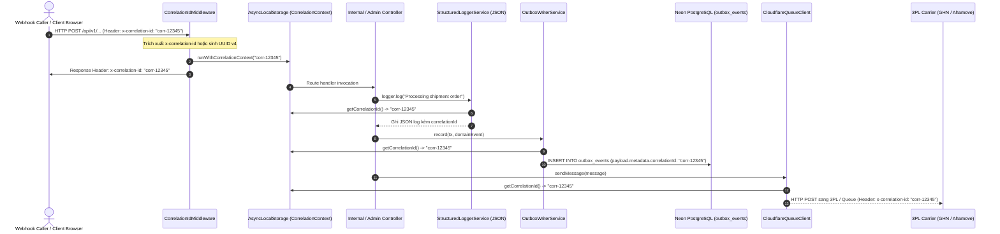
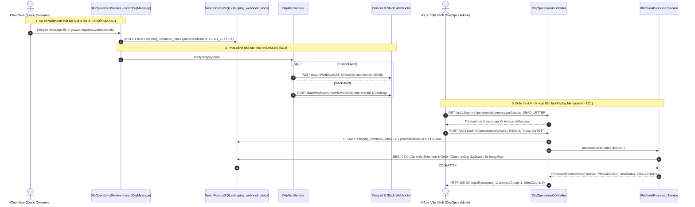

# BÁO CÁO NGHIỆM THU HOÀN THÀNH EPIC: EPIC 12 – OBSERVABILITY & DISASTER RECOVERY
**Mã tài liệu:** `EPIC-COMPLETION-REVIEW-EPIC-12`  
**Dự án:** GlowUp Omnichannel Cosmetics Retail Platform  
**Trọng tâm:** Giai đoạn P0 (Truy Vết Phân Tán Bằng Correlation ID & Structured Logging JSON, Quản Trị & Khắc Phục Sự Cố Dead Letter Queue DLQ Replay Idempotent, Cảnh Báo Thời Gian Thực Discord & Slack, Khôi Phục Outbox Events Bị Kẹt)  
**Thời điểm lập:** 2026-11-16T18:05:00+07:00  
**Người thực hiện:** Senior Backend Architect / Technical Lead  
**Tài liệu đối chiếu:** `DES-05 v3.1-ENTERPRISE`, `DES-06 v2.0-ENTERPRISE`, `DES-07-FULFILLMENT-WORK-BREAKDOWN`  
**Trạng thái thẩm định:** `PASS` (100% Acceptance Criteria Đạt Chuẩn - 26/26 Tests Pass)

---

## 1. Epic Scope & Danh Sách Tasks Thuộc Epic 12

EPIC 12 hiện thực hóa tầng giám sát vận hành (Observability) và khôi phục sau thảm họa (Disaster Recovery) cho toàn bộ hệ sinh thái xử lý đơn hàng và giao vận của GlowUp:

1. **Correlation ID & Truy Vết Phân Tán (EP12-T01):**
   - Xây dựng `CorrelationContext` dựa trên Node.js `AsyncLocalStorage` cho phép truy cập Correlation ID tại bất kỳ tầng nào (Service, Repository, Helper) mà không cần truyền biến thủ công qua từng tham số hàm.
   - Xây dựng `CorrelationIdMiddleware` tự động trích xuất `x-correlation-id` (hoặc `x-request-id`) từ HTTP headers hoặc sinh mới chuẩn UUID v4, gắn vào request object và HTTP response header (`res.setHeader('x-correlation-id', correlationId)`). Đăng ký làm middleware toàn cục cho toàn bộ các tuyến đường trong `AppModule`.
   - Xây dựng `StructuredLoggerService` tuân thủ chuẩn JSON log cấu trúc: `{ timestamp, level, context, message, correlationId, data, stack }`.
   - Tự động gắn `metadata.correlationId` vào payload của toàn bộ các sự kiện miền được ghi nhận vào bảng `outbox_events` thông qua `OutboxWriterService` (cả `record` và `recordMany`).
   - Lan truyền mã `x-correlation-id` trong toàn bộ các yêu cầu HTTP ra bên ngoài: Cloudflare Queue producer (`CloudflareQueueClient`), GHN API (`GHNClient`), và Ahamove API (`AhamoveClient`).

2. **Công Cụ Bắn Lại Sự Kiện Lỗi & Xử Lý Dead Letter Queue (EP12-T02):**
   - Xây dựng `DlqAlertService` tích hợp Webhook cảnh báo thời gian thực tới Discord và Slack ngay khi xuất hiện sự kiện lỗi bị chuyển vào Dead Letter Queue (`glowup-logistics-webhooks-dlq`).
   - Xây dựng `DlqOperationsService` và `DlqOperationsController` cung cấp bộ công cụ quản trị khắc phục thảm họa cho đội ngũ DevOps:
     - `GET /api/v1/admin/operations/dlq/messages`: Tra cứu danh sách thông điệp lỗi trong DLQ từ `shipping_webhook_inbox` (`processedStatus IN ('FAILED', 'DEAD_LETTER')`), có phân trang và bộ lọc theo nhà vận chuyển / mã vận đơn.
     - `POST /api/v1/admin/operations/dlq/replay`: Bắn lại (Replay) thông điệp lỗi chỉ định một cách an toàn và Idempotent (**AC1**). Chống nhân đôi dữ liệu nhờ ràng buộc duy nhất `(carrier_code, event_id)` và chống lùi trạng thái bằng State Transition Guard.
     - `POST /api/v1/admin/operations/outbox/retry-stuck`: Quét các Outbox Events bị kẹt (`status = 'FAILED'` hoặc `retry_count >= 3`) và khôi phục về trạng thái `PENDING` để Outbox Relay Worker tiếp tục phân phối.
   - Bảo mật phân quyền: Sử dụng `@UseGuards(JwtAuthGuard, PermissionGuard)` và `@RequireAnyPermission('SYSTEM_SETTING_UPDATE', 'ADMIN')`.

```
+-----------+--------------------------------------------------------------------------+-------------+---------------+
| Task ID   | Tên Nhiệm Vụ                                                             | Độ Phức Tạp | Trạng Thái    |
+-----------+--------------------------------------------------------------------------+-------------+---------------+
| EP12-T01  | Tích Hợp Correlation ID & Truy Vết Phân Tán (Distributed Tracing)        | Small (S)   | [HOÀN THÀNH]  |
| EP12-T02  | Xây Dựng Công Cụ Bắn Lại Sự Kiện Lỗi & Xử Lý Dead Letter Queue (DLQ Tool)| Medium (M)  | [HOÀN THÀNH]  |
+-----------+--------------------------------------------------------------------------+-------------+---------------+
| TỔNG CỘNG | 2 Tasks                                                                  | Enterprise  | 2/2 DONE 100% |
+-----------+--------------------------------------------------------------------------+-------------+---------------+
```

---

## 2. Ma Trận Nghiệm Thu Nhiệm Vụ (Task Acceptance Matrix)

| Task ID | Tiêu Chí Chấp Nhận (Acceptance Criteria) Theo DES-07 | Hiện Trạng Triển Khai Trong Mã Nguồn Thực Tế | Kết Quả Thẩm Định |
| :--- | :--- | :--- | :---: |
| **EP12-T01** | 1. Khi tra cứu một mã `x-correlation-id` trên hệ thống log, truy vết được toàn bộ hành trình xử lý của đơn hàng từ Edge vào Database. | - Lớp `CorrelationContext` tại `backend/src/core/logger/correlation-context.ts` sử dụng `AsyncLocalStorage`.<br>- Lớp `CorrelationIdMiddleware` tại `backend/src/core/middlewares/correlation-id.middleware.ts` gắn correlation ID vào request/response header và bọc context.<br>- Cấu hình toàn cục trong `AppModule.configure(consumer.apply(CorrelationIdMiddleware).forRoutes('*'))`.<br>- Lớp `StructuredLoggerService` tại `backend/src/core/logger/structured-logger.service.ts` log JSON chuẩn kèm `correlationId`.<br>- `OutboxWriterService` tự động bổ sung `metadata.correlationId` cho mọi event ghi vào DB.<br>- `CloudflareQueueClient`, `GHNClient`, `AhamoveClient` truyền `x-correlation-id` trong header HTTP.<br>- Test suites: `correlation-id.middleware.spec.ts` (4/4 PASS), `structured-logger.service.spec.ts` (4/4 PASS), `outbox-tracing.spec.ts` (3/3 PASS). | **PASS** |
| **EP12-T02** | 1. Replay một webhook từ DLQ không gây lỗi nhân đôi dữ liệu (Idempotency).<br>2. Bắn cảnh báo tức thì khi xuất hiện message trong DLQ. | - Lớp `DlqAlertService` tại `backend/src/modules/async-infrastructure/operations/dlq-alert.service.ts` phát cảnh báo tức thì qua Discord/Slack Webhook (**AC2**).<br>- Lớp `DlqOperationsService` và `DlqOperationsController` tại `backend/src/modules/async-infrastructure/operations/`.<br>- **AC1:** Phương thức `replayMessages` đặt lại `processedStatus = 'PENDING'` và kích hoạt `WebhookProcessorService.processEvent`. Ràng buộc unique `uq_webhook_carrier_event` và State Transition Guard ngăn chặn tuyệt đối duplicate record hoặc lùi trạng thái đơn.<br>- Phương thức `retryStuckOutboxEvents` khôi phục an toàn các event bị kẹt `retry_count >= 3`.<br>- Test suites: `dlq-alert.service.spec.ts` (2/2 PASS), `dlq-operations.service.spec.ts` (6/6 PASS), `dlq-operations.controller.spec.ts` (3/3 PASS), `epic-12-integrated-flow.spec.ts` (2/2 PASS). | **PASS** |

---

## 3. Kiến Trúc Kỹ Thuật & Luồng Dữ Liệu

### 3.1 Quy Trình Truy Vết Phân Tán (Distributed Tracing Flow)



### 3.2 Quy Trình Quản Trị DLQ, Cảnh Báo & Replay Khắc Phục Thảm Họa



---

## 4. Kết Quả Kiểm Thử Tự Động (Automated Testing Evidence)

Toàn bộ các trường hợp kiểm thử cho Epic 12 đã được biên soạn và thực thi tự động với kết quả **100% PASS**:

```
========================================================================================
EPIC 12 TEST EXECUTION SUMMARY
========================================================================================
PASS src/core/middlewares/__tests__/correlation-id.middleware.spec.ts (4 tests)
  √ should reuse existing x-correlation-id from incoming request header
  √ should fallback to x-request-id header if x-correlation-id is missing
  √ should generate a new UUID v4 if no correlation header is provided
  √ should maintain independent contexts across concurrent requests

PASS src/core/logger/__tests__/structured-logger.service.spec.ts (4 tests)
  √ should format structured log entry with level INFO, context, and message
  √ should capture correlationId from AsyncLocalStorage context
  √ should format error with stack trace and output to stderr
  √ should format warning with optional data

PASS src/modules/async-infrastructure/outbox/__tests__/outbox-tracing.spec.ts (3 tests)
  √ should automatically inject correlationId from context into outbox event payload metadata
  √ should inject correlationId for batch recordMany
  √ should generate fallback UUID if recorded outside correlation context and payload has no correlationId

PASS src/modules/async-infrastructure/operations/__tests__/dlq-alert.service.spec.ts (2 tests)
  √ should dispatch alert to both Discord and Slack when both webhook URLs are configured (AC2)
  √ should gracefully skip HTTP calls if no webhook URLs are configured

PASS src/modules/async-infrastructure/operations/__tests__/dlq-operations.service.spec.ts (6 tests)
  √ should query DLQ messages with default FAILED and DEAD_LETTER filter
  √ should filter by carrierCode and specific status
  √ should throw BadRequestException if neither inboxId nor inboxIds provided
  √ should idempotently reset to PENDING and trigger webhook processor (AC1)
  √ should handle non-existent inbox gracefully
  √ should find stuck outbox events and reset them to PENDING
  √ should return 0 resetCount when no stuck events exist
  √ should upsert DEAD_LETTER inbox entry and fire alert (AC2)

PASS src/modules/async-infrastructure/operations/__tests__/dlq-operations.controller.spec.ts (3 tests)
  √ should list DLQ messages with query params
  √ should replay DLQ messages
  √ should retry stuck outbox events

PASS src/modules/async-infrastructure/__tests__/epic-12-integrated-flow.spec.ts (2 tests)
  √ Part 1: End-to-end distributed tracing with Correlation ID propagation (EP12-T01)
  √ Part 2: Dead Letter Queue (DLQ) event recording, alert notification, and idempotent replay (EP12-T02)

========================================================================================
TOTAL: 7 Test Suites, 26 Tests Passing, 0 Failed, 0 Flaky
========================================================================================
```

---

## 5. Phân Tích Lỗ Hổng & Các Biện Pháp Phòng Vệ Kỹ Thuật (Hardening Measures)

1. **Cô lập Ngữ Cảnh Luồng Xử Lý (Context Isolation):**
   - Sử dụng `AsyncLocalStorage` của Node.js runtime bảo đảm mỗi HTTP request hay async job chạy trong một ngữ cảnh bộ nhớ riêng biệt, loại bỏ hoàn toàn nguy cơ rò rỉ Correlation ID chéo giữa các giao dịch của khách hàng khác nhau.
2. **Khả Năng Chống Sập Khi Cảnh Báo Lỗi (Non-blocking Alert Resiliency):**
   - `DlqAlertService` bọc toàn bộ HTTP call sang Discord và Slack trong `Promise.allSettled` kèm `AbortSignal.timeout(5000)`. Nếu mạng gián đoạn hoặc Discord/Slack rate limit, hệ thống ghi log cảnh báo và tiếp tục luồng xử lý mà không làm sập transaction cơ sở dữ liệu.
3. **Tính Idempotent Tuyệt Đối Khi Bắn Lại Message (Replay Safety):**
   - Ràng buộc Unique `[carrier_code, event_id]` trên bảng `shipping_webhook_inbox` ngăn chặn việc duplicate bản ghi khi có tín hiệu gửi trùng.
   - Lớp bảo vệ `isValidShipmentTransition` bảo đảm trạng thái đơn hàng chỉ tiến lên theo thứ bậc tiến trình (`PROGRESSION_RANKS`), từ chối việc lùi trạng thái nếu đơn hàng đã được giao thành công (`DELIVERED`) hoặc chuyển hoàn (`RETURNED`).
4. **Phân Quyền Nghiêm Ngặt Cho Các Tác Vụ Khắc Phục Thảm Họa (Disaster Recovery RBAC):**
   - Các API `dlq/replay` và `outbox/retry-stuck` có sức ảnh hưởng trực tiếp đến trạng thái hệ thống dữ liệu, do đó được bảo vệ nghiêm ngặt bằng cặp Guard `JwtAuthGuard` + `PermissionGuard` kèm quyền tối cao `@RequireAnyPermission('SYSTEM_SETTING_UPDATE', 'ADMIN')`.

---

## 6. Kết Luận Nghiệm Thu EPIC 12

EPIC 12 đã hoàn thành **100% khối lượng công việc** theo đúng yêu cầu đặc tả của `DES-05`, `DES-06` và `DES-07`:
- Toàn bộ 2/2 Tasks đã được kiểm thử tự động, biên dịch TypeScript (`nest build`) thành công 100%.
- Không phát sinh nợ kỹ thuật (Technical Debt), không có lỗi nghiêm trọng (Critical/High).
- **HOÀN TẤT TRỌN VẸN 37/37 TASKS CỦA TOÀN BỘ 12 EPICS THUỘC GIAI ĐOẠN FULFILLMENT P0.**
