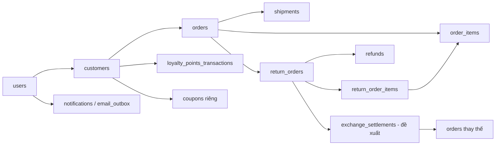

# Sprint 4 — Việt Trung — Backend End-user

**Chủ đề:** Đổi/trả, theo dõi giao hàng, loyalty, wishlist và thông báo.  
**Ngày lập:** 2026-10-24. **Cập nhật triển khai:** 2026-10-25. **Trạng thái:** Đã triển khai và kiểm thử mã backend; còn gate cấu hình/provider và nghiệm thu tích hợp.  
**Phạm vi đã xác nhận:** Sprint 4, 5, 6 của roadmap hiện tại, mỗi sprint một file.  
**Cách lập kế hoạch:** Theo thứ tự công việc, phụ thuộc và tiêu chí nghiệm thu; không ước lượng ngày công theo yêu cầu người dùng.  
**Liên kết:** [Roadmap](08_sprint_plan.md) · [Functional Requirements](../1-requirement/07_functional_requirements.md) · [Thiết kế DB](../2-design/04_thiet_ke_csdl.md) · [Sprint 5](10_sprint_5_viet_trung_backend_enduser.md) · [Sprint 6](11_sprint_6_viet_trung_backend_enduser.md).

## 1. Mục tiêu, phạm vi và quyết định đã chốt

Khách hàng xem được tiến trình giao hàng, gửi và theo dõi yêu cầu trả hàng hoặc đổi sang sản phẩm khác; xem điểm/hạng, đổi điểm lấy voucher và quản lý wishlist. Web/Mobile nhận được trạng thái nghiệp vụ nhất quán với Admin.

| FR / nguồn | Việt Trung phụ trách | Phụ thuộc Thành Lập |
|---|---|---|
| FR-04.06 | Tạo/list/detail yêu cầu REFUND và EXCHANGE, ảnh bằng chứng, lựa chọn hàng thay thế, xem báo giá/chênh lệch | Duyệt, nhận hàng, kiểm định, nhập lại kho, tạo đơn thay thế, xử lý phần chênh |
| FR-04.08; FR-04.07 là phụ thuộc | API tracking và thông báo cho chủ đơn | Tạo vận đơn, adapter hãng vận chuyển, webhook |
| FR-08.04–08.05 | Loyalty read/redeem, dùng chung quy tắc điểm với checkout | Cấu hình hạng/phần thưởng, trigger COMPLETED và điều chỉnh khi đổi/trả |
| FR-08.07 / FR-02.07 | Wishlist và cờ `isWishlisted` trong catalog | Dữ liệu trạng thái sản phẩm |
| FR-07.06; thông báo trong Sprint 4 | Hiển thị trạng thái hoàn tiền, thông báo sau thành công | Refund command, adapter gateway, đối soát kết quả |

Quyết định của người dùng trong phiên lập kế hoạch:

- Làm **cả REFUND và EXCHANGE ngay Sprint 4**, cho phép đổi sang sản phẩm/biến thể khác giá.
- Định giá hàng thay thế tại lúc xác nhận đổi; đối trừ giá trị hàng trả sau giảm giá. Khách trả thêm nếu đắt hơn, được hoàn phần chênh nếu rẻ hơn.
- Phí giao lại và điều chỉnh điểm là cấu hình phải chốt trước triển khai. Không tự đặt tỷ lệ đổi điểm, hạn voucher, thời hạn điểm hoặc chính sách thu hồi điểm.
- Redis của dự án dùng **Upstash Redis**, áp dụng thống nhất cho cache và rate limit dùng chung; cấu hình adapter và kiểm chứng tích hợp được chi tiết ở Sprint 6. Các kiểm tra số dư/credit/tồn kho vẫn nằm trong transaction PostgreSQL.
- Quy tắc giá dùng xuyên S4/S5: chọn mức tốt hơn giữa ưu đãi hạng và promotion cho từng dòng, sau đó tối đa một coupon rồi điểm. Phí giao hàng, phân bổ giảm giá khi trả một phần, sale nhập tay và phục hồi quota được người dùng cho phép chốt thành cấu hình tại kickoff.
- Khung đề xuất để hiện thực FR “COMPLETED trong 7 ngày”: dùng thời điểm chuyển COMPLETED đầu tiên trong history; hỗ trợ trả một phần/nhiều lần với tổng lượng không vượt lượng mua. Đây là cách diễn giải kỹ thuật cần ghi vào acceptance khi kickoff.

Admin HR, nhà cung cấp, chuyển kho, kiểm kê và phân quyền nằm trong công việc Thành Lập; không tính các phần đó vào deliverable Việt Trung.

## 2. Căn cứ hiện trạng và điều kiện đầu vào

Phân tích dựa trên file trong repository, gồm [schema Prisma](../../backend/prisma/schema.prisma), các migration về constraint/index/Sprint 3 và các đường xử lý liên quan. **Chưa truy vấn DB đang chạy, chưa xác nhận migration đã được áp dụng, chưa chạy kiểm thử backend trong lần lập kế hoạch này.**

| Bằng chứng | Kết luận phục vụ kế hoạch |
|---|---|
| `backend/package.json`, `src/app.module.ts` | NestJS + Prisma + PostgreSQL, module Auth/Catalog/Cart/Customer/Order đã được đăng ký. Giữ cấu trúc controller → use case → port/repository hiện có |
| `src/modules/payments` hiện chỉ có domain policy/readiness và test | Chưa có controller/module/adapter thanh toán được nối vào AppModule; không coi migration Sprint 3 là chứng cứ gateway đã chạy |
| `Notification`, `EmailOutbox`, `UserDevice`; `core/services/order-events.ts` | Có schema và helper ghi notification/email; chưa thấy module notification và worker gửi được nối vào ứng dụng |
| `PrismaAdminOrderRepository.rewardCustomer` | Đã có EARN, tăng tổng chi tiêu/số đơn, xét hạng khi COMPLETED; tái sử dụng và sửa tính đồng thời, không cộng điểm lần nữa ở listener |
| `CreateOrderUseCase`, `PrismaOrderRepository.createOrderWithTransaction` | Điểm/coupon được đọc trước transaction, ghi giảm/tăng chưa kiểm tra lại giới hạn; clear cart sau commit; dòng hàng chưa phân bổ giảm giá cấp đơn |
| `OrderPricingService` | Đang hardcode 1 điểm = 1.000 VND, phí 30.000 và miễn phí từ 500.000; đây là hiện trạng, không phải chính sách mới đã được duyệt |
| `CustomerContextService` | Lookup đang có nhánh tự tạo customer. API read mới cần lookup chỉ đọc, kiểm tra vai trò và ownership; không tự sinh customer cho staff khi đọc wishlist |
| `JwtAuthGuard` | Public route đã đọc JWT tùy chọn; guard hiện kiểm tra chữ ký/hạn, cần kiểm chứng trạng thái tài khoản và session trước thao tác nhạy cảm |

**Gate S4-00 trước nhận sprint:** xác nhận build, auth/owner context, checkout COD, chuyển trạng thái đơn, dữ liệu COMPLETED và các migration trên DB thử nghiệm. Ghi rõ gateway nào đã có smoke test và notification/email worker nào đã chạy. Nếu thiếu, tạo backlog carry-over Sprint 3 với effort riêng; chưa được đánh dấu luồng hoàn tiền online/notification E2E hoàn tất bằng mock.

## 3. Phân tích DB và thiết kế bổ sung

### 3.1 Quan hệ và bất biến

- `userId` và `customerId` là hai UUID khác nhau. Ownership RMA/tracking/loyalty phải suy từ user xác thực → customer → order; không tin `customerId`, `storeId`, giá hoặc condition client gửi.
- `ReturnOrder` có cả `orderId/customerId/storeId`; FK đơn lẻ chưa đảm bảo chúng cùng một giao dịch. Kiểm tra nhất quán trong transaction. Đề xuất tiếp nhận online tại store đơn gốc; yêu cầu đổi chi nhánh cần quyết định riêng.
- `ReturnOrderItem` giữ `orderItemId` và `productVariantId`; lấy variant từ dòng gốc. Tổng lượng trong các phiếu REQUESTED/APPROVED/RECEIVED/INSPECTED/COMPLETED cộng lượng mới không được vượt lượng mua; REJECTED giải phóng quyền yêu cầu lại.
- `condition` hiện NOT NULL nhưng lúc khách yêu cầu chưa có kết quả kiểm định. Đề xuất cho phép NULL trước INSPECTED, sau đó bắt buộc RESALEABLE/DAMAGED; không cho khách tự xác nhận hàng được nhập lại bán.
- `Order` chưa có `completedAt`; đọc mốc COMPLETED từ `OrderStatusHistory`, không dùng `updatedAt`. Thiếu history thì trả lỗi cần kiểm tra dữ liệu, không suy đoán từ ngày tạo.
- `Shipment` là quan hệ 1-n với Order; tracking phải trả nhiều kiện. `carrierMetadata` không thay thế lịch sử shipment có cấu trúc.
- Tiền dùng Decimal hoặc số nguyên VND với quy tắc làm tròn thống nhất, không để sai số số thực quyết định số tiền hoàn.

### 3.2 Migration đề xuất — review chung với BE Admin

Tên bảng/cột dưới đây là **thiết kế mới**, chưa có trong schema hiện tại.

| Thay đổi | Lý do và ràng buộc |
|---|---|
| `return_attachments` | FK return, uploader user, object key, MIME/size, createdAt; ảnh thuộc owner, không lưu binary trong DB; staging upload cần ownership và dọn file chưa gắn |
| `return_status_history` | FK return, status, actor, note public, timestamp; tách ghi chú nội bộ khỏi phản hồi customer |
| `return_order_items.condition` nullable; UNIQUE `(return_order_id, order_item_id)` | Có trạng thái chưa kiểm định; ngăn trùng dòng trong một phiếu. CHECK quantity > 0 đã có trong migration cũ |
| `return_order_items.refund_amount` và snapshot phân bổ | Lưu giá trị hoàn đã xác nhận từng dòng; aggregate phải bằng khoản hàng trả được duyệt; không lấy giá catalog mới |
| `exchange_items` | FK return, variant thay thế, quantity > 0; lưu snapshot giá/discount và phiên bản quote khi xác nhận. Cho phép một phiếu đổi nhiều dòng |
| `exchange_settlements` | UNIQUE return, UNIQUE replacementOrderId, giá trị hàng trả, giá hàng mới, phí, credit applied, additional due/refund due, trạng thái. Giá trị không âm; lưu nguyên nhân/version báo giá |
| `shipment_events` | FK shipment, status, occurredAt, receivedAt, provider event identity UNIQUE theo carrier; webhook trùng không tạo timeline/thông báo trùng |
| `command_receipts` | UNIQUE `(user_id, operation, idempotency_key)`, request hash, resource/result ref; dùng cho tạo RMA, chấp nhận quote, đổi điểm; key trùng payload khác trả 409 |
| `loyalty_redemptions` | customer, reward code/version, points cost, couponId UNIQUE, command receipt; gắn lần đổi với đúng voucher và ledger |
| `loyalty_points_transactions.event_key` nullable UNIQUE | Dedupe EARN/REDEEM/refund adjustment; bảng hiện chưa có business event key, chưa có liên kết voucher |
| Cấu hình reward trong `settings` | Danh sách reward versioned và validate schema; chứa pointsCost, discountType/value, minOrder, validity, usage rules; snapshot vào redemption/coupon |
| `push_deliveries` | notification + device UNIQUE, status/attempts/nextAttemptAt/lease; lưu tiến độ gửi từng thiết bị. Tận dụng EmailOutbox cho email |

`Wishlist` đã có UNIQUE `(customerId, productId)`, `CouponUsage` đã có UNIQUE order, `Notification.eventKey`, `Refund.compensationKey` đã unique; không tạo bảng hoặc unique trùng chức năng. Mọi trạng thái đang là VARCHAR, nên cần state machine/validation và CHECK SQL phù hợp, không giả định Prisma enum đã tồn tại.

Index cần đối chiếu query thực trước khi thêm:

- Return list: `(customer_id, created_at, id)`; return items: `(order_item_id)` để tính lượng đã yêu cầu.
- Order history: `(order_id, status, created_at)`; shipment events: `(shipment_id, occurred_at, id)`.
- Loyalty ledger: `(customer_id, created_at, id)`; wishlist: `(customer_id, created_at, id)` nếu sort theo mới nhất.
- Refund lookup: `(return_order_id, status)`; worker: `(status, next_attempt_at, lease_until)`.

Migration mới theo thứ tự: thêm bảng/cột nullable → kiểm tra/backfill dữ liệu → thêm unique/check → regenerate client → code đọc/ghi → kiểm tra tương thích. Không sửa migration đã áp dụng; giữ generated `inventory.available_quantity`, CHECK tồn kho và SQL index viết tay. Backfill event key lịch sử phải tránh gây phát lại notification/EARN. Không bật CHECK điểm không âm trước khi chốt cách xử lý khách đã tiêu điểm rồi hoàn hàng.

### 3.3 Transaction RMA và đổi sản phẩm

**Tạo yêu cầu:** xác thực → khóa order gốc → kiểm tra owner/status/mốc 7 ngày → khóa/đọc dòng gốc theo thứ tự ID → tính lượng còn được trả → kiểm tra ảnh và lựa chọn thay thế → tạo return + items + history + receipt + notification/outbox → commit. Chưa hoàn tiền, chưa restock, chưa giữ hàng thay thế chỉ vì khách gửi yêu cầu.

**Giá trị hàng trả:** dùng snapshot dòng hàng, phân bổ coupon/điểm/giảm giá cấp đơn theo quy tắc được thống nhất với checkout; giới hạn tổng credit/hoàn tiền tích lũy không vượt quyền lợi của lượng hàng thực trả và tiền đã thu. Code hiện ghi `order_items.discount_amount = 0` và gộp giảm điểm vào giảm giá đơn: phải bổ sung breakdown trước khi chạy RMA thật. Đơn cũ không đủ snapshot cần backfill có kiểm chứng hoặc chuyển kiểm tra thủ công; không trả theo giá niêm yết.

Phần sửa nền checkout này thuộc S4-02: tách coupon discount khỏi điểm trong `coupon_usage`, lưu điểm thực trừ và phân bổ vào từng dòng, kiểm tra lại số dư/lượt coupon khi ghi trong transaction. Chọn cấu trúc snapshot dùng được cho tier/promotion và để các phần chưa áp dụng bằng 0/null. Sprint 5 mở rộng engine promotion/quota trên cấu trúc đó; S4 không phụ thuộc ngược vào việc hoàn tất Sprint 5 mới chạy được REFUND/EXCHANGE.

**EXCHANGE khác giá:**

1. Sau kiểm định, Admin lập quote gồm hàng được nhận lại, hàng thay thế, giá hiện hành, giảm giá, credit, phí giao lại, số cần thu/hoàn. Khách đọc và chấp nhận đúng `quoteVersion`; quá hạn/thay đổi quote trả 409 và yêu cầu xem lại.
2. Khi khách xác nhận: khóa phiếu + quote + tồn kho biến thể theo thứ tự ổn định, kiểm tra quote còn hiệu lực, snapshot giá tại thời điểm xác nhận, tạo một đơn thay thế và settlement, giữ tồn kho theo cơ chế online hiện tại. Nếu giá thay đổi, báo giá lại trước khi commit.
3. Công thức: `creditApplied = min(returnCredit, replacementPayable)`; `additionalDue = max(replacementPayable - returnCredit, 0)`; `refundDue = max(returnCredit - replacementPayable, 0)`. `replacementPayable` gồm phần phí được chính sách cho phép. `returnCredit` phải tách tiền và điểm theo chính sách để không hoàn điểm thành tiền ngoài ý muốn.
4. Credit là bút toán đối trừ, **không tạo payment gateway giả đã thu tiền**. Payment mới chỉ cho phần phải trả thêm; phần hoàn đi qua Refund liên kết payment gốc. Với COD/thu tiền thủ công cần adapter/quy trình Admin tương ứng, không coi nhấn nút là tiền đã về khách.
5. Chỉ cho chuyển đơn thay thế tới bước fulfillment khi credit hợp lệ và phần chênh cần thu đã thanh toán hoặc đủ điều kiện COD theo cấu hình. Sửa giả định `sum(payments) == order.totalAmount` trong các đường dùng đơn thay thế; dùng `payments + applied exchange credit` để tính nghĩa vụ còn lại.
6. Hủy/hết hạn đơn thay thế phải release reservation đúng một lần, giữ rõ số phận credit và refund đã phát sinh; trạng thái chưa rõ từ gateway cần đối soát trước khi retry. Chính sách hủy sau nhận hàng trả phải chốt, không tự hoàn tiền lần hai.
7. Admin chịu trách nhiệm restock theo kiểm định, FEFO khi xuất hàng mới và traceability lô. Một return item hiện chỉ có một `restockBatchId`; nếu một dòng gốc xuất từ nhiều lô thì cần bảng phân bổ restock theo lô hoặc xác định lô tiếp nhận mới có liên kết truy vết, không ghi đè cho mất dấu.
8. Thống nhất với Admin báo cáo/loyalty: đối trừ không được làm tăng doanh thu/totalSpent/điểm hai lần. Audit lưu gross hàng thay thế, credit từ hàng trả, cash chênh và các reversal riêng; chốt cách trình bày trước nghiệm thu EXCHANGE.

**Hoàn tiền:** Admin xử lý gateway ngoài DB transaction, ghi trạng thái kết quả + outbox trong transaction ngắn. Việt Trung gửi “hoàn tiền thành công” chỉ khi refund thực sự thành công; `ReturnOrder.COMPLETED` hoặc yêu cầu gateway đã được nhận chưa đủ. Dedupe theo refund ID + trạng thái + user.

### 3.4 Loyalty, wishlist và notification

- Dùng một service nghiệp vụ điểm với transaction client chung cho COMPLETED, redeem, checkout và hoàn/hủy. Khóa customer hoặc conditional update có kiểm tra số dư; ghi ledger cùng transaction. Hai đơn cùng khách không được xét hạng từ số dư cũ.
- `GET loyalty` trả balance, tier/benefits, next tier, lịch sử phân trang; xét hạng theo `totalPoints` đúng FR hiện tại. Đổi điểm có thể hạ hạng; quy tắc phải nhất quán mọi nhánh thay đổi điểm.
- `POST redeem` nhận `rewardCode` và Idempotency-Key, không nhận giá trị voucher tùy ý. Validate reward config, khóa customer, trừ điểm, tạo coupon riêng + redemption + ledger + receipt; retry trả cùng coupon.
- Không mặc định hết hạn điểm chỉ vì ledger có `expiresAt`: muốn EXPIRE đúng phải theo dõi lượng điểm từng lần EARN đã tiêu/đã hết hạn. Nếu bật chính sách hết hạn, bổ sung lot/allocation trước worker; không trừ toàn bộ EARN ban đầu lần nữa.
- Wishlist cần JWT customer. Toggle dùng transaction/lock và receipt khi retry; có thể bổ sung PUT/DELETE theo trạng thái đích để FE dùng ổn định. Cờ wishlist enrich theo batch cho trang sản phẩm; không chạy query theo từng card, không cache cờ của khách vào cache public.
- Notification ghi cùng transaction với event nghiệp vụ; email/push gửi sau commit, có retry/backoff, lease và xử lý token vô hiệu. `eventKey` phải gồm recipient; shipment event key phải định danh lần chuyển, không chỉ shipment + status vì có thể giao lại nhiều lần.
- Dedupe DB không bảo đảm provider gửi đúng một lần khi worker chết sau gửi; payload push chứa notification ID để client loại trùng. Sự kiện loyalty, return, shipment, refund dùng helper dùng chung, tránh mỗi module một worker.

## 4. API contract cần bàn giao

Prefix mặc định `/api/v1`. Endpoint mới là đề xuất contract; route catalog đang tồn tại `/customer/products`, cần giữ tương thích. JSON theo interceptor hiện có; DTO mới thống nhất camelCase, ghi mapping snake_case của tài liệu gốc trong OpenAPI.

| API | Input/output chính | Điều kiện |
|---|---|---|
| `POST /returns` | orderId, type, reason, items `{orderItemId, quantity}`, attachment IDs, replacement selections; trả return ID/code/status | 201, JWT customer, Idempotency-Key; không cho ghi adminNote/condition/refundAmount |
| `GET /returns`, `GET /returns/:id` | Phân trang/status; items, history public, ảnh được cấp quyền, quote, settlement/refunds, replacement order | Chỉ owner; thiếu/sai owner trả 404 |
| `POST /uploads/return-images` | Ảnh → attachment ID/object reference | Validate loại thật, size/count có giới hạn, owner; không mở endpoint upload admin cho customer |
| `POST /returns/:id/exchange/accept` | quoteVersion + Idempotency-Key → đơn thay thế, số cần thu/hoàn | Chỉ phiếu EXCHANGE của owner đang đủ điều kiện; đây là bổ sung để chốt giá với khách |
| `GET /orders/:id/tracking` | shipments[], timeline, safe tracking URL, thời điểm cập nhật | Owner, chưa có vận đơn trả danh sách rỗng; không lộ carrierMetadata/shipping label nội bộ |
| `GET /customers/me/loyalty` | balance, tier, benefits, nextTier, ledger phân trang | JWT customer |
| `GET /customers/me/loyalty/rewards` | Phần thưởng đang áp dụng, điểm cần đổi, điều kiện | Bổ sung phục vụ màn hình chọn thưởng; không dựng giá từ FE |
| `POST /customers/me/loyalty/redeem` | rewardCode → redemption, coupon, balance | Receipt + transaction; thiếu cấu hình trả lỗi rõ, không trừ điểm |
| `POST /wishlists/toggle`, `GET /wishlists` | productId → trạng thái cuối; list sản phẩm phân trang | Owner, sản phẩm phải tồn tại/đủ điều kiện hiển thị |
| `GET /customer/products`, `GET /customer/products/:slug` | Bổ sung `isWishlisted` theo auth context | Guest false; lookup chỉ đọc |
| `GET /notifications`, `PUT /notifications/:id/read` | List/unread count; đánh dấu đã đọc | Tái sử dụng contract Sprint 3 nếu đã bổ sung; scope userId |
| `POST /users/me/devices`, `DELETE /users/me/devices/:id` | Đăng ký/hủy push device | Tái sử dụng nếu có; xử lý token rotation, đổi tài khoản, logout |

Lỗi cần có trong contract: 400 dữ liệu sai, 401 thiếu/xác thực hết hạn, 403 sai vai trò, 404 không có quyền thấy resource, 409 xung đột/trùng request khác payload/không còn đủ điểm hoặc lượng trả, 429 vượt giới hạn. Mã lỗi nghiệp vụ ổn định; không phụ thuộc câu tiếng Việt để FE điều hướng.

## 5. Backlog và thứ tự thực hiện

| ID | Công việc và đầu ra | Phụ thuộc |
|---|---|---|
| S4-00 | Gate nền tảng, contract chung, rà migration và chính sách còn mở | Nhánh backend hiện tại + Thành Lập |
| S4-01 | Migration RMA/settlement/receipt/ledger, fixture và review DB | S4-00 |
| S4-02 | Tạo/list/detail RMA, upload, quantity lock, snapshot credit | S4-01 + discount breakdown |
| S4-03 | Quote/accept EXCHANGE, liên kết đơn thay thế, thu/hoàn chênh, bù trừ | S4-02 + Admin inspection + payment readiness |
| S4-04 | Tracking nhiều shipment, event history và contract webhook | Schema/event writer Thành Lập |
| S4-05 | Loyalty read/reward/redeem và dùng chung transaction điểm | Cấu hình policy + S4-01 |
| S4-06 | Wishlist + enrich catalog an toàn với cache | Customer context, catalog |
| S4-07 | Notification read/device/worker còn thiếu; return/refund/loyalty/shipment events | S4-00, writer events từ Admin |
| S4-08 | Test cạnh tranh trên PostgreSQL, E2E Web/Mobile, Swagger và review | Các API chính đã sẵn sàng |

Thứ tự triển khai: gate/contract → migration và giá trị hàng trả → RMA → settlement → loyalty/tracking/wishlist → tích hợp notification → kiểm thử. Bàn giao OpenAPI/fixture ngay sau contract, API từng luồng trước buổi FE tích hợp 1–2 ngày. Review với Thành Lập trước migration và trước ghép state machine.

Các hợp đồng cần nhận từ Thành Lập: danh sách transition RMA và actor được phép; thời điểm ghi settlement/refund; mapping carrier status; sự kiện `return.status_changed`, `shipment.status_changed`, `refund.completed`, `loyalty.changed`; payload có eventId/userId/resourceId/occurredAt. Không phát sự kiện “thành công” trước commit.

## 6. Kiểm thử và Definition of Done

- Unit: biên đúng 7 ngày, reason hợp lệ, lượng trả nhiều lần, công thức credit/chênh giá và rounding; tier/reward và thông báo theo trạng thái.
- PostgreSQL integration: hai request trả cùng lượng cuối; hai redeem/checkout dùng cùng số điểm; lặp accept EXCHANGE chỉ có một đơn thay thế; lỗi giữa transaction rollback cả ledger/coupon; khóa theo thứ tự không gây deadlock không kiểm soát.
- E2E REFUND: customer A mua hoàn tất → gửi trả → Admin duyệt/nhận/kiểm định → refund thực thành công → A thấy notification; customer B không đọc/sửa được resource.
- E2E EXCHANGE: đổi ngang giá, đắt hơn, rẻ hơn; hết tồn khi xác nhận; quote cũ; trả chênh thất bại; callback trùng/đến muộn; hủy đơn thay thế; hoàn tiền một phần nhiều lần không vượt trần.
- Dữ liệu: kiểm tra cả variant/product/order/store khớp; không restock hàng DAMAGED; traceability vẫn liên kết được lô gốc; số dư/ledger và cash/credit đối soát được.
- Worker: restart sau claim, gửi lại, mất mạng, token hết hiệu lực; không tạo notification trùng, không báo hoàn tiền thành công sớm.
- Regression Auth/Cart/Order hiện có; mock đơn vị không thay cho test locking với PostgreSQL thật.
- `npm run build`, test liên quan và migration trên DB thử nghiệm phải pass. `npm run test:e2e` đang tham chiếu `test/jest-e2e.json` nhưng chưa thấy thư mục `backend/test`: tạo harness trước, không ghi lệnh chạy thành công khi chưa có cấu hình.
- Swagger có ví dụ request/response/error, phân trang, Idempotency-Key, ownership và webhook/event contract. Web + Mobile demo được, có review chéo với Thành Lập và merge theo quy trình repo.

## 7. Skill bắt buộc khi thực hiện

**Đảm bảo dùng các skill liên quan:** trước mỗi nhóm việc, đọc SKILL.md tương ứng trong repository; trong PR ghi skill đã áp dụng và bằng chứng kiểm chứng. Không chỉ liệt kê tên skill.

| Skill | Áp dụng cụ thể |
|---|---|
| [backend-architect](../../.agents/skills/backend-architect/SKILL.md) | Ranh giới End-user/Admin, settlement và event contract |
| [database-design](../../.agents/skills/database-design/SKILL.md), [prisma-expert](../../.agents/skills/prisma-expert/SKILL.md) | Quan hệ, transaction, receipt, migration và query |
| [database-migration](../../.agents/skills/database-migration/SKILL.md) | Backfill snapshot, unique/check, kế hoạch rollback dữ liệu |
| [api-design-principles](../../.agents/skills/api-design-principles/SKILL.md), [nestjs-expert](../../.agents/skills/nestjs-expert/SKILL.md) | DTO, status code, module wiring, DI và OpenAPI |
| [api-security-best-practices](../../.agents/skills/api-security-best-practices/SKILL.md) | Ownership, upload, rate limit, ngăn client tự cấp credit |
| [payment-integration](../../.agents/skills/payment-integration/SKILL.md) | Refund/thu chênh idempotent, xác thực kết quả, retry và đối soát |
| [unit-testing-test-generate](../../.agents/skills/unit-testing-test-generate/SKILL.md), [code-review-checklist](../../.agents/skills/code-review-checklist/SKILL.md) | Kiểm thử nghiệp vụ/cạnh tranh và review trước merge |

Skill payment có ví dụ provider khác; khi triển khai VNPay/MoMo/ZaloPay phải đối chiếu tài liệu chính thức của provider đang dùng, đặc biệt chữ ký, ACK, refund/query API. Không áp nguyên ví dụ Stripe vào contract cổng Việt Nam.

## 8. Những cấu hình/quyết định còn cần chốt trước triển khai

Người dùng đã yêu cầu để chính sách loyalty thành cấu hình cần chốt. Danh sách dưới đây là gate nghiệp vụ, không phải giá trị mặc định ngầm:

1. Tỷ lệ tích/tiêu điểm, hạng và quyền lợi giảm giá, danh mục reward, hạn voucher/điểm, phần điểm hoàn lại/thu hồi khi REFUND/EXCHANGE, cách xử lý điểm đã tiêu hết, điều chỉnh totalSpent/totalOrders.
2. Phí giao lại, thời hạn quote/thanh toán chênh, có cho COD phần chênh hay không, xử lý credit khi hủy đơn thay thế sau khi đã nhận hàng trả, cửa hàng tiếp nhận khác store gốc.
3. Phân bổ giảm giá/điểm/phí cho trả một phần; làm rõ phần credit nào hoàn bằng tiền, phần nào hoàn bằng điểm; backfill đơn cũ.
4. Bàn giao Admin gateway/RMA/shipment và event contract. Thiếu tích hợp thật phải ghi trạng thái “chờ tích hợp”, không đóng DoD.

## 9. Kết quả triển khai backend — 2026-10-25

Chi tiết API, cấu hình, tích hợp Admin, migration/rollback và lệnh kiểm thử: [backend/docs/sprint-4.md](../../backend/docs/sprint-4.md).

| ID | Kết quả hiện tại |
|---|---|
| S4-00 | Build/wiring backend được kiểm chứng. Nhánh hiện tại chưa có module payment online; ghi nhận là carry-over, không giả lập gateway thành công |
| S4-01 | Schema + migration additive cho receipt, RMA/history/ảnh, quote, settlement/funding, redemption/ledger, shipment events và delivery. Đã apply đủ migration trên PostgreSQL 17 thử nghiệm riêng |
| S4-02 | API tạo/list/detail RMA, private upload/signed URL, owner guard, khóa lượng trả, hạn 7 ngày, snapshot và phân bổ tiền/điểm; checkout được sửa kiểm tra lại dữ liệu trong transaction |
| S4-03 | Quote/accept versioned, đơn thay thế, credit và phần chênh, hủy/compensation. Bổ sung `exchange_funding` truy nguồn tới payment gốc để hỗ trợ RMA tiếp theo mà không hoàn vượt tiền thật |
| S4-04 | Tracking nhiều shipment và timeline; helper nhận sự kiện carrier đã xác thực, dedupe và không kéo lùi trạng thái từ sự kiện cũ. Hãng vận chuyển/Admin vẫn phải nối writer thật |
| S4-05 | Loyalty read/reward/redeem, receipt, transaction điểm, xét hạng; helper finalization đổi/trả có hoàn/thu hồi điểm và điều chỉnh totals theo policy rõ ràng |
| S4-06 | Wishlist idempotent, đặt trạng thái đích và batch enrich catalog, không ghi thông tin khách vào cache public |
| S4-07 | Notification/device APIs, email outbox và push delivery worker có lease/retry/FAILED. Đã nối order/loyalty events và export helper cho RMA/refund/shipment; provider delivery chưa bật mặc định |
| S4-08 | Build pass; 410 unit tests/64 suites pass; 19 PostgreSQL/HTTP tests pass, gồm cạnh tranh điểm/coupon/tồn/lượng trả, credit qua nhiều lần đổi, rollback, inventory constraints và full AppModule/Swagger wiring |

Các chính sách tiền còn mở ở mục 8 được giữ dưới dạng setting bắt buộc; chưa tự seed giá trị production. Các fixture như quote 30 phút, phí 0 hoặc cho COD chênh chỉ phục vụ kiểm thử, không phải quyết định nghiệp vụ đã được duyệt.

Chưa đóng DoD toàn sprint cho đến khi: chốt/cấu hình policy; BE Admin nối state machine/inspection/restock và provider callbacks đã xác thực; smoke test gateway, private storage, SMTP/FCM; tích hợp Web/Mobile và code review/merge theo quy trình nhóm. Migration hiện mới được áp dụng trên DB thử nghiệm riêng, chưa áp dụng vào DB chính trong `.env`.
