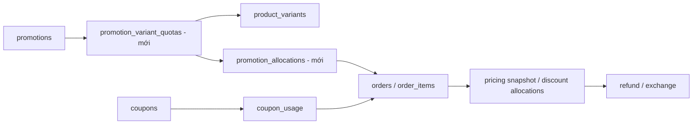

# Sprint 5 — Việt Trung — Backend End-user

**Chủ đề:** Review, CMS public, khuyến mãi/coupon, Flash Sale, push và search.  
**Ngày lập:** 2026-10-24. **Trạng thái:** Đã triển khai backend local trên `feat/be-sprint5`; xem [runbook và phạm vi kiểm chứng](../../backend/docs/sprint-5.md). Còn chờ nghiệm thu Admin/POS, FE/Mobile và provider thực.
**Cách lập kế hoạch:** Theo thứ tự công việc, phụ thuộc và tiêu chí nghiệm thu; không ước lượng ngày công theo yêu cầu người dùng.  
**Liên kết:** [Roadmap](08_sprint_plan.md) · [FR](../1-requirement/07_functional_requirements.md) · [Thiết kế DB](../2-design/04_thiet_ke_csdl.md) · [Sprint 4](09_sprint_4_viet_trung_backend_enduser.md) · [Sprint 6](11_sprint_6_viet_trung_backend_enduser.md).

## 1. Mục tiêu và phạm vi

Khách xem nội dung đã xuất bản, đánh giá sản phẩm đã mua, xem giá khuyến mãi đúng điều kiện, áp coupon và mua Flash Sale mà không vượt quota. Giá hiển thị, preview, checkout và giá trị hoàn/đổi phải cùng một chính sách.

| FR / nguồn | Việt Trung | Thành Lập / bên phối hợp |
|---|---|---|
| FR-02.08 | Tạo review, list public, aggregate rating | Admin duyệt/từ chối/phản hồi; cùng dùng service aggregate |
| FR-13.01, 13.02, 13.04 | Page/blog/FAQ public, metadata, lượt xem | CMS CRUD, lịch xuất bản, sanitization nội dung đầu vào |
| FR-10.03 / 13.03 | Banner public đúng lịch/vị trí | CRUD banner |
| FR-10.01–10.02 | Promotion read, pricing, coupon validation, Flash Sale và checkout | CRUD campaign/coupon, cấu hình quota và điều kiện |
| FR-10.05 | Device delivery, notification/deep link contract, retry | Admin chọn audience và tạo broadcast |
| Roadmap Sprint 5 | Search sync/reindex, giá và rating trong catalog | Event khi Admin sửa product/variant/promotion/review |

Không nhận dashboard/report/import sản phẩm/CRUD CMS vào workload Việt Trung. Nếu logic giá dùng cả POS, Thành Lập tích hợp service dùng chung và kiểm thử POS; không copy công thức sang module riêng.

**Quy tắc đã được người dùng chọn:** mỗi dòng hàng chọn mức tốt hơn giữa ưu đãi hạng và promotion tốt nhất đủ điều kiện → tối đa một coupon → dùng điểm. Flash Sale có quota theo từng biến thể, độc lập với tồn kho vật lý. Các tỷ lệ/giới hạn loyalty vẫn là cấu hình bắt buộc theo Sprint 4. Người dùng đồng ý đưa phí/miễn phí giao hàng, phân bổ giảm giá khi trả một phần, giá sale nhập tay và phục hồi quota vào danh sách cấu hình phải chốt tại kickoff.

## 2. Điều kiện vào sprint và sai khác hiện trạng

- Redis provider đã chốt là **Upstash Redis**. Cache giá/catalog và rate limit dùng chung phải tương thích adapter Upstash ở Sprint 6; quota Flash Sale, coupon và điểm vẫn được kiểm tra atomic trong PostgreSQL.
- Sprint 4 đã có transaction điểm an toàn, ownership context, snapshot discount/credit và notification delivery. Coupon riêng từ redeem phải đi qua cùng validator với coupon marketing.
- Chốt data contract campaign, reward, trạng thái nội dung và payload notification với Thành Lập ngay đầu sprint; FE nhận OpenAPI và fixture trước ngày tích hợp 1–2 ngày.
- Phân tích là tĩnh từ [schema](../../backend/prisma/schema.prisma), migration và code, chưa xác nhận DB triển khai. Cần kiểm tra migration status trên DB thử nghiệm trước sửa schema.

| Hiện trạng có bằng chứng | Hệ quả cho Sprint 5 |
|---|---|
| `Review` có rating CHECK trong migration nhưng chưa có UNIQUE customer/product | FR yêu cầu mỗi khách một review/product; phải thêm unique sau kiểm tra trùng |
| `products.avgRating/totalReviews` đã có | Aggregate phải chỉ tính `isApproved = true`; duyệt lại không được cộng thêm |
| `Promotion` dùng JSONB applicableProducts/applicableCategories, có usageLimit/usedCount | Chưa có quota từng variant, reservation hoặc marker Flash Sale; không suy luận mọi promotion ngắn hạn đều là Flash Sale |
| `Coupon` có owner, limit, dates nhưng không có maxDiscountAmount | `CouponInput` trong pricing có trường này; cần chọn nguồn cap rõ và thêm migration nếu cap độc lập, không đọc thuộc tính DB không tồn tại |
| DB design ghi coupon `FIXED`; code dùng `FIXED_AMOUNT` | Chuẩn hóa contract và backfill dữ liệu có kiểm chứng; không để loại lạ bị tính giảm 0 âm thầm |
| `OrderPricingService` hiện dùng number và chỉ tính coupon/points | Cần engine chung có promotion, tier policy, shipping và breakdown; không chỉ đổi `salePrice` của listing |
| `PrismaOrderRepository` ghi coupon usage bằng tổng discount truyền vào | Hiện tổng đó có thể gồm điểm; phải ghi đúng riêng phần coupon, tách các thành phần vào snapshot |
| `ProductCustomerController` dùng `/customer/products` | Review nested API theo namespace thực tế; docs ghi alias `/products` chỉ khi có triển khai rõ |
| ES đã index khi create/update/delete và reindex theo batch lúc bootstrap | Bổ sung đường retry/durable sync và sự kiện còn thiếu; không coi đây là chức năng hoàn toàn chưa có |
| Có `EmailOutbox`, chưa có module push/notification hoàn chỉnh được đăng ký trong snapshot | Xác nhận đầu ra Sprint 4; nếu chưa có phải ghi carry-over trước broadcast |

## 3. Thiết kế dữ liệu

### 3.1 Review và CMS

| Nhóm | Quan hệ / ràng buộc hiện có | Thay đổi và query đề xuất |
|---|---|---|
| Reviews | customer/product/order FK; orderId nullable; rating CHECK 1–5; isApproved mặc định false | UNIQUE `(customer_id, product_id)`; index `(product_id, is_approved, created_at, id)`; chỉ thêm index rating nếu EXPLAIN cho thấy cần |
| Purchase proof | Order → OrderItem → ProductVariant → Product | Validate đơn thuộc customer, COMPLETED và variant thuộc product. API tự chọn đơn hợp lệ hoặc xác minh orderId; client không đặt verified/approved/adminReply |
| Pages | slug UNIQUE, isPublished | Chỉ trả published; select content + metadata public. Index listing nếu có use case; lookup slug đã có index |
| Blog | slug UNIQUE; category/author FK; status/publishedAt | Index `(status, published_at, id)` và `(blog_category_id, status, published_at, id)` theo query; lọc PUBLISHED và publishedAt <= now |
| Banner | position, isActive, start/end nullable, sortOrder | Lọc active + start null/đã tới + end null/chưa qua; sort sortOrder rồi id; cân nhắc `(position, is_active, sort_order)` |
| FAQ | category là text nullable, isActive, sortOrder | Group category, nhóm mặc định cho null; sort ổn định; giới hạn payload |

Trước UNIQUE review: truy vấn nhóm trùng, thống kê review đã duyệt/chưa duyệt, chọn bản giữ theo quyết định có audit và giữ bản sao. Không xóa tùy ý review lịch sử. Trong cùng transaction duyệt/từ chối: khóa product, đổi trạng thái review, tính lại AVG/COUNT của tất cả review approved, ghi aggregate và event invalidation. Mọi writer Admin phải dùng cùng quy trình để tránh lost update.

`isApproved` hiện không phân biệt chờ duyệt và bị từ chối. Với public API cả hai đều ẩn; nếu màn hình “review của tôi” cần phân biệt thì thêm moderationStatus/reason cùng Admin, không tự suy diễn từ boolean.

`viewsCount` blog tăng atomic khi xem detail hợp lệ, không tăng cho list/404. Định nghĩa ban đầu là lượt gọi detail thành công, không tuyên bố là unique visitors. Nếu cache detail, tách ghi lượt xem khỏi dữ liệu cache và giới hạn abuse; chốt cách loại bot nếu dùng số này cho báo cáo.

### 3.2 Promotion, quota, receipt và snapshot

Migration mới, nối tiếp Sprint 4; không tạo lại receipt/ledger/outbox đã làm:

1. Thêm `Promotion.isFlashSale` hoặc trường campaignKind với mapping rõ; giữ `type` cho PERCENTAGE/FIXED_AMOUNT/FREE_SHIPPING. Không dùng `type=FLASH_SALE` làm mất công thức giảm giá.
2. `promotion_variant_quotas`: FK promotion + variant, UNIQUE cặp này, quota, reservedQuantity, consumedQuantity; CHECK mọi số không âm và reserved + consumed <= quota. Quota là giới hạn ưu đãi toàn campaign/variant; tồn bán được vẫn đọc inventory theo store.
3. `promotion_allocations`: FK quota/order/orderItem, quantity, trạng thái RESERVED/CONSUMED/RELEASED, timestamps, UNIQUE `(order_item_id, promotion_id)` theo một promotion mỗi dòng. Lưu allocation để hủy/hết hạn hoàn đúng quota, không chỉ trừ counter không có dấu vết.
4. Tách `usageLimit/usedCount` cấp campaign khỏi quota đơn vị hàng. Đề xuất tính usage cấp campaign theo một order áp dụng, có `promotion_order_usages` UNIQUE `(promotion_id, order_id)` để nhiều dòng cùng campaign không cộng nhiều lượt. Cách đếm này phải thống nhất với Admin trước seed/CRUD.
5. Bổ sung cap coupon nếu business yêu cầu cap riêng: `maxDiscountAmount` nullable, validate >= 0; coupon gắn promotion phải rõ dùng cap nào. Không áp đồng thời hai cap ngầm.
6. Pricing snapshot trên order/dòng hoặc bảng `order_item_discount_allocations`: originalPrice, effectivePrice, promotionId/version, promotion discount, tier discount nếu có, coupon allocation, point quantity/value allocation, shipping/tax breakdown. Chốt nghĩa `unitPrice/totalPrice/discountAmount` đang có, giữ compatibility DTO. Lưu phần giảm thuộc cấp nào để hoàn tiền/EXCHANGE tính từ lịch sử.
7. Index `coupon_usage(coupon_id, customer_id)` cho per-customer limit; allocation `(order_id, status)` cho release/reconciliation; quota lookup có UNIQUE pair; campaign read index theo active/date chỉ thêm sau xem execution plan.

Product-level `salePrice` chỉ là dữ liệu/cache hiển thị có ngữ nghĩa đã chốt; giá một biến thể phải bắt đầu từ `ProductVariant.price`. Cần thống nhất xử lý salePrice nhập tay có sẵn: coi là base override hay ngừng dùng khi có engine. Không tự cộng giảm giá tay với campaign khi chưa chốt.

### 3.3 Engine tính giá chung và atomic checkout

**Đầu vào:** product/variant IDs, quantity, store, customer xác thực, couponCode, điểm yêu cầu; backend tải giá/campaign/tier/coupon hiện hành. FE không gửi số tiền cuối để backend tin.

1. Xác định các campaign active trong khoảng thời gian, đúng đối tượng sản phẩm/danh mục và đủ điều kiện. Campaign FREE_SHIPPING là lợi ích shipping, không gán sale price sản phẩm bằng 0.
2. Với mỗi dòng, tính promotion tốt nhất đủ điều kiện và ưu đãi theo hạng, chọn mức giảm lớn hơn; không cộng cả hai. Hòa thì dùng tiêu chí ổn định đã ghi trong contract. Áp cap/floor, không giảm âm hoặc vượt giá trị dòng. Nếu ưu đãi hạng thắng thì không chiếm quota promotion. Điều kiện minOrderAmount/maxDiscountAmount cần rõ áp cấp order hay dòng.
3. Tính coupon trên cơ sở sau giảm dòng theo chính sách đã chốt; tối đa một coupon/order. Check owner, active/time, minOrder, global maxUses, per-customer limit và promotion liên quan.
4. Dùng điểm sau coupon; số điểm thực trừ phải tương ứng số tiền được giảm, không trừ toàn bộ điểm khách nhập khi giá trị được cấn đã bị giới hạn. Quy tắc rounding số điểm và phần tiền lẻ lấy từ cấu hình S4.
5. Tính shipping/tax và discount breakdown. Ghi rõ discount dòng đến từ tier hay promotion; `tier.discountPercentage` của FR-08.04 là ứng viên ở bước 2 theo quyết định đã chốt, không phải một lớp giảm thêm.
6. Preview/validate chỉ đọc, không giữ quota, không tăng usedCount hoặc trừ điểm. Trả `calculatedAt`, phiên bản/điều kiện và cảnh báo đây chưa phải reservation.
7. Khi tạo order: receipt chống request lặp → khóa customer/coupon/campaign/quota/inventory theo thứ tự thống nhất cho mọi writer → đọc lại điều kiện và giá → giữ tồn/quota, dùng coupon/điểm → ghi order + items + breakdown + allocation + history/outbox → dọn đúng dòng cart được mua trong cùng transaction nếu cùng DB → commit.
8. Nếu khác giá so với quote FE đã xác nhận, trả conflict và bảng giá mới để khách xác nhận; không tự thu tiền cao hơn. Hai request chỉ còn một quota thì một thành công, một lỗi nghiệp vụ.
9. Chuyển quota RESERVED sang CONSUMED tại mốc xác nhận order đã chốt với Admin; hủy trước fulfillment phải release cả RESERVED hoặc CONSUMED đủ điều kiện đúng một lần. Callback, cron và Admin cancel dùng cùng hàm. Restock vật lý sau RMA không tự đồng nghĩa mở lại quota Flash Sale; cần policy riêng.
10. Cập nhật `OrderItem.promotionId` và CouponUsage.discountAmount đúng thành phần. Có query đối soát counter với allocations/usages; tiền/số dư/quota không lấy Redis làm nguồn quyết định cuối.

Với promotion có điều kiện giỏ hàng, catalog chỉ trả “ưu đãi có điều kiện” và mức giá minh họa được ghi rõ điều kiện; không hứa một giá vô điều kiện mà checkout không thể áp dụng. Filter/sort theo sale price phải chạy trước pagination với cùng semantics, không phân trang theo base price rồi sort cục bộ.

## 4. API contract và luồng đọc

Prefix `/api/v1`, JSON envelope theo backend hiện có. Catalog giữ `/customer/products`; nếu bổ sung alias `/products`, cần route/test/documentation đầy đủ và không phá client cũ.

| API | Contract chính | Quyền / kiểm soát |
|---|---|---|
| `POST /reviews` | productId, optional orderId, rating, title/content → review pending | Customer đã mua COMPLETED; 409 nếu đã có review product |
| `GET /customer/products/:id/reviews` | page/limit, rating, sort → approved reviews, count, histogram, aggregate | Public; ID là UUID khác slug detail; không lộ email/phone/orderId của reviewer |
| `GET /pages/:slug` | Published page, HTML đã sanitize, metadata | Public; unpublished và không tồn tại cùng 404 |
| `GET /blog/posts`, `GET /blog/posts/:slug` | Pagination/category; detail/metadata/author public/views | Chỉ PUBLISHED đã tới ngày; không lộ profile riêng của tác giả |
| `GET /blog/categories` | Categories cho bộ lọc | Bổ sung phục vụ UI, thống nhất category rỗng có hiển thị không |
| `GET /faqs` | Nhóm category + items sort ổn định | Chỉ active |
| `GET /banners?position=HOME_HERO` | Vị trí allowlist, lịch hiển thị, image/link | Chỉ active/đúng lịch; allowlist URL/deep-link scheme |
| `GET /promotions/active` | Thông tin campaign public, phạm vi/điều kiện, thời gian | Không public private coupon/audience dữ liệu cá nhân |
| `POST /coupons/validate` | code + selection/cart context → valid, reasonCode, breakdown | Customer; cùng engine preview, rate limit chống dò mã riêng |
| `GET /promotions/flash-sale` | Campaign + variant prices + quota còn lại, serverTime/endAt | Public; quota hiển thị có thể thay đổi, checkout xác nhận lại |
| `GET /customer/products`, `GET /customer/products/:slug` | effective price/range, promotion info/conditions, rating, wishlist | Phân biệt dữ liệu public và theo customer |
| `POST /orders/preview`, `POST /orders` | Mở rộng breakdown/quote version; giữ DTO tương thích | Transaction mới là điểm thực thi giới hạn |

Public response whitelist trường; nội dung CMS phải sanitize tại write và xử lý dữ liệu cũ trước publish. Không render script/event handler hoặc URL nguy hiểm từ rich text. URL ảnh/banner do hệ thống quản lý; không fetch URL tùy ý từ request để tránh truy cập tài nguyên nội bộ.

## 5. Push và Elasticsearch

### Push broadcast

- Thành Lập sở hữu endpoint Admin và audience; Việt Trung sở hữu delivery/device API dùng chung với Sprint 4.
- Freeze danh sách audience hoặc lưu phiên bản targeting cho một campaign send. Với mỗi recipient tạo notification có key `campaign:sendVersion:userId`; retry không nhân bản notification, sau đó fan-out tới device còn active.
- Không dùng một `notifications.eventKey` giống nhau cho tất cả người dùng vì cột này UNIQUE toàn bảng. Delivery theo notification/device có trạng thái độc lập và retry.
- Payload chỉ có notificationId/type/resourceId + route hợp lệ; Web/Mobile xác thực lại ownership khi mở order/return. Không nhúng token/PII hoặc URL tùy ý vào deep link.
- Nếu chọn topic-based FCM, phải xác định subscription/unsubscribe và không dùng topic public cho nội dung riêng. Delivery trực tiếp dựa user_devices là nền cho owner notifications.

### Search và giá động

- Tận dụng index/reindex đã có; bổ sung retry cho DB commit thành công nhưng ES thất bại, sự kiện variant/approval/deactivation, checkpoint khi reindex bị dừng. Có thể dùng bảng `catalog_index_jobs` có productId/version và trạng thái retry; không nhét job search vào email_outbox.
- ES phục vụ tìm kiếm; PostgreSQL + pricing engine là nguồn quyết định active status, ownership, giá/quota lúc checkout. Tránh trả sản phẩm đã ẩn chỉ vì ES chưa sync.
- Promotion bắt đầu/kết thúc theo thời gian phải làm cache/index giá hết hiệu lực dù không có CRUD. Nếu không index giá động, enrich giá từ DB theo batch và thiết kế filter/sort chính xác trước pagination.
- Variant đổi giá/rating thay đổi phải invalidation đúng product. Full reindex khi bootstrap hiện có không thay thế retry trong quá trình server chạy.
- Test search fallback DB, cùng filter/sort/pagination và không N+1. Không thêm ingredient filter P3 ngoài scope roadmap đã chốt.

## 6. Backlog và thứ tự bàn giao

| ID | Công việc / đầu ra | Phụ thuộc |
|---|---|---|
| S5-00 | Chốt pricing/moderation/CMS contract, rà số liệu và migration | S4 + Thành Lập |
| S5-01 | Review create/list + purchase proof + aggregate contract | Migration unique + Admin moderation |
| S5-02 | Page/blog/categories/FAQ/banner public + lịch hiển thị | Admin fixture/publish/sanitize |
| S5-03 | Engine promotion/coupon/tier/points + breakdown dùng chung | Policy rõ, snapshot S4 |
| S5-04 | Quota variant/allocation; atomic checkout/cancel và đối soát | S5-03 + order state machine |
| S5-05 | Catalog/Flash Sale/coupon APIs, search sync và invalidation | S5-03/04 + event Admin |
| S5-06 | Broadcast delivery/deep link/retry | Notification S4 + audience Admin |
| S5-07 | Concurrency/E2E, regression RMA/checkout, Swagger, FE integration | Các luồng đã ghép |

Không gắn nhãn “đã hoàn thành Sprint 5” nếu chỉ hiển thị giá Flash Sale mà chưa khóa quota khi mua.

Trình tự: hợp đồng + dữ liệu → review/CMS độc lập → engine → quota/checkout → catalog/search → broadcast → kiểm thử. Bàn giao hợp đồng OpenAPI sớm giúp Tuấn Anh/Văn Kim dùng fixture trong khi chờ endpoint. Dữ liệu seed tối thiểu: product nhiều variant, một suất Flash Sale cuối, coupon private/public, bài scheduled/draft/published và review pending/approved.

## 7. Kiểm thử và Definition of Done

| Nhóm | Trường hợp bắt buộc |
|---|---|
| Review | Chưa mua/đơn chưa COMPLETED bị chặn; order của người khác bị chặn; 2 request đồng thời chỉ có 1 review; approved aggregate đúng khi duyệt lại/từ chối; pagination/rating không lộ pending |
| CMS | Biên start/end, future publishedAt, SCHEDULED/ARCHIVED không public; banner nullable dates; HTML/URL độc hại; viewsCount tăng atomic; không lộ author private data |
| Pricing | Promotion chồng nhau chọn tốt nhất; tier thắng promotion hoặc ngược lại, không cộng cả hai và không chiếm quota khi tier thắng; cap/min-order; FREE_SHIPPING; coupon trước điểm; private coupon của A không dùng được bởi B; Decimal rounding; điểm bị giới hạn không mất dư |
| Concurrency | 2 checkout tranh quota/cuối lượt coupon/cùng điểm; rollback giữa transaction không giữ quota rác; lặp request không tạo đơn mới; các lock dùng cùng thứ tự |
| State transitions | Confirm/cancel/cron/payment callback lặp; quota release đúng một lần; COMPLETED không nhận callback thất bại làm lùi trạng thái; RMA không tự phục hồi quota ngoài policy |
| Price snapshots | Listing/preview/create nhất quán; giá thay đổi cần xác nhận lại; sửa campaign sau mua không đổi refund/EXCHANGE của đơn cũ; CouponUsage chỉ lưu coupon discount |
| Search/cache/push | ES down/retry/reindex; ẩn product sau indexing; hết giờ promotion; A/B wishlist không lẫn; broadcast retry không nhân bản notification; deep link đúng resource/owner |

Unit test engine/state machine; integration PostgreSQL thật cho khóa, unique, counter và rollback; E2E luồng mua Flash Sale → hoàn tất → review → duyệt và luồng mua có promotion → REFUND/EXCHANGE. Kết hợp Web/Mobile kiểm tra tổng tiền và điều kiện giá hiển thị.

Chỉ hoàn tất khi build và test liên quan pass, migration thử nghiệm/backfill có bằng chứng, không có lỗi vượt quota/điểm/coupon, OpenAPI cập nhật đầy đủ, API Admin dùng chung engine/aggregate đã tích hợp, FE demo thành công và PR được review. Tạo E2E harness nếu Sprint 4 chưa bàn giao; không coi `test:e2e` trong package.json là bằng chứng harness tồn tại.

## 8. Skill bắt buộc khi thực hiện

**Đảm bảo dùng các skill liên quan** và ghi trong PR phần đã áp dụng, test/EXPLAIN hoặc contract tương ứng.

| Skill | Áp dụng |
|---|---|
| [backend-architect](../../.agents/skills/backend-architect/SKILL.md) | Pricing service dùng chung End-user/Admin/POS, event contract |
| [database-design](../../.agents/skills/database-design/SKILL.md), [prisma-expert](../../.agents/skills/prisma-expert/SKILL.md), [database-migration](../../.agents/skills/database-migration/SKILL.md) | Quota/allocation, review unique, backfill, transaction và index |
| [api-design-principles](../../.agents/skills/api-design-principles/SKILL.md), [nestjs-expert](../../.agents/skills/nestjs-expert/SKILL.md) | DTO, errors, contract catalog/CMS, DI/module |
| [api-security-best-practices](../../.agents/skills/api-security-best-practices/SKILL.md) | Private coupon, purchase proof, rich text, rate limiting |
| [sql-optimization-patterns](../../.agents/skills/sql-optimization-patterns/SKILL.md) | Aggregate review, query giá/filter/pagination, query plan |
| [unit-testing-test-generate](../../.agents/skills/unit-testing-test-generate/SKILL.md), [code-review-checklist](../../.agents/skills/code-review-checklist/SKILL.md) | Ma trận giá/quota/cạnh tranh và review |

## 9. Điểm cần chốt tại kickoff

Đã chốt chọn mức tốt hơn giữa tier và promotion cho từng dòng → một coupon → điểm, cùng quota theo variant. Các cấu hình sau được người dùng cho phép chốt tại kickoff:

1. Base price khi có `products.salePrice` nhập tay; cap/minimum áp theo dòng hay đơn; mã FIXED/FIXED_AMOUNT và coupon cap độc lập hay kế thừa.
2. Mốc reserve/consume/release, đếm lượt campaign và có khôi phục quota sau RMA không; thống nhất cùng Admin/POS. Đề xuất consume tại CONFIRMED và release khi hủy trước fulfillment, cần đưa vào state machine chung.
3. Ngưỡng/phí shipping và điều kiện miễn phí tính trước hay sau giảm giá; phân bổ giảm giá khi trả một phần; chính sách loyalty từ Sprint 4 phải đủ trước test tổng tiền cuối.
4. Audience broadcast/FCM environment và bàn giao Admin để kiểm chứng tích hợp thật.
