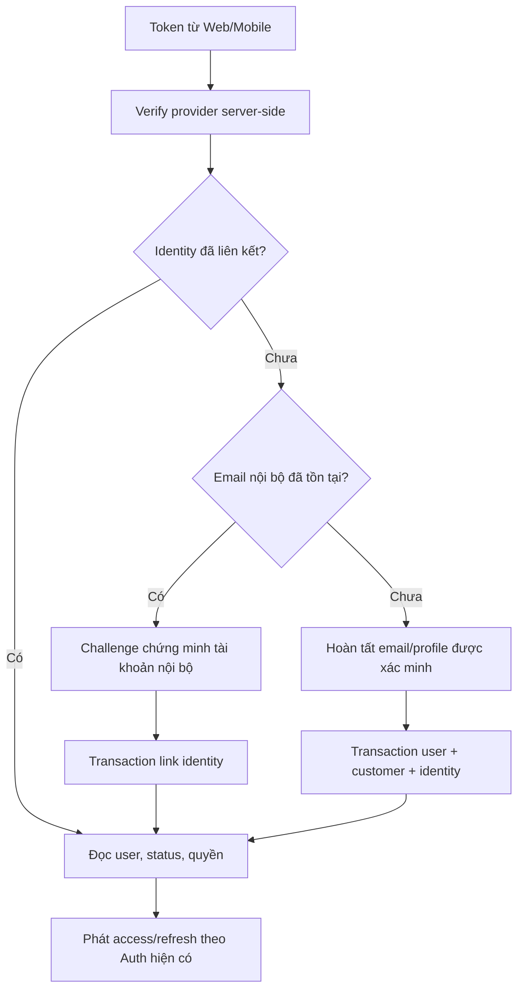

# Sprint 6 — Việt Trung — Backend End-user

**Chủ đề:** Hoàn thiện backend end-user, OAuth, SEO, hiệu năng và bàn giao.  
**Ngày lập:** 2026-10-24. **Trạng thái:** Đã triển khai phần backend ngày 2026-10-25; còn gate provider/Web/Mobile/payment và nghiệm thu production, chưa đóng toàn bộ DoD. Xem [báo cáo triển khai](../../backend/docs/sprint-6.md).
**Lập kế hoạch theo:** thứ tự công việc, phụ thuộc và tiêu chí nghiệm thu; không ước lượng ngày công theo yêu cầu người dùng.  
**Liên kết:** [Roadmap](08_sprint_plan.md) · [FR](../1-requirement/07_functional_requirements.md) · [Thiết kế DB](../2-design/04_thiet_ke_csdl.md) · [Sprint 4](09_sprint_4_viet_trung_backend_enduser.md) · [Sprint 5](10_sprint_5_viet_trung_backend_enduser.md).

## 1. Mục tiêu và phạm vi chịu trách nhiệm

Hoàn tất các luồng end-user còn lỗi, kiểm chứng DB và giao dịch đồng thời, cung cấp SEO endpoint và OAuth Google/Facebook, chuẩn hóa tài liệu API để Web/Mobile triển khai được và backend sẵn sàng bàn giao.

| FR / roadmap | Việt Trung phụ trách | Phối hợp |
|---|---|---|
| FR-01.08, P3 | Google/Facebook login, tạo/link identity, phát session nội bộ | Tuấn Anh/Văn Kim: SDK, redirect/deep link, onboarding/link account |
| FR-13.05; đọc metadata FR-06.07 | Sitemap/robots từ nội dung public, SEO contract | Tuấn Anh: route website/canonical/JSON-LD; Thành Lập: metadata/publish CRUD |
| Roadmap performance | Cache Upstash Redis adapter, invalidation, rate limit, query/index review | Thành Lập: events Admin làm thay đổi dữ liệu; cấu hình triển khai chung |
| Roadmap bug-fix/E2E | Sửa lỗi Sprint 1–5 ảnh hưởng end-user, kiểm thử thanh toán/đổi trả/points/quota/notification | Cả hai BE và FE/Mobile |
| Roadmap documentation | OpenAPI, bộ request Apidog, hướng dẫn cấu hình và runbook | Thành Lập phụ trách tài liệu Admin, Docker/deployment chung |

RFM, dự báo, HR report, email marketing và campaign analytics vẫn thuộc Thành Lập. Việt Trung cung cấp event/data contract cần thiết khi các tính năng đó sử dụng dữ liệu end-user; không tự nhận các module analytics vào sprint này.

## 2. Gate đầu vào và phát hiện từ repository

Phân tích tĩnh ở ngày lập kế hoạch; chưa chạy DB hoặc kiểm thử thực thi. Nhánh triển khai Sprint 6 phải được kiểm tra lại vì các file sẽ thay đổi sau Sprint 4/5.

| Bằng chứng hiện tại | Việc cần làm |
|---|---|
| `User.email` bắt buộc UNIQUE, `passwordHash` nullable, `Customer.userId` nullable UNIQUE | Hỗ trợ OAuth không password; cần luồng bổ sung/xác thực email nếu provider không trả email, không gán email giả |
| `UserOAuthAccount` UNIQUE `(provider, providerUserId)` | Có khóa identity cần thiết; chưa có controller/use case OAuth trong auth hiện tại |
| `UserSession`, `VerificationToken` đã có | Tái sử dụng phát/revoke session và xác thực email; kiểm thử login OAuth có cùng lifecycle với password login |
| `core/cache/cache.module.ts` dùng `InMemoryCacheService`; package chưa có Redis client trực tiếp | Redis là việc phải triển khai/kiểm thử, không coi tên CacheModule là cache phân tán |
| AppModule import ThrottlerModule nhưng APP_GUARD hiện chỉ có JwtAuthGuard/PermissionGuard; Auth/Cart đã gắn ThrottlerGuard tại controller | Mở rộng và kiểm chứng giới hạn cho các route còn lại; không kết luận toàn hệ thống đã có global rate limit |
| `JwtAuthGuard.verify` có secret fallback và chưa đọc user/session | Bỏ fallback ở môi trường triển khai, kiểm tra revoked/disabled theo policy; tránh OAuth phát token cho tài khoản bị khóa |
| `main.ts` CORS `origin: true`, credentials true | Chốt allowed origins theo môi trường và test Web/Mobile; không mang cấu hình dev nguyên trạng sang môi trường bàn giao |
| `TransformResponseInterceptor` bọc mọi response thường vào JSON | Sitemap XML/robots text phải có đường bypass rõ và test Content-Type/body |
| `package.json` có `test:e2e` nhưng snapshot chưa có `backend/test` | Xác nhận harness đã được S4/S5 bổ sung; nếu chưa thì tạo trước chạy E2E |

Gate: S4 REFUND/EXCHANGE đủ state machine/settlement; S5 engine giá/quota dùng chung đã tích hợp; chính sách tiền/loyalty được cấu hình và version hóa; dependency Admin có môi trường chạy thật. Danh sách bug phải ghi severity, reproducer, owner, acceptance và liên kết FR.

## 3. OAuth — mô hình identity và dữ liệu

### 3.1 Bất biến phải giữ

- `(provider, providerUserId)` định danh identity; không dùng email làm khóa identity bên provider. Google dùng `sub`; verify server-side chữ ký, issuer, audience, hạn token và các điều kiện theo SDK chính thức. Google lưu ý email từ bên thứ ba không luôn đủ để chứng minh quyền sở hữu hiện tại. [Google: verify ID token](https://developers.google.com/identity/gsi/web/guides/verify-google-id-token).
- Facebook dùng adapter xác minh server-side token/app/user/expiry theo flow Web/Mobile thực chọn; không coi Facebook access token là Google ID token. Đối chiếu tài liệu Meta/SDK hiện hành khi triển khai, không tự viết bộ giải mã rồi tin payload.
- Provider chỉ xác minh danh tính. Role/dataScope/permissions của GlowUp phải đọc trong DB và dùng service quyền hiện có; request/provider không được tự cấp role.
- Link cùng email phải bảo vệ tài khoản đã có: yêu cầu chứng minh quyền sở hữu tài khoản nội bộ bằng đăng nhập hoặc challenge đã xác thực trước khi gắn identity. Không tạo user trùng, không tự hợp nhất staff/customer chỉ vì email giống nhau.
- Tài khoản BANNED/INACTIVE hoặc session không hợp lệ bị chặn theo chính sách Auth hiện có. Provider email thay đổi không tự đổi email nội bộ khi chưa có quy trình xác minh.
- `customers` có thể là khách POS chưa liên kết. Chỉ merge khách theo phone sau khi chứng minh quyền sở hữu số điện thoại, không lấy phone không xác minh từ provider để kế thừa lịch sử mua/điểm.

### 3.2 Flow triển khai

Gọi provider ở ngoài transaction. Sau khi có kết quả đã xác minh, trong transaction kiểm tra lại unique identity/email, tạo/link user/customer, ghi audit không chứa token và tạo session. Hai request đăng nhập lần đầu đồng thời phải trả cùng identity/user; xử lý unique conflict bằng re-read có kiểm tra owner, không dùng upsert để đổi chủ identity.

Nếu provider không cung cấp email hoặc email chưa đủ độ tin cậy: trả `EMAIL_VERIFICATION_REQUIRED` cùng challenge hạn ngắn, hoàn tất xác thực trước khi tạo user ACTIVE. Thiết kế bảng `oauth_pending_identities` nếu cần lưu challenge: provider/subject, target email hoặc target user, challenge hash, expiresAt, usedAt; chỉ lưu dữ liệu tối thiểu, không lưu access token provider. Consume một lần, ràng buộc với đúng client/session. Không phát access token đầy đủ từ challenge.

Migration chỉ thêm khi flow cần: index `user_oauth_accounts(user_id)` cho lookup/link; bảng pending identity nếu dùng. Không mặc định thêm UNIQUE `(user_id, provider)` vì schema hiện cho phép nhiều identity của cùng provider trên một user; nếu UI muốn giới hạn một tài khoản/provider phải chốt và xử lý dữ liệu cũ trước.

### 3.3 API contract

Prefix `/api/v1`:

| API | Đầu vào / kết quả | Quy tắc |
|---|---|---|
| `POST /auth/oauth/google` | idToken + client context → Auth response hoặc link/onboarding challenge | Public có rate limit; audience nằm trong allowlist client ID Web/Mobile |
| `POST /auth/oauth/facebook` | Token theo flow đã chọn → Auth response/challenge | Adapter riêng; verify app/user server-side |
| `POST /auth/oauth/link` | Challenge và bằng chứng re-auth → identity linked + session phù hợp | Bổ sung để hiện thực link an toàn; challenge một lần/TTL/đúng owner |
| Flow xác thực email onboarding | Email + challenge + mã xác minh | Tái sử dụng Auth verification phù hợp; nếu thêm route cần OpenAPI riêng |

Response login phải tương thích password login hiện có, giữ access/refresh TTL theo cấu hình dự án; không tự thay toàn bộ Auth trong Sprint 6. Web redirect và Mobile deep link dùng allowlist, state/nonce/PKCE theo flow SDK được chọn; không nhận arbitrary return URL. Không log password, OAuth token, refresh token hoặc secret.

## 4. SEO — truy vấn DB và xuất đúng nội dung

### 4.1 Nguồn dữ liệu

| Nguồn | Điều kiện public | URL đích |
|---|---|---|
| Product | isActive và đủ điều kiện catalog; kiểm tra category/brand visibility thống nhất với API | Route Web sản phẩm theo slug, không phải URL API |
| Category | isActive và quy tắc visibility cây danh mục | Route Web category |
| BlogPost | PUBLISHED, publishedAt không ở tương lai | Route Web blog detail |
| Page | isPublished | Route Web page catch-all, tránh slug trùng route hệ thống |

Host lấy từ `PUBLIC_WEB_URL` hoặc setting đã validate theo môi trường, không lấy Host header tùy ý. Slug được URL-encode rồi XML-escape đúng ngữ cảnh; `lastmod` lấy mốc thay đổi nội dung, không set NOW() mỗi lần đọc sitemap. Blog tăng views không nên làm sitemap báo nội dung mới; cần timestamp nội dung riêng nếu updatedAt hiện cũng đổi khi tăng views.

### 4.2 Endpoints và tích hợp Web

- `GET /api/v1/sitemap.xml`: `application/xml`, raw XML, public; select id/slug/updatedAt tối thiểu, batch/cursor để không tải cả content. Nếu vượt giới hạn file thì dùng sitemap index và endpoint từng phần; giao thức giới hạn 50.000 URL hoặc 50 MB chưa nén mỗi sitemap. [Sitemap protocol](https://www.sitemaps.org/protocol.html).
- `GET /api/v1/robots.txt`: `text/plain`, public; URL sitemap và quy tắc cho domain website, cấu hình riêng staging/production. Robots không thay cho auth bảo vệ API.
- Tuấn Anh phục vụ hoặc proxy hai file tại gốc domain website `/sitemap.xml`, `/robots.txt`; file ở prefix backend không tự trở thành robots của website.
- Bypass `TransformResponseInterceptor` bằng cơ chế rõ theo route/metadata và có test, tránh XML bị JSON-quote hoặc bọc trong ApiResponseDto. HTTP cache/ETag có invalidation khi nội dung xuất bản/ẩn/đổi slug.
- JSON-LD, canonical tag và Open Graph render tại FE; backend trả metadata đúng và public data, không tạo một hệ thống cấu hình SEO trùng với Admin.

## 5. Cache, rate limiting và DB performance

### 5.1 Cache đúng dữ liệu

**Provider đã chốt: Upstash Redis.** Giữ interface `CACHE_SERVICE`, thêm adapter Upstash phù hợp dependency đã khóa phiên bản, cấu hình namespace/TTL/timeout/health và kiểm chứng dùng chung giữa nhiều instance. Dữ liệu tồn kho/quota/points cuối cùng vẫn phải kiểm tra trong PostgreSQL transaction.

Phương án kết nối đề xuất cho cache là `@upstash/redis` qua HTTP/REST, dùng `UPSTASH_REDIS_REST_URL` và `UPSTASH_REDIS_REST_TOKEN` từ cấu hình backend; đây là cấu hình dự kiến bổ sung, chưa phải biến đã được code hiện tại sử dụng. [Hướng dẫn kết nối Upstash chính thức](https://upstash.com/docs/redis/howto/connect-with-upstash-redis).

- Tách namespace/môi trường để test không invalidation cache triển khai; giữ token ở backend, không đưa vào frontend hoặc bộ request export.
- Rate limit cần storage/adapter dùng Upstash với thao tác đếm và hết hạn atomic, kiểm thử trên nhiều instance. Cache adapter không tự biến NestJS Throttler thành rate limiter phân tán; kiểm tra tương thích client/command trước khi chọn tích hợp.
- Kiểm chứng TTL, serialization, invalidation, timeout/retry và hành vi khi Upstash lỗi hoặc chạm giới hạn dịch vụ. Theo dõi số request, latency và mức sử dụng thực tế để tránh retry không giới hạn.

| Dữ liệu | Cache key / phạm vi | Invalidation |
|---|---|---|
| Catalog public | normalized filter/sort/page, store nếu liên quan, locale, pricing policy version | Product/variant/category/brand/promotion/approved review thay đổi |
| Product detail | product ID/slug + public projection/version | Giá, active, ảnh, metadata, review, promotion |
| Wishlist / tier riêng | Enrich theo user sau cache public hoặc cache private có customer ID | Toggle, tier/points change; không dùng chung public response |
| CMS/banner/FAQ | slug/category/position + version | Publish/unpublish/update và mốc lịch |
| Active promotion/Flash Sale | Giới hạn TTL tới mốc bắt đầu/kết thúc; quota chỉ là read hint | Allocation/state changes và campaign CRUD |
| Order/profile/notification | Ưu tiên không shared-cache response cá nhân | Ownership luôn kiểm tra trước trả dữ liệu |

Không xóa cache thành công trước DB commit rồi để transaction rollback; phát invalidation sau commit bằng job/event bền vững. Cache key chứa version/generation hoặc cơ chế tương đương để request đọc cũ đang chạy không ghi đè dữ liệu mới sau invalidation. Có TTL và retry làm đường tự phục hồi khi event mất; test hai instance.

Upstash Redis không khả dụng: public read có thể fallback DB có giới hạn tải; transaction tiền không bypass kiểm tra DB. Rate limit nhạy cảm cần policy khi store limit down, không âm thầm mở vô hạn auth/coupon/redeem.

### 5.2 Rate limit và security hoàn thiện

- Gắn ThrottlerGuard thực tế, tách limit cho auth/OAuth, search/suggest, coupon validate, upload, redeem và write RMA. Webhook có limit/signature policy riêng để không chặn retry hợp lệ của provider.
- Limit theo IP + user/resource phù hợp, proxy trust cấu hình đúng; client không tự chọn IP bằng header không tin cậy. Trả 429 với Retry-After rõ.
- Revalidate JWT/account/session theo contract đã chốt; production thiếu secret phải fail startup. Permission bitmask vẫn chỉ xử lý tại service quyền duy nhất, trả permission codes cho module.
- CORS allowlist theo Web/Admin, không log token/PII; DTO whitelist và kiểm tra ownership trong query. Giới hạn body/page size/upload size có test.

### 5.3 Query/index review có bằng chứng

1. Chạy seed đại diện đủ lớn cho product, order, review, history, wishlist, ledger, quota và notification. Ghi số dòng, môi trường, concurrency và baseline p50/p95/error rate/query count.
2. Dùng EXPLAIN ANALYZE/BUFFERS trên DB thử nghiệm cho query read nặng; kiểm tra slow query, lock wait, connection usage. Không suy hiệu năng từ việc index tồn tại.
3. Rà các index đề xuất S4/S5 cùng index đã có: review approved sort, customer return history, ledger, shipment events, coupon per customer, campaign/quota và CMS published.
4. Tránh N+1 với batch wishlist/pricing/stock/rating, chọn cột tối thiểu; pagination ổn định theo timestamp + ID, cursor khi phù hợp.
5. Rà transaction dài, khóa đồng nhất và retry hữu hạn khi conflict/deadlock; không gọi SMTP/HTTP/FCM/gateway khi giữ lock DB.
6. Chỉ thêm/drop index theo query plan và workload ghi. Migration phải giữ generated column/check/partial index viết tay hiện có; kiểm tra schema Prisma lẫn SQL, không chỉ `prisma validate`.

Ngưỡng latency/throughput mục tiêu lấy từ NFR đã thống nhất và baseline, ghi rõ trước nghiệm thu; không tự tuyên bố nhanh hơn bằng benchmark không cùng dữ liệu/môi trường. Test correctness luôn đứng trước cache hit rate.

## 6. Backlog triển khai theo thứ tự

| Thứ tự / ID | Công việc | Đầu ra để chuyển bước |
|---|---|---|
| S6-00 | Audit carry-over và gate S4/S5, rà chính sách kickoff còn thiếu | Backlog có severity/owner/reproducer; không còn quyết định tiền ngầm |
| S6-01 | Sửa lỗi P0/P1 ảnh hưởng checkout/payment/refund/EXCHANGE/points/quota/owner | Reproducer thất bại trước sửa, test nghiệp vụ pass sau sửa; DB đối soát được |
| S6-02 | Hoàn tất P2 SEO và query/cache/rate-limit trên các luồng đã đúng | XML/text đúng, dữ liệu public đúng, baseline và invalidation test |
| S6-03 | Google/Facebook OAuth + linking/onboarding | Test provider sandbox/dev app và Web/Mobile; không trùng user hoặc takeover |
| S6-04 | Full regression, race tests và test recovery khi restart/provider lỗi | Ma trận E2E đạt, issue còn lại có disposition rõ |
| S6-05 | OpenAPI/Apidog/runbook, deployment readiness và demo | Bộ bàn giao có thể tái lập, cấu hình không chứa secret, owner vận hành rõ |

OAuth là P3 trong FR; thứ tự trên chủ động tuân thủ nguyên tắc P0 → P1 → P2 → P3 dù bảng ngày ở roadmap gốc đặt OAuth trước. Vẫn giữ cả Google và Facebook trong scope; nếu chưa qua gate provider thì ghi chưa hoàn tất thay vì thay bằng mock rồi đóng sprint.

Contract OAuth/SEO có thể soạn từ đầu để Tuấn Anh/Văn Kim chuẩn bị UI trong khi backend sửa P0/P1. Thành Lập cung cấp event invalidation cho Admin, kiểm chứng order/return/payment state machine chung và chuẩn bị môi trường triển khai.

## 7. Ma trận kiểm thử và nghiệm thu

| Nhóm | Kịch bản bắt buộc |
|---|---|
| Auth/OAuth | Token sai chữ ký/audience/issuer/hết hạn; provider lỗi; login lần đầu đồng thời; email đã có; thiếu email; user bị khóa; challenge replay; login/logout/refresh/revoke nhiều thiết bị |
| Catalog/CMS/SEO | Guest/customer thấy public data đúng; private wishlist/tier không lẫn cache; draft/future blog không vào sitemap; XML escaping; raw Content-Type; URL host đúng môi trường |
| Cart/checkout | Add/merge/selected items; thay giá trước commit; hai khách mua hàng cuối; coupon riêng/global limit; hai request dùng cùng điểm/quota; idempotency, rollback và cart cleanup |
| Payment | Callback/IPN trùng, sai signature/amount/reference, đến muộn sau expiry/cancel; trạng thái không xác định; worker restart; không tạo order/charge/notification lặp |
| RMA/EXCHANGE | Biên 7 ngày, nhiều phiếu cùng dòng; đổi rẻ/ngang/đắt; hết tồn/quote cũ; thu chênh thất bại; refund thật thành công; hủy đơn thay thế, credit/points/tồn kho đúng |
| Review/loyalty | Một review/product/customer; moderation nhiều lần; aggregate đúng; reward redemption lặp; EARN không nhân đôi; xét hạng sau mọi thay đổi điểm |
| Notification/search/cache | Worker crash sau gửi, retry, device đổi chủ/token rotation, deep-link ownership; ES/Redis down; invalidation nhiều instance; promotion hết giờ tự mất hiệu lực |
| Data migration | DB mới chạy đủ migration; DB bản sao có dữ liệu cũ backfill được; unique/check không làm mất dữ liệu; Prisma client và SQL constraints thống nhất |

Provider test phải phân biệt unit mock, sandbox integration và E2E client; không công bố “VNPay/MoMo/ZaloPay/FCM đã hoạt động” chỉ từ test mock. Trạng thái SDK/device registration cần đối chiếu bản triển khai thực tế; xử lý lỗi đăng ký hết hiệu lực theo tài liệu Firebase hiện hành. [FCM registration management](https://firebase.google.com/docs/cloud-messaging/manage-tokens).

**Lệnh/check dự kiến tại `backend`:** `npm run build`; `npm test -- --runInBand` cho regression phù hợp; `npm run test:e2e` sau khi harness tồn tại; Prisma validate/generate và apply migration trên DB thử nghiệm; smoke test routes + provider sandbox. Những lệnh này là việc cần làm khi triển khai, không phải kết quả đã chạy trong phiên lập kế hoạch.

DoD:

- Không còn lỗi nghiêm trọng làm lộ dữ liệu người khác, sai giá/điểm/quota/credit hoặc ghi nhận thanh toán/hoàn tiền lặp.
- Các flow đã cam kết có test E2E và demo Web/Mobile; OAuth cả hai provider có cấu hình và kiểm chứng tương ứng.
- Migration/rollback-backup hướng dẫn rõ, fixture tái lập được, không có secret hoặc dữ liệu khách thật trong tài liệu/test export.
- Query/cache benchmark có baseline, payload và môi trường rõ; giả định/rủi ro còn lại ghi cụ thể.
- OpenAPI và Apidog khớp route/controller đang chạy; review chéo, merge theo quy trình dự án. Production deployment thực tế là bước riêng của nhóm, không tự đánh đồng “ready” với “đã deploy”.

## 8. Bộ bàn giao

1. OpenAPI đầy đủ cho endpoint end-user: auth/security, request/response/error, pagination, idempotency, examples REFUND/EXCHANGE/pricing, provider callback/webhook riêng.
2. Apidog import/export từ spec thực, environment placeholders cho local/staging, token không hardcode; request flow từ login tới mua/đổi trả.
3. Biến môi trường và điều kiện enable: DB, JWT, OAuth client/app IDs, provider secrets, allowed origins/redirects, Upstash Redis, search, storage, email/push, public web URL. Với phương án REST, bổ sung `UPSTASH_REDIS_REST_URL` và `UPSTASH_REDIS_REST_TOKEN`; tên cuối đối chiếu ConfigModule code, không ghi tên dự kiến như thể đã có.
4. Runbook: migration/backfill, seed, start workers, retry/dead letter, đối soát payment/refund/credit/quota/points, rebuild search, invalidate cache, rollback application tương thích schema.
5. Event contract với Admin và ma trận resource ownership; log/metric có correlation ID, queue lag/failures, duplicate event count, transaction conflicts và provider readiness.

## 9. Skill bắt buộc khi thực hiện

**Đảm bảo dùng các skill liên quan:** đọc skill trước nhóm việc tương ứng, áp vào thiết kế/code/test và ghi bằng chứng trong PR.

| Skill | Áp dụng |
|---|---|
| [auth-implementation-patterns](../../.agents/skills/auth-implementation-patterns/SKILL.md), [api-security-best-practices](../../.agents/skills/api-security-best-practices/SKILL.md) | OAuth verify/link/onboarding, session, ownership, rate limit và secrets |
| [backend-architect](../../.agents/skills/backend-architect/SKILL.md), [nestjs-expert](../../.agents/skills/nestjs-expert/SKILL.md) | Module/DI, cache adapter, worker, XML/text interceptor |
| [api-design-principles](../../.agents/skills/api-design-principles/SKILL.md) | OpenAPI/Apidog, error codes, alias route và compatibility |
| [prisma-expert](../../.agents/skills/prisma-expert/SKILL.md), [database-design](../../.agents/skills/database-design/SKILL.md), [database-migration](../../.agents/skills/database-migration/SKILL.md) | Identity unique, schema drift, backfill và migration an toàn |
| [postgresql-optimization](../../.agents/skills/postgresql-optimization/SKILL.md), [sql-optimization-patterns](../../.agents/skills/sql-optimization-patterns/SKILL.md) | EXPLAIN, index, N+1, lock contention và query regression |
| [payment-integration](../../.agents/skills/payment-integration/SKILL.md) | Retry/reconciliation/idempotency payment, refund và đổi hàng |
| [unit-testing-test-generate](../../.agents/skills/unit-testing-test-generate/SKILL.md), [code-review-checklist](../../.agents/skills/code-review-checklist/SKILL.md) | E2E/race/recovery và review release |
| [docker-expert](../../.agents/skills/docker-expert/SKILL.md) | Khi phối hợp production image/startup/health/worker với Thành Lập |

Tài liệu provider/SDK phải được kiểm tra lại ở thời điểm triển khai; các liên kết chính thức trong file hỗ trợ quyết định thiết kế, không thay cho kiểm chứng cấu hình của dự án.

## 10. Những đầu vào còn cần cung cấp

- Cấu hình tiền/loyalty đã được người dùng cho phép chốt tại kickoff trong S4/S5; các flow liên quan phải có policy version và test fixture trước bật thật.
- OAuth Web/Mobile app registrations, allowed client IDs/redirects, quyền truy cập dev app Facebook và bộ account test; lấy từ cấu hình bảo mật của nhóm, không yêu cầu gửi secret vào tài liệu.
- Domain Web/API và chế độ staging/production để sinh sitemap/robots, CORS và deep links đúng.
- Môi trường DB/Upstash Redis/ES/storage/email/push/gateway thử nghiệm, target performance và người nhận bàn giao. Redis provider đã chốt là Upstash; lấy endpoint/token từ cấu hình bảo mật của nhóm khi triển khai. Thiếu kết nối provider thì vẫn hoàn thiện adapter contract/unit tests, giữ integration ở trạng thái chờ, không đánh dấu toàn bộ DoD pass.
