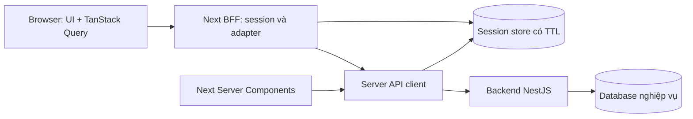

# 01 — Kiến trúc và quy tắc triển khai

## 1. Stack đề xuất

Next.js **16.x stable** App Router, React phiên bản tương thích, TypeScript strict; pin patch version và lockfile tại lúc bootstrap sau khi kiểm tra compatibility/security. Không dùng canary. Node LTS phù hợp cả Next và baseline backend `>=22.12.0`.

FE-00 đã pin **Next 16.4.3, React 19.3.1, TypeScript 5.9.3**, baseline Node 22.14.0; xem [package.json](../../../frontend/package.json) và [ADR runtime](../../../frontend/docs/adr/002-runtime-contracts-cache.md) cho phiên bản/caching thực tế.

- Tailwind CSS và shadcn/ui cho primitive tương tác; style theo GlowUp, không giữ theme mặc định của thư viện. Chuyển HTML CDN Tailwind thành component và CSS tokens, không nhúng nguyên trang bằng iframe/HTML injection.
- TanStack Query cho dữ liệu tương tác phía client; React Hook Form + Zod cho biểu mẫu. Chốt phiên bản cụ thể trong FE-00 và dùng tài liệu chính thức của phiên bản đã pin.
- State UI đơn giản bằng React state/context. Chỉ thêm Zustand nếu drawer/filter/selection dùng xuyên nhiều nhánh thực sự cần; không nhân bản giỏ hàng authoritative thành store local.
- Vitest + Testing Library cho logic client quan trọng; Playwright cho luồng người dùng, visual regression và accessibility checks. Fixtures/MSW chỉ phục vụ preview và kiểm thử.
- `next/font` cho Montserrat/Be Vietnam Pro; `next/image` cho ảnh public có nguồn hợp lệ và kích thước rõ. Không đưa ảnh bằng chứng đổi trả qua image optimizer/cache public.

## 2. Ranh giới trách nhiệm



Session store chỉ chứa thông tin phiên kỹ thuật, không có catalog/order/stock database thứ hai. Backend xác thực quyền và ownership trên mọi request private. UI guard và `proxy.ts` chỉ phục vụ điều hướng, không thay backend authorization.

Server Components dùng trực tiếp server client gọi backend. Browser dùng BFF khi cần giữ token/session riêng hoặc chuẩn hóa response. Public browser autocomplete cũng có thể qua adapter cố định để không phát sinh hai HTTP client khác nhau; không xây endpoint tổng quát cho phép caller tùy chọn URL upstream. Đây là mô hình phù hợp với [hướng dẫn BFF của Next.js](https://nextjs.org/docs/app/guides/backend-for-frontend).

## 3. Folder structure

```text
frontend/
├── public/                         # assets đã kiểm tra nguồn và tối ưu
├── src/
│   ├── app/
│   │   ├── layout.tsx              # html lang=vi, fonts, global providers
│   │   ├── providers.tsx           # QueryClient; không bắt cả app thành Client
│   │   ├── globals.css
│   │   ├── (site)/
│   │   │   ├── layout.tsx          # navbar trang chủ + footer dùng chung
│   │   │   ├── (storefront)/
│   │   │   │   ├── page.tsx
│   │   │   │   ├── products/[slug]/page.tsx
│   │   │   │   ├── products/page.tsx
│   │   │   │   ├── categories/[slug]/page.tsx
│   │   │   │   ├── brands/[slug]/page.tsx
│   │   │   │   ├── brands/page.tsx
│   │   │   │   ├── search/page.tsx
│   │   │   │   ├── new-arrivals/page.tsx
│   │   │   │   ├── flash-sale/page.tsx
│   │   │   │   ├── promotions/[id]/page.tsx
│   │   │   │   ├── promotions/page.tsx
│   │   │   │   ├── cart/page.tsx
│   │   │   │   ├── checkout/page.tsx
│   │   │   │   ├── order-success/[id]/page.tsx
│   │   │   │   ├── payment/return/page.tsx
│   │   │   │   ├── stores/[id]/page.tsx
│   │   │   │   └── stores/page.tsx
│   │   │   ├── (auth)/             # login/register/verify-email/forgot/reset/oauth
│   │   │   ├── (account)/account/
│   │   │   │   ├── layout.tsx      # xác thực + sidebar chuẩn Sổ địa chỉ
│   │   │   │   ├── page.tsx
│   │   │   │   ├── profile/page.tsx
│   │   │   │   ├── addresses/page.tsx
│   │   │   │   ├── orders/[id]/tracking/page.tsx
│   │   │   │   ├── orders/[id]/page.tsx
│   │   │   │   ├── orders/page.tsx
│   │   │   │   ├── wishlist/page.tsx
│   │   │   │   ├── loyalty/rewards/page.tsx
│   │   │   │   ├── loyalty/page.tsx
│   │   │   │   ├── returns/new/page.tsx
│   │   │   │   ├── returns/[id]/page.tsx
│   │   │   │   ├── returns/page.tsx
│   │   │   │   ├── notifications/page.tsx
│   │   │   │   └── security/page.tsx
│   │   │   └── (content)/          # blog, blog/category, faq, help, CMS
│   │   ├── api/                    # BFF allowlist, không nghiệp vụ commerce
│   │   ├── maintenance/page.tsx
│   │   ├── not-found.tsx
│   │   ├── error.tsx
│   │   └── global-error.tsx
│   ├── features/
│   │   ├── authentication/         # login, email verify, OAuth challenge, session UX
│   │   ├── product-catalog/
│   │   ├── product-search/
│   │   ├── product-reviews/
│   │   ├── cart/
│   │   ├── checkout/
│   │   ├── account-profile/
│   │   ├── addresses/
│   │   ├── orders/
│   │   ├── returns/
│   │   ├── wishlist/
│   │   ├── loyalty/
│   │   ├── notifications/
│   │   ├── promotions/
│   │   ├── store-locator/
│   │   ├── store-inventory/        # chỉ kích hoạt khi có public contract
│   │   └── content/
│   ├── entities/                  # product/category/brand/store/inventory/order/user
│   ├── widgets/                   # header/footer/account-sidebar/home-hero/
│   │                              # product-grid/product-detail/checkout-summary
│   ├── shared/
│   │   ├── ui/
│   │   ├── api/                   # browser.ts, server.ts, errors.ts, generated/
│   │   ├── auth/                  # server-only session & token broker
│   │   ├── hooks/
│   │   ├── lib/
│   │   ├── config/                # navigation, routes, capabilities, env
│   │   └── types/
│   └── proxy.ts
├── tests/                         # integration, e2e, fixtures
└── next.config.ts
```

Thêm `(site)` chung bên trên ba route group để navbar dùng đúng một instance và không reset drawer khi chuyển storefront/account. Không đặt header riêng ở mỗi page. Error boundary, loading, not-found đặt thêm theo segment có data độc lập, không chỉ ở root.

Mỗi feature chỉ tạo thư mục có sử dụng: `api/`, `components/`, `hooks/`, `schemas/`, `index.ts`; dùng `api/server.ts` hoặc entry `server.ts` riêng cho RSC. Không export module `server-only` qua barrel bị Client Component import. Hướng dependency: app → widgets/features → entities/shared. Feature phối hợp tại app/widget; tránh vòng import giữa features. Entity là type/mapper/view, không tự tính giá hay tồn kho.

## 4. Shared layout và design system

### Header

- Theo `trang_ch_glowup_beauty_retail/code.html`: announcement bar, logo/search, tra cứu, wishlist, notification, account, cart; hàng category navigation và mega menu.
- Guest thấy Đăng nhập/Đăng ký, không tên người dùng giả. Tra cứu dẫn vào lịch sử đơn được bảo vệ; chưa có guest lookup API.
- Badge/count/subtotal đọc đúng dữ liệu user hiện tại; khi loading dùng skeleton/ẩn badge, không mặc định số demo.
- Mobile giữ cùng hệ thống điều hướng, thu về menu drawer, search và cart. Đo chiều cao sticky bằng layout/CSS, không copy các `pt-[148px]` khác nhau từ từng HTML.

### Account sidebar

Chuẩn hình thức: `s_a_ch_glowup`, desktop khoảng 260px, card trắng bo góc, avatar/tier, nhóm “Quản lý cá nhân” và “Ưu đãi & Tích lũy”, active state nền nhạt/viền trái, logout và hỗ trợ cuối card. Mobile dùng sheet/accordion có mục active và focus rõ. Người dùng đã chốt bổ sung các mục còn thiếu; Ví voucher dẫn tới Đổi ưu đãi. Menu cụ thể ở [02](02_screen_inventory.md).

### Tokens và nội dung

- Palette đã chốt primary `#C85A70`, ghi đè primary `#9D394F` của HTML/frontmatter cũ; dùng token semantic. Background `#F9ECEE`, surface trắng, text `#412E27`.
- Montserrat cho heading/nav; Be Vietnam Pro cho body/form/giá. Container khoảng 1280px; product grid 2 cột mobile, 3 tablet, 4–5 desktop tùy sidebar.
- Một ProductCard, Money, PriceRange, StockStatus, Badge, QuantityStepper, EmptyState, FormField, Modal/Sheet, OrderStatus, Pagination dùng chung.
- Đo contrast thật; nếu màu brand không đủ cho chữ nhỏ, tạo token chữ/action đậm hơn và ghi rõ khi review, không tự đổi màu thương hiệu toàn cục.
- VND bằng `Intl.NumberFormat('vi-VN')`; ngày hiển thị `dd/MM/yyyy`, timezone `Asia/Ho_Chi_Minh`. Số tiền/điểm do backend trả, không suy ra tỷ lệ quy đổi từ mock.
- Không đưa `API GAP`, endpoint, mã truy vấn demo, chứng nhận PCI/VAT/cam kết giả hoặc số người đang xem giả vào sản phẩm chạy thật. Preview kỹ thuật có thể ghi trạng thái tích hợp ngoài nội dung mua hàng.
- Thay logo hỏng/hotlink bằng asset local có chất lượng phù hợp; `image.png_3` chỉ là tham khảo, không phải banner GlowUp.

## 5. Rendering, data fetching và state

| Nhóm | Server | Client | Nguồn state |
|---|---|---|---|
| Home | Banner/content/category + stream shelves | Carousel, wishlist, quick add, countdown | Backend; UI state cục bộ |
| Listing/category/brand/search | Fetch theo URL, metadata | Filter sheet, debounce, transitions | `searchParams`: page/filter/sort/q |
| PDP | Slug lookup, metadata, content | Gallery, chọn variant, qty, review, add/buy | Variant ID + backend offer |
| Cart/drawer | Initial read nếu hữu ích | Query cache + mutation + rollback/refetch | Backend cart, không local authoritative cart |
| Checkout | Session, address và initial data | RHF, preview, confirm quote, submit | Backend quote, form draft riêng |
| Account/order/returns | Verify session + initial private data | Form/action/tabs/pagination | Query private, không public cache |
| CMS/blog/FAQ | Render semantic HTML | Search FAQ, accordion | Published backend content |

Không dùng TanStack Query để fetch lại ngay cùng dữ liệu vừa có từ server. Nếu hydrate, tạo QueryClient riêng từng request SSR, dùng query key đầy đủ (resource, user scope, filter) và thiết lập freshness có chủ ý. Xóa private query cache khi logout/chuyển user. Không persist order/profile/token vào localStorage.

Autocomplete debounce khoảng 300ms, hủy request cũ, chỉ nhận response đúng query mới nhất; tôn trọng 429/`Retry-After`, cache ngắn có giới hạn. Lịch sử tìm kiếm local cần nút xóa; không xem lịch sử đó là API gợi ý xu hướng.

## 6. BFF và phiên đăng nhập

### Lựa chọn đề xuất

Backend phát access/refresh token trong JSON, không tự set cookie. Đề xuất cookie session ID ngẫu nhiên `HttpOnly`, `Secure` khi HTTPS, `SameSite=Lax`, `Path=/`; production có thể dùng tiền tố `__Host-`. Token nằm trong session store server có TTL, tách namespace/quyền khỏi dữ liệu nghiệp vụ.

Lý do chọn opaque session thay vì hai token cookie độc lập: backend rotate refresh làm access token cũ mất hiệu lực, nhiều tab/request SSR rất dễ race. Session store cho phép lock/CAS theo phiên và cập nhật token trên server mà RSC không phải ghi cookie. Chi phí đánh đổi: thêm hạ tầng session có TTL và xử lý store unavailable. Nếu chọn phương án cookie token đơn giản hơn, phải có ADR thay thế giải quyết refresh race đa instance; không dùng module-global promise làm bảo đảm production.

### Luồng

1. Browser POST BFF login/register/OAuth; BFF validate hình dạng input, gọi backend, không tự xác thực password.
2. Login thành công tạo/rotate session ID; chỉ trả user fields cần cho UI, không trả refresh token về JavaScript.
3. RSC/Route Handler dùng server token broker đọc session, gọi backend bằng Bearer. Không gọi HTTP `/api` của chính Next từ RSC.
4. Một refresh tại một thời điểm cho mỗi phiên, lock có TTL và kiểm tra version; request thua đọc lại token mới. Retry tối đa một lần khi đúng lỗi 401. Với write, chỉ retry nếu backend chưa thực hiện hoặc command có idempotency; không retry timeout tùy ý.
5. Refresh 401: invalidate session, điều hướng login với `returnTo` nội bộ đã validate. Refresh 429/503/network: giữ session để thử lại có kiểm soát; không logout nhầm.
6. Logout gọi backend revoke, xóa phiên BFF/cookie và private query cache. Nếu revoke lỗi mạng, vẫn vô hiệu hóa phiên web local, ghi nhận thất bại upstream an toàn để xử lý; không báo đã revoke tất cả thiết bị.
7. Guest cart: BFF tạo UUID session kỹ thuật trong cookie khi cần; chuyển thành `X-Session-Id` upstream, không cho browser chọn cart session tùy ý. Sau login merge guest cart và refetch; chỉ xóa guest reference sau merge thành công.
8. OAuth challenge/clientNonce giữ server-side ngắn hạn; xử lý đầy đủ success, `EMAIL_VERIFICATION_REQUIRED`, `ACCOUNT_LINK_REQUIRED`. Link account cần login tài khoản đích và proof email; không merge tài khoản tự động.

Cookie mutation chỉ ở Route Handler/Server Action; RSC không set/delete cookie khi render. `proxy.ts` kiểm tra điều hướng nhẹ; kiểm tra thật tại server client/BFF/backend. Tham khảo [authentication](https://nextjs.org/docs/app/guides/authentication) và [Proxy](https://nextjs.org/docs/app/api-reference/file-conventions/proxy).

### Contract BFF

- Route nhóm rõ: `/api/auth/*`, `/api/cart/*`, `/api/checkout/*`, `/api/account/*`, `/api/search/suggest`; đây là **route Next dự kiến**, không phải API backend đã có.
- Mutation cookie-based kiểm tra Origin/CSRF token theo cơ chế chọn; validate content-type/body, không dùng GET để đổi trạng thái. Chỉ forward allowlist method/path/header; không forward browser Authorization/Host tùy ý.
- Preserve HTTP status, stable `code`, `details`, `Retry-After` và `Idempotency-Key`. Lỗi hiển thị tiếng Việt; không log token, email proof, private image URL hay body chứa thông tin cá nhân.
- Multipart upload giữ nguyên binary/boundary, giới hạn kích thước theo backend. Không chuyển file thành JSON.
- Khi deploy qua BFF, chốt trusted proxy/IP strategy để backend rate limit không gom tất cả khách về IP Next. Không tin header do browser tự gửi.

## 7. Caching

FE-00 giữ `cacheComponents: false`, kiểm chứng dynamic SSR + no-store. Opt-in `cacheComponents: true` cần spike riêng sau khi có public representation/invalidation contract; dùng `use cache`, `cacheLife`, `cacheTag` cho component/hàm public thực sự ổn định và Suspense cho phần động. Không trộn máy móc cấu hình cache cũ vào route bật Cache Components. Xem ADR-002; nguồn: [Caching](https://nextjs.org/docs/app/getting-started/caching), [use cache](https://nextjs.org/docs/app/api-reference/directives/use-cache).

| Dữ liệu | Chính sách ban đầu | Invalidation / lưu ý |
|---|---|---|
| Shell, assets, menu cấu hình | Static | Theo release |
| Category/FAQ/CMS | Backend đang có versioned cache; Next revalidate/no-store ban đầu để không che cập nhật | Sau có invalidation contract mới thêm cache bền ở Next; không gọi TTL là cập nhật tức thời |
| Brand metadata | Cache khi API public được bàn giao | Tag theo brand; TTL/freshness ghi rõ |
| Banner | TTL ngắn chỉ sau kiểm tra lịch chạy | Không để banner hết hạn tồn tại lâu; no-store là baseline an toàn |
| Listing/PDP/related/suggest | **No-store trong contract hiện tại** | Payload trộn giá, promotion, inventory, tier và wishlist; không cache cả response |
| Flash sale, quota, tồn chi nhánh | No-store, polling có giới hạn nếu cần | Countdown từ `serverTime`; hết giờ refetch, không tự xác nhận giá |
| Cart/quote/order/payment/account | No-store + private/no-store tại BFF/CDN | Không cross-user cache; invalidate Query sau mutation |
| Blog detail | Request memoization để metadata/page không gọi hai lần | GET đang tăng views; giải quyết O05 trước cam kết cache bền hoặc analytics chính xác |

Nếu muốn cache mô tả PDP riêng, cần tách server representation không chứa giá/tồn/user state, đồng thời có contract update. Không chỉ bỏ vài field sau khi fetch rồi mặc định upstream đã an toàn để cache. Dữ liệu cá nhân luôn đọc cookies/session ngoài shared cache.

## 8. SEO và routing

- Dùng `/products/[slug]`, `/categories/[slug]` theo đề xuất người dùng và sitemap backend; blueprint cũ dùng số ít sẽ redirect nếu cần. Slug category resolve qua tree → categoryId.
- Đề xuất CMS canonical `/<pageSlug>` qua `(content)/[pageSlug]/page.tsx` (một segment, allowlist/reserved routes), khớp backend sitemap. `/pages/[slug]` redirect về canonical. Đây là lựa chọn kỹ thuật để đồng bộ backend hiện tại; nếu đổi canonical sau này phải cập nhật sitemap cùng lúc.
- Metadata, canonical, OpenGraph, Product/BreadcrumbList/Article JSON-LD từ dữ liệu thật. Không có review thật thì không tạo aggregateRating giả; không đưa giá thành viên vào public SEO.
- Noindex auth/cart/checkout/account/payment, preview và search/filter tổ hợp không cần index. Pagination listing có URL rõ, không blanket canonical mọi trang về page 1.
- Proxy đúng **cả** `/sitemap.xml`, `/sitemaps/*`, `/robots.txt` tới backend và giữ raw XML/text, ETag/304. Chỉ chọn một cơ chế, không tạo sitemap route Next trùng rewrite.
- `PUBLIC_WEB_URL` và `FRONTEND_URL` backend phải là origin Next, local **3001**, backend **3000**. Staging giữ indexing tắt; production chỉ bật sau kiểm tra canonical.
- `not-found.tsx`/HTTP 404, `error.tsx` + retry, `global-error.tsx` shell độc lập. Maintenance ở gateway/runtime phải trả 503 + `Retry-After`; trang `/maintenance` HTTP 200 đơn thuần chưa đáp ứng tiêu chí.

## 9. Skills và quy tắc làm việc

Trong lượt lập kế hoạch đã đọc và dùng `architecture`, `api-design-principles`, `payment-integration`. Khi triển khai, mở SKILL.md phù hợp với công việc thực tế và thông báo lần đầu áp dụng:

| Công việc | Skill phù hợp |
|---|---|
| Kiến trúc, quyết định folder/data flow | `architecture` |
| API contract, adapter và đề xuất backend | `api-design-principles`, `api-patterns` |
| Token/cookie/CSRF/session | `auth-implementation-patterns`, `api-security-best-practices` |
| VNPAY, callback, idempotency và reconciliation | `payment-integration`; protocol VNPAY chính thức là nguồn kỹ thuật cho provider |
| TypeScript và typed API | `typescript-expert`; `typescript-advanced-types` khi cần |
| Component/refactor/review | `clean-code`, `code-review-checklist` |
| Form/checkout/session regression | `test-driven-development` hoặc `unit-testing-test-generate` khi phù hợp |
| Kiểm tra accessibility | `accessibility-compliance-accessibility-audit` |
| Backend đã được người dùng chốt sửa | `nestjs-expert`, `prisma-expert` và skill chuyên môn liên quan |

Ưu tiên skill trong `.agents/skills` của repository nếu có cùng tên. Không tự cài nhiều skill/dependency chỉ vì có sẵn; không biến skill thành quy trình xin duyệt mọi thao tác. Với thay đổi backend, lập đề xuất cụ thể ở [03](03_api_contracts_and_gaps.md), hỏi người dùng chốt trước khi sửa theo yêu cầu ban đầu. Không tự dùng sub-agent khi chưa có chỉ định phù hợp.

## 10. ADR tóm tắt

| Quyết định | Trạng thái | Đánh đổi / lúc xem xét lại |
|---|---|---|
| Next render/BFF mỏng, backend nghiệp vụ | Đã chốt bởi người dùng | Tránh duplication; API thiếu phải xử lý tại backend |
| Shared `(site)` layout + sidebar Sổ địa chỉ | Đã chốt, gồm bổ sung menu | Giữ một instance header/sidebar; Ví voucher dẫn rewards |
| Modular features/entities/widgets/shared, không Full FSD | Đề xuất theo cấu trúc người dùng | Có quy tắc import nhưng ít ceremony; tách thêm khi code tăng |
| Opaque web session + TTL store/refresh lock | Chọn tại FE-00, runtime FE-01 theo ADR-001 | Thêm session infra để giải quyết refresh đa tab/instance |
| Catalog no-store hiện tại | Chọn baseline FE-00 theo ADR-002 | Chỉ cache khi tách metadata/offer và có invalidation |
| Canonical CMS root slug | Đề xuất kỹ thuật | Khớp sitemap; nếu chọn `/pages` phải sửa mapping backend |
