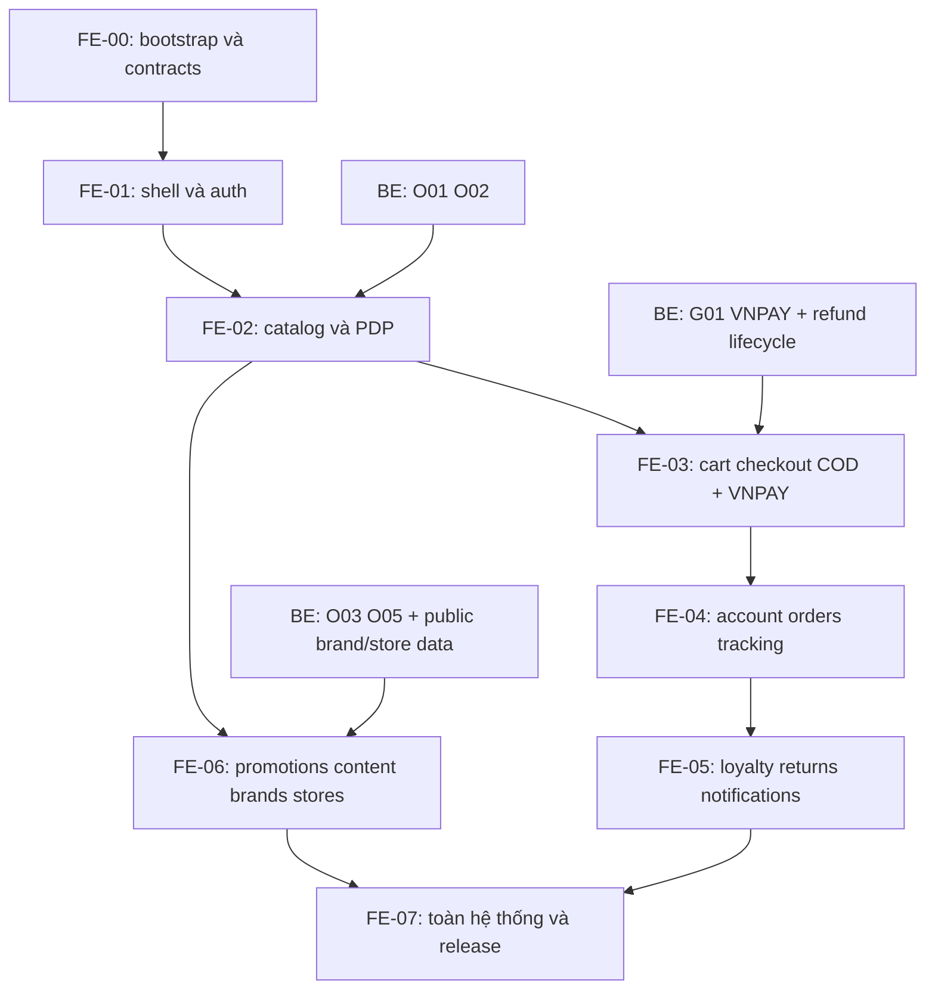

# 04 — Lộ trình triển khai và nghiệm thu

Ngày cập nhật: 26/10/2026. Phạm vi đã chốt: **đủ blueprint, VNPAY + COD, bỏ CTA phụ chưa có API, sửa O01/O02/O03/O05 trước tích hợp liên quan**.

## 1. Nguyên tắc chia việc

- Mỗi phase có UI, dữ liệu, trạng thái lỗi và luồng demo kiểm chứng được. Không dành hết các phase đầu cho trang tĩnh rồi để tích hợp cuối cùng.
- Phần API đang thiếu có thể dựng skeleton/fixture để review trong lúc BE làm; chỉ ghi “UI done”, chưa ghi “integrated”. VNPAY là release gate, không được bỏ qua để gọi COD-only là hoàn thành.
- UI không chờ các CTA đã thống nhất bỏ: newsletter/chat/booking/pickup/2FA/beauty profile. Các **page** vẫn thuộc phạm vi 41 HTML + 5 trang blueprint.
- Giữ navbar/sidebar chuẩn ngay FE-01; không dựng 41 layout riêng rồi sửa đồng bộ ở cuối.
- Người phụ trách theo sprint plan hiện có: FE Web **Tuấn Anh**, BE End-user **Việt Trung**; nội dung/Admin phối hợp **Thành Lập**. Đây là phân công tham chiếu, không tự gửi giao việc ra ngoài.
- Không đổi source backend trong lượt lập kế hoạch. Mỗi ticket sửa backend dưới đây có contract/review/validation riêng khi bắt đầu thực hiện.

## 2. Dependencies và thứ tự

Các nhánh có thể được các thành viên FE/BE làm độc lập khi contract đã rõ; sơ đồ không phải chỉ định dùng sub-agent. Nếu một FE duy nhất, thực hiện tuần tự theo ưu tiên và tranh thủ dựng UI phần độc lập lúc chờ BE.

## 3. Các phase và sản phẩm bàn giao

| Phase | Công việc chính | Bàn giao / điều kiện qua phase | FE ngày công sơ bộ |
|---|---|---|---|
| **FE-00** Foundation/contract | Tạo `frontend/`, pin stack, env sample, lint/type/build scripts; ADR session/refresh; kiểm kê asset; khóa route/tokens; BE review backlog | App chạy cổng 3001; SSR thử gọi backend; chuẩn API envelope/error/generated types; registry capabilities và route inventory được đưa vào checklist | 3–4 |
| **FE-01** Shell/auth | Header/footer chuẩn, mobile nav, sidebar Sổ địa chỉ, primitives; login/register/link email/reset/OAuth flow; BFF session; error shells; address UI nền | Một layout xuyên site, màu #C85A70; Guest → register/verify/login → account; logout/private access/refresh race được kiểm tra; skeleton/404/error/maintenance UI | 5–7 |
| **FE-02** Catalog/search/PDP | Home sections cơ bản, products/category/search/new-arrivals, PDP/variant/reviews/related; URL filters; metadata | Search → filter → PDP → chọn variant/add cart; không dùng filter giả; O01/O02 bàn giao trước integration; responsive cards/navbar | 5–7 |
| **FE-03** Cart/checkout/payment | Drawer+cart shared, partial checkout/merge; address/coupon/points preview; COD + VNPAY; success/payment return | Guest cart → login merge → preview → đặt COD; luồng VNPAY sandbox success/fail/pending/return/reload; quote/idempotency/stale responses đúng; **G01 bắt buộc** | 6–8 |
| **FE-04** Account/orders | Tổng quan/profile/address CRUD, orders/detail/cancel/tracking, security read/reset link | Sidebar đủ mục, profile/address update thật, delete default theo BE; order ownership, multiple shipments; không fake ETA/voucher count | 4–6 |
| **FE-05** Post-purchase | Wishlist, loyalty/rewards, returns/create/detail/quote/evidence, notifications; review sau mua | Mua → COMPLETED → review/RMA; private upload; redeem/retry không trừ điểm hai lần; accept quote/refund status; 7 ngày đúng backend | 5–7 |
| **FE-06** Marketing/content/retail | Home hoàn chỉnh, promotions/detail/flash, brands/detail, stores/detail, blog/topic/article, CMS/FAQ/help; CTA thiếu API bỏ | Đủ 5 trang blueprint chưa có HTML; O03/O05 trước integration; public brand/store data thật hoặc nguồn được duyệt; nội dung nhất quán; sitemap/metadata đúng | 4–6 |
| **FE-07** Hardening/release | Cross-browser/mobile, visual coverage, a11y, SEO, performance, recovery, provider staging và docs deploy | Mọi route/screen có bằng chứng; mandatory API integrated; test gate đạt; preview mock không lẫn release; VNPAY và COD hoạt động trên staging | 3–5 |
| **Tổng** | Chưa tính thời gian BE/provider/content | Chưa phải lịch cam kết theo ngày | **35–50** |

Thêm 20% dự phòng ≈ **42–60 ngày công frontend**. Một người làm 5 ngày/tuần tương đương khoảng 8–12 tuần công việc, còn calendar time phụ thuộc BE và nội dung. Không cộng hoặc gán ước lượng backend thiếu căn cứ; cần BE estimate sau review G01/O01–O05/G02/G03. Số liệu này không thay thế roadmap sáu sprint của toàn dự án; đây là kế hoạch thực hiện FE từ trạng thái repository hiện tại.

## 4. Backlog backend đi trước

| Mốc | Owner tham chiếu | Việc cần bàn giao | FE bị chặn |
|---|---|---|---|
| BE-FE-01 | BE End-user + BE Admin review DTO dùng chung | O01 public projection không giá vốn; O02 schema/query/errors/quote typed; sample contract | Catalog/private adapters, checkout |
| BE-FE-02 | BE End-user/payment owner | G01: VNPAY attempt/status/return/IPN/query/refund, ownership/idempotency, reservation lifecycle; sandbox account/config | Online payment và nghiệm thu cuối |
| BE-FE-03 | BE End-user | O03 flash/promotion cards + detail/products; thời hạn/quota/pagination | Flash sale, campaign detail và home sale shelves |
| BE-FE-04 | BE End-user/CMS | O05 read-only blog + view event/dedupe | Blog metadata/cache/analytics |
| BE-FE-05 | BE End-user + BE Admin/content | Public brand/store read contract hoặc nguồn nội dung đã được duyệt; logo/coordinates/active states | Brand directory/detail, store locator/detail |
| ENV-01 | Backend/deployment owner | Recheck migrations, SMTP, public/private storage, origins, trusted proxy, session store, OAuth provider | Auth thật, upload, private session, integration |

Ưu tiên bàn giao API/schema **trước phần FE integration tương ứng ít nhất 1–2 ngày** theo nguyên tắc sprint chung. Nếu BE trễ, chuyển sang component/fixture review phần độc lập và ghi rõ dependency; không tự viết nghiệp vụ ở BFF để vượt chặn.

## 5. Luồng kiểm thử bắt buộc

| Nhóm | Tình huống có giá trị | Bằng chứng mong muốn |
|---|---|---|
| Auth/session | Token expired, refresh nhiều request/tab, logout user A rồi login B, refresh 503, OAuth challenge/link | Không rò cache/phiên; một refresh cho phiên; không logout nhầm do network; link đúng user |
| Guest cart | Add/update/remove, reload, login merge, merge lỗi rồi retry, variant unavailable | Backend cart đúng, drawer/page đồng bộ, không mất guest cart trước merge thành công |
| Catalog | URL filter/page back-forward, search out-of-order, variant hết hàng, 404 slug | URL và nội dung khớp; API filter thật; loading/empty/errors rõ |
| Quote/order | Update quantity/points trong khi preview cũ đang chạy, giá đổi, stock hết, submit hai lần, timeout sau commit | Quote mới nhất được xác nhận; idempotency giữ nguyên khi retry cùng command; không tạo đơn trùng |
| VNPAY | Success/failure/cancel/pending, return trước/sau IPN, không quay lại site, return query bị sửa, callback lặp, charge late, retry attempt | Chỉ backend xác nhận paid; không double charge/order/reservation; UI recovery qua order detail |
| Ownership | Đổi order/return/payment/attachment ID sang user khác | Backend từ chối; UI không cache hoặc render dữ liệu user khác |
| Address | Max 10, first/default, xóa default/last, server validation | UI đồng bộ danh sách/refetch theo backend; không gửi addressNote lạ |
| Rewards/RMA | Thiếu policy/điểm, redeem retry, RMA ngoài hạn 7 ngày, upload quá lớn/URL hết hạn, quote changed/expired | Không trừ điểm/lập RMA hai lần; không public-cache evidence; không báo refund settled sớm |
| CMS/SEO | Unpublished slug, blog prefetch, canonical, sitemap index và parts, robots staging | Không lộ bản nháp, không đếm views do metadata, sitemap đúng URL site |
| Failure/recovery | 429 Retry-After, 503 riêng từng section, offline, maintenance | Không fake empty/success; retry có giới hạn, không mất form hoặc checkout reference cần thiết |

Mức kiểm thử:

1. **Static:** lint, TypeScript strict, production build; generated types/spec không drift.
2. **Unit/integration có chọn lọc:** money display/parser, contract adapter, query key/user isolation, refresh broker/concurrency, allowed redirects, quote state và idempotency command lifecycle. Không viết test chỉ lặp lại className hoặc copy implementation.
3. **E2E:** tối thiểu Guest → buy, register/link/reset, COD, VNPAY, account/address, order/tracking/cancel, wishlist/redeem, return/refund; dùng backend test cô lập và tài khoản fixtures. Provider mock cho regression, sandbox thật cho sign-off.
4. **Visual:** screenshot mọi screen ID S01–S41 và B01–B05, states trọng yếu; desktop/mobile. Snapshot dựa thiết kế đã chuẩn hóa, không cố giữ các header/sidebar/màu sai cũ.
5. **Accessibility:** keyboard flow, focus management, labels/errors, contrast, zoom 200%, reduced motion, touch targets; automated scan cộng kiểm tra thủ công checkout/auth/modal.

## 6. Performance, SEO và vận hành

- Mục tiêu ban đầu cho trang public ở percentile 75 khi có dữ liệu đo đủ: LCP ≤ 2.5s, INP ≤ 200ms, CLS ≤ 0.1. Giai đoạn local dùng lab measurements làm proxy; không tuyên bố đạt field metrics chỉ qua Lighthouse một lần. Các ngưỡng là mục tiêu kỹ thuật đề xuất của dự án.
- Đo home/listing/PDP/checkout với ảnh/dữ liệu thật; không tải toàn bộ catalog để làm filter/count, không request waterfall có thể chạy song song. Xác định payload và số request trước khi thêm aggregation endpoint.
- SSR metadata không double-fetch tác dụng phụ; hydration không fetch cùng data ngay lập tức; font/image tối ưu đúng responsive sizes. Account/private queries không nằm trong shared persistent cache.
- Có timeout/backend request tracing qua request ID, log có redact; error UI gửi mã hỗ trợ thay stacktrace. Không cài analytics/session replay chứa PII mặc định.
- Env frontend: `BACKEND_API_BASE_URL` server-only, website origin, session store credentials/key server-only, provider public client IDs nếu bật OAuth. Secret VNPAY/JWT/DB chỉ backend hoặc session layer tương ứng, không `NEXT_PUBLIC_*`.
- Runbook: build/start, port 3001, domain/origin/callback changes, image hosts, migration responsibility, disable indexing staging, maintenance 503 và rollback. Không static-export app có session/BFF/runtime.

## 7. Definition of Done

Một screen/feature chỉ coi hoàn tất khi:

- [ ] Có mapping S/B ID, route thật và navigation tới/đi khỏi trang; mọi CTA còn giữ đều có hành vi.
- [ ] Navbar trang chủ, sidebar Sổ địa chỉ và màu #C85A70 đồng nhất; footer theo trang chủ đã sửa nội dung mâu thuẫn.
- [ ] Data adapter dùng endpoint thực, kiểm tra contract; dữ liệu mock chỉ môi trường test/preview rõ ràng.
- [ ] Loading/empty/error/unauthorized/validation và mobile được xử lý.
- [ ] Mutation chạy đúng backend, không tính nghiệp vụ chính ở frontend; ownership/session/cache/idempotency đúng.
- [ ] API gap/optimization có ID, owner và trạng thái; CTA đã thống nhất bỏ thực sự không còn hứa tính năng.
- [ ] Checks và test phù hợp đã pass, visual review có bằng chứng; lỗi còn lại ghi rõ mức ảnh hưởng.

Toàn bộ frontend chỉ đạt nghiệm thu khi:

- [ ] Đủ phạm vi 46 mục blueprint và mini-cart composition, không sót 5 trang chưa có HTML.
- [ ] O01/O02/O03/O05 có thay đổi BE được review, contract bàn giao và kiểm chứng integration.
- [ ] VNPAY + COD hoạt động với backend/staging; callback/reconcile/refund không chỉ mock; không còn gate `ONLINE_PAYMENT_MODULE_REQUIRED` trên luồng VNPAY được bật.
- [ ] Màn brand/store dùng nguồn dữ liệu được chốt; published CMS và asset đã chuẩn bị; không có danh tính/hotline/chứng nhận/đơn hàng demo trong bản public.
- [ ] Không rò token/PII/giá vốn/private attachment; không cross-user cache; SEO/canonical/robots/sitemap đúng.
- [ ] Có README frontend, env example không secret, hướng dẫn kiểm thử, dependency/backlog tồn đọng và runbook deploy.

## 8. Theo dõi tiến độ

Dùng một bảng theo S/B ID hoặc ticket, gồm: `UI | API contract | integration | states/mobile | tests | review | blocker`. Trạng thái: TODO → UI-ready → API-ready → Integrated → Verified. Tạo issue/PR khi bắt đầu triển khai theo workflow repository; không coi tài liệu kế hoạch là issue đã giao hoặc PR đã tạo.

### FE-00 — cập nhật 26/10/2026

Đã tạo app `frontend/` cổng 3001, pin dependency/lockfile, env sample, scripts, API envelope/error/runtime validation, generated OpenAPI + drift check, tokens, route/capability registry, asset inventory và ADR session/refresh/cache. Chi tiết kiểm chứng và phần còn chờ ở [checklist FE-00](../../../frontend/docs/fe-00-checklist.md).

SSR smoke dùng health fixture cô lập trong E2E; probe backend thật `localhost:3000` hiện không kết nối được. Chưa coi runtime backend/provider đã nghiệm thu. Screen S01–S41/B01–B05 vẫn TODO, bao gồm home S39; trang `/` chỉ là bootstrap. O01/O02/O03/O05/G01/G02/G03/ENV-01 tiếp tục theo backlog BE, không có thay đổi source BE trong FE-00.

### FE-01 — cập nhật 27/10/2026

Đã triển khai shell chung, mobile menu/desktop dropdown, sidebar tài khoản, form/auth routes, server-only opaque session broker và các error/loading/maintenance shell. UI nền Sổ địa chỉ có adapter và CRUD theo DTO hiện tại. S01/S17/S25–S30/S41 được theo dõi UI-ready trong `frontend/docs/screen-progress.json`; không đánh dấu Integrated/Verified cho auth/provider/staging bằng fixture. Home S39 vẫn chờ FE-02/06.

Theo yêu cầu người dùng, frontend dùng chung Upstash backend với namespace `glowup:frontend:local:session:`; secret chỉ ở `.env.local`. 14 ca concurrency/CAS/logout/recovery session đã pass trên Upstash thật. Chi tiết, cache policy, kết quả kiểm thử và gate ENV-01/O02 ở [checklist FE-01](../../../frontend/docs/fe-01-checklist.md).
