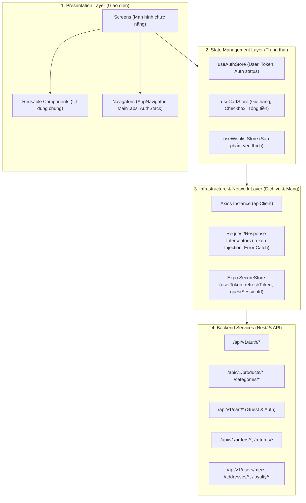
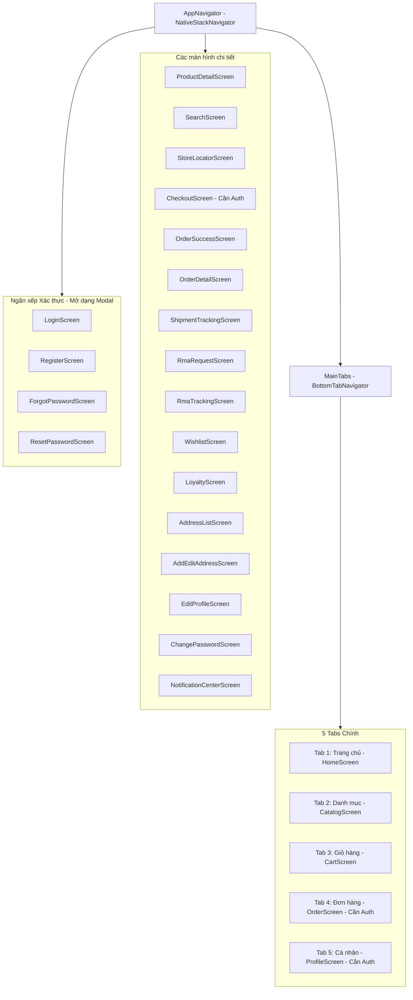

# 01 — Kiến trúc Ứng dụng & Tech Stack (Mobile)

Tài liệu này xác định kiến trúc tổng thể, mô hình dữ liệu, chiến lược quản lý trạng thái, tầng mạng và tiêu chuẩn thiết kế cho ứng dụng di động GlowUp Cosmetics.

---

## 1. Công nghệ sử dụng (Technology Stack)

| Thành phần | Công nghệ / Thư viện | Phiên bản | Ghi chú |
|---|---|---|---|
| **Framework nền tảng** | React Native (Expo) | Expo SDK ~58.0, RN 0.88 | Chạy được trên cả Expo Go và Prebuild Native |
| **Ngôn ngữ** | TypeScript | ~6.0.3 / TS strict | Đồng bộ type definition và an toàn kiểu dữ liệu |
| **Điều hướng (Routing)** | `@react-navigation/native`<br>`@react-navigation/native-stack`<br>`@react-navigation/bottom-tabs` | ^6.x | Quản lý ngăn xếp màn hình và thanh điều hướng dưới |
| **Quản lý trạng thái** | Zustand | ^4.4.7 | Nhẹ, dễ đọc, không boilerplate như Redux, hỗ trợ persist |
| **HTTP Client** | Axios | ^1.6.2 | Tích hợp Interceptors tự động gắn Token & xử lý lỗi 401 |
| **Lưu trữ bảo mật** | `expo-secure-store` | ~58.0.2 | Lưu trữ JWT Access/Refresh Token và Guest Session UUID |
| **Sinh trắc học** | `expo-local-authentication` | ~58.0.2 | Đăng nhập vân tay / Face ID |
| **Biểu tượng (Icons)** | `@expo/vector-icons` (Ionicons) | ^15.0.2 | Bộ icon tiêu chuẩn phong cách iOS/Android |

---

## 2. Mô hình Kiến trúc Phân tầng (Layered Architecture)



---

## 3. Kiến trúc Điều hướng (Navigation Architecture)

### Vấn đề hiện tại:
Trong file `AppNavigator.tsx`, code hiện tại đang viết:
```tsx
{token ? <MainTabs /> : <AuthStack />}
```
> [!CAUTION]
> **Đây là lỗi luồng nghiêm trọng đối với ứng dụng thương mại điện tử.** Nếu chưa đăng nhập, người dùng sẽ bị kẹt vĩnh viễn ở màn hình Đăng nhập/Đăng ký, không thể xem Trang chủ, không thể duyệt Danh mục sản phẩm hay tìm kiếm.

### Kiến trúc điều hướng chuẩn (Guest-Friendly Flow):
Cấu trúc Navigator sẽ được tổ chức lại như sau:



* **Khách vãng lai (Guest):** Thoải mái xem Trang chủ, duyệt Danh mục, xem Chi tiết sản phẩm, Tìm kiếm, thêm vào Giỏ hàng (dùng `guestSessionId`).
* **Kích hoạt Auth Guard:** Khi người dùng nhấn nút **Thanh toán**, mở Tab **Đơn hàng**, hoặc mở Tab **Cá nhân**, ứng dụng sẽ hiển thị thông báo hoặc mở `LoginScreen` (hoặc Auth Modal). Sau khi đăng nhập thành công, tự động quay lại màn hình người dùng đang thực hiện dở.

---

## 4. Cơ chế Mạng & Quản lý Phiên (Networking & Session Strategy)

Theo tài liệu handoff từ Backend (`backend/docs/api/nextjs-expo-handoff.md`), Expo Mobile cần tuân thủ nghiêm ngặt các quy tắc:

### 4.1. Cấu hình URL linh hoạt
```typescript
// mobile/src/api/apiClient.ts
export const getBaseUrl = () => {
  if (process.env.EXPO_PUBLIC_API_URL) return process.env.EXPO_PUBLIC_API_URL;
  // Android Emulator: 10.0.2.2 trỏ về localhost máy chủ
  // Thiết bị thật qua Wi-Fi: dùng IP LAN của máy host (VD: 192.168.1.4)
  return 'http://192.168.1.4:3000/api/v1';
};
```

### 4.2. Token Lifecycle & Auto Refresh
* **Lưu trữ:**
  * `accessToken`: Lưu trong bộ nhớ (Zustand store) và `SecureStore` key `userToken`.
  * `refreshToken`: Lưu trong `SecureStore` key `userRefreshToken`.
* **Cơ chế 401 Interceptor:**
  * Khi nhận mã lỗi HTTP 401 từ các private API, Interceptor của Axios sẽ tự động gọi `POST /auth/refresh-token` với `{ refreshToken }`.
  * Nếu thành công: Cập nhật cặp token mới và thử lại request cũ (retry).
  * Nếu thất bại (hết hạn hoặc bị thu hồi): Xóa token, đưa state về `user: null`, và điều hướng người dùng tới màn hình Đăng nhập.

### 4.3. Giỏ hàng Khách (Guest Cart) & Đồng bộ sau Đăng nhập
* Khi người dùng là khách (chưa login), ứng dụng tự sinh một UUID ngẫu nhiên và lưu vào SecureStore: `guestSessionId`.
* Mọi request tới `/cart/*` khi chưa login đều gửi kèm Header: `X-Session-Id: <UUID>`.
* Khi người dùng đăng nhập thành công: Gọi API merge giỏ hàng hoặc backend tự động merge giỏ hàng khách vào tài khoản khách hàng.

---

## 5. Design System & Theme Tokens

Ứng dụng tuân thủ bộ nhận diện thương hiệu GlowUp Cosmetics:

```typescript
// mobile/src/constants/theme.ts
export const COLORS = {
  // Thương hiệu chính
  primary: '#C85A70',         // Rose Berry (Màu chủ đạo)
  primaryLight: '#E28B9B',
  primaryDark: '#A23B51',
  primarySurface: '#FDF2F4',  // Nền ửng hồng phớt

  // Màu phụ & Điểm nhấn
  secondary: '#F9ECEE',       // Blush Pink
  accent: '#D4AF37',          // Champagne Gold (Hạng VIP / Khuyến mãi)
  
  // Trạng thái hệ thống
  success: '#10B981',         // Xanh ngọc (Thành công, Đã giao)
  warning: '#F59E0B',         // Cam (Chờ xử lý, Đang giao)
  error: '#EF4444',           // Đỏ (Hủy đơn, Lỗi validation)
  info: '#3B82F6',            // Xanh dương (Thông tin)

  // Màu nền & Bề mặt
  background: '#F8F9FA',      // Nền canvas sáng
  surface: '#FFFFFF',         // Nền thẻ card
  surfaceSubtle: '#F3F4F6',   // Nền xám nhạt

  // Văn bản
  textDark: '#1F2937',        // Văn bản tiêu đề chính
  textBody: '#4B5563',        // Văn bản nội dung
  textMuted: '#9CA3AF',       // Văn bản phụ, chú thích
  border: '#E5E7EB',          // Đường kẻ viền mờ
};
```

