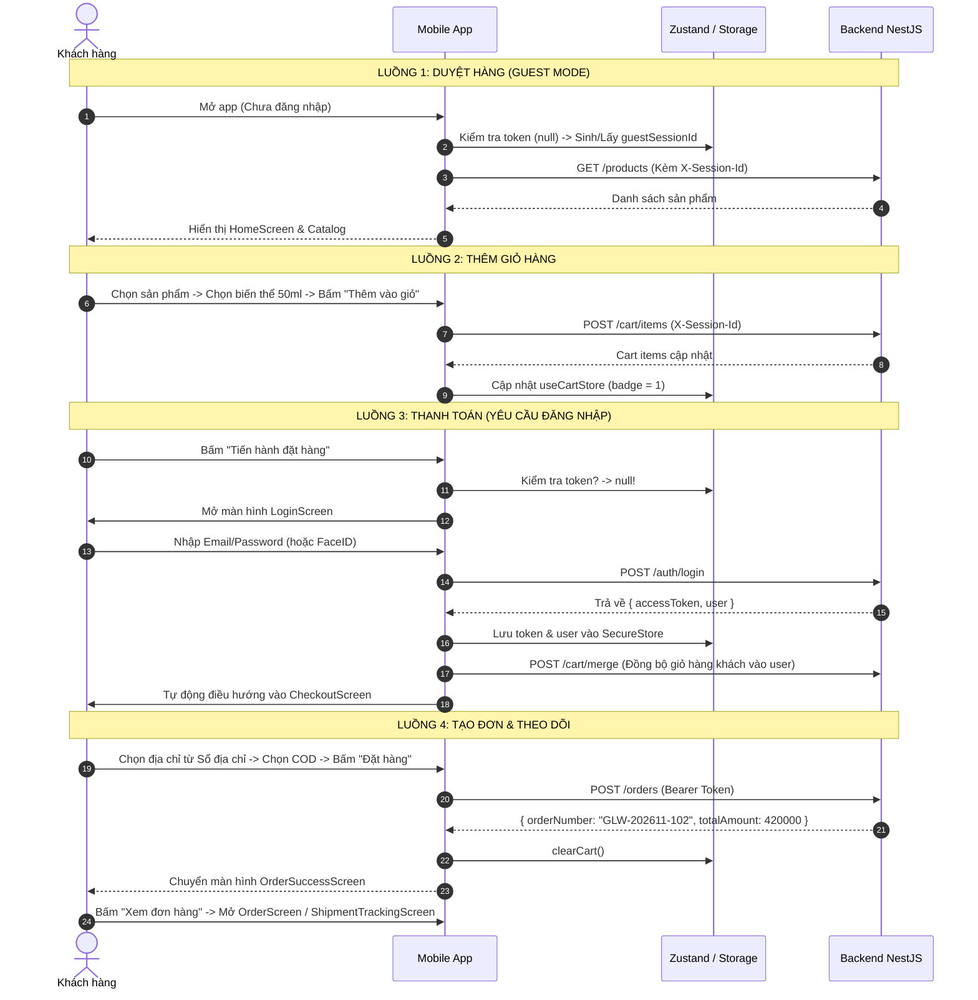

# 02 — Danh Mục Màn Hình & Phân Tích Khoảng Cách (Screen Inventory & Gap Analysis)

Tài liệu này đối chiếu chi tiết giữa **Frontend Web** (41 màn Stitch Design + 5 trang blueprint) với **Mobile App (React Native)** nhằm xác định rõ màn hình nào đã có, màn hình nào còn thiếu, và các luồng chức năng cần hoàn thiện.

---

## 1. Bảng Đối Chiếu 1:1 (Frontend Web vs Mobile App)

| STT | Màn hình Frontend Web | Mã Web | Màn hình Mobile tương ứng | Trạng thái Mobile | Đánh giá & Khoảng cách (Gaps) |
|:---:|---|:---:|---|:---:|---|
| **I** | **XÁC THỰC & TÀI KHOẢN (AUTH)** | | | | |
| 1 | Đăng nhập (`/login`) | S26 | `LoginScreen.tsx` |  Đã có | Đã có Form Email/Pass, nút Biometric (Face ID/Vân tay), nút Google. Cần kết nối API thật. |
| 2 | Đăng ký tài khoản (`/register`) | S25 | `RegisterScreen.tsx` |  Đã có | Form đăng ký với các trường cơ bản. Cần xử lý validation & link API backend. |
| 3 | Quên mật khẩu (`/forgot-password`) | S28 | `ForgotPasswordScreen.tsx` |  Đã có | Form nhập email nhận mã OTP/link. |
| 4 | Đặt lại mật khẩu (`/reset-password`) | S28 | `ResetPasswordScreen.tsx` | ❌ **Chưa có** | **Thiếu màn hình**: Cần thêm màn hình nhập mật khẩu mới sau khi người dùng nhận mã OTP. |
| 5 | Xác thực Email / OAuth link | S41, S27 | — | ⏳ Chưa có | Web dùng link verify token; trên mobile có thể xử lý qua deep link hoặc nhập mã OTP 6 số. |
| **II** | **DUYỆT & TÌM KIẾM SẢN PHẨM (CATALOG)** | | | | |
| 6 | Trang chủ (`/`) | S39 | `HomeScreen.tsx` |  Đã có | Rất đẹp: Hero banner Flash sale, danh mục chip cuộn ngang, lưới sản phẩm 2 cột, thả tim. Đang dùng mock data fallback. |
| 7 | Danh mục sản phẩm (`/categories/[slug]`) | S11 | `CatalogScreen.tsx` |  Đã có | Có chia tab/danh mục dọc bên trái hoặc chip trên, lưới sản phẩm, bộ lọc sắp xếp. |
| 8 | Chi tiết sản phẩm (`/products/[slug]`) | S09 | `ProductDetailScreen.tsx` |  Đã có | Trình chiếu ảnh, bộ chọn biến thể (dung tích 30ml/50ml), mô tả, thành phần, nút Thêm giỏ / Mua ngay. |
| 9 | Tìm kiếm sản phẩm (`/search`) | S21 | `SearchScreen.tsx` |  Đã có | Thanh tìm kiếm tức thời, gợi ý từ khóa hot, lịch sử tìm kiếm gần đây. |
| 10 | Hàng mới về (`/new-arrivals`) | S15 | — | 🔄 Ghép | Tích hợp thành bộ lọc/tab "Mới về" trong `CatalogScreen` hoặc shelf trên `HomeScreen`. |
| 11 | Flash Sale đếm ngược (`/flash-sale`) | S13 | — | 🔄 Ghép | Đã có đồng hồ đếm ngược Flash Sale trực tiếp trên `HomeScreen`. |
| 12 | Danh mục Thương hiệu (`/brands`, `/brands/[slug]`) | B01, B02 | `BrandScreen.tsx` | ⚠️ Tùy chọn | Hiện tại có thể lọc theo Brand trong `CatalogScreen`. Đợt MVP có thể chưa cần trang Brand riêng. |
| 13 | Hệ thống Showroom / Cửa hàng (`/stores`) | S18, S10 | `StoreLocatorScreen.tsx` | ❌ **Chưa có** | **Thiếu màn hình**: Rất cần thiết cho trải nghiệm chuỗi mỹ phẩm O2O. Cần danh sách chi nhánh, giờ mở cửa, hotline, địa chỉ bản đồ. |
| **III** | **GIỎ HÀNG & MUA HÀNG (COMMERCE)** | | | | |
| 14 | Giỏ hàng (`/cart`) | S14 | `CartScreen.tsx` |  Đã có | Checkbox chọn từng item / chọn tất cả, tăng giảm số lượng, vuốt xóa, tính tổng tiền. |
| 15 | Xác nhận & Thanh toán (`/checkout`) | S37 | `CheckoutScreen.tsx` |  Đã có | Chọn vận chuyển, chọn phương thức thanh toán (COD, SePay), nhập voucher, preview chi phí. |
| 16 | Đặt hàng thành công (`/order-success/[id]`) | S32 | `OrderSuccessScreen.tsx` |  Đã có | Thông báo thành công, mã đơn hàng, phương thức thanh toán, nút quay về Trang chủ / Xem đơn. |
| 17 | Kết quả thanh toán Online (`/payment/return`) | S22 | — | 🔄 Tích hợp | Với SePay/Chuyển khoản: hiển thị mã QR kèm thông tin thanh toán trong `CheckoutScreen` hoặc `OrderSuccessScreen`. |
| **IV** | **ĐƠN HÀNG & HẬU MÃI (POST-PURCHASE)** | | | | |
| 18 | Danh sách đơn hàng (`/account/orders`) | S23 | `OrderScreen.tsx` |  Đã có | Phân loại tab (Tất cả, Chờ xử lý, Đang giao, Đã giao, Đã hủy). |
| 19 | Chi tiết đơn hàng (`/account/orders/[id]`) | S08 | `OrderDetailScreen.tsx` | ⚠️ Dạng Modal | Hiện tại đang mở dạng **Modal chi tiết** bên trong `OrderScreen`. Cần chuẩn hoá thành Screen hoặc giữ Modal mượt mà. |
| 20 | Theo dõi vận chuyển (`/account/orders/[id]/tracking`) | S38 | `ShipmentTrackingScreen.tsx` |  Đã có | Timeline các chặng vận chuyển, đơn vị vận chuyển, mã vận đơn, thông tin shipper. |
| 21 | Yêu cầu đổi trả (`/account/returns/new`) | S34 | `RmaRequestScreen.tsx` |  Đã có | Chọn sản phẩm cần đổi, nhập lý do, upload ảnh bằng chứng, chọn hình thức (đổi mới/hoàn tiền). |
| 22 | Theo dõi tiến độ đổi trả (`/account/returns/[id]`) | S06, S12 | `RmaTrackingScreen.tsx` |  Đã có | Theo dõi timeline xét duyệt RMA, giải pháp xử lý, tình trạng bù trừ/hoàn tiền. |
| **V** | **TÀI KHOẢN, ƯU ĐÃI & THÀNH VIÊN (ACCOUNT & LOYALTY)** | | | | |
| 23 | Hồ sơ cá nhân (`/account/profile`) | S36 | `ProfileScreen.tsx` `EditProfileScreen.tsx` |  Đã có | Xem tổng quan tài khoản, chỉnh sửa họ tên, số điện thoại, ngày sinh, giới tính. |
| 24 | Sổ địa chỉ giao hàng (`/account/addresses`) | S29 | `AddressListScreen.tsx` `AddEditAddressScreen.tsx` | ❌ **Chưa có** | **Thiếu màn hình then chốt**: Hiện tại Checkout đang bắt người dùng nhập tay; người dùng không quản lý được danh sách địa chỉ đã lưu. |
| 25 | Đổi mật khẩu (`/account/security`) | S02 | `ChangePasswordScreen.tsx` |  Đã có | Form đổi mật khẩu hiện tại sang mật khẩu mới. |
| 26 | Điểm thưởng & Đổi ưu đãi (`/account/loyalty`) | S19, S20 | `LoyaltyScreen.tsx` |  Đã có | Thẻ thành viên VIP, số dư điểm GlowPoint, lịch sử tích/tiêu điểm, danh sách voucher đổi điểm. |
| 27 | Danh sách yêu thích (`/account/wishlist`) | S31 | `WishlistScreen.tsx` |  Đã có | Danh sách sản phẩm thả tim, xóa khỏi wishlist, nút thêm nhanh vào giỏ hàng. |
| 28 | Hộp thư thông báo (`/account/notifications`) | S16 | `NotificationCenterScreen.tsx` |  Đã có | Danh sách thông báo chia tab (Khuyến mãi, Đơn hàng, Hệ thống), đánh dấu đã đọc. |
| 29 | Trợ giúp & Chính sách (`/help`, `/faq`) | S40, S03, S05 | `HelpCenterScreen.tsx` | ⚠️ Chưa có màn | Hiện tại trong `ProfileScreen` chỉ có nút bấm hiện popup Alert hoặc mở liên kết điện thoại. |

---

## 2. Danh Sách Màn Hình Cần Bổ Sung (New Screen Requirements)

Để ứng dụng mobile đạt chuẩn MVP Demo trọn vẹn và liền mạch như Frontend, cần bổ sung **3 nhóm màn hình ưu tiên**:

### Màn hình 1: Sổ địa chỉ (`AddressListScreen` & `AddEditAddressScreen`)
* **Mục đích:** Cho phép khách hàng quản lý danh sách địa chỉ giao hàng (Thêm mới, Sửa, Xóa, Đặt mặc định) và chọn nhanh địa chỉ tại màn hình `CheckoutScreen`.
* **Design & Bố cục:**
  * Phong cách thẻ Card bo góc mềm mại, huy hiệu "Mặc định" màu Rose Berry.
  * Form gồm: Tên người nhận, Số điện thoại, Địa chỉ chi tiết (Số nhà, tên đường), Tỉnh/Thành phố, Quận/Huyện, Phường/Xã.
  * Checkbox "Đặt làm địa chỉ mặc định".

### Màn hình 2: Màn hình Đặt lại mật khẩu (`ResetPasswordScreen`)
* **Mục đích:** Hoàn thiện luồng Quên mật khẩu. Sau khi nhập Email ở `ForgotPasswordScreen`, người dùng được chuyển tới màn hình này để nhập mã OTP và mật khẩu mới.
* **Design & Bố cục:** Ô nhập OTP 6 số, ô Mật khẩu mới, ô Xác nhận mật khẩu, nút bấm Rose Berry "Cập nhật mật khẩu".

### Màn hình 3: Hệ thống Showroom / Cửa hàng (`StoreLocatorScreen`)
* **Mục đích:** Khách hàng tra cứu showroom gần nhất, địa chỉ, giờ hoạt động, hotline tư vấn (tương ứng S18 trên Web).
* **Design & Bố cục:**
  * Thanh tìm kiếm theo Tỉnh/Thành phố hoặc Quận.
  * Danh sách showroom dạng thẻ cuộn dọc (Hình ảnh mặt tiền, Tên showroom, Khoảng cách km, Địa chỉ, Nút gọi Hotline, Nút Chỉ đường).

### Màn hình 4: Trung tâm Trợ giúp & Chính sách (`HelpCenterScreen`)
* **Mục đích:** Khách hàng tra cứu câu hỏi thường gặp (FAQ), chính sách đổi trả hàng 7 ngày của GlowUp, điều khoản bảo hành da và liên hệ hỗ trợ (tương ứng S40, S03, S05 trên Web).
* **Design & Bố cục:**
  * Danh mục hỗ trợ theo chủ đề (Đơn hàng & Giao vận, Đổi trả & Hoàn tiền, Điểm thưởng GlowPoint, Bảo hành da).
  * Khối câu hỏi thường gặp dạng Accordion (mở ra/thu lại).
  * Thẻ liên hệ nhanh: Hotline tư vấn 1900 8899, Email hỗ trợ, Địa chỉ văn phòng.

---

## 3. Rà Soát & Chuẩn Hoá Các Luồng Chức Năng (User Flows)

