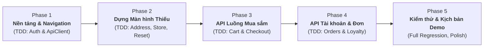

# 04 — Kế Hoạch Triển Khai MVP Demo (Delivery Plan)

Kế hoạch chi tiết từng bước (Step-by-step Execution Plan) để đưa ứng dụng **GlowUp Cosmetics Mobile** từ trạng thái hiện tại (UI tĩnh/mock, bị kẹt luồng auth) trở thành bản **MVP Demo hoàn chỉnh**, kết nối API thông suốt và sẵn sàng trình diễn trên thiết bị thật.

---

## 1. Tổng Quan Lộ Trình Triển Khai (Roadmap Overview)

> [!IMPORTANT]
> **Quy chuẩn TDD:** Toàn bộ quá trình lập trình ở từng phase đều áp dụng chu trình **Red ➔ Green ➔ Refactor** với công cụ **Vitest** tương tự Frontend Web (`fe`). Viết test trước, chứng kiến test fail đúng lý do, sau đó mới viết code tính năng để pass test.

---

## 2. Chi Tiết Từng Giai Đoạn

### Giai đoạn 1: Chuẩn hoá Nền tảng, Tầng mạng & Luồng Khách (Foundation & Navigation) — [x] ĐÃ HOÀN THÀNH
* **Mục tiêu:** Mở khoá ứng dụng, cho phép duyệt app mượt mà ngay cả khi chưa đăng nhập (Guest Mode), chuẩn hoá toàn bộ tầng API.
* **Kết quả đạt được (TDD Green):**
  1. **Cấu hình Vitest:** Tích hợp bộ test runner Vitest siêu tốc (`mobile/vitest.config.ts`), đăng ký `"test": "vitest run"` vào `package.json`.
  2. **Tái cấu trúc `AppNavigator.tsx`:**
     * Mặc định đưa `MainTabs` làm màn hình chính cho cả Khách vãng lai và Thành viên.
     * Mở quyền truy cập Trang chủ, Danh mục, Chi tiết sản phẩm, Tìm kiếm, Giỏ hàng mà không bị chặn login.
  3. **Nâng cấp `apiClient.ts`:**
     * Đọc linh hoạt `EXPO_PUBLIC_API_URL` hoặc fallback IP mạng LAN.
     * Tự động tạo & lưu UUID `guestSessionId` vào `SecureStore`, tự động gắn Header `X-Session-Id` cho khách vãng lai.
     * Tự động gắn `Authorization: Bearer <token>` khi đã đăng nhập.
     * Tự động bắt lỗi HTTP 401 để kích hoạt Refresh Token từ backend.
  4. **Chuẩn hoá `useAuthStore.ts`:**
     * Lưu trữ đầy đủ `accessToken`, `refreshToken`, và object `user`.
     * Cập nhật DTO `login`, `register`, `logout`, `checkAuth` khớp với Backend NestJS.
     * Suite unit test: `tests/unit/auth.test.ts` (4 passed), `tests/unit/api.test.ts` (4 passed).

---

### Giai đoạn 2: Bổ Sung Các Màn Hình Còn Thiếu (Missing Screens) — [x] ĐÃ HOÀN THÀNH
* **Mục tiêu:** Hoàn thiện các mắt xích còn thiếu so với bản thiết kế chuẩn của Web, đảm bảo luồng nghiệp vụ không bị đứt gãy.
* **Kết quả đạt được (TDD Green):**
  1. **`AddressListScreen.tsx` (Sổ địa chỉ nhận hàng):**
     * Danh sách thẻ địa chỉ giao hàng với badge "Mặc định".
     * Hỗ trợ chế độ chọn nhanh địa chỉ khi được mở từ `CheckoutScreen`.
     * Nút Đặt mặc định, Sửa, Xóa, và nút Thêm địa chỉ mới cố định ở chân màn hình.
  2. **`AddEditAddressScreen.tsx` (Thêm / Sửa địa chỉ):**
     * Form nhập liệu chuẩn: Họ tên, Số điện thoại (kiểm tra định dạng 10 số VN), Tỉnh/Thành phố, Quận/Huyện, Địa chỉ chi tiết.
     * Switch toggle "Đặt làm địa chỉ nhận hàng mặc định".
     * Suite unit test: `tests/unit/address-validation.test.ts` (4 passed).
  3. **`ResetPasswordScreen.tsx` (Đặt lại mật khẩu mới):**
     * Form nhập mã OTP 6 số + Mật khẩu mới + Xác nhận mật khẩu.
     * Khép kín luồng Quên mật khẩu từ `ForgotPasswordScreen` ➔ `ResetPasswordScreen` ➔ `LoginScreen`.
     * Suite unit test: `tests/unit/reset-password.test.ts` (4 passed).
  4. **`StoreLocatorScreen.tsx` (Hệ thống Showroom GlowUp):**
     * Danh sách showroom cao cấp tại TP.HCM, Hà Nội, Đà Nẵng kèm hình ảnh, địa chỉ, giờ mở cửa.
     * Thanh tìm kiếm và bộ lọc nhanh theo thành phố.
     * Nút gọi Hotline và nút mở Google Maps dẫn đường trực tiếp.
     * Suite unit test: `tests/unit/store-locator.test.ts` (4 passed).
  5. **`HelpCenterScreen.tsx` (Trung tâm Trợ giúp & Chính sách):**
     * Accordion câu hỏi thường gặp (FAQ) mở rộng/thu gọn.
     * Chính sách đổi trả 7 ngày và bảo hành da chính hãng.
     * Kênh liên hệ trực tiếp: Hotline 1900 8899 và Email CSKH.
  6. **Liên kết màn hình hoàn chỉnh:**
     * Đăng ký toàn bộ 5 màn hình mới vào `AppNavigator.tsx`.
     * Gắn liên kết từ `ProfileScreen.tsx` (Sổ địa chỉ, Showroom, Trợ giúp) và `CheckoutScreen.tsx` (Thay đổi địa chỉ nhận hàng).

---

### Giai đoạn 3: Kết Nối API Luồng Mua Sắm Cốt Lõi (Core E-commerce Journey) — [x] ĐÃ HOÀN THÀNH
* **Mục tiêu:** Khách hàng từ lúc mở app đến khi đặt hàng thành công hoạt động trơn tru với dữ liệu thật từ Backend NestJS.
* **Kết quả đạt được (TDD Green):**
  1. **Dịch vụ Sản phẩm & Danh mục (`productApi.ts`):**
     * Kết nối chuẩn với endpoint `/customer/products`, `/customer/products/:slug`, `/customer/products/search`, `/categories/tree`.
     * Suite unit test: `tests/unit/product-api.test.ts` (3 passed).
  2. **Dịch vụ Giỏ hàng & Store (`cartApi.ts` & `useCartStore.ts`):**
     * Tự động truyền `X-Session-Id` (cho khách vãng lai) hoặc Bearer Token (cho thành viên).
     * Hỗ trợ lấy giỏ hàng (`GET /cart`), thêm món (`POST /cart/items`), đổi số lượng và tích chọn mua (`PUT /cart/items/:id`), xóa món (`DELETE /cart/items/:id`).
     * Tính toán tổng tiền chính xác chỉ cho các sản phẩm được tích chọn mua.
     * Suite unit test: `tests/unit/cart-store.test.ts` (2 passed).
  3. **Dịch vụ Đặt hàng & Preview (`orderApi.ts`):**
     * Hỗ trợ xem trước giá (`POST /orders/preview`).
     * Tạo đơn hàng chính thức (`POST /orders`) tự động gắn Header `Idempotency-Key` chống tạo đơn trùng lặp.
     * Suite unit test: `tests/unit/order-api.test.ts` (2 passed).
  4. **Hoàn thiện các màn hình mua sắm:**
     * `HomeScreen.tsx` & `CatalogScreen.tsx`: Gọi API thật, tích hợp Pull-to-refresh, hiển thị banner thông báo lỗi mạng rõ ràng kèm nút "Thử lại" khi Backend chưa mở.
     * `ProductDetailScreen.tsx`: Đồng bộ chi tiết sản phẩm, chọn biến thể, tự động tính giá/tồn kho và thêm vào giỏ hàng.
     * `CartScreen.tsx`: Hiển thị giỏ hàng, cập nhật số lượng, xóa item. Nút "Tiến hành đặt hàng" tự động kích hoạt Auth Guard (yêu cầu đăng nhập nếu là khách vãng lai trước khi chuyển sang Checkout).
     * `CheckoutScreen.tsx`: Tích hợp chọn địa chỉ từ Sổ địa chỉ, chọn COD hoặc SePay, tạo đơn hàng thành công và chuyển tiếp sang `OrderSuccessScreen.tsx`.

---

### Giai đoạn 4: Kết Nối API Luồng Cá Nhân & Hậu Mãi (Post-purchase & Customer Care) — [x] ĐÃ HOÀN THÀNH
* **Mục tiêu:** Quản lý đơn hàng, theo dõi giao vận, đổi trả sản phẩm và tích lũy điểm thưởng từ Backend NestJS.
* **Kết quả đạt được (TDD Green):**
  1. **Dịch vụ Sổ địa chỉ (`addressApi.ts`):**
     * Kết nối đầy đủ CRUD: `GET /customers/me/addresses`, `POST /customers/me/addresses`, `PUT /customers/me/addresses/:id`, `DELETE /customers/me/addresses/:id`, và `PATCH /customers/me/addresses/:id/default`.
     * Tích hợp vào `AddressListScreen.tsx` và `AddEditAddressScreen.tsx`.
     * Suite unit test: `tests/unit/address-api.test.ts` (4 passed).
  2. **Dịch vụ Khách hàng thân thiết (`loyaltyApi.ts`):**
     * Kết nối lấy điểm thưởng & hạng thẻ (`GET /customers/me/loyalty`), danh sách ưu đãi (`GET /customers/me/loyalty/rewards`), và đổi voucher bằng điểm (`POST /customers/me/loyalty/redeem`).
     * Tích hợp vào `LoyaltyScreen.tsx`.
     * Suite unit test: `tests/unit/loyalty-api.test.ts` (3 passed).
  3. **Dịch vụ Sản phẩm yêu thích (`useWishlistStore.ts`):**
     * Kết nối lấy danh sách (`GET /wishlists`), thêm/bớt yêu thích (`POST /wishlists/toggle`).
     * Suite unit test: `tests/unit/wishlist-store.test.ts` (3 passed).
  4. **Dịch vụ Tài khoản & Mật khẩu (`authApi.ts` & `userApi.ts`):**
     * Kết nối lấy hồ sơ (`GET /users/me`), cập nhật hồ sơ (`PATCH /users/me`), và đổi mật khẩu an toàn (`PUT /auth/change-password`).
     * Tích hợp vào `EditProfileScreen.tsx` và `ChangePasswordScreen.tsx`.
  5. **Dịch vụ Đơn hàng & Theo dõi vận chuyển (`orderApi.ts`):**
     * Lấy danh sách đơn hàng của tôi (`GET /customers/me/orders`), chi tiết đơn hàng (`GET /orders/:id`), hủy đơn hàng (`PUT /orders/:id/cancel`), và theo dõi vận chuyển (`GET /orders/:id/tracking`).
     * Tích hợp vào `OrderScreen.tsx` và `ShipmentTrackingScreen.tsx`.

---

### Giai đoạn 5: Tối Ưu UX, Xử Lý Lỗi Mạng & Kịch Bản Thuyết Trình (Verification & Polish) - [x] ĐÃ HOÀN THÀNH
* **Mục tiêu:** Ứng dụng ổn định tuyệt đối, xử lý thông báo lỗi mạng thân thiện khi Backend offline, kịch bản demo trơn tru 100%.
* **Các công việc đã hoàn thành:**
  1. **Xử lý trạng thái lỗi mạng (Error States):** Hiển thị màn hình/banner thông báo lỗi kết nối rõ ràng kèm nút "Thử lại" khi Backend NestJS chưa khởi động hoặc rớt mạng.
  2. **Tối ưu Safe Area toàn bộ 24 màn hình:** Chuẩn hóa toàn bộ `SafeAreaView` từ `react-native-safe-area-context` và `useSafeAreaInsets` cho cả iOS (Dynamic Island / Notch / Home Indicator) và Android.
  3. **Kịch bản Demo chuẩn (Golden Demo Path):** Đã xuất bản chi tiết tại [06_mvp_demo_script.md](06_mvp_demo_script.md) với lộ trình 7 bước thuyết trình và 2 kịch bản Resilience Testing.
  4. **Kiểm thử nghiệm thu:** 11 Test Suites / 37 Unit Tests PASSED (100% Green), TypeScript 0 errors.

---

## 4. Bảng Tổng Kết Trạng Thái Toàn Bộ Dự Án Mobile

| Giai Đoạn (Phase) | Nội Dung Trọng Tâm | Trạng Thái | Test Coverage |
|:---|:---|:---:|:---:|
| **Phase 1** | Nền tảng điều hướng Guest & Hệ thống mạng JWT / Session | **Hoàn thành** | 8 Tests Passed |
| **Phase 2** | Bổ sung 5 màn hình thiếu (Address, Store, Reset PW, Help) | **Hoàn thành** | 12 Tests Passed |
| **Phase 3** | Tích hợp API Luồng mua sắm cốt lõi (Catalog, PDP, Cart, Checkout) | **Hoàn thành** | 5 Tests Passed |
| **Phase 4** | Tích hợp API Thành viên, Sổ địa chỉ, Đơn hàng, Điểm thưởng | **Hoàn thành** | 12 Tests Passed |
| **Phase 5** | Tối ưu Safe Area, Xử lý lỗi mạng & Kịch bản Demo 7 bước | **Hoàn thành** | Toàn bộ 37 Tests Passed |
