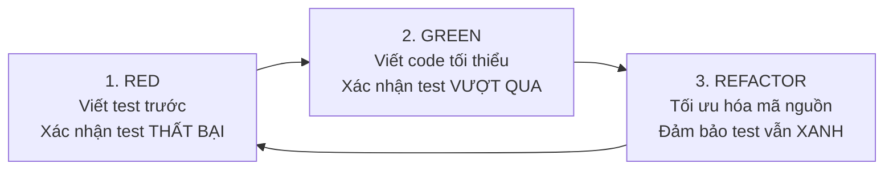

# 05 — Chiến Lược Kiểm Thử & Quy Trình TDD (Test-Driven Development)

Tài liệu này xác định nguyên tắc, công cụ và quy trình kiểm thử hướng kiểm thử (TDD) cho ứng dụng di động **GlowUp Cosmetics Mobile**, đồng bộ phương pháp phát triển chất lượng cao giống như **Frontend Web (`fe`)**.

---

## 1. Nguyên Tắc Tối Cao của TDD (The Iron Law of TDD)

> [!IMPORTANT]
> **KHÔNG VIẾT CODE TÍNH NĂNG KHI CHƯA CÓ TEST THẤT BẠI TRƯỚC ĐÓ.**
> *(NO PRODUCTION CODE WITHOUT A FAILING TEST FIRST)*

Mọi tính năng mới, sửa lỗi (bugfix) hoặc tái cấu trúc (refactor) đều phải tuân thủ nghiêm ngặt chu trình 3 bước **Red — Green — Refactor**:



1. **RED:** Viết một test nhỏ đại diện cho yêu cầu nghiệp vụ cụ thể. Chạy test và chứng kiến test thất bại vì lý do chính đáng (chưa có code, chưa trả về đúng kiểu dữ liệu).
2. **GREEN:** Viết lượng code tối thiểu vừa đủ để test chuyển sang màu xanh (passed). Không viết thừa chức năng chưa được test mô tả.
3. **REFACTOR:** Dọn dẹp cấu trúc, đặt tên biến rõ nghĩa, loại bỏ code trùng lặp (DRY), nhưng kiểm tra lại toàn bộ test suite để đảm bảo hệ thống vẫn xanh 100%.

---

## 2. Công Cụ Kiểm Thử (Testing Tooling)

Đồng bộ với Frontend Web, Mobile sử dụng bộ công cụ kiểm thử siêu tốc:

| Thành phần | Công cụ | Mục đích |
|---|---|---|
| **Test Runner & Assertion** | `vitest` (phiên bản tương thích với FE) | Chạy unit test cực nhanh, hỗ trợ TypeScript tự nhiên, mock hàm (`vi.fn()`, `vi.spyOn()`) |
| **Môi trường (Environment)** | `node` / `happy-dom` | Kiểm thử tầng logic, store, API client, router helpers mà không cần khởi động thiết bị thật |
| **Cấu hình Alias** | `@/*` trỏ vào `mobile/src/*` | Đường dẫn import sạch đẹp, đồng bộ quy ước giữa Web và Mobile |
| **Thư mục kiểm thử** | `mobile/tests/unit/**/*.test.ts` | Tách biệt hoàn toàn mã test khỏi mã nguồn `src/` |

---

## 3. Danh Mục Các Ca Kiểm Thử Unit Test (Test Inventory)

Theo lộ trình MVP, các suite test được xây dựng theo từng phase trước khi implement code:

### 3.1. Nhóm Xác thực & Phiên làm việc (`tests/unit/auth.test.ts`)
* `test('useAuthStore initial state has null token and user')`
* `test('login successfully saves accessToken and refreshToken to SecureStore and updates state')`
* `test('login failure resets state and throws friendly error message')`
* `test('logout clears user, token from state and removes keys from SecureStore')`
* `test('checkAuth reads token from SecureStore and fetches /users/me profile')`
* `test('auto-refresh token: 401 error triggers /auth/refresh-token and retries original request')`

### 3.2. Nhóm Tầng mạng & Guest Cart (`tests/unit/api.test.ts`, `tests/unit/guest-cart.test.ts`)
* `test('apiClient automatically attaches Bearer token if user is logged in')`
* `test('apiClient automatically generates and attaches X-Session-Id UUID if user is Guest')`
* `test('apiClient unwraps backend envelope res.data.data automatically')`
* `test('cartApi.getCart calls /cart and returns mapped items')`
* `test('cartApi.mergeCart transfers guest items to customer cart on login')`

### 3.3. Nhóm Giỏ hàng & Tính toán Chi phí (`tests/unit/cart-store.test.ts`)
* `test('useCartStore.addItem adds new item or increases quantity if variant exists')`
* `test('useCartStore.toggleSelect updates selection status and recalculates total')`
* `test('useCartStore.getTotalPrice calculates only selected items correctly')`
* `test('useCartStore.removeItem deletes item from cart')`

### 3.4. Nhóm Sổ địa chỉ & Checkout Validation (`tests/unit/address-checkout.test.ts`)
* `test('address form validation: rejects invalid Vietnamese phone numbers')`
* `test('address form validation: requires recipientName, addressLine, and city')`
* `test('checkout preview: calculates subtotal, shipping fee, and grand total')`
* `test('createOrder sends Idempotency-Key header and selected shippingAddressId')`

### 3.5. Nhóm Đổi mật khẩu & Reset Password (`tests/unit/password-recovery.test.ts`)
* `test('forgot password validates email format before calling API')`
* `test('reset password requires 6-digit OTP and matching new passwords')`
* `test('change password validates currentPassword is not empty and newPassword >= 6 chars')`

### 3.6. Nhóm Hệ thống Showroom & Hỗ trợ (`tests/unit/store-locator.test.ts`)
* `test('store locator filters stores by city and search keyword')`
* `test('store locator formats hotline and map link correctly')`

---

## 4. Tích Hợp Lệnh Kiểm Thử Vào Quy Trình Phát Triển

Trong `mobile/package.json`, kịch bản test sẽ được đăng ký:

```json
"scripts": {
  "start": "expo start",
  "android": "expo start --android",
  "ios": "expo start --ios",
  "test": "vitest run",
  "test:watch": "vitest",
  "test:coverage": "vitest run --coverage"
}
```

Mỗi khi lập trình:
1. Chạy `npm run test:watch` ở cửa sổ terminal riêng.
2. Viết test case mới trong `tests/unit/*.test.ts` (Thấy **RED** ❌).
3. Viết code trong `src/` để test chuyển sang **GREEN**  trong vòng vài giây.
4. Refactor và commit code sạch.

