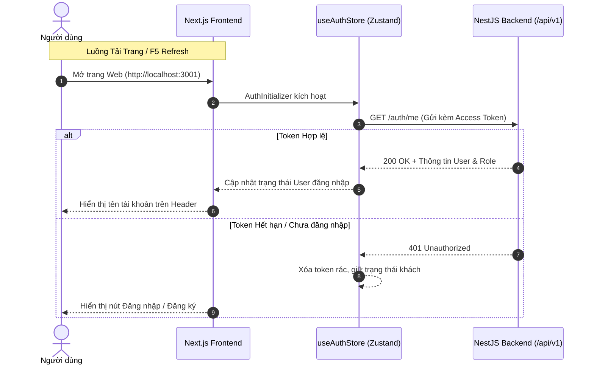

# GlowUp Web — Nền Tảng Thương Mại Điện Tử Mỹ Phẩm

<div align="center">


*Giao diện thương mại điện tử hiện đại, tinh tế dành riêng cho hệ thống phân phối và bán lẻ mỹ phẩm cao cấp.*

</div>

---

##  Giới Thiệu Tổng Quan

**GlowUp Web** là ứng dụng Frontend cho hệ thống bán lẻ mỹ phẩm cao cấp (Swiss Haute Parfumerie & Cellular Skincare). Dự án được xây dựng dựa trên kiến trúc tiên tiến **Next.js 14 App Router**, kết hợp **TypeScript** chuẩn mực và **Tailwind CSS**, mang đến trải nghiệm mua sắm mượt mà, giao diện sang trọng, tốc độ tải trang tối ưu và khả năng tương thích cao trên mọi thiết bị.

---

##  Các Cột Mốc Vừa Hoàn Thành

### 1. Tích hợp RESTful API & Xác thực Người dùng (Authentication)
- **Tích hợp Backend NestJS:** Kết nối đầy đủ với hệ thống API tại `http://localhost:8080/api/v1` thông qua Axios Client tập trung (`api-client.ts`), hỗ trợ cấu hình Header, Timeout và Interceptor chuẩn hóa.
- **Quản lý Phiên làm việc (Session Management):**
  - Cơ chế Token kép: Lưu trữ và đồng bộ an toàn **Access Token** & **Refresh Token** qua HTTP Cookie và Zustand Store.
  - Tự động duy trì phiên: Tích hợp component `AuthInitializer` tại Root Layout, tự động gọi API `GET /api/v1/auth/me` để nạp dữ liệu người dùng thực mỗi khi người dùng F5 hoặc tải lại trang.
  - Loại bỏ hoàn toàn mock data phiên giả, nâng cao tính bảo mật và tính xác thực cho toàn bộ luồng Auth.
- **Khám phá Sản phẩm (Product Discovery):** Kết nối API sản phẩm thực tế, hỗ trợ tìm kiếm theo từ khóa, lọc theo danh mục, thương hiệu, mức giá và phân trang động.

### 2. Đa Ngôn Ngữ (i18n) & Định Dạng Tiền Tệ Động (Dynamic Currency)
- **Internationalization với `next-intl`:** Hỗ trợ đầy đủ song ngữ **Tiếng Việt (`vi`)** và **Tiếng Anh (`en`)** với cơ chế định tuyến chuyên nghiệp qua App Router (`/[locale]/...`).
- **Language Switcher Tinh Gọn:** Dropdown chuyển đổi ngôn ngữ gắn kết thẩm mỹ, mượt mà trên Header, tự động ghi nhớ tùy chọn ngôn ngữ của người dùng.
- **Định dạng tiền tệ thông minh (`useCurrency`):** Chuẩn hóa toàn bộ hệ thống giá sang VND, tự động hiển thị linh hoạt theo ngôn ngữ:
  - Bản Tiếng Việt: `1.350.000 ₫`
  - Bản Tiếng Anh: `1,350,000 VND`
- Đồng bộ chính xác với thuật toán lọc giá, giỏ hàng (`useCartStore`) và hóa đơn thanh toán.

### 3. Thiết Lập Bộ Quy Chuẩn AI Coding Qua `CLAUDE.md`
- Xây dựng file quy tắc kỹ thuật chuẩn hóa `CLAUDE.md` nhằm định hướng cho quá trình cộng tác với AI / LLM:
  - **Think Before Coding:** Luôn phân tích giả định, đánh giá rủi ro và giải quyết thấu đáo trước khi viết mã.
  - **Simplicity First:** Tối giản mã nguồn, loại bỏ trừu tượng hóa dư thừa và dead code.
  - **Surgical Changes:** Chỉnh sửa chính xác đúng phạm vi yêu cầu, tuyệt đối không gây side-effect lên mã nguồn sẵn có.
  - **Vùng cấm phân quyền:** Nghiêm cấm can thiệp hoặc thay đổi các tệp quản trị tại `src/app/admin/` và `src/services/admin.service.ts` khi chưa có yêu cầu cụ thể.

---

## 📂 Cấu Trúc Thư Mục Cốt Lõi

Dự án áp dụng mô hình phân tách độc lập giữa **Cổng Khách hàng (Customer Storefront)** và **Cổng Quản trị viên (Admin Backoffice)**:

```
frontend/
├── .env.local                  # Cấu hình biến môi trường cục bộ
├── CLAUDE.md                   # Bộ quy chuẩn đạo đức & kỹ thuật cho AI Agent
├── messages/                   # Từ điển bản dịch đa ngôn ngữ
│   ├── en.json                 # Bản dịch Tiếng Anh
│   └── vi.json                 # Bản dịch Tiếng Việt
├── src/
│   ├── app/
│   │   ├── [locale]/           # PHÂN HỆ KHÁCH HÀNG (Customer Storefront)
│   │   │   ├── layout.tsx      # Root layout cho khách hàng (Theme, AuthInitializer, Header, Footer)
│   │   │   ├── page.tsx        # Trang chủ (Hero banner, USP, Sản phẩm nổi bật, Story)
│   │   │   ├── shop/           # Trang danh mục & bộ lọc sản phẩm chi tiết
│   │   │   ├── products/[id]/  # Trang chi tiết sản phẩm & đánh giá
│   │   │   ├── cart/           # Trang giỏ hàng
│   │   │   ├── checkout/       # Luồng thanh toán & nhập thông tin giao hàng
│   │   │   ├── login/          # Trang đăng nhập người dùng
│   │   │   ├── register/       # Trang đăng ký tài khoản mới
│   │   │   └── account/        # Trang quản lý hồ sơ, địa chỉ & lịch sử đơn hàng
│   │   │
│   │   └── admin/              # PHÂN HỆ QUẢN TRỊ VIÊN (Admin Backoffice)
│   │       ├── layout.tsx      # Layout quản trị riêng biệt (Sidebar, Admin Topbar)
│   │       ├── page.tsx        # Dashboard tổng quan doanh số & đơn hàng
│   │       ├── products/       # Quản lý danh mục & biến thể sản phẩm
│   │       ├── categories/     # Quản lý ngành hàng
│   │       ├── brands/         # Quản lý thương hiệu đối tác
│   │       └── inventory/      # Quản lý tồn kho & nhập hàng
│   │
│   ├── components/             # Thư viện UI Components tái sử dụng
│   │   ├── Header.tsx          # Thanh điều hướng chính (Navigation, Search, Mini Cart, Auth)
│   │   ├── Footer.tsx          # Chân trang & liên kết hỗ trợ
│   │   ├── CartSlideOut.tsx    # Giỏ hàng trượt (Quick Drawer Cart)
│   │   ├── LanguageSwitcher.tsx# Menu chuyển đổi ngôn ngữ
│   │   └── DynamicProductCard.tsx # Thẻ hiển thị sản phẩm đồng bộ API
│   │
│   ├── hooks/                  # Custom React Hooks
│   │   └── useCurrency.ts      # Hook định dạng tiền tệ thông minh theo locale
│   │
│   ├── i18n/                   # Cấu hình Next-Intl (routing, request config)
│   │   ├── routing.ts
│   │   └── request.ts
│   │
│   ├── services/               # Tầng giao tiếp RESTful API (Axios)
│   │   ├── api-client.ts       # Axios instance trung tâm kèm interceptors
│   │   ├── auth.service.ts     # Dịch vụ Đăng nhập, Đăng ký, Lấy thông tin cá nhân
│   │   ├── customer.service.ts # Dịch vụ Sản phẩm, Danh mục, Đơn hàng khách hàng
│   │   └── admin.service.ts    # Dịch vụ API dành riêng cho quản trị viên
│   │
│   ├── store/                  # Quản lý State toàn cục với Zustand
│   │   ├── useAuthStore.ts     # Trạng thái đăng nhập, User Profile & Phân quyền Role
│   │   └── useCartStore.ts     # Trạng thái giỏ hàng, số lượng, lưu trữ LocalStorage
│   │
│   └── types/                  # Định nghĩa TypeScript Types & DTOs
│       ├── api.ts              # Interface cấu trúc dữ liệu Backend API
│       └── product.ts          # Kiểu dữ liệu Sản phẩm & Thuộc tính
```

---

## 🛠️ Hướng Dẫn Cài Đặt & Khởi Chạy

### 1. Yêu Cầu Môi Trường
- **Node.js:** Phiên bản `>= 18.17.0` (Khuyến nghị Node.js LTS 20.x).
- **Trình quản lý gói:** `npm`, `yarn` hoặc `pnpm`.
- **Backend Service:** Backend NestJS chạy tại cổng `8080`.

### 2. Cấu Hình Biến Môi Trường (.env)
Tạo tệp `.env.local` tại thư mục gốc `frontend/` (hoặc kiểm tra tệp đã tồn tại):

```env
# URL trỏ đến Backend API (NestJS)
NEXT_PUBLIC_API_URL=http://localhost:8080/api/v1
```

### 3. Cài Đặt Thư Viện Phụ Thuộc
Di chuyển vào thư mục `frontend` và cài đặt các dependencies:

```bash
cd frontend
npm install
```

### 4. Khởi Chạy Máy Chủ Phát Triển (Development)
Chạy lệnh khởi động ứng dụng:

```bash
npm run dev
```

> **📌 Lưu Ý Quan Trọng Về Port:**
> Ứng dụng đã được cấu hình mặc định chạy trên cổng **`3001`** (`next dev -p 3001`) nhằm tránh xung đột với các dịch vụ khác (như Backend NestJS hoặc Docker).
> 
> Truy cập ứng dụng tại trình duyệt: **[http://localhost:3001](http://localhost:3001)**

---

## 📜 Các Lệnh Script Tiện Ích

| Lệnh | Chức Năng |
| :--- | :--- |
| `npm run dev` | Khởi chạy máy chủ phát triển trên cổng **3001** với Hot Reload. |
| `npm run build` | Kiểm tra kiểu TypeScript và biên dịch gói ứng dụng Production tối ưu. |
| `npm run start` | Khởi chạy máy chủ Production trên cổng **3001** sau khi đã build. |
| `npm run lint` | Chạy công cụ phân tích tĩnh ESLint để phát hiện lỗi mã nguồn. |
| `npx tsc --noEmit` | Kiểm tra toàn diện hệ thống kiểu TypeScript (Type Checking). |

---

## 🔐 Cơ Chế Xác Thực & Luồng Người Dùng



---

<div align="center">

**GlowUp Cosmetics Retail System** • Được phát triển với định hướng hiện đại, chuẩn mực và trải nghiệm người dùng tối ưu.

</div>
